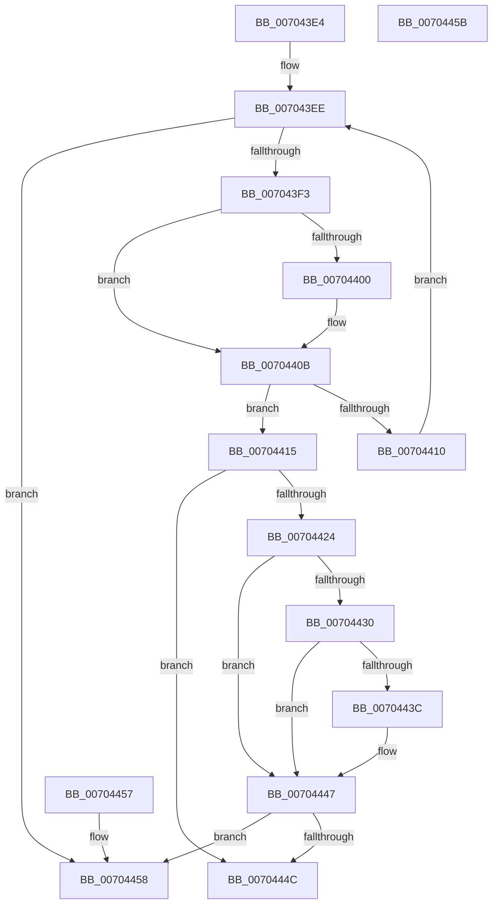

# IopCheckAndUpdateStopOnSymlinkEcp

- RVA: `0x007043E4`–`0x0070445C` (길이 `120` bytes)
- VA: `0x00000001407043E4`
- 실행 섹션: `PAGE`
- PDB 이름 있음: `예`; PDB Function 태그: `아니요`
- unwind 정보 RVA: `0x000DB714`
- 디코드: `37`개 명령, `120/120` bytes 표시
- 미해석 바이트: `0` (있으면 어셈블리에 `.byte`로 보존)

> 이 문서는 커널 이미지의 기계어와 PDB 기호를 분석해 생성했습니다. 4번과 5번은 함수 원형과 자료형을 바이너리 사용 방식에서 추정한 C 해석이며 원본 소스 복구 결과는 아닙니다.

## 1. Dependencies

- 직접 호출 지점: **0**; 고유 호출 대상: **0**
- 직접 호출자로 확인된 함수: **1**
- RIP 상대 이미지 참조: **2**

### Outgoing calls
- 직접 디코드된 call 명령이 없습니다.

### Direct callers
- [IopParseDevice](../89/IopParseDevice_function_0089E510.md) at `0x008A05E0`

### Static image references
- `0x007043F7` → RVA `0x0001EE78` (`.rdata`; read)
- `0x00704404` → RVA `0x0001EE80` (`.rdata`; read)

## 2. Other-region calls and transfers

- 다른 실행 섹션으로 향하는 call: **0**
- 별도 외부 분기/꼬리 이동을 확인하지 못했습니다.

## 3. Assembly (complete function range)

```asm
007043E4  44 8B CA                        mov r9d, edx
007043E7  48 8D 51 08                     lea rdx, [rcx + 8]
007043EB  48 8B 0A                        mov rcx, qword ptr [rdx]
007043EE  48 3B CA                        cmp rcx, rdx
007043F1  74 65                           je 0x140704458
007043F3  48 8B 41 10                     mov rax, qword ptr [rcx + 0x10]
007043F7  48 2B 05 7A AA 91 FF            sub rax, qword ptr [rip - 0x6e5586]
007043FE  75 0B                           jne 0x14070440b
00704400  48 8B 41 18                     mov rax, qword ptr [rcx + 0x18]
00704404  48 2B 05 75 AA 91 FF            sub rax, qword ptr [rip - 0x6e558b]
0070440B  48 85 C0                        test rax, rax
0070440E  74 05                           je 0x140704415
00704410  48 8B 09                        mov rcx, qword ptr [rcx]
00704413  EB D9                           jmp 0x1407043ee
00704415  8B 51 2C                        mov edx, dword ptr [rcx + 0x2c]
00704418  83 49 28 04                     or dword ptr [rcx + 0x28], 4
0070441C  83 EA 48                        sub edx, 0x48
0070441F  83 FA 08                        cmp edx, 8
00704422  72 28                           jb 0x14070444c
00704424  41 8D 81 FD FF FF 5F            lea eax, [r9 + 0x5ffffffd]
0070442B  83 F8 16                        cmp eax, 0x16
0070442E  77 17                           ja 0x140704447
00704430  41 BA 01 02 40 00               mov r10d, 0x400201
00704436  41 0F A3 C2                     bt r10d, eax
0070443A  73 0B                           jae 0x140704447
0070443C  FF 41 40                        inc dword ptr [rcx + 0x40]
0070443F  41 0F B7 40 06                  movzx eax, word ptr [r8 + 6]
00704444  89 41 44                        mov dword ptr [rcx + 0x44], eax
00704447  83 FA 08                        cmp edx, 8
0070444A  77 0C                           ja 0x140704458
0070444C  41 81 F9 0C 00 00 A0            cmp r9d, 0xa000000c
00704453  0F 94 C0                        sete al
00704456  C3                              ret
00704457  CC                              int3
00704458  B0 01                           mov al, 1
0070445A  C3                              ret
0070445B  CC                              int3
```

## 4. C-style interpretation (structured pseudocode)

```c
__int64 __fastcall IopCheckAndUpdateStopOnSymlinkEcp(__int64 a1, int a2, __int64 a3)
{
    __int64 result;

loc_007043EE:
    if ((*(unsigned __int64 *)(a1 + 8)) == (a1 + 8)) goto loc_00704458;
    result = (*(unsigned __int64 *)(*(unsigned __int64 *)(a1 + 8) + 16)) - (*(unsigned __int64 *)(v_rip - 7230854));
    if (!(condition_is_not_equal)) {
        result = *(unsigned __int64 *)(*(unsigned __int64 *)(a1 + 8) + 24);
        result = (result) - (*(unsigned __int64 *)(v_rip - 7230859));
    }
    if (result == 0) goto loc_00704415;
    goto loc_007043EE;
loc_00704415:
    a2 = (unsigned int)(((unsigned int)(*(unsigned int *)(*(unsigned __int64 *)(*(unsigned __int64 *)(a1 + 8)) + 44))) - (72));
    if (a2 < 8) goto loc_0070444C;
    if (((unsigned int)((unsigned int)(a2) + 1610612733)) > 22) goto loc_00704447;
    result = (unsigned int)(a2) + 1610612733;
    if (((unsigned int)((unsigned int)(a2) + 1610612733)) < 22) {
        result = *(unsigned __int16 *)(a3 + 6);
        *(unsigned int *)(*(unsigned __int64 *)(*(unsigned __int64 *)(a1 + 8)) + 68) = (unsigned int)(result);
    }
    if (a2 > 8) goto loc_00704458;
loc_0070444C:
    result = (((unsigned int)((unsigned int)(a2))) == 0xA000000CULL) ? 1 : 0;
    return result;
loc_00704458:
    return 1;
}
```

## 5. (Beta) C Style

```c
int64_t IopCheckAndUpdateStopOnSymlinkEcp(void *Arg1, void *Arg2, void *Arg3)
{
    uint8_t *arg1 = (uint8_t *)Arg1;
    uint8_t *arg2 = (uint8_t *)Arg2;
    uint8_t *arg3 = (uint8_t *)Arg3;

    int64_t result;

loc_007043EE:
    if ((*(uint64_t *)(arg1 + 0x8)) == (Arg1 + 8)) goto loc_00704458;
    result = (*(uint64_t *)(*(uint64_t *)(arg1 + 0x8) + 0x10)) - (*(uint64_t *)(v_rip - 0x6E5586));
    if (!(condition_is_not_equal)) {
        result = *(uint64_t *)(*(uint64_t *)(arg1 + 0x8) + 0x18);
        result = (result) - (*(uint64_t *)(v_rip - 0x6E558B));
    }
    if (result == 0) goto loc_00704415;
    goto loc_007043EE;
loc_00704415:
    Arg2 = (uint32_t)(((uint32_t)(*(uint32_t *)(*(uint64_t *)(*(uint64_t *)(arg1 + 0x8)) + 0x2C))) - (72));
    if (Arg2 < 8) goto loc_0070444C;
    if (((uint32_t)((uint32_t)(Arg2) + 1610612733)) > 22) goto loc_00704447;
    result = (uint32_t)(Arg2) + 1610612733;
    if (((uint32_t)((uint32_t)(Arg2) + 1610612733)) < 22) {
        result = *(uint16_t *)(arg3 + 0x6);
        *(uint32_t *)(*(uint64_t *)(*(uint64_t *)(arg1 + 0x8)) + 0x44) = (uint32_t)(result);
    }
    if (Arg2 > 8) goto loc_00704458;
loc_0070444C:
    result = (((uint32_t)((uint32_t)(Arg2))) == 0xA000000CULL) ? 1 : 0;
    return result;
loc_00704458:
    return 1;
}
```

### 관측된 메모리 오프셋

구조체 형식이 확인되지 않은 접근은 인자 기준의 오프셋으로만 기록했습니다.

| 기준 인자 | 오프셋 표현 | 폭 (bit) | 접근 |
|---|---:|---:|---|
| `Arg1` | `+ 0x0` | `64` | `R` |
| `Arg1` | `+ 0x8` | `64` | `R` |
| `Arg2` | `+ 0x5FFFFFFD` | `32` | `R` |
| `Arg3` | `+ 0x6` | `16` | `R` |

## 6. Execution-region graph

[열기: 2D/3D 그래프와 함수 탐색 컨트롤 패널](../../../control-panel.html?section=page&rva=0x007043E4&view=graph)

- 2D 그래프는 위에서 아래로 흐르고, 3D 그래프는 빈 공간을 드래그해 회전합니다. Shift+드래그는 이동, 휠은 확대·축소, 함수 노드 선택은 대상 보고서 이동입니다.

### Static fallback


