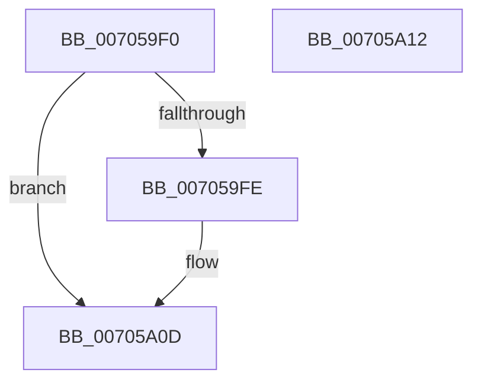

# IopDestroyPassiveInterruptBlock

- RVA: `0x007059F0`–`0x00705A13` (길이 `35` bytes)
- VA: `0x00000001407059F0`
- 실행 섹션: `PAGE`
- PDB 이름 있음: `예`; PDB Function 태그: `아니요`
- unwind 정보 RVA: `0x0005C788`
- 디코드: `10`개 명령, `35/35` bytes 표시
- 미해석 바이트: `0` (있으면 어셈블리에 `.byte`로 보존)

> 이 문서는 커널 이미지의 기계어와 PDB 기호를 분석해 생성했습니다. 4번과 5번은 함수 원형과 자료형을 바이너리 사용 방식에서 추정한 C 해석이며 원본 소스 복구 결과는 아닙니다.

## 1. Dependencies

- 직접 호출 지점: **2**; 고유 호출 대상: **2**
- 직접 호출자로 확인된 함수: **2**
- RIP 상대 이미지 참조: **0**

### Outgoing calls
- `0x007059F4` → [IopFindPassiveInterruptBlock](../../text/45/IopFindPassiveInterruptBlock_function_0045F4BC.md) (function, `0x0045F4BC`)
- `0x00705A08` → [IopDereferencePassiveInterruptBlock](../../text/45/IopDereferencePassiveInterruptBlock_function_0045F52C.md) (function, `0x0045F52C`)

### Direct callers
- [IoDisconnectInterrupt](../90/IoDisconnectInterrupt_function_00900890.md) at `0x00900A2E`
- [IopConnectInterrupt](../90/IopConnectInterrupt_function_00900B40.md) at `0x00900F8C`

### Static image references
- 디코드된 RIP-relative 메모리 참조가 없습니다.

## 2. Other-region calls and transfers

- 다른 실행 섹션으로 향하는 call: **2**
  - `0x007059F4` → [IopFindPassiveInterruptBlock](../../text/45/IopFindPassiveInterruptBlock_function_0045F4BC.md) (`PAGE` → `.text`)
  - `0x00705A08` → [IopDereferencePassiveInterruptBlock](../../text/45/IopDereferencePassiveInterruptBlock_function_0045F52C.md) (`PAGE` → `.text`)
- 별도 외부 분기/꼬리 이동을 확인하지 못했습니다.

## 3. Assembly (complete function range)

```asm
007059F0  48 83 EC 28                     sub rsp, 0x28
007059F4  E8 C3 9A D5 FF                  call 0x14045f4bc
007059F9  48 85 C0                        test rax, rax
007059FC  74 0F                           je 0x140705a0d
007059FE  F0 FF 88 C0 00 00 00            lock dec dword ptr [rax + 0xc0]
00705A05  48 8B C8                        mov rcx, rax
00705A08  E8 1F 9B D5 FF                  call 0x14045f52c
00705A0D  48 83 C4 28                     add rsp, 0x28
00705A11  C3                              ret
00705A12  CC                              int3
```

## 4. C-style interpretation (structured pseudocode)

```c
__int64 __fastcall IopDestroyPassiveInterruptBlock(void)
{
    __int64 result;
    __int64 v_rsp;

    v_rsp = (v_rsp) - (40);
    result = IopFindPassiveInterruptBlock(a1, a2, a3, a4);
    if (result != 0) {
        a1 = result;
        result = IopDereferencePassiveInterruptBlock(a1, a2, a3, a4);
    }
    v_rsp = (v_rsp) + (40);
    return result;
}
```

## 5. (Beta) C Style

```c
void IopDestroyPassiveInterruptBlock(void)
{
    int64_t result;
    int64_t local_rsp;

    local_rsp = (local_rsp) - (40);
    result = IopFindPassiveInterruptBlock(a1, a2, a3, a4);
    if (result != 0) {
        a1 = result;
        result = IopDereferencePassiveInterruptBlock(a1, a2, a3, a4);
    }
    local_rsp = (local_rsp) + (40);
    return result;
}
```

## 6. Execution-region graph

[열기: 2D/3D 그래프와 함수 탐색 컨트롤 패널](../../../control-panel.html?section=page&rva=0x007059F0&view=graph)

- 2D 그래프는 위에서 아래로 흐르고, 3D 그래프는 빈 공간을 드래그해 회전합니다. Shift+드래그는 이동, 휠은 확대·축소, 함수 노드 선택은 대상 보고서 이동입니다.

### Static fallback


