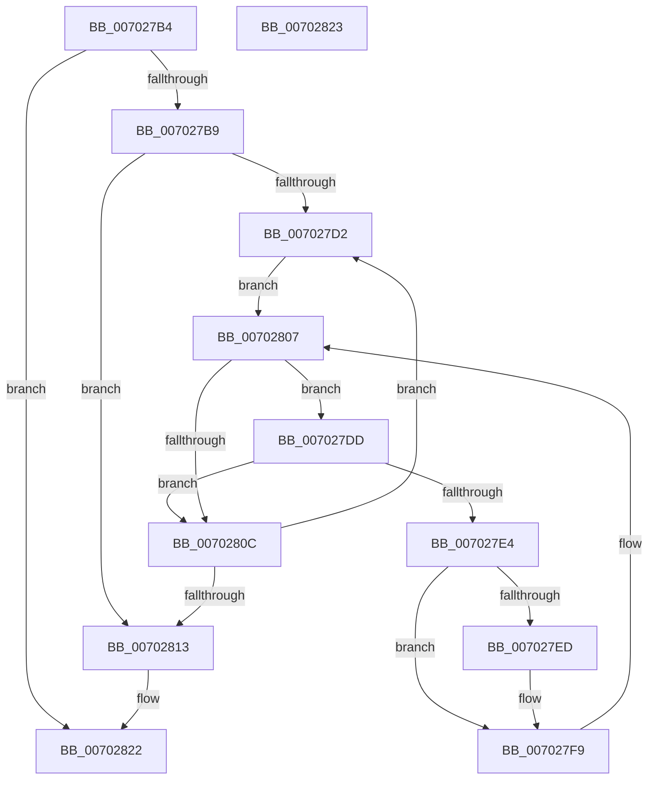

# IopFreeReqAlternative

- RVA: `0x007027B4`–`0x00702824` (길이 `112` bytes)
- VA: `0x00000001407027B4`
- 실행 섹션: `PAGE`
- PDB 이름 있음: `예`; PDB Function 태그: `아니요`
- unwind 정보 RVA: `0x000ADC24`
- 디코드: `36`개 명령, `112/112` bytes 표시
- 미해석 바이트: `0` (있으면 어셈블리에 `.byte`로 보존)

> 이 문서는 커널 이미지의 기계어와 PDB 기호를 분석해 생성했습니다. 4번과 5번은 함수 원형과 자료형을 바이너리 사용 방식에서 추정한 C 해석이며 원본 소스 복구 결과는 아닙니다.

## 1. Dependencies

- 직접 호출 지점: **2**; 고유 호출 대상: **1**
- 직접 호출자로 확인된 함수: **2**
- RIP 상대 이미지 참조: **0**

### Outgoing calls
- `0x007027EF` → [ExFreePoolWithTag](../../poolcode/B8/ExFreePoolWithTag_function_00B82870.md) (function, `0x00B82870`)
- `0x00702802` → [ExFreePoolWithTag](../../poolcode/B8/ExFreePoolWithTag_function_00B82870.md) (function, `0x00B82870`)

### Direct callers
- [IopFreeReqList](../72/IopFreeReqList_function_0072ADAC.md) at `0x0072ADCF`
- [IopResourceRequirementsListToReqList](../A8/IopResourceRequirementsListToReqList_function_00A82954.md) at `0x00A82CC8`

### Static image references
- 디코드된 RIP-relative 메모리 참조가 없습니다.

## 2. Other-region calls and transfers

- 다른 실행 섹션으로 향하는 call: **2**
  - `0x007027EF` → [ExFreePoolWithTag](../../poolcode/B8/ExFreePoolWithTag_function_00B82870.md) (`PAGE` → `POOLCODE`)
  - `0x00702802` → [ExFreePoolWithTag](../../poolcode/B8/ExFreePoolWithTag_function_00B82870.md) (`PAGE` → `POOLCODE`)
- 별도 외부 분기/꼬리 이동을 확인하지 못했습니다.

## 3. Assembly (complete function range)

```asm
007027B4  48 85 C9                        test rcx, rcx
007027B7  74 69                           je 0x140702822
007027B9  48 89 5C 24 08                  mov qword ptr [rsp + 8], rbx
007027BE  48 89 74 24 10                  mov qword ptr [rsp + 0x10], rsi
007027C3  57                              push rdi
007027C4  48 83 EC 20                     sub rsp, 0x20
007027C8  33 F6                           xor esi, esi
007027CA  48 8B F9                        mov rdi, rcx
007027CD  39 71 14                        cmp dword ptr [rcx + 0x14], esi
007027D0  76 41                           jbe 0x140702813
007027D2  48 8B 4C F7 18                  mov rcx, qword ptr [rdi + rsi*8 + 0x18]
007027D7  48 8B 59 20                     mov rbx, qword ptr [rcx + 0x20]
007027DB  EB 2A                           jmp 0x140702807
007027DD  48 83 7B 10 00                  cmp qword ptr [rbx + 0x10], 0
007027E2  75 28                           jne 0x14070280c
007027E4  48 8B 4B 40                     mov rcx, qword ptr [rbx + 0x40]
007027E8  48 85 C9                        test rcx, rcx
007027EB  74 0C                           je 0x1407027f9
007027ED  33 D2                           xor edx, edx
007027EF  E8 7C 00 48 00                  call 0x140b82870
007027F4  48 83 63 40 00                  and qword ptr [rbx + 0x40], 0
007027F9  48 8B CB                        mov rcx, rbx
007027FC  33 D2                           xor edx, edx
007027FE  48 8B 5B 20                     mov rbx, qword ptr [rbx + 0x20]
00702802  E8 69 00 48 00                  call 0x140b82870
00702807  48 85 DB                        test rbx, rbx
0070280A  75 D1                           jne 0x1407027dd
0070280C  FF C6                           inc esi
0070280E  3B 77 14                        cmp esi, dword ptr [rdi + 0x14]
00702811  72 BF                           jb 0x1407027d2
00702813  48 8B 5C 24 30                  mov rbx, qword ptr [rsp + 0x30]
00702818  48 8B 74 24 38                  mov rsi, qword ptr [rsp + 0x38]
0070281D  48 83 C4 20                     add rsp, 0x20
00702821  5F                              pop rdi
00702822  C3                              ret
00702823  CC                              int3
```

## 4. C-style interpretation (structured pseudocode)

```c
__int64 __fastcall IopFreeReqAlternative(__int64 a1, int a2)
{
    __int64 result;
    __int64 v_rsi;
    __int64 v_rsp;
    unsigned __int64 v_stack_p10;
    unsigned __int64 v_stack_p8;

    if (a1 == 0) goto loc_00702822;
    v_stack_p8 = v_rbx;
    v_stack_p10 = v_rsi;
    v_rsp = (v_rsp) - (32);
    v_rsi = 0;
    if ((*(unsigned int *)(a1 + 20)) <= 0) goto loc_00702813;
loc_007027D2:
    goto loc_00702807;
loc_007027DD:
    if ((*(unsigned __int64 *)(*(unsigned __int64 *)(*(unsigned __int64 *)(a1 + v_rsi * 8 + 24) + 32) + 16)) != 0) goto loc_0070280C;
    if (*(unsigned __int64 *)(*(unsigned __int64 *)(*(unsigned __int64 *)(a1 + v_rsi * 8 + 24) + 32) + 64) != 0) {
        a2 = 0;
        result = ExFreePoolWithTag(*(unsigned __int64 *)(*(unsigned __int64 *)(*(unsigned __int64 *)(a1 + v_rsi * 8 + 24) + 32) + 64), a2, a3, a4);
    }
    a2 = 0;
    result = ExFreePoolWithTag(*(unsigned __int64 *)(*(unsigned __int64 *)(a1 + v_rsi * 8 + 24) + 32), a2, a3, a4);
loc_00702807:
    if (*(unsigned __int64 *)(*(unsigned __int64 *)(*(unsigned __int64 *)(a1 + v_rsi * 8 + 24) + 32) + 32) != 0) goto loc_007027DD;
loc_0070280C:
    v_rsi = (unsigned int)((v_rsi) + 1);
    if (((unsigned int)(v_rsi)) < (*(unsigned int *)(a1 + 20))) goto loc_007027D2;
loc_00702813:
    v_rsp = (v_rsp) + (32);
loc_00702822:
    return result;
}
```

## 5. (Beta) C Style

```c
int64_t IopFreeReqAlternative(int64_t Arg1, int32_t Arg2)
{
    int64_t result;
    int64_t local_rsi;
    int64_t local_rsp;
    uint64_t v_stack_p10;
    uint64_t v_stack_p8;

    if (Arg1 == 0) goto loc_00702822;
    v_stack_p8 = local_rbx;
    v_stack_p10 = local_rsi;
    local_rsp = (local_rsp) - (32);
    local_rsi = 0;
    if ((*(uint32_t *)(Arg1 + 0x14)) <= 0) goto loc_00702813;
loc_007027D2:
    goto loc_00702807;
loc_007027DD:
    if ((*(uint64_t *)(*(uint64_t *)(*(uint64_t *)(Arg1 + local_rsi * 8 + 0x18) + 0x20) + 0x10)) != 0) goto loc_0070280C;
    if (*(uint64_t *)(*(uint64_t *)(*(uint64_t *)(Arg1 + local_rsi * 8 + 0x18) + 0x20) + 0x40) != 0) {
        Arg2 = 0;
        result = ExFreePoolWithTag(*(uint64_t *)(*(uint64_t *)(*(uint64_t *)(Arg1 + local_rsi * 8 + 0x18) + 0x20) + 0x40), Arg2, a3, a4);
    }
    Arg2 = 0;
    result = ExFreePoolWithTag(*(uint64_t *)(*(uint64_t *)(Arg1 + local_rsi * 8 + 0x18) + 0x20), Arg2, a3, a4);
loc_00702807:
    if (*(uint64_t *)(*(uint64_t *)(*(uint64_t *)(Arg1 + local_rsi * 8 + 0x18) + 0x20) + 0x20) != 0) goto loc_007027DD;
loc_0070280C:
    local_rsi = (uint32_t)((local_rsi) + 1);
    if (((uint32_t)(local_rsi)) < (*(uint32_t *)(Arg1 + 0x14))) goto loc_007027D2;
loc_00702813:
    local_rsp = (local_rsp) + (32);
loc_00702822:
    return result;
}
```

## 6. Execution-region graph

[열기: 2D/3D 그래프와 함수 탐색 컨트롤 패널](../../../control-panel.html?section=page&rva=0x007027B4&view=graph)

- 2D 그래프는 위에서 아래로 흐르고, 3D 그래프는 빈 공간을 드래그해 회전합니다. Shift+드래그는 이동, 휠은 확대·축소, 함수 노드 선택은 대상 보고서 이동입니다.

### Static fallback


