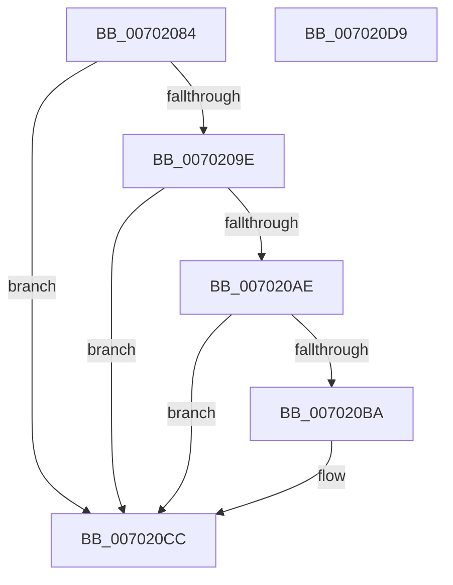

# IopGetSessionIdFromSymbolicName

- RVA: `0x00702084`–`0x007020DA` (길이 `86` bytes)
- VA: `0x0000000140702084`
- 실행 섹션: `PAGE`
- PDB 이름 있음: `예`; PDB Function 태그: `아니요`
- unwind 정보 RVA: `0x0005CAAC`
- 디코드: `25`개 명령, `86/86` bytes 표시
- 미해석 바이트: `0` (있으면 어셈블리에 `.byte`로 보존)

> 이 문서는 커널 이미지의 기계어와 PDB 기호를 분석해 생성했습니다. 4번과 5번은 함수 원형과 자료형을 바이너리 사용 방식에서 추정한 C 해석이며 원본 소스 복구 결과는 아닙니다.

## 1. Dependencies

- 직접 호출 지점: **3**; 고유 호출 대상: **3**
- 직접 호출자로 확인된 함수: **3**
- RIP 상대 이미지 참조: **0**

### Outgoing calls
- `0x00702091` → [IopDeviceObjectFromSymbolicName](../AD/IopDeviceObjectFromSymbolicName_function_00AD63EC.md) (function, `0x00AD63EC`)
- `0x007020BD` → [IopGetSessionIdFromPDO](../8F/IopGetSessionIdFromPDO_function_008FFDD8.md) (function, `0x008FFDD8`)
- `0x007020C7` → [ObfDereferenceObject](../../text/2F/ObfDereferenceObject_function_002F9350.md) (function, `0x002F9350`)

### Direct callers
- [IoRegisterPlugPlayNotification](../95/IoRegisterPlugPlayNotification_function_009535A0.md) at `0x0095394B`
- [PnpNotifyDeviceClassChange](../95/PnpNotifyDeviceClassChange_function_0095441C.md) at `0x009545A7`
- [PiUEventProcessBroadcastNotifications](../9C/PiUEventProcessBroadcastNotifications_function_009C370C.md) at `0x009C39C8`

### Static image references
- 디코드된 RIP-relative 메모리 참조가 없습니다.

## 2. Other-region calls and transfers

- 다른 실행 섹션으로 향하는 call: **1**
  - `0x007020C7` → [ObfDereferenceObject](../../text/2F/ObfDereferenceObject_function_002F9350.md) (`PAGE` → `.text`)
- 별도 외부 분기/꼬리 이동을 확인하지 못했습니다.

## 3. Assembly (complete function range)

```asm
00702084  48 89 5C 24 08                  mov qword ptr [rsp + 8], rbx
00702089  57                              push rdi
0070208A  48 83 EC 20                     sub rsp, 0x20
0070208E  83 CF FF                        or edi, 0xffffffff
00702091  E8 56 43 3D 00                  call 0x140ad63ec
00702096  48 8B D8                        mov rbx, rax
00702099  48 85 C0                        test rax, rax
0070209C  74 2E                           je 0x1407020cc
0070209E  48 8B 80 38 01 00 00            mov rax, qword ptr [rax + 0x138]
007020A5  48 8B 40 28                     mov rax, qword ptr [rax + 0x28]
007020A9  48 85 C0                        test rax, rax
007020AC  74 1E                           je 0x1407020cc
007020AE  F7 80 8C 01 00 00 00 00 02 00   test dword ptr [rax + 0x18c], 0x20000
007020B8  75 12                           jne 0x1407020cc
007020BA  48 8B CB                        mov rcx, rbx
007020BD  E8 16 DD 1F 00                  call 0x1408ffdd8
007020C2  48 8B CB                        mov rcx, rbx
007020C5  8B F8                           mov edi, eax
007020C7  E8 84 72 BF FF                  call 0x1402f9350
007020CC  48 8B 5C 24 30                  mov rbx, qword ptr [rsp + 0x30]
007020D1  8B C7                           mov eax, edi
007020D3  48 83 C4 20                     add rsp, 0x20
007020D7  5F                              pop rdi
007020D8  C3                              ret
007020D9  CC                              int3
```

## 4. C-style interpretation (structured pseudocode)

```c
__int64 __fastcall IopGetSessionIdFromSymbolicName(void)
{
    __int64 result;
    __int64 v_rdi;
    __int64 v_rsp;
    unsigned __int64 v_stack_p8;

    v_stack_p8 = v_rbx;
    v_rsp = (v_rsp) - (32);
    v_rdi = (unsigned int)((v_rdi) | (0xFFFFFFFFULL));
    result = IopDeviceObjectFromSymbolicName(a1, a2, a3, a4);
    if (result == 0) goto loc_007020CC;
    if (*(unsigned __int64 *)(*(unsigned __int64 *)(result + 312) + 40) == 0) goto loc_007020CC;
    result = *(unsigned __int64 *)(*(unsigned __int64 *)(result + 312) + 40);
    if (((*(unsigned int *)(*(unsigned __int64 *)(*(unsigned __int64 *)(result + 312) + 40) + 396)) & (0x20000ULL)) == 0) {
        a1 = result;
        result = IopGetSessionIdFromPDO(a1, a2, a3, a4);
        a1 = result;
        v_rdi = (unsigned int)(result);
        result = ObfDereferenceObject(a1, a2, a3, a4);
    }
    v_rsp = (v_rsp) + (32);
    return (unsigned int)((unsigned int)(v_rdi));
}
```

## 5. (Beta) C Style

```c
void IopGetSessionIdFromSymbolicName(void)
{
    int64_t result;
    int64_t local_rdi;
    int64_t local_rsp;
    uint64_t v_stack_p8;

    v_stack_p8 = local_rbx;
    local_rsp = (local_rsp) - (32);
    local_rdi = (uint32_t)((local_rdi) | (0xFFFFFFFFULL));
    result = IopDeviceObjectFromSymbolicName(a1, a2, a3, a4);
    if (result == 0) goto loc_007020CC;
    if (*(uint64_t *)(*(uint64_t *)(result + 0x138) + 0x28) == 0) goto loc_007020CC;
    result = *(uint64_t *)(*(uint64_t *)(result + 0x138) + 0x28);
    if (((*(uint32_t *)(*(uint64_t *)(*(uint64_t *)(result + 0x138) + 0x28) + 0x18C)) & (0x20000ULL)) == 0) {
        a1 = result;
        result = IopGetSessionIdFromPDO(a1, a2, a3, a4);
        a1 = result;
        local_rdi = (uint32_t)(result);
        result = ObfDereferenceObject(a1, a2, a3, a4);
    }
    local_rsp = (local_rsp) + (32);
    return (uint32_t)((uint32_t)(local_rdi));
}
```

## 6. Execution-region graph

[열기: 2D/3D 그래프와 함수 탐색 컨트롤 패널](../../../control-panel.html?section=page&rva=0x00702084&view=graph)

- 2D 그래프는 위에서 아래로 흐르고, 3D 그래프는 빈 공간을 드래그해 회전합니다. Shift+드래그는 이동, 휠은 확대·축소, 함수 노드 선택은 대상 보고서 이동입니다.

### Static fallback


