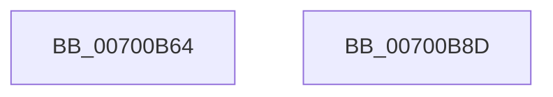

# IopIoRingDispatchComplete

- RVA: `0x00700B64`–`0x00700B8E` (길이 `42` bytes)
- VA: `0x0000000140700B64`
- 실행 섹션: `PAGE`
- PDB 이름 있음: `예`; PDB Function 태그: `아니요`
- unwind 정보 RVA: `0x00097934`
- 디코드: `12`개 명령, `42/42` bytes 표시
- 미해석 바이트: `0` (있으면 어셈블리에 `.byte`로 보존)

> 이 문서는 커널 이미지의 기계어와 PDB 기호를 분석해 생성했습니다. 4번과 5번은 함수 원형과 자료형을 바이너리 사용 방식에서 추정한 C 해석이며 원본 소스 복구 결과는 아닙니다.

## 1. Dependencies

- 직접 호출 지점: **1**; 고유 호출 대상: **1**
- 직접 호출자로 확인된 함수: **1**
- RIP 상대 이미지 참조: **0**

### Outgoing calls
- `0x00700B83` → [IopCompleteIoRingEntry](../../text/3E/IopCompleteIoRingEntry_function_003ED2C0.md) (function, `0x003ED2C0`)

### Direct callers
- [IopProcessIoRingEntry](IopProcessIoRingEntry_function_00700A38.md) at `0x00700B45`

### Static image references
- 디코드된 RIP-relative 메모리 참조가 없습니다.

## 2. Other-region calls and transfers

- 다른 실행 섹션으로 향하는 call: **1**
  - `0x00700B83` → [IopCompleteIoRingEntry](../../text/3E/IopCompleteIoRingEntry_function_003ED2C0.md) (`PAGE` → `.text`)
- 별도 외부 분기/꼬리 이동을 확인하지 못했습니다.

## 3. Assembly (complete function range)

```asm
00700B64  48 8B C4                        mov rax, rsp
00700B67  48 83 EC 38                     sub rsp, 0x38
00700B6B  83 60 EC 00                     and dword ptr [rax - 0x14], 0
00700B6F  45 33 C9                        xor r9d, r9d
00700B72  48 83 60 F0 00                  and qword ptr [rax - 0x10], 0
00700B77  48 8B 52 08                     mov rdx, qword ptr [rdx + 8]
00700B7B  44 89 40 E8                     mov dword ptr [rax - 0x18], r8d
00700B7F  4C 8D 40 E8                     lea r8, [rax - 0x18]
00700B83  E8 38 C7 CE FF                  call 0x1403ed2c0
00700B88  48 83 C4 38                     add rsp, 0x38
00700B8C  C3                              ret
00700B8D  CC                              int3
```

## 4. C-style interpretation (structured pseudocode)

```c
__int64 __fastcall IopIoRingDispatchComplete(__int64 a1, __int64 a2, int a3, int a4)
{
    __int64 result;
    __int64 v_rsp;

    v_rsp = (v_rsp) - (56);
    a4 = 0;
    *(unsigned int *)(v_rsp - 24) = a3;
    result = IopCompleteIoRingEntry(a1, *(unsigned __int64 *)(a2 + 8), v_rsp - 24, a4);
    v_rsp = (v_rsp) + (56);
    return result;
}
```

## 5. (Beta) C Style

```c
int64_t IopIoRingDispatchComplete(int64_t Arg1, void *Arg2, int32_t Arg3, int32_t Arg4)
{
    uint8_t *arg2 = (uint8_t *)Arg2;

    int64_t result;
    int64_t local_rsp;

    local_rsp = (local_rsp) - (56);
    Arg4 = 0;
    *(uint32_t *)(local_rsp - 0x18) = Arg3;
    result = IopCompleteIoRingEntry(Arg1, *(uint64_t *)(arg2 + 0x8), local_rsp - 24, Arg4);
    local_rsp = (local_rsp) + (56);
    return result;
}
```

### 관측된 메모리 오프셋

구조체 형식이 확인되지 않은 접근은 인자 기준의 오프셋으로만 기록했습니다.

| 기준 인자 | 오프셋 표현 | 폭 (bit) | 접근 |
|---|---:|---:|---|
| `Arg2` | `+ 0x8` | `64` | `R` |

## 6. Execution-region graph

[열기: 2D/3D 그래프와 함수 탐색 컨트롤 패널](../../../control-panel.html?section=page&rva=0x00700B64&view=graph)

- 2D 그래프는 위에서 아래로 흐르고, 3D 그래프는 빈 공간을 드래그해 회전합니다. Shift+드래그는 이동, 휠은 확대·축소, 함수 노드 선택은 대상 보고서 이동입니다.

### Static fallback


