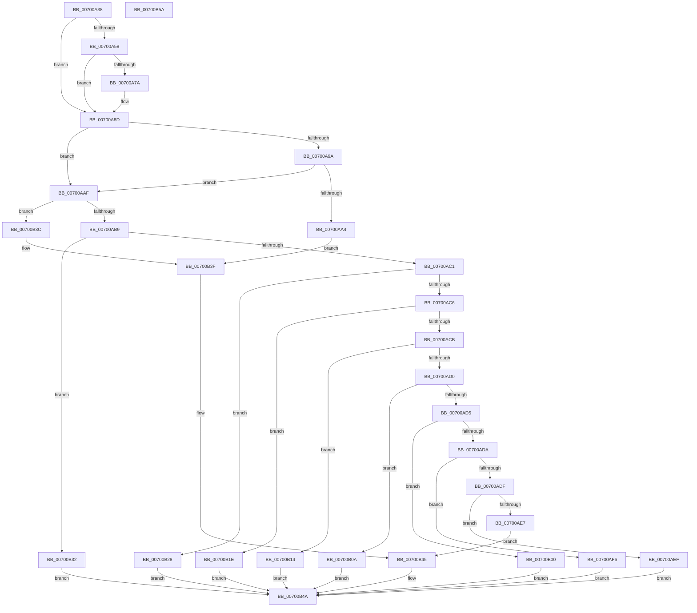

# IopProcessIoRingEntry

- RVA: `0x00700A38`–`0x00700B5B` (길이 `291` bytes)
- VA: `0x0000000140700A38`
- 실행 섹션: `PAGE`
- PDB 이름 있음: `예`; PDB Function 태그: `아니요`
- unwind 정보 RVA: `0x0009E61C`
- 디코드: `91`개 명령, `291/291` bytes 표시
- 미해석 바이트: `0` (있으면 어셈블리에 `.byte`로 보존)

> 이 문서는 커널 이미지의 기계어와 PDB 기호를 분석해 생성했습니다. 4번과 5번은 함수 원형과 자료형을 바이너리 사용 방식에서 추정한 C 해석이며 원본 소스 복구 결과는 아닙니다.

## 1. Dependencies

- 직접 호출 지점: **11**; 고유 호출 대상: **11**
- 직접 호출자로 확인된 함수: **1**
- RIP 상대 이미지 참조: **0**

### Outgoing calls
- `0x00700A6E` → [IopIoRingSetupCompletionWait](../../text/4C/IopIoRingSetupCompletionWait_function_004CFCA0.md) (function, `0x004CFCA0`)
- `0x00700A85` → [IopIoRingWaitForCompletionEvent](../../text/59/IopIoRingWaitForCompletionEvent_function_0059890C.md) (function, `0x0059890C`)
- `0x00700AEF` → [IopIoRingDispatchWriteGather](../72/IopIoRingDispatchWriteGather_function_007203F0.md) (function, `0x007203F0`)
- `0x00700AF9` → [IopIoRingDispatchReadScatter](../71/IopIoRingDispatchReadScatter_function_0071FB0C.md) (function, `0x0071FB0C`)
- `0x00700B03` → [IopIoRingDispatchFlush](../71/IopIoRingDispatchFlush_function_0071FA2C.md) (function, `0x0071FA2C`)
- `0x00700B0D` → [IopIoRingDispatchWrite](../72/IopIoRingDispatchWrite_function_00720248.md) (function, `0x00720248`)
- `0x00700B17` → [IopIoRingDispatchCancel](../71/IopIoRingDispatchCancel_function_0071F96C.md) (function, `0x0071F96C`)
- `0x00700B21` → [IopIoRingDispatchRegisterBuffers](../71/IopIoRingDispatchRegisterBuffers_function_0071FC18.md) (function, `0x0071FC18`)
- `0x00700B2B` → [IopIoRingDispatchRegisterFiles](../71/IopIoRingDispatchRegisterFiles_function_0071FFD8.md) (function, `0x0071FFD8`)
- `0x00700B35` → [IopIoRingDispatchRead](../AA/IopIoRingDispatchRead_function_00AAC974.md) (function, `0x00AAC974`)
- `0x00700B45` → [IopIoRingDispatchComplete](IopIoRingDispatchComplete_function_00700B64.md) (function, `0x00700B64`)

### Direct callers
- [NtSubmitIoRing](../../text/4C/NtSubmitIoRing_function_004CF9E0.md) at `0x004CFBAD`

### Static image references
- 디코드된 RIP-relative 메모리 참조가 없습니다.

## 2. Other-region calls and transfers

- 다른 실행 섹션으로 향하는 call: **2**
  - `0x00700A6E` → [IopIoRingSetupCompletionWait](../../text/4C/IopIoRingSetupCompletionWait_function_004CFCA0.md) (`PAGE` → `.text`)
  - `0x00700A85` → [IopIoRingWaitForCompletionEvent](../../text/59/IopIoRingWaitForCompletionEvent_function_0059890C.md) (`PAGE` → `.text`)
- 별도 외부 분기/꼬리 이동을 확인하지 못했습니다.

## 3. Assembly (complete function range)

```asm
00700A38  4C 8B DC                        mov r11, rsp
00700A3B  49 89 5B 10                     mov qword ptr [r11 + 0x10], rbx
00700A3F  49 89 73 18                     mov qword ptr [r11 + 0x18], rsi
00700A43  57                              push rdi
00700A44  48 83 EC 30                     sub rsp, 0x30
00700A48  8B 42 04                        mov eax, dword ptr [rdx + 4]
00700A4B  49 8B F0                        mov rsi, r8
00700A4E  48 8B DA                        mov rbx, rdx
00700A51  48 8B F9                        mov rdi, rcx
00700A54  A8 01                           test al, 1
00700A56  74 35                           je 0x140700a8d
00700A58  49 8D 43 08                     lea rax, [r11 + 8]
00700A5C  C6 44 24 40 00                  mov byte ptr [rsp + 0x40], 0
00700A61  45 33 C9                        xor r9d, r9d
00700A64  49 89 43 E8                     mov qword ptr [r11 - 0x18], rax
00700A68  41 83 C8 FF                     or r8d, 0xffffffff
00700A6C  33 D2                           xor edx, edx
00700A6E  E8 2D F2 DC FF                  call 0x1404cfca0
00700A73  80 7C 24 40 00                  cmp byte ptr [rsp + 0x40], 0
00700A78  74 13                           je 0x140700a8d
00700A7A  45 33 C9                        xor r9d, r9d
00700A7D  45 33 C0                        xor r8d, r8d
00700A80  33 D2                           xor edx, edx
00700A82  48 8B CF                        mov rcx, rdi
00700A85  E8 82 7E E9 FF                  call 0x14059890c
00700A8A  C6 06 01                        mov byte ptr [rsi], 1
00700A8D  48 FF 47 70                     inc qword ptr [rdi + 0x70]
00700A91  F7 43 04 FE FF FF FF            test dword ptr [rbx + 4], 0xfffffffe
00700A98  74 15                           je 0x140700aaf
00700A9A  8B 03                           mov eax, dword ptr [rbx]
00700A9C  83 E8 02                        sub eax, 2
00700A9F  83 F8 01                        cmp eax, 1
00700AA2  76 0B                           jbe 0x140700aaf
00700AA4  41 B8 01 00 46 C0               mov r8d, 0xc0460001
00700AAA  E9 90 00 00 00                  jmp 0x140700b3f
00700AAF  8B 0B                           mov ecx, dword ptr [rbx]
00700AB1  85 C9                           test ecx, ecx
00700AB3  0F 84 83 00 00 00               je 0x140700b3c
00700AB9  48 8B D3                        mov rdx, rbx
00700ABC  83 E9 01                        sub ecx, 1
00700ABF  74 71                           je 0x140700b32
00700AC1  83 E9 01                        sub ecx, 1
00700AC4  74 62                           je 0x140700b28
00700AC6  83 E9 01                        sub ecx, 1
00700AC9  74 53                           je 0x140700b1e
00700ACB  83 E9 01                        sub ecx, 1
00700ACE  74 44                           je 0x140700b14
00700AD0  83 E9 01                        sub ecx, 1
00700AD3  74 35                           je 0x140700b0a
00700AD5  83 E9 01                        sub ecx, 1
00700AD8  74 26                           je 0x140700b00
00700ADA  83 E9 01                        sub ecx, 1
00700ADD  74 17                           je 0x140700af6
00700ADF  83 F9 01                        cmp ecx, 1
00700AE2  48 8B CF                        mov rcx, rdi
00700AE5  74 08                           je 0x140700aef
00700AE7  41 B8 02 00 00 C0               mov r8d, 0xc0000002
00700AED  EB 56                           jmp 0x140700b45
00700AEF  E8 FC F8 01 00                  call 0x1407203f0
00700AF4  EB 54                           jmp 0x140700b4a
00700AF6  48 8B CF                        mov rcx, rdi
00700AF9  E8 0E F0 01 00                  call 0x14071fb0c
00700AFE  EB 4A                           jmp 0x140700b4a
00700B00  48 8B CF                        mov rcx, rdi
00700B03  E8 24 EF 01 00                  call 0x14071fa2c
00700B08  EB 40                           jmp 0x140700b4a
00700B0A  48 8B CF                        mov rcx, rdi
00700B0D  E8 36 F7 01 00                  call 0x140720248
00700B12  EB 36                           jmp 0x140700b4a
00700B14  48 8B CF                        mov rcx, rdi
00700B17  E8 50 EE 01 00                  call 0x14071f96c
00700B1C  EB 2C                           jmp 0x140700b4a
00700B1E  48 8B CF                        mov rcx, rdi
00700B21  E8 F2 F0 01 00                  call 0x14071fc18
00700B26  EB 22                           jmp 0x140700b4a
00700B28  48 8B CF                        mov rcx, rdi
00700B2B  E8 A8 F4 01 00                  call 0x14071ffd8
00700B30  EB 18                           jmp 0x140700b4a
00700B32  48 8B CF                        mov rcx, rdi
00700B35  E8 3A BE 3A 00                  call 0x140aac974
00700B3A  EB 0E                           jmp 0x140700b4a
00700B3C  45 33 C0                        xor r8d, r8d
00700B3F  48 8B D3                        mov rdx, rbx
00700B42  48 8B CF                        mov rcx, rdi
00700B45  E8 1A 00 00 00                  call 0x140700b64
00700B4A  48 8B 5C 24 48                  mov rbx, qword ptr [rsp + 0x48]
00700B4F  48 8B 74 24 50                  mov rsi, qword ptr [rsp + 0x50]
00700B54  48 83 C4 30                     add rsp, 0x30
00700B58  5F                              pop rdi
00700B59  C3                              ret
00700B5A  CC                              int3
```

## 4. C-style interpretation (structured pseudocode)

```c
__int64 __fastcall IopProcessIoRingEntry(__int64 a1, __int64 a2, __int64 a3, int a4)
{
    __int64 result;
    __int64 v_rsp;
    unsigned __int64 v_stack_p10;
    unsigned __int64 v_stack_p18;
    unsigned __int8 v_stack_p8;

    *(unsigned __int64 *)(v_rsp + 16) = v_rbx;
    *(unsigned __int64 *)(v_rsp + 24) = v_rsi;
    v_rsp = (v_rsp) - (48);
    if ((((unsigned __int8)((unsigned int)(*(unsigned int *)(a2 + 4)))) & (1)) == 0) goto loc_00700A8D;
    v_stack_p8 = 0;
    a4 = 0;
    *(unsigned __int64 *)(v_rsp - 24) = v_rsp + 8;
    a3 = (unsigned int)((a3) | (0xFFFFFFFFULL));
    a2 = 0;
    result = IopIoRingSetupCompletionWait(a1, a2, a3, a4);
    if (v_stack_p8 != 0) {
        a4 = 0;
        a3 = 0;
        a2 = 0;
        a1 = a1;
        result = IopIoRingWaitForCompletionEvent(a1, a2, a3, a4);
        *(unsigned __int8 *)(a3) = 1;
    }
    if (((*(unsigned int *)(a2 + 4)) & (0xFFFFFFFEULL)) == 0) goto loc_00700AAF;
    result = (unsigned int)(((unsigned int)(*(unsigned int *)(a2))) - (2));
    if (((unsigned int)(result)) <= 1) goto loc_00700AAF;
    goto loc_00700B3F;
loc_00700AAF:
    if ((unsigned int)((unsigned int)(*(unsigned int *)(a2))) == 0) goto loc_00700B3C;
    a1 = (unsigned int)(((unsigned int)(*(unsigned int *)(a2))) - (1));
    if (condition_is_equal) goto loc_00700B32;
    a1 = (unsigned int)((a1) - (1));
    if (condition_is_equal) goto loc_00700B28;
    a1 = (unsigned int)((a1) - (1));
    if (condition_is_equal) goto loc_00700B1E;
    a1 = (unsigned int)((a1) - (1));
    if (condition_is_equal) goto loc_00700B14;
    a1 = (unsigned int)((a1) - (1));
    if (condition_is_equal) goto loc_00700B0A;
    a1 = (unsigned int)((a1) - (1));
    if (condition_is_equal) goto loc_00700B00;
    a1 = (unsigned int)((a1) - (1));
    if (condition_is_equal) goto loc_00700AF6;
    if (((unsigned int)(a1)) == 1) goto loc_00700AEF;
    goto loc_00700B45;
loc_00700AEF:
    result = IopIoRingDispatchWriteGather(a1, 0, (unsigned int)(0xC0000002ULL), a4);
    goto loc_00700B4A;
loc_00700AF6:
    result = IopIoRingDispatchReadScatter(a1, 0, (unsigned int)(0xC0000002ULL), a4);
    goto loc_00700B4A;
loc_00700B00:
    result = IopIoRingDispatchFlush(a1, 0, (unsigned int)(0xC0000002ULL), a4);
    goto loc_00700B4A;
loc_00700B0A:
    result = IopIoRingDispatchWrite(a1, 0, (unsigned int)(0xC0000002ULL), a4);
    goto loc_00700B4A;
loc_00700B14:
    result = IopIoRingDispatchCancel(a1, 0, (unsigned int)(0xC0000002ULL), a4);
    goto loc_00700B4A;
loc_00700B1E:
    result = IopIoRingDispatchRegisterBuffers(a1, 0, (unsigned int)(0xC0000002ULL), a4);
    goto loc_00700B4A;
loc_00700B28:
    result = IopIoRingDispatchRegisterFiles(a1, 0, (unsigned int)(0xC0000002ULL), a4);
    goto loc_00700B4A;
loc_00700B32:
    result = IopIoRingDispatchRead(a1, 0, (unsigned int)(0xC0000002ULL), a4);
    goto loc_00700B4A;
loc_00700B3C:
    a3 = 0;
loc_00700B3F:
loc_00700B45:
    result = IopIoRingDispatchComplete(a1, 0, a3, a4);
loc_00700B4A:
    v_rsp = (v_rsp) + (48);
    return result;
}
```

## 5. (Beta) C Style

```c
int64_t IopProcessIoRingEntry(void *Arg1, void *Arg2, void *Arg3, int32_t Arg4)
{
    uint8_t *arg1 = (uint8_t *)Arg1;
    uint8_t *arg2 = (uint8_t *)Arg2;
    uint8_t *arg3 = (uint8_t *)Arg3;

    int64_t result;
    int64_t local_rsp;
    uint64_t v_stack_p10;
    uint64_t v_stack_p18;
    uint8_t v_stack_p8;

    *(uint64_t *)(local_rsp + 0x10) = local_rbx;
    *(uint64_t *)(local_rsp + 0x18) = local_rsi;
    local_rsp = (local_rsp) - (48);
    if ((((uint8_t)((uint32_t)(*(uint32_t *)(arg2 + 0x4)))) & (1)) == 0) goto loc_00700A8D;
    v_stack_p8 = 0;
    Arg4 = 0;
    *(uint64_t *)(local_rsp - 0x18) = local_rsp + 8;
    Arg3 = (uint32_t)((Arg3) | (0xFFFFFFFFULL));
    Arg2 = 0;
    result = IopIoRingSetupCompletionWait(Arg1, Arg2, Arg3, Arg4);
    if (v_stack_p8 != 0) {
        Arg4 = 0;
        Arg3 = 0;
        Arg2 = 0;
        Arg1 = Arg1;
        result = IopIoRingWaitForCompletionEvent(Arg1, Arg2, Arg3, Arg4);
        *(uint8_t *)(arg3) = 1;
    }
    if (((*(uint32_t *)(arg2 + 0x4)) & (0xFFFFFFFEULL)) == 0) goto loc_00700AAF;
    result = (uint32_t)(((uint32_t)(*(uint32_t *)(arg2))) - (2));
    if (((uint32_t)(result)) <= 1) goto loc_00700AAF;
    goto loc_00700B3F;
loc_00700AAF:
    if ((uint32_t)((uint32_t)(*(uint32_t *)(arg2))) == 0) goto loc_00700B3C;
    Arg1 = (uint32_t)(((uint32_t)(*(uint32_t *)(arg2))) - (1));
    if (condition_is_equal) goto loc_00700B32;
    Arg1 = (uint32_t)((Arg1) - (1));
    if (condition_is_equal) goto loc_00700B28;
    Arg1 = (uint32_t)((Arg1) - (1));
    if (condition_is_equal) goto loc_00700B1E;
    Arg1 = (uint32_t)((Arg1) - (1));
    if (condition_is_equal) goto loc_00700B14;
    Arg1 = (uint32_t)((Arg1) - (1));
    if (condition_is_equal) goto loc_00700B0A;
    Arg1 = (uint32_t)((Arg1) - (1));
    if (condition_is_equal) goto loc_00700B00;
    Arg1 = (uint32_t)((Arg1) - (1));
    if (condition_is_equal) goto loc_00700AF6;
    if (((uint32_t)(Arg1)) == 1) goto loc_00700AEF;
    goto loc_00700B45;
loc_00700AEF:
    result = IopIoRingDispatchWriteGather(Arg1, 0, (uint32_t)(0xC0000002ULL), Arg4);
    goto loc_00700B4A;
loc_00700AF6:
    result = IopIoRingDispatchReadScatter(Arg1, 0, (uint32_t)(0xC0000002ULL), Arg4);
    goto loc_00700B4A;
loc_00700B00:
    result = IopIoRingDispatchFlush(Arg1, 0, (uint32_t)(0xC0000002ULL), Arg4);
    goto loc_00700B4A;
loc_00700B0A:
    result = IopIoRingDispatchWrite(Arg1, 0, (uint32_t)(0xC0000002ULL), Arg4);
    goto loc_00700B4A;
loc_00700B14:
    result = IopIoRingDispatchCancel(Arg1, 0, (uint32_t)(0xC0000002ULL), Arg4);
    goto loc_00700B4A;
loc_00700B1E:
    result = IopIoRingDispatchRegisterBuffers(Arg1, 0, (uint32_t)(0xC0000002ULL), Arg4);
    goto loc_00700B4A;
loc_00700B28:
    result = IopIoRingDispatchRegisterFiles(Arg1, 0, (uint32_t)(0xC0000002ULL), Arg4);
    goto loc_00700B4A;
loc_00700B32:
    result = IopIoRingDispatchRead(Arg1, 0, (uint32_t)(0xC0000002ULL), Arg4);
    goto loc_00700B4A;
loc_00700B3C:
    Arg3 = 0;
loc_00700B3F:
loc_00700B45:
    result = IopIoRingDispatchComplete(Arg1, 0, Arg3, Arg4);
loc_00700B4A:
    local_rsp = (local_rsp) + (48);
    return result;
}
```

### 관측된 메모리 오프셋

구조체 형식이 확인되지 않은 접근은 인자 기준의 오프셋으로만 기록했습니다.

| 기준 인자 | 오프셋 표현 | 폭 (bit) | 접근 |
|---|---:|---:|---|
| `Arg1` | `+ 0x70` | `64` | `R/W` |
| `Arg2` | `+ 0x0` | `32` | `R` |
| `Arg2` | `+ 0x4` | `32` | `R` |
| `Arg3` | `+ 0x0` | `8` | `W` |

## 6. Execution-region graph

[열기: 2D/3D 그래프와 함수 탐색 컨트롤 패널](../../../control-panel.html?section=page&rva=0x00700A38&view=graph)

- 2D 그래프는 위에서 아래로 흐르고, 3D 그래프는 빈 공간을 드래그해 회전합니다. Shift+드래그는 이동, 휠은 확대·축소, 함수 노드 선택은 대상 보고서 이동입니다.

### Static fallback


