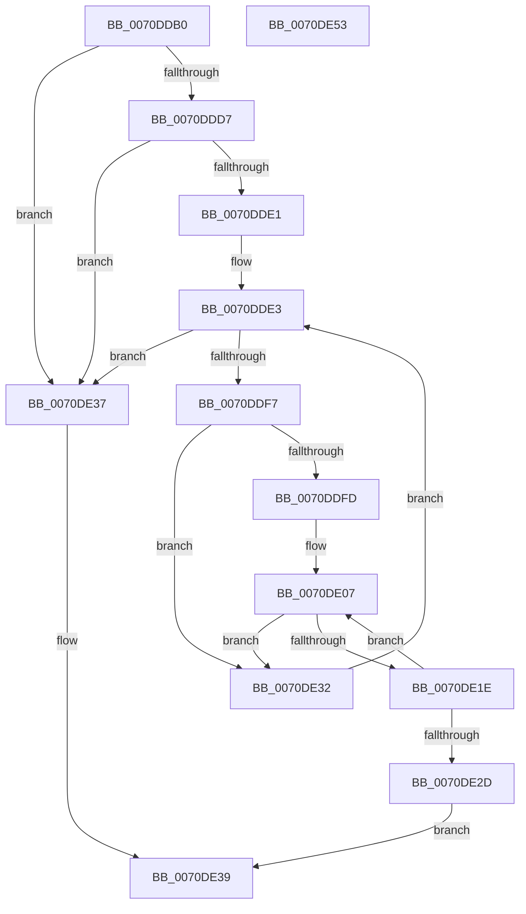

# IvtCheckForReservedRegion

- RVA: `0x0070DDB0`–`0x0070DE54` (길이 `164` bytes)
- VA: `0x000000014070DDB0`
- 실행 섹션: `PAGE`
- PDB 이름 있음: `예`; PDB Function 태그: `아니요`
- unwind 정보 RVA: `0x000C5564`
- 디코드: `50`개 명령, `164/164` bytes 표시
- 미해석 바이트: `0` (있으면 어셈블리에 `.byte`로 보존)

> 이 문서는 커널 이미지의 기계어와 PDB 기호를 분석해 생성했습니다. 4번과 5번은 함수 원형과 자료형을 바이너리 사용 방식에서 추정한 C 해석이며 원본 소스 복구 결과는 아닙니다.

## 1. Dependencies

- 직접 호출 지점: **3**; 고유 호출 대상: **3**
- 직접 호출자로 확인된 함수: **0**
- RIP 상대 이미지 참조: **1**

### Outgoing calls
- `0x0070DDEA` → [DmrGetNextRemappingStructure](../../text/57/DmrGetNextRemappingStructure_function_0057AA78.md) (function, `0x0057AA78`)
- `0x0070DE11` → [DmrGetNextDeviceScope](../../text/57/DmrGetNextDeviceScope_function_0057AA30.md) (function, `0x0057AA30`)
- `0x0070DE24` → [HalpIvtCheckIdPathMatch](../../text/4F/HalpIvtCheckIdPathMatch_function_004FAF2C.md) (function, `0x004FAF2C`)

### Direct callers
- 이 함수 시작 RVA로 연결되는 직접 call은 확인되지 않았습니다. 간접 호출은 완전히 역산할 수 없습니다.

### Static image references
- `0x0070DDD7` → RVA `0x00E65AD0` (`.data`; read)

## 2. Other-region calls and transfers

- 다른 실행 섹션으로 향하는 call: **3**
  - `0x0070DDEA` → [DmrGetNextRemappingStructure](../../text/57/DmrGetNextRemappingStructure_function_0057AA78.md) (`PAGE` → `.text`)
  - `0x0070DE11` → [DmrGetNextDeviceScope](../../text/57/DmrGetNextDeviceScope_function_0057AA30.md) (`PAGE` → `.text`)
  - `0x0070DE24` → [HalpIvtCheckIdPathMatch](../../text/4F/HalpIvtCheckIdPathMatch_function_004FAF2C.md) (`PAGE` → `.text`)
- 별도 외부 분기/꼬리 이동을 확인하지 못했습니다.

## 3. Assembly (complete function range)

```asm
0070DDB0  48 89 5C 24 08                  mov qword ptr [rsp + 8], rbx
0070DDB5  48 89 6C 24 10                  mov qword ptr [rsp + 0x10], rbp
0070DDBA  48 89 74 24 18                  mov qword ptr [rsp + 0x18], rsi
0070DDBF  41 54                           push r12
0070DDC1  41 56                           push r14
0070DDC3  41 57                           push r15
0070DDC5  48 83 EC 20                     sub rsp, 0x20
0070DDC9  41 BC 01 00 00 00               mov r12d, 1
0070DDCF  48 8B F1                        mov rsi, rcx
0070DDD2  44 39 21                        cmp dword ptr [rcx], r12d
0070DDD5  75 60                           jne 0x14070de37
0070DDD7  48 83 3D F1 7C 75 00 00         cmp qword ptr [rip + 0x757cf1], 0
0070DDDF  74 56                           je 0x14070de37
0070DDE1  33 D2                           xor edx, edx
0070DDE3  48 8B 0D E6 7C 75 00            mov rcx, qword ptr [rip + 0x757ce6]
0070DDEA  E8 89 CC E6 FF                  call 0x14057aa78
0070DDEF  48 8B D8                        mov rbx, rax
0070DDF2  48 85 C0                        test rax, rax
0070DDF5  74 40                           je 0x14070de37
0070DDF7  66 44 39 20                     cmp word ptr [rax], r12w
0070DDFB  75 35                           jne 0x14070de32
0070DDFD  44 0F B7 70 02                  movzx r14d, word ptr [rax + 2]
0070DE02  33 ED                           xor ebp, ebp
0070DE04  4C 03 F0                        add r14, rax
0070DE07  4C 8B C5                        mov r8, rbp
0070DE0A  48 8D 4B 18                     lea rcx, [rbx + 0x18]
0070DE0E  49 8B D6                        mov rdx, r14
0070DE11  E8 1A CC E6 FF                  call 0x14057aa30
0070DE16  48 8B E8                        mov rbp, rax
0070DE19  48 85 C0                        test rax, rax
0070DE1C  74 14                           je 0x14070de32
0070DE1E  48 8B D0                        mov rdx, rax
0070DE21  48 8B CE                        mov rcx, rsi
0070DE24  E8 03 D1 DE FF                  call 0x1404faf2c
0070DE29  84 C0                           test al, al
0070DE2B  74 DA                           je 0x14070de07
0070DE2D  41 8A C4                        mov al, r12b
0070DE30  EB 07                           jmp 0x14070de39
0070DE32  48 8B D3                        mov rdx, rbx
0070DE35  EB AC                           jmp 0x14070dde3
0070DE37  32 C0                           xor al, al
0070DE39  48 8B 5C 24 40                  mov rbx, qword ptr [rsp + 0x40]
0070DE3E  48 8B 6C 24 48                  mov rbp, qword ptr [rsp + 0x48]
0070DE43  48 8B 74 24 50                  mov rsi, qword ptr [rsp + 0x50]
0070DE48  48 83 C4 20                     add rsp, 0x20
0070DE4C  41 5F                           pop r15
0070DE4E  41 5E                           pop r14
0070DE50  41 5C                           pop r12
0070DE52  C3                              ret
0070DE53  CC                              int3
```

## 4. C-style interpretation (structured pseudocode)

```c
__int64 __fastcall IvtCheckForReservedRegion(__int64 a1, int a2)
{
    __int64 result;
    __int64 v_r14;
    __int64 v_rbp;
    __int64 v_rsp;
    unsigned __int64 v_stack_p10;
    unsigned __int64 v_stack_p18;
    unsigned __int64 v_stack_p8;

    v_stack_p8 = v_rbx;
    v_stack_p10 = v_rbp;
    v_stack_p18 = v_rsi;
    v_rsp = (v_rsp) - (32);
    if ((*(unsigned int *)(a1)) != 1) goto loc_0070DE37;
    if ((*(unsigned __int64 *)(v_rip + 7699697)) == 0) goto loc_0070DE37;
    a2 = 0;
loc_0070DDE3:
    result = DmrGetNextRemappingStructure(*(unsigned __int64 *)(v_rip + 7699686), a2, a3, a4);
    if (result == 0) goto loc_0070DE37;
    if ((*(unsigned __int16 *)(result)) != 1) goto loc_0070DE32;
    v_rbp = 0;
    v_r14 = (*(unsigned __int16 *)(result + 2)) + (result);
loc_0070DE07:
    result = DmrGetNextDeviceScope(result + 24, v_r14, 0, a4);
    if (result == 0) goto loc_0070DE32;
    result = HalpIvtCheckIdPathMatch(a1, result, 0, a4);
    if ((unsigned __int8)(result) == 0) goto loc_0070DE07;
    goto loc_0070DE39;
loc_0070DE32:
    goto loc_0070DDE3;
loc_0070DE37:
    result = 0;
loc_0070DE39:
    v_rsp = (v_rsp) + (32);
    return result;
}
```

## 5. (Beta) C Style

```c
int64_t IvtCheckForReservedRegion(void *Arg1, int32_t Arg2)
{
    uint8_t *arg1 = (uint8_t *)Arg1;

    int64_t result;
    int64_t local_r14;
    int64_t local_rbp;
    int64_t local_rsp;
    uint64_t v_stack_p10;
    uint64_t v_stack_p18;
    uint64_t v_stack_p8;

    v_stack_p8 = local_rbx;
    v_stack_p10 = local_rbp;
    v_stack_p18 = local_rsi;
    local_rsp = (local_rsp) - (32);
    if ((*(uint32_t *)(arg1)) != 1) goto loc_0070DE37;
    if ((*(uint64_t *)(v_rip + 0x757CF1)) == 0) goto loc_0070DE37;
    Arg2 = 0;
loc_0070DDE3:
    result = DmrGetNextRemappingStructure(*(uint64_t *)(v_rip + 0x757CE6), Arg2, a3, a4);
    if (result == 0) goto loc_0070DE37;
    if ((*(uint16_t *)(result)) != 1) goto loc_0070DE32;
    local_rbp = 0;
    local_r14 = (*(uint16_t *)(result + 0x2)) + (result);
loc_0070DE07:
    result = DmrGetNextDeviceScope(result + 24, local_r14, 0, a4);
    if (result == 0) goto loc_0070DE32;
    result = HalpIvtCheckIdPathMatch(Arg1, result, 0, a4);
    if ((uint8_t)(result) == 0) goto loc_0070DE07;
    goto loc_0070DE39;
loc_0070DE32:
    goto loc_0070DDE3;
loc_0070DE37:
    result = 0;
loc_0070DE39:
    local_rsp = (local_rsp) + (32);
    return result;
}
```

### 관측된 메모리 오프셋

구조체 형식이 확인되지 않은 접근은 인자 기준의 오프셋으로만 기록했습니다.

| 기준 인자 | 오프셋 표현 | 폭 (bit) | 접근 |
|---|---:|---:|---|
| `Arg1` | `+ 0x0` | `32` | `R` |

## 6. Execution-region graph

[열기: 2D/3D 그래프와 함수 탐색 컨트롤 패널](../../../control-panel.html?section=page&rva=0x0070DDB0&view=graph)

- 2D 그래프는 위에서 아래로 흐르고, 3D 그래프는 빈 공간을 드래그해 회전합니다. Shift+드래그는 이동, 휠은 확대·축소, 함수 노드 선택은 대상 보고서 이동입니다.

### Static fallback


