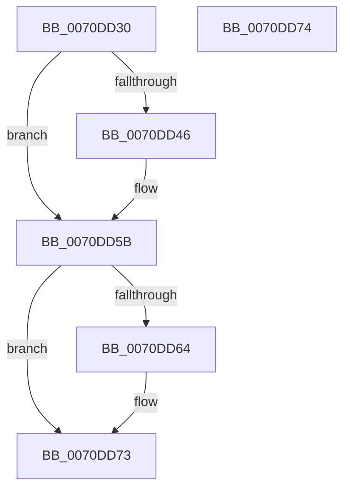

# IvtDisableInterrupt

- RVA: `0x0070DD30`–`0x0070DD75` (길이 `69` bytes)
- VA: `0x000000014070DD30`
- 실행 섹션: `PAGE`
- PDB 이름 있음: `예`; PDB Function 태그: `아니요`
- unwind 정보 RVA: `0x000DB714`
- 디코드: `19`개 명령, `69/69` bytes 표시
- 미해석 바이트: `0` (있으면 어셈블리에 `.byte`로 보존)

> 이 문서는 커널 이미지의 기계어와 PDB 기호를 분석해 생성했습니다. 4번과 5번은 함수 원형과 자료형을 바이너리 사용 방식에서 추정한 C 해석이며 원본 소스 복구 결과는 아닙니다.

## 1. Dependencies

- 직접 호출 지점: **0**; 고유 호출 대상: **0**
- 직접 호출자로 확인된 함수: **0**
- RIP 상대 이미지 참조: **0**

### Outgoing calls
- 직접 디코드된 call 명령이 없습니다.

### Direct callers
- 이 함수 시작 RVA로 연결되는 직접 call은 확인되지 않았습니다. 간접 호출은 완전히 역산할 수 없습니다.

### Static image references
- 디코드된 RIP-relative 메모리 참조가 없습니다.

## 2. Other-region calls and transfers

- 다른 실행 섹션으로 향하는 call: **0**
- 별도 외부 분기/꼬리 이동을 확인하지 못했습니다.

## 3. Assembly (complete function range)

```asm
0070DD30  48 8B 51 08                     mov rdx, qword ptr [rcx + 8]
0070DD34  45 33 C0                        xor r8d, r8d
0070DD37  41 B9 00 00 00 80               mov r9d, 0x80000000
0070DD3D  44 38 81 3C 01 00 00            cmp byte ptr [rcx + 0x13c], r8b
0070DD44  74 15                           je 0x14070dd5b
0070DD46  90                              nop
0070DD47  8B 82 E0 00 00 00               mov eax, dword ptr [rdx + 0xe0]
0070DD4D  41 0B C1                        or eax, r9d
0070DD50  89 82 E0 00 00 00               mov dword ptr [rdx + 0xe0], eax
0070DD56  F0 44 09 04 24                  lock or dword ptr [rsp], r8d
0070DD5B  44 38 81 3E 01 00 00            cmp byte ptr [rcx + 0x13e], r8b
0070DD62  74 0F                           je 0x14070dd73
0070DD64  90                              nop
0070DD65  8B 42 38                        mov eax, dword ptr [rdx + 0x38]
0070DD68  41 0B C1                        or eax, r9d
0070DD6B  89 42 38                        mov dword ptr [rdx + 0x38], eax
0070DD6E  F0 44 09 04 24                  lock or dword ptr [rsp], r8d
0070DD73  C3                              ret
0070DD74  CC                              int3
```

## 4. C-style interpretation (structured pseudocode)

```c
__int64 __fastcall IvtDisableInterrupt(__int64 a1, __int64 a2, int a3)
{
    __int64 result;
    unsigned int v_stack_p0;

    a3 = 0;
    if ((*(unsigned __int8 *)(a1 + 316)) != 0) {
        result = *(unsigned int *)(*(unsigned __int64 *)(a1 + 8) + 224);
        result = (unsigned int)((result) | ((unsigned int)((unsigned int)(0x80000000ULL))));
        *(unsigned int *)(*(unsigned __int64 *)(a1 + 8) + 224) = (unsigned int)(result);
    }
    if ((*(unsigned __int8 *)(a1 + 318)) != 0) {
        result = *(unsigned int *)(*(unsigned __int64 *)(a1 + 8) + 56);
        result = (unsigned int)((result) | ((unsigned int)((unsigned int)(0x80000000ULL))));
        *(unsigned int *)(*(unsigned __int64 *)(a1 + 8) + 56) = (unsigned int)(result);
    }
    return result;
}
```

## 5. (Beta) C Style

```c
int64_t IvtDisableInterrupt(void *Arg1, int64_t Arg2, int32_t Arg3)
{
    uint8_t *arg1 = (uint8_t *)Arg1;

    int64_t result;
    uint32_t v_stack_p0;

    Arg3 = 0;
    if ((*(uint8_t *)(arg1 + 0x13C)) != 0) {
        result = *(uint32_t *)(*(uint64_t *)(arg1 + 0x8) + 0xE0);
        result = (uint32_t)((result) | ((uint32_t)((uint32_t)(0x80000000ULL))));
        *(uint32_t *)(*(uint64_t *)(arg1 + 0x8) + 0xE0) = (uint32_t)(result);
    }
    if ((*(uint8_t *)(arg1 + 0x13E)) != 0) {
        result = *(uint32_t *)(*(uint64_t *)(arg1 + 0x8) + 0x38);
        result = (uint32_t)((result) | ((uint32_t)((uint32_t)(0x80000000ULL))));
        *(uint32_t *)(*(uint64_t *)(arg1 + 0x8) + 0x38) = (uint32_t)(result);
    }
    return result;
}
```

### 관측된 메모리 오프셋

구조체 형식이 확인되지 않은 접근은 인자 기준의 오프셋으로만 기록했습니다.

| 기준 인자 | 오프셋 표현 | 폭 (bit) | 접근 |
|---|---:|---:|---|
| `Arg1` | `+ 0x8` | `64` | `R` |
| `Arg1` | `+ 0x13C` | `8` | `R` |
| `Arg1` | `+ 0x13E` | `8` | `R` |

## 6. Execution-region graph

[열기: 2D/3D 그래프와 함수 탐색 컨트롤 패널](../../../control-panel.html?section=page&rva=0x0070DD30&view=graph)

- 2D 그래프는 위에서 아래로 흐르고, 3D 그래프는 빈 공간을 드래그해 회전합니다. Shift+드래그는 이동, 휠은 확대·축소, 함수 노드 선택은 대상 보고서 이동입니다.

### Static fallback


