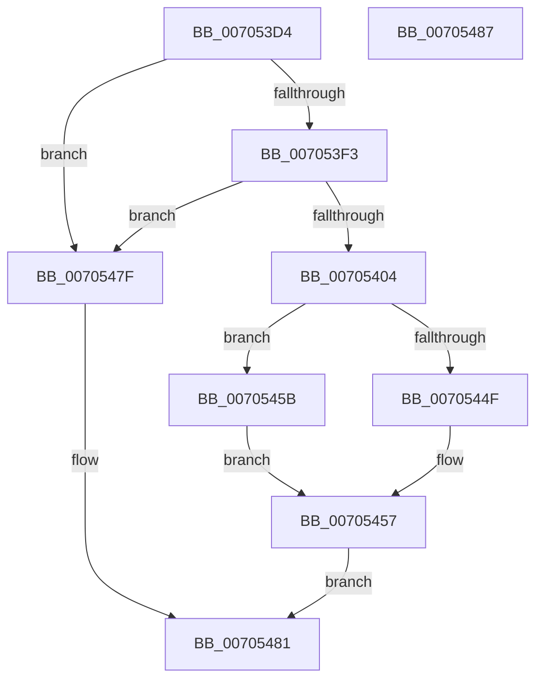

# MiApplyRequiredDriverHotPatches

- RVA: `0x007053D4`–`0x00705488` (길이 `180` bytes)
- VA: `0x00000001407053D4`
- 실행 섹션: `PAGE`
- PDB 이름 있음: `예`; PDB Function 태그: `아니요`
- unwind 정보 RVA: `0x00071A74`
- 디코드: `46`개 명령, `180/180` bytes 표시
- 미해석 바이트: `0` (있으면 어셈블리에 `.byte`로 보존)

> 이 문서는 커널 이미지의 기계어와 PDB 기호를 분석해 생성했습니다. 4번과 5번은 함수 원형과 자료형을 바이너리 사용 방식에서 추정한 C 해석이며 원본 소스 복구 결과는 아닙니다.

## 1. Dependencies

- 직접 호출 지점: **5**; 고유 호출 대상: **5**
- 직접 호출자로 확인된 함수: **1**
- RIP 상대 이미지 참조: **2**

### Outgoing calls
- `0x007053F3` → [MiGetBaseLoaderPortion](../../text/4D/MiGetBaseLoaderPortion_function_004D9D34.md) (function, `0x004D9D34`)
- `0x0070540B` → [RtlInitUnicodeString](../../text/42/RtlInitUnicodeString_function_0042A780.md) (function, `0x0042A780`)
- `0x00705446` → [MiFindHotPatchRecord](../A6/MiFindHotPatchRecord_function_00A6E618.md) (function, `0x00A6E618`)
- `0x0070546C` → [MiLoadHotPatch](../AB/MiLoadHotPatch_function_00AB521C.md) (function, `0x00AB521C`)
- `0x00705478` → [RtlFreeAnsiString](../9C/RtlFreeAnsiString_function_009C0800.md) (function, `0x009C0800`)

### Direct callers
- [MmLoadSystemImageEx](../99/MmLoadSystemImageEx_function_00999B8C.md) at `0x0099A0FF`

### Static image references
- `0x007053DA` → RVA `0x00E375B4` (`.data`; read)
- `0x00705420` → RVA `0x00E37578` (`.data`; read)

## 2. Other-region calls and transfers

- 다른 실행 섹션으로 향하는 call: **2**
  - `0x007053F3` → [MiGetBaseLoaderPortion](../../text/4D/MiGetBaseLoaderPortion_function_004D9D34.md) (`PAGE` → `.text`)
  - `0x0070540B` → [RtlInitUnicodeString](../../text/42/RtlInitUnicodeString_function_0042A780.md) (`PAGE` → `.text`)
- 별도 외부 분기/꼬리 이동을 확인하지 못했습니다.

## 3. Assembly (complete function range)

```asm
007053D4  40 53                           push rbx
007053D6  48 83 EC 50                     sub rsp, 0x50
007053DA  8B 05 D4 21 73 00               mov eax, dword ptr [rip + 0x7321d4]
007053E0  0F 57 C0                        xorps xmm0, xmm0
007053E3  48 8B D9                        mov rbx, rcx
007053E6  0F 11 44 24 40                  movups xmmword ptr [rsp + 0x40], xmm0
007053EB  A8 01                           test al, 1
007053ED  0F 84 8C 00 00 00               je 0x14070547f
007053F3  E8 3C 49 DD FF                  call 0x1404d9d34
007053F8  F7 80 B8 00 00 00 00 20 00 00   test dword ptr [rax + 0xb8], 0x2000
00705402  75 7B                           jne 0x14070547f
00705404  33 D2                           xor edx, edx
00705406  48 8D 4C 24 40                  lea rcx, [rsp + 0x40]
0070540B  E8 70 53 D2 FF                  call 0x14042a780
00705410  44 8B 43 78                     mov r8d, dword ptr [rbx + 0x78]
00705414  48 8D 44 24 40                  lea rax, [rsp + 0x40]
00705419  44 8B 8B 9C 00 00 00            mov r9d, dword ptr [rbx + 0x9c]
00705420  48 8D 0D 51 21 73 00            lea rcx, [rip + 0x732151]
00705427  48 89 44 24 30                  mov qword ptr [rsp + 0x30], rax
0070542C  33 DB                           xor ebx, ebx
0070542E  48 89 5C 24 28                  mov qword ptr [rsp + 0x28], rbx
00705433  33 D2                           xor edx, edx
00705435  66 C7 44 24 20 64 86            mov word ptr [rsp + 0x20], 0x8664
0070543C  44 89 44 24 70                  mov dword ptr [rsp + 0x70], r8d
00705441  44 89 4C 24 68                  mov dword ptr [rsp + 0x68], r9d
00705446  E8 CD 91 36 00                  call 0x140a6e618
0070544B  85 C0                           test eax, eax
0070544D  79 0C                           jns 0x14070545b
0070544F  3D 25 02 00 C0                  cmp eax, 0xc0000225
00705454  0F 45 D8                        cmovne ebx, eax
00705457  8B C3                           mov eax, ebx
00705459  EB 26                           jmp 0x140705481
0070545B  4C 8D 4C 24 68                  lea r9, [rsp + 0x68]
00705460  33 D2                           xor edx, edx
00705462  4C 8D 44 24 70                  lea r8, [rsp + 0x70]
00705467  48 8D 4C 24 40                  lea rcx, [rsp + 0x40]
0070546C  E8 AB FD 3A 00                  call 0x140ab521c
00705471  48 8D 4C 24 40                  lea rcx, [rsp + 0x40]
00705476  8B D8                           mov ebx, eax
00705478  E8 83 B3 2B 00                  call 0x1409c0800
0070547D  EB D8                           jmp 0x140705457
0070547F  33 C0                           xor eax, eax
00705481  48 83 C4 50                     add rsp, 0x50
00705485  5B                              pop rbx
00705486  C3                              ret
00705487  CC                              int3
```

## 4. C-style interpretation (structured pseudocode)

```c
__int64 __fastcall MiApplyRequiredDriverHotPatches(__int64 a1, int a2)
{
    __int64 result;
    __int64 v_rbx;
    __int64 v_rsp;
    unsigned __int64 v_stack_m18;
    unsigned __int64 v_stack_m28;
    unsigned __int64 v_stack_m30;
    unsigned __int16 v_stack_m38;
    unsigned int v_stack_p10;
    unsigned int v_stack_p18;

    v_rsp = (v_rsp) - (80);
    v_stack_m18 = v_xmm0;
    if ((((unsigned __int8)((unsigned int)(*(unsigned int *)(v_rip + 7545300)))) & (1)) == 0) goto loc_0070547F;
    result = MiGetBaseLoaderPortion(a1, a2, a3, a4);
    if (((*(unsigned int *)(result + 184)) & (0x2000ULL)) != 0) goto loc_0070547F;
    a2 = 0;
    result = RtlInitUnicodeString(v_stack_m18, a2, a3, a4);
    v_stack_m28 = v_stack_m18;
    v_rbx = 0;
    v_stack_m30 = 0;
    a2 = 0;
    v_stack_m38 = 0x8664ULL;
    v_stack_p18 = (unsigned int)((unsigned int)(*(unsigned int *)(a1 + 120)));
    v_stack_p10 = (unsigned int)((unsigned int)(*(unsigned int *)(a1 + 156)));
    result = MiFindHotPatchRecord(v_rip + 7545169, a2, (unsigned int)(*(unsigned int *)(a1 + 120)), (unsigned int)(*(unsigned int *)(a1 + 156)));
    if (!sign_flag) goto loc_0070545B;
    if (((unsigned int)(result)) != 0xC0000225ULL) { v_rbx = (unsigned int)(result); }
loc_00705457:
    goto loc_00705481;
loc_0070545B:
    a2 = 0;
    result = MiLoadHotPatch(v_stack_m18, a2, v_stack_p18, v_stack_p10);
    result = RtlFreeAnsiString(v_stack_m18, a2, v_stack_p18, v_stack_p10);
    goto loc_00705457;
loc_0070547F:
    result = 0;
loc_00705481:
    v_rsp = (v_rsp) + (80);
    return result;
}
```

## 5. (Beta) C Style

```c
int64_t MiApplyRequiredDriverHotPatches(void *Arg1, int32_t Arg2)
{
    uint8_t *arg1 = (uint8_t *)Arg1;

    int64_t result;
    int64_t local_rbx;
    int64_t local_rsp;
    uint64_t v_stack_m18;
    uint64_t v_stack_m28;
    uint64_t v_stack_m30;
    uint16_t v_stack_m38;
    uint32_t v_stack_p10;
    uint32_t v_stack_p18;

    local_rsp = (local_rsp) - (80);
    v_stack_m18 = v_xmm0;
    if ((((uint8_t)((uint32_t)(*(uint32_t *)(v_rip + 0x7321D4)))) & (1)) == 0) goto loc_0070547F;
    result = MiGetBaseLoaderPortion(Arg1, Arg2, a3, a4);
    if (((*(uint32_t *)(result + 0xB8)) & (0x2000ULL)) != 0) goto loc_0070547F;
    Arg2 = 0;
    result = RtlInitUnicodeString(v_stack_m18, Arg2, a3, a4);
    v_stack_m28 = v_stack_m18;
    local_rbx = 0;
    v_stack_m30 = 0;
    Arg2 = 0;
    v_stack_m38 = 0x8664ULL;
    v_stack_p18 = (uint32_t)((uint32_t)(*(uint32_t *)(arg1 + 0x78)));
    v_stack_p10 = (uint32_t)((uint32_t)(*(uint32_t *)(arg1 + 0x9C)));
    result = MiFindHotPatchRecord(v_rip + 7545169, Arg2, (uint32_t)(*(uint32_t *)(arg1 + 0x78)), (uint32_t)(*(uint32_t *)(arg1 + 0x9C)));
    if (!sign_flag) goto loc_0070545B;
    if (((uint32_t)(result)) != 0xC0000225ULL) { local_rbx = (uint32_t)(result); }
loc_00705457:
    goto loc_00705481;
loc_0070545B:
    Arg2 = 0;
    result = MiLoadHotPatch(v_stack_m18, Arg2, v_stack_p18, v_stack_p10);
    result = RtlFreeAnsiString(v_stack_m18, Arg2, v_stack_p18, v_stack_p10);
    goto loc_00705457;
loc_0070547F:
    result = 0;
loc_00705481:
    local_rsp = (local_rsp) + (80);
    return result;
}
```

### 관측된 메모리 오프셋

구조체 형식이 확인되지 않은 접근은 인자 기준의 오프셋으로만 기록했습니다.

| 기준 인자 | 오프셋 표현 | 폭 (bit) | 접근 |
|---|---:|---:|---|
| `Arg1` | `+ 0x78` | `32` | `R` |
| `Arg1` | `+ 0x9C` | `32` | `R` |

## 6. Execution-region graph

[열기: 2D/3D 그래프와 함수 탐색 컨트롤 패널](../../../control-panel.html?section=page&rva=0x007053D4&view=graph)

- 2D 그래프는 위에서 아래로 흐르고, 3D 그래프는 빈 공간을 드래그해 회전합니다. Shift+드래그는 이동, 휠은 확대·축소, 함수 노드 선택은 대상 보고서 이동입니다.

### Static fallback


