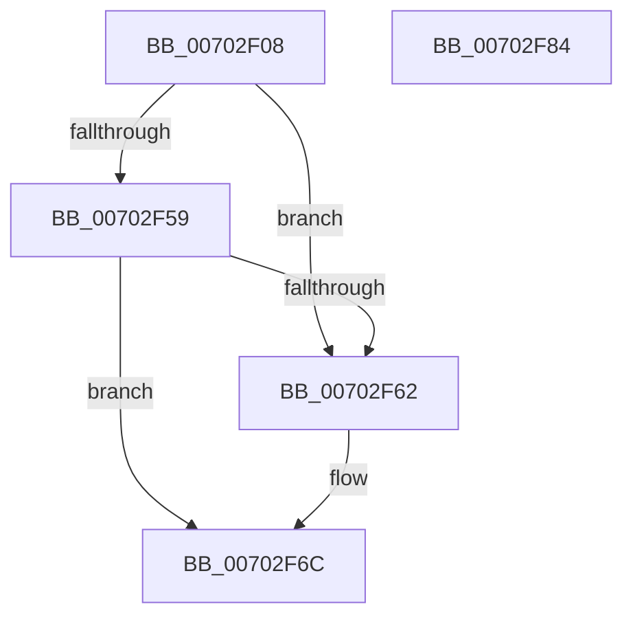

# MiDriverLoadSucceeded

- RVA: `0x00702F08`–`0x00702F85` (길이 `125` bytes)
- VA: `0x0000000140702F08`
- 실행 섹션: `PAGE`
- PDB 이름 있음: `예`; PDB Function 태그: `아니요`
- unwind 정보 RVA: `0x00060BC4`
- 디코드: `32`개 명령, `125/125` bytes 표시
- 미해석 바이트: `0` (있으면 어셈블리에 `.byte`로 보존)

> 이 문서는 커널 이미지의 기계어와 PDB 기호를 분석해 생성했습니다. 4번과 5번은 함수 원형과 자료형을 바이너리 사용 방식에서 추정한 C 해석이며 원본 소스 복구 결과는 아닙니다.

## 1. Dependencies

- 직접 호출 지점: **6**; 고유 호출 대상: **6**
- 직접 호출자로 확인된 함수: **1**
- RIP 상대 이미지 참조: **0**

### Outgoing calls
- `0x00702F27` → [MiGetBaseLoaderPortion](../../text/4D/MiGetBaseLoaderPortion_function_004D9D34.md) (function, `0x004D9D34`)
- `0x00702F33` → [MiCallImageNotify](../AD/MiCallImageNotify_function_00ADB9CC.md) (function, `0x00ADB9CC`)
- `0x00702F41` → [MiCacheImageSymbols](../AD/MiCacheImageSymbols_function_00AD9410.md) (function, `0x00AD9410`)
- `0x00702F4A` → [MiSectionControlArea](../../text/29/MiSectionControlArea_function_00294CB0.md) (function, `0x00294CB0`)
- `0x00702F67` → [MiProtectSystemImage](../AA/MiProtectSystemImage_function_00AA7D74.md) (function, `0x00AA7D74`)
- `0x00702F6F` → [VfDriverLoadSucceeded](../../text/4B/VfDriverLoadSucceeded_function_004BD418.md) (function, `0x004BD418`)

### Direct callers
- [MiApplyHotPatchToLoadedDriver](../80/MiApplyHotPatchToLoadedDriver_function_00802078.md) at `0x008022FA`

### Static image references
- 디코드된 RIP-relative 메모리 참조가 없습니다.

## 2. Other-region calls and transfers

- 다른 실행 섹션으로 향하는 call: **3**
  - `0x00702F27` → [MiGetBaseLoaderPortion](../../text/4D/MiGetBaseLoaderPortion_function_004D9D34.md) (`PAGE` → `.text`)
  - `0x00702F4A` → [MiSectionControlArea](../../text/29/MiSectionControlArea_function_00294CB0.md) (`PAGE` → `.text`)
  - `0x00702F6F` → [VfDriverLoadSucceeded](../../text/4B/VfDriverLoadSucceeded_function_004BD418.md) (`PAGE` → `.text`)
- 별도 외부 분기/꼬리 이동을 확인하지 못했습니다.

## 3. Assembly (complete function range)

```asm
00702F08  48 89 5C 24 08                  mov qword ptr [rsp + 8], rbx
00702F0D  48 89 74 24 10                  mov qword ptr [rsp + 0x10], rsi
00702F12  57                              push rdi
00702F13  48 83 EC 20                     sub rsp, 0x20
00702F17  81 49 68 00 40 00 41            or dword ptr [rcx + 0x68], 0x41004000
00702F1E  49 8B D9                        mov rbx, r9
00702F21  49 8B F8                        mov rdi, r8
00702F24  48 8B F1                        mov rsi, rcx
00702F27  E8 08 6E DD FF                  call 0x1404d9d34
00702F2C  83 88 B8 00 00 00 02            or dword ptr [rax + 0xb8], 2
00702F33  E8 94 8A 3D 00                  call 0x140adb9cc
00702F38  4C 8B C3                        mov r8, rbx
00702F3B  48 8B D7                        mov rdx, rdi
00702F3E  48 8B CE                        mov rcx, rsi
00702F41  E8 CA 64 3D 00                  call 0x140ad9410
00702F46  48 8B 4E 70                     mov rcx, qword ptr [rsi + 0x70]
00702F4A  E8 61 1D B9 FF                  call 0x140294cb0
00702F4F  48 83 B8 90 00 00 00 00         cmp qword ptr [rax + 0x90], 0
00702F57  74 09                           je 0x140702f62
00702F59  F7 46 68 00 00 00 08            test dword ptr [rsi + 0x68], 0x8000000
00702F60  75 0A                           jne 0x140702f6c
00702F62  33 D2                           xor edx, edx
00702F64  48 8B CE                        mov rcx, rsi
00702F67  E8 08 4E 3A 00                  call 0x140aa7d74
00702F6C  48 8B CE                        mov rcx, rsi
00702F6F  E8 A4 A4 DB FF                  call 0x1404bd418
00702F74  48 8B 5C 24 30                  mov rbx, qword ptr [rsp + 0x30]
00702F79  48 8B 74 24 38                  mov rsi, qword ptr [rsp + 0x38]
00702F7E  48 83 C4 20                     add rsp, 0x20
00702F82  5F                              pop rdi
00702F83  C3                              ret
00702F84  CC                              int3
```

## 4. C-style interpretation (structured pseudocode)

```c
__int64 __fastcall MiDriverLoadSucceeded(__int64 a1, __int64 a2, __int64 a3, __int64 a4)
{
    __int64 result;
    __int64 v_rsp;
    unsigned __int64 v_stack_p10;
    unsigned __int64 v_stack_p8;

    v_stack_p8 = v_rbx;
    v_stack_p10 = v_rsi;
    v_rsp = (v_rsp) - (32);
    result = MiGetBaseLoaderPortion(a1, a2, a3, a4);
    result = MiCallImageNotify(a1, a2, a3, a4);
    result = MiCacheImageSymbols(a1, a3, a4, a4);
    result = MiSectionControlArea(*(unsigned __int64 *)(a1 + 112), a3, a4, a4);
    if ((*(unsigned __int64 *)(result + 144)) == 0) goto loc_00702F62;
    if (((*(unsigned int *)(a1 + 104)) & (0x8000000ULL)) == 0) {
        a2 = 0;
        a1 = a1;
        result = MiProtectSystemImage(a1, a2, a4, a4);
    }
    result = VfDriverLoadSucceeded(a1, a2, a4, a4);
    v_rsp = (v_rsp) + (32);
    return result;
}
```

## 5. (Beta) C Style

```c
int64_t MiDriverLoadSucceeded(void *Arg1, int64_t Arg2, int64_t Arg3, int64_t Arg4)
{
    uint8_t *arg1 = (uint8_t *)Arg1;

    int64_t result;
    int64_t local_rsp;
    uint64_t v_stack_p10;
    uint64_t v_stack_p8;

    v_stack_p8 = local_rbx;
    v_stack_p10 = local_rsi;
    local_rsp = (local_rsp) - (32);
    result = MiGetBaseLoaderPortion(Arg1, Arg2, Arg3, Arg4);
    result = MiCallImageNotify(Arg1, Arg2, Arg3, Arg4);
    result = MiCacheImageSymbols(Arg1, Arg3, Arg4, Arg4);
    result = MiSectionControlArea(*(uint64_t *)(arg1 + 0x70), Arg3, Arg4, Arg4);
    if ((*(uint64_t *)(result + 0x90)) == 0) goto loc_00702F62;
    if (((*(uint32_t *)(arg1 + 0x68)) & (0x8000000ULL)) == 0) {
        Arg2 = 0;
        Arg1 = Arg1;
        result = MiProtectSystemImage(Arg1, Arg2, Arg4, Arg4);
    }
    result = VfDriverLoadSucceeded(Arg1, Arg2, Arg4, Arg4);
    local_rsp = (local_rsp) + (32);
    return result;
}
```

### 관측된 메모리 오프셋

구조체 형식이 확인되지 않은 접근은 인자 기준의 오프셋으로만 기록했습니다.

| 기준 인자 | 오프셋 표현 | 폭 (bit) | 접근 |
|---|---:|---:|---|
| `Arg1` | `+ 0x68` | `32` | `R` |
| `Arg1` | `+ 0x68` | `32` | `R/W` |
| `Arg1` | `+ 0x70` | `64` | `R` |

## 6. Execution-region graph

[열기: 2D/3D 그래프와 함수 탐색 컨트롤 패널](../../../control-panel.html?section=page&rva=0x00702F08&view=graph)

- 2D 그래프는 위에서 아래로 흐르고, 3D 그래프는 빈 공간을 드래그해 회전합니다. Shift+드래그는 이동, 휠은 확대·축소, 함수 노드 선택은 대상 보고서 이동입니다.

### Static fallback


