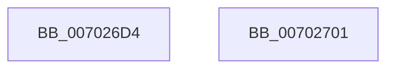

# MiExtendWorkingSetSwapPagefile

- RVA: `0x007026D4`–`0x00702702` (길이 `46` bytes)
- VA: `0x00000001407026D4`
- 실행 섹션: `PAGE`
- PDB 이름 있음: `예`; PDB Function 태그: `아니요`
- unwind 정보 RVA: `0x0005C788`
- 디코드: `13`개 명령, `46/46` bytes 표시
- 미해석 바이트: `0` (있으면 어셈블리에 `.byte`로 보존)

> 이 문서는 커널 이미지의 기계어와 PDB 기호를 분석해 생성했습니다. 4번과 5번은 함수 원형과 자료형을 바이너리 사용 방식에서 추정한 C 해석이며 원본 소스 복구 결과는 아닙니다.

## 1. Dependencies

- 직접 호출 지점: **1**; 고유 호출 대상: **1**
- 직접 호출자로 확인된 함수: **2**
- RIP 상대 이미지 참조: **0**

### Outgoing calls
- `0x007026EC` → [MiIssuePageExtendRequest](../../text/47/MiIssuePageExtendRequest_function_004752F4.md) (function, `0x004752F4`)

### Direct callers
- [MmOutSwapWorkingSet](../../text/2A/MmOutSwapWorkingSet_function_002A6BC8.md) at `0x002A6FDE`
- [MmOutSwapVirtualAddresses](../../text/2A/MmOutSwapVirtualAddresses_function_002A8C30.md) at `0x002A8D46`

### Static image references
- 디코드된 RIP-relative 메모리 참조가 없습니다.

## 2. Other-region calls and transfers

- 다른 실행 섹션으로 향하는 call: **1**
  - `0x007026EC` → [MiIssuePageExtendRequest](../../text/47/MiIssuePageExtendRequest_function_004752F4.md) (`PAGE` → `.text`)
- 별도 외부 분기/꼬리 이동을 확인하지 못했습니다.

## 3. Assembly (complete function range)

```asm
007026D4  48 83 EC 28                     sub rsp, 0x28
007026D8  48 81 C2 FF 7F 00 00            add rdx, 0x7fff
007026DF  45 8B C8                        mov r9d, r8d
007026E2  48 81 E2 00 80 FF FF            and rdx, 0xffffffffffff8000
007026E9  45 33 C0                        xor r8d, r8d
007026EC  E8 03 2C D7 FF                  call 0x1404752f4
007026F1  F7 D8                           neg eax
007026F3  1B C0                           sbb eax, eax
007026F5  F7 D0                           not eax
007026F7  25 99 00 00 C0                  and eax, 0xc0000099
007026FC  48 83 C4 28                     add rsp, 0x28
00702700  C3                              ret
00702701  CC                              int3
```

## 4. C-style interpretation (structured pseudocode)

```c
__int64 __fastcall MiExtendWorkingSetSwapPagefile(__int64 a1, __int64 a2, int a3)
{
    __int64 result;
    __int64 v_rsp;

    v_rsp = (v_rsp) - (40);
    a2 = (a2) + (0x7FFFULL);
    a2 = (a2) & (0xFFFFFFFFFFFF8000ULL);
    a3 = 0;
    result = MiIssuePageExtendRequest(a1, a2, a3, (unsigned int)(a3));
    result = (unsigned int)(-(result));
    result = (unsigned int)(~(result));
    result = (unsigned int)((result) & (0xC0000099ULL));
    v_rsp = (v_rsp) + (40);
    return result;
}
```

## 5. (Beta) C Style

```c
int64_t MiExtendWorkingSetSwapPagefile(int64_t Arg1, int64_t Arg2, int32_t Arg3)
{
    int64_t result;
    int64_t local_rsp;

    local_rsp = (local_rsp) - (40);
    Arg2 = (Arg2) + (0x7FFFULL);
    Arg2 = (Arg2) & (0xFFFFFFFFFFFF8000ULL);
    Arg3 = 0;
    result = MiIssuePageExtendRequest(Arg1, Arg2, Arg3, (uint32_t)(Arg3));
    result = (uint32_t)(-(result));
    result = (uint32_t)(~(result));
    result = (uint32_t)((result) & (0xC0000099ULL));
    local_rsp = (local_rsp) + (40);
    return result;
}
```

## 6. Execution-region graph

[열기: 2D/3D 그래프와 함수 탐색 컨트롤 패널](../../../control-panel.html?section=page&rva=0x007026D4&view=graph)

- 2D 그래프는 위에서 아래로 흐르고, 3D 그래프는 빈 공간을 드래그해 회전합니다. Shift+드래그는 이동, 휠은 확대·축소, 함수 노드 선택은 대상 보고서 이동입니다.

### Static fallback


