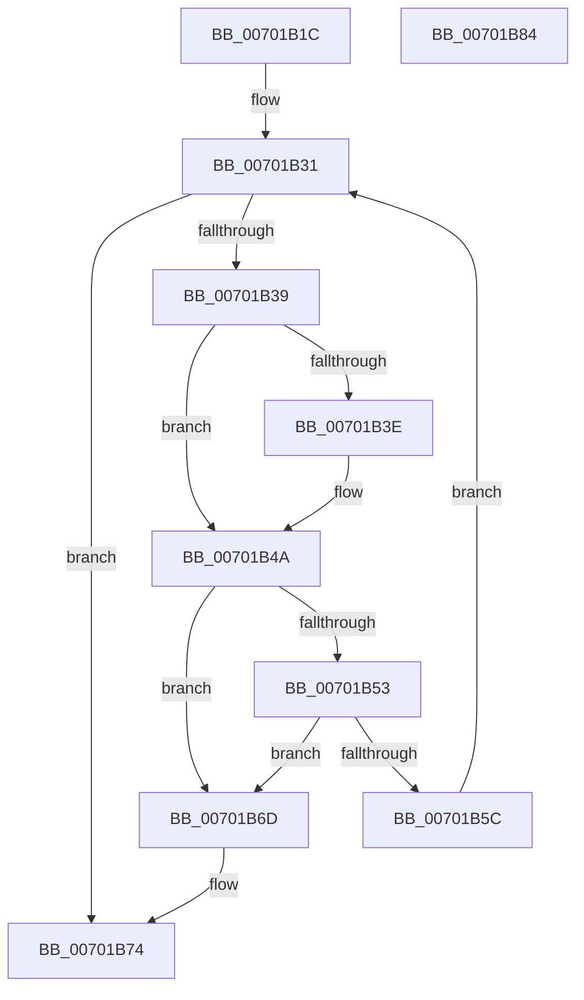

# MiFreeEnclaveModules

- RVA: `0x00701B1C`–`0x00701B85` (길이 `105` bytes)
- VA: `0x0000000140701B1C`
- 실행 섹션: `PAGE`
- PDB 이름 있음: `예`; PDB Function 태그: `아니요`
- unwind 정보 RVA: `0x00060BC4`
- 디코드: `33`개 명령, `105/105` bytes 표시
- 미해석 바이트: `0` (있으면 어셈블리에 `.byte`로 보존)

> 이 문서는 커널 이미지의 기계어와 PDB 기호를 분석해 생성했습니다. 4번과 5번은 함수 원형과 자료형을 바이너리 사용 방식에서 추정한 C 해석이며 원본 소스 복구 결과는 아닙니다.

## 1. Dependencies

- 직접 호출 지점: **2**; 고유 호출 대상: **2**
- 직접 호출자로 확인된 함수: **1**
- RIP 상대 이미지 참조: **0**

### Outgoing calls
- `0x00701B45` → [DbgkUnMapViewOfSection](../A3/DbgkUnMapViewOfSection_function_00A3B18C.md) (function, `0x00A3B18C`)
- `0x00701B66` → [MiDereferenceEnclaveModule](../80/MiDereferenceEnclaveModule_function_008089B4.md) (function, `0x008089B4`)

### Direct callers
- [MiCanDeleteEnclave](../../text/68/MiCanDeleteEnclave_function_00686D18.md) at `0x00686DA1`

### Static image references
- 디코드된 RIP-relative 메모리 참조가 없습니다.

## 2. Other-region calls and transfers

- 다른 실행 섹션으로 향하는 call: **0**
- 별도 외부 분기/꼬리 이동을 확인하지 못했습니다.

## 3. Assembly (complete function range)

```asm
00701B1C  48 89 5C 24 08                  mov qword ptr [rsp + 8], rbx
00701B21  48 89 74 24 10                  mov qword ptr [rsp + 0x10], rsi
00701B26  57                              push rdi
00701B27  48 83 EC 20                     sub rsp, 0x20
00701B2B  48 8B F2                        mov rsi, rdx
00701B2E  48 8B F9                        mov rdi, rcx
00701B31  48 8B 1F                        mov rbx, qword ptr [rdi]
00701B34  48 3B DF                        cmp rbx, rdi
00701B37  74 3B                           je 0x140701b74
00701B39  48 85 F6                        test rsi, rsi
00701B3C  74 0C                           je 0x140701b4a
00701B3E  48 8B 53 10                     mov rdx, qword ptr [rbx + 0x10]
00701B42  48 8B CE                        mov rcx, rsi
00701B45  E8 42 96 33 00                  call 0x140a3b18c
00701B4A  48 8B 0B                        mov rcx, qword ptr [rbx]
00701B4D  48 39 59 08                     cmp qword ptr [rcx + 8], rbx
00701B51  75 1A                           jne 0x140701b6d
00701B53  48 8B 43 08                     mov rax, qword ptr [rbx + 8]
00701B57  48 39 18                        cmp qword ptr [rax], rbx
00701B5A  75 11                           jne 0x140701b6d
00701B5C  48 89 08                        mov qword ptr [rax], rcx
00701B5F  48 89 41 08                     mov qword ptr [rcx + 8], rax
00701B63  48 8B CB                        mov rcx, rbx
00701B66  E8 49 6E 10 00                  call 0x1408089b4
00701B6B  EB C4                           jmp 0x140701b31
00701B6D  B9 03 00 00 00                  mov ecx, 3
00701B72  CD 29                           int 0x29
00701B74  48 8B 5C 24 30                  mov rbx, qword ptr [rsp + 0x30]
00701B79  48 8B 74 24 38                  mov rsi, qword ptr [rsp + 0x38]
00701B7E  48 83 C4 20                     add rsp, 0x20
00701B82  5F                              pop rdi
00701B83  C3                              ret
00701B84  CC                              int3
```

## 4. C-style interpretation (structured pseudocode)

```c
__int64 __fastcall MiFreeEnclaveModules(__int64 a1, __int64 a2)
{
    __int64 result;
    __int64 v_rsp;
    unsigned __int64 v_stack_p10;
    unsigned __int64 v_stack_p8;

    v_stack_p8 = v_rbx;
    v_stack_p10 = v_rsi;
    v_rsp = (v_rsp) - (32);
loc_00701B31:
    if ((*(unsigned __int64 *)(a1)) == a1) goto loc_00701B74;
    if (a2 != 0) {
        a2 = *(unsigned __int64 *)(*(unsigned __int64 *)(a1) + 16);
        a1 = a2;
        result = DbgkUnMapViewOfSection(a1, a2, a3, a4);
    }
    if ((*(unsigned __int64 *)(*(unsigned __int64 *)(*(unsigned __int64 *)(a1)) + 8)) != (*(unsigned __int64 *)(a1))) goto loc_00701B6D;
    if ((*(unsigned __int64 *)(*(unsigned __int64 *)(*(unsigned __int64 *)(a1) + 8))) != (*(unsigned __int64 *)(a1))) goto loc_00701B6D;
    *(unsigned __int64 *)(*(unsigned __int64 *)(*(unsigned __int64 *)(a1) + 8)) = *(unsigned __int64 *)(*(unsigned __int64 *)(a1));
    *(unsigned __int64 *)(*(unsigned __int64 *)(*(unsigned __int64 *)(a1)) + 8) = *(unsigned __int64 *)(*(unsigned __int64 *)(a1) + 8);
    result = MiDereferenceEnclaveModule(*(unsigned __int64 *)(a1), a2, a3, a4);
    goto loc_00701B31;
loc_00701B6D:
loc_00701B74:
    v_rsp = (v_rsp) + (32);
    return result;
}
```

## 5. (Beta) C Style

```c
int64_t MiFreeEnclaveModules(void *Arg1, int64_t Arg2)
{
    uint8_t *arg1 = (uint8_t *)Arg1;

    int64_t result;
    int64_t local_rsp;
    uint64_t v_stack_p10;
    uint64_t v_stack_p8;

    v_stack_p8 = local_rbx;
    v_stack_p10 = local_rsi;
    local_rsp = (local_rsp) - (32);
loc_00701B31:
    if ((*(uint64_t *)(arg1)) == Arg1) goto loc_00701B74;
    if (Arg2 != 0) {
        Arg2 = *(uint64_t *)(*(uint64_t *)(arg1) + 0x10);
        Arg1 = Arg2;
        result = DbgkUnMapViewOfSection(Arg1, Arg2, a3, a4);
    }
    if ((*(uint64_t *)(*(uint64_t *)(*(uint64_t *)(arg1)) + 0x8)) != (*(uint64_t *)(arg1))) goto loc_00701B6D;
    if ((*(uint64_t *)(*(uint64_t *)(*(uint64_t *)(arg1) + 0x8))) != (*(uint64_t *)(arg1))) goto loc_00701B6D;
    *(uint64_t *)(*(uint64_t *)(*(uint64_t *)(arg1) + 0x8)) = *(uint64_t *)(*(uint64_t *)(arg1));
    *(uint64_t *)(*(uint64_t *)(*(uint64_t *)(arg1)) + 0x8) = *(uint64_t *)(*(uint64_t *)(arg1) + 0x8);
    result = MiDereferenceEnclaveModule(*(uint64_t *)(arg1), Arg2, a3, a4);
    goto loc_00701B31;
loc_00701B6D:
loc_00701B74:
    local_rsp = (local_rsp) + (32);
    return result;
}
```

### 관측된 메모리 오프셋

구조체 형식이 확인되지 않은 접근은 인자 기준의 오프셋으로만 기록했습니다.

| 기준 인자 | 오프셋 표현 | 폭 (bit) | 접근 |
|---|---:|---:|---|
| `Arg1` | `+ 0x0` | `64` | `R` |

## 6. Execution-region graph

[열기: 2D/3D 그래프와 함수 탐색 컨트롤 패널](../../../control-panel.html?section=page&rva=0x00701B1C&view=graph)

- 2D 그래프는 위에서 아래로 흐르고, 3D 그래프는 빈 공간을 드래그해 회전합니다. Shift+드래그는 이동, 휠은 확대·축소, 함수 노드 선택은 대상 보고서 이동입니다.

### Static fallback


