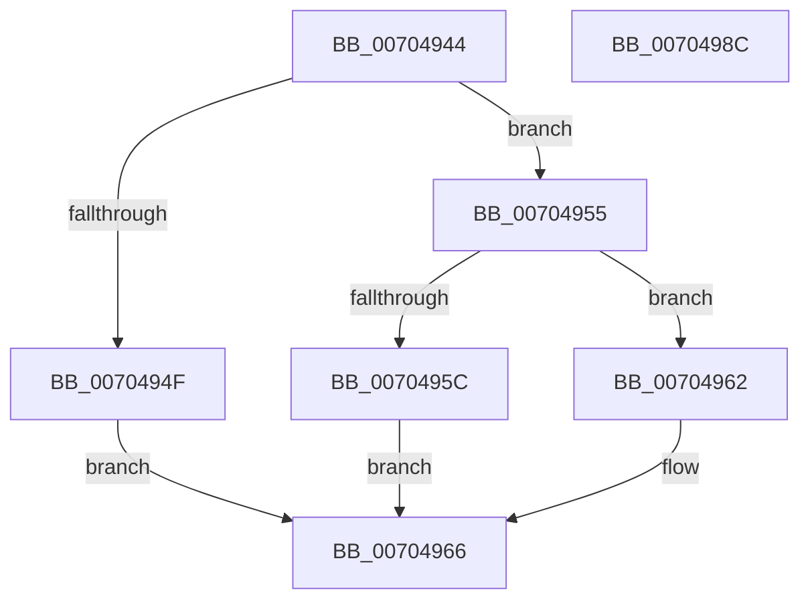

# MiFreeVadEventBitmapCharges

- RVA: `0x00704944`–`0x0070498D` (길이 `73` bytes)
- VA: `0x0000000140704944`
- 실행 섹션: `PAGE`
- PDB 이름 있음: `예`; PDB Function 태그: `아니요`
- unwind 정보 RVA: `0x0005C788`
- 디코드: `24`개 명령, `73/73` bytes 표시
- 미해석 바이트: `0` (있으면 어셈블리에 `.byte`로 보존)

> 이 문서는 커널 이미지의 기계어와 PDB 기호를 분석해 생성했습니다. 4번과 5번은 함수 원형과 자료형을 바이너리 사용 방식에서 추정한 C 해석이며 원본 소스 복구 결과는 아닙니다.

## 1. Dependencies

- 직접 호출 지점: **1**; 고유 호출 대상: **1**
- 직접 호출자로 확인된 함수: **2**
- RIP 상대 이미지 참조: **0**

### Outgoing calls
- `0x00704982` → [PsReturnProcessNonPagedPoolQuota](../../text/41/PsReturnProcessNonPagedPoolQuota_function_0041C200.md) (function, `0x0041C200`)

### Direct callers
- [MiFreeAweView](../6F/MiFreeAweView_function_006FE7A4.md) at `0x006FE81D`
- [MiFreeVadEventBitmap](../AD/MiFreeVadEventBitmap_function_00ADB6B8.md) at `0x00ADB6E1`

### Static image references
- 디코드된 RIP-relative 메모리 참조가 없습니다.

## 2. Other-region calls and transfers

- 다른 실행 섹션으로 향하는 call: **1**
  - `0x00704982` → [PsReturnProcessNonPagedPoolQuota](../../text/41/PsReturnProcessNonPagedPoolQuota_function_0041C200.md) (`PAGE` → `.text`)
- 별도 외부 분기/꼬리 이동을 확인하지 못했습니다.

## 3. Assembly (complete function range)

```asm
00704944  48 83 EC 28                     sub rsp, 0x28
00704948  8B 42 50                        mov eax, dword ptr [rdx + 0x50]
0070494B  A8 40                           test al, 0x40
0070494D  74 06                           je 0x140704955
0070494F  4C 8B 42 08                     mov r8, qword ptr [rdx + 8]
00704953  EB 11                           jmp 0x140704966
00704955  3D 00 01 00 00                  cmp eax, 0x100
0070495A  75 06                           jne 0x140704962
0070495C  4C 8B 42 38                     mov r8, qword ptr [rdx + 0x38]
00704960  EB 04                           jmp 0x140704966
00704962  4C 8B 42 10                     mov r8, qword ptr [rdx + 0x10]
00704966  41 8A C0                        mov al, r8b
00704969  24 3F                           and al, 0x3f
0070496B  F6 D8                           neg al
0070496D  48 1B D2                        sbb rdx, rdx
00704970  49 C1 E8 06                     shr r8, 6
00704974  48 F7 DA                        neg rdx
00704977  48 83 C2 0B                     add rdx, 0xb
0070497B  49 03 D0                        add rdx, r8
0070497E  48 C1 E2 03                     shl rdx, 3
00704982  E8 79 78 D1 FF                  call 0x14041c200
00704987  48 83 C4 28                     add rsp, 0x28
0070498B  C3                              ret
0070498C  CC                              int3
```

## 4. C-style interpretation (structured pseudocode)

```c
__int64 __fastcall MiFreeVadEventBitmapCharges(__int64 a1, __int64 a2)
{
    __int64 result;
    __int64 v_rsp;

    v_rsp = (v_rsp) - (40);
    if ((((unsigned __int8)((unsigned int)(*(unsigned int *)(a2 + 80)))) & (64)) == 0) goto loc_00704955;
    goto loc_00704966;
loc_00704955:
    if (((unsigned int)((unsigned int)(*(unsigned int *)(a2 + 80)))) != 256) goto loc_00704962;
    goto loc_00704966;
loc_00704962:
loc_00704966:
    result = (unsigned __int8)(((unsigned __int8)(*(unsigned __int64 *)(a2 + 16))) & (63));
    result = (unsigned __int8)(-(result));
    a3 = (*(unsigned __int64 *)(a2 + 16)) >> (6);
    a2 = -(a2);
    a2 = (a2) + (11);
    a2 = (a2) + (a3);
    a2 = (a2) << (3);
    result = PsReturnProcessNonPagedPoolQuota(a1, a2, a3, a4);
    v_rsp = (v_rsp) + (40);
    return result;
}
```

## 5. (Beta) C Style

```c
int64_t MiFreeVadEventBitmapCharges(int64_t Arg1, void *Arg2)
{
    uint8_t *arg2 = (uint8_t *)Arg2;

    int64_t result;
    int64_t local_rsp;

    local_rsp = (local_rsp) - (40);
    if ((((uint8_t)((uint32_t)(*(uint32_t *)(arg2 + 0x50)))) & (64)) == 0) goto loc_00704955;
    goto loc_00704966;
loc_00704955:
    if (((uint32_t)((uint32_t)(*(uint32_t *)(arg2 + 0x50)))) != 256) goto loc_00704962;
    goto loc_00704966;
loc_00704962:
loc_00704966:
    result = (uint8_t)(((uint8_t)(*(uint64_t *)(arg2 + 0x10))) & (63));
    result = (uint8_t)(-(result));
    a3 = (*(uint64_t *)(arg2 + 0x10)) >> (6);
    Arg2 = -(Arg2);
    Arg2 = (Arg2) + (11);
    Arg2 = (Arg2) + (a3);
    Arg2 = (Arg2) << (3);
    result = PsReturnProcessNonPagedPoolQuota(Arg1, Arg2, a3, a4);
    local_rsp = (local_rsp) + (40);
    return result;
}
```

### 관측된 메모리 오프셋

구조체 형식이 확인되지 않은 접근은 인자 기준의 오프셋으로만 기록했습니다.

| 기준 인자 | 오프셋 표현 | 폭 (bit) | 접근 |
|---|---:|---:|---|
| `Arg2` | `+ 0x8` | `64` | `R` |
| `Arg2` | `+ 0x10` | `64` | `R` |
| `Arg2` | `+ 0x38` | `64` | `R` |
| `Arg2` | `+ 0x50` | `32` | `R` |

## 6. Execution-region graph

[열기: 2D/3D 그래프와 함수 탐색 컨트롤 패널](../../../control-panel.html?section=page&rva=0x00704944&view=graph)

- 2D 그래프는 위에서 아래로 흐르고, 3D 그래프는 빈 공간을 드래그해 회전합니다. Shift+드래그는 이동, 휠은 확대·축소, 함수 노드 선택은 대상 보고서 이동입니다.

### Static fallback


