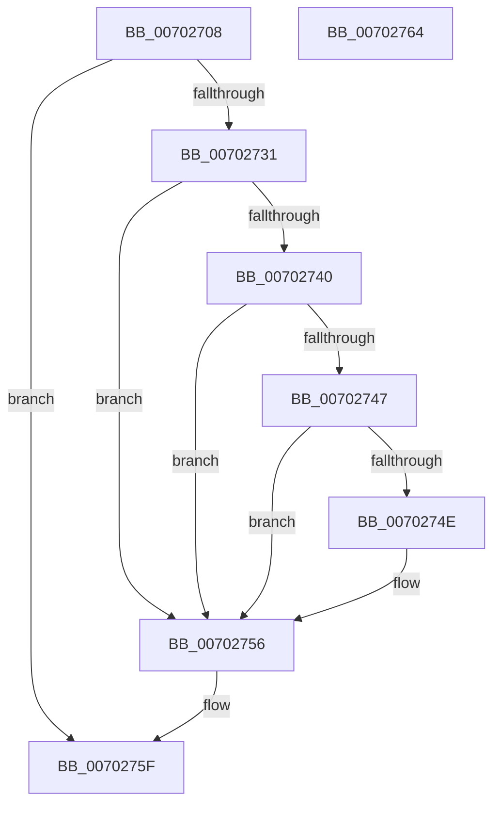

# MiHandleEnclaveFault

- RVA: `0x00702708`–`0x00702765` (길이 `93` bytes)
- VA: `0x0000000140702708`
- 실행 섹션: `PAGE`
- PDB 이름 있음: `예`; PDB Function 태그: `아니요`
- unwind 정보 RVA: `0x0005C788`
- 디코드: `26`개 명령, `93/93` bytes 표시
- 미해석 바이트: `0` (있으면 어셈블리에 `.byte`로 보존)

> 이 문서는 커널 이미지의 기계어와 PDB 기호를 분석해 생성했습니다. 4번과 5번은 함수 원형과 자료형을 바이너리 사용 방식에서 추정한 C 해석이며 원본 소스 복구 결과는 아닙니다.

## 1. Dependencies

- 직접 호출 지점: **2**; 고유 호출 대상: **2**
- 직접 호출자로 확인된 함수: **1**
- RIP 상대 이미지 참조: **0**

### Outgoing calls
- `0x0070271B` → [MiObtainReferencedVadEx](../../text/31/MiObtainReferencedVadEx_function_00316690.md) (function, `0x00316690`)
- `0x00702756` → [MiUnlockAndDereferenceVadShared](../../text/2A/MiUnlockAndDereferenceVadShared_function_002AEF10.md) (function, `0x002AEF10`)

### Direct callers
- [sub_0027F233](../../text/27/Unknown_function_0027F233.md) at `0x0027F240`

### Static image references
- 디코드된 RIP-relative 메모리 참조가 없습니다.

## 2. Other-region calls and transfers

- 다른 실행 섹션으로 향하는 call: **2**
  - `0x0070271B` → [MiObtainReferencedVadEx](../../text/31/MiObtainReferencedVadEx_function_00316690.md) (`PAGE` → `.text`)
  - `0x00702756` → [MiUnlockAndDereferenceVadShared](../../text/2A/MiUnlockAndDereferenceVadShared_function_002AEF10.md) (`PAGE` → `.text`)
- 별도 외부 분기/꼬리 이동을 확인하지 못했습니다.

## 3. Assembly (complete function range)

```asm
00702708  48 83 EC 28                     sub rsp, 0x28
0070270C  83 64 24 38 00                  and dword ptr [rsp + 0x38], 0
00702711  4C 8D 44 24 38                  lea r8, [rsp + 0x38]
00702716  BA 02 00 00 00                  mov edx, 2
0070271B  E8 70 3F C1 FF                  call 0x140316690
00702720  48 8B C8                        mov rcx, rax
00702723  B8 05 00 00 C0                  mov eax, 0xc0000005
00702728  89 44 24 38                     mov dword ptr [rsp + 0x38], eax
0070272C  48 85 C9                        test rcx, rcx
0070272F  74 2E                           je 0x14070275f
00702731  8B 41 30                        mov eax, dword ptr [rcx + 0x30]
00702734  25 00 00 20 0C                  and eax, 0xc200000
00702739  3D 00 00 20 08                  cmp eax, 0x8200000
0070273E  75 16                           jne 0x140702756
00702740  8B 41 40                        mov eax, dword ptr [rcx + 0x40]
00702743  A8 01                           test al, 1
00702745  74 0F                           je 0x140702756
00702747  8B 41 48                        mov eax, dword ptr [rcx + 0x48]
0070274A  A8 01                           test al, 1
0070274C  74 08                           je 0x140702756
0070274E  C7 44 24 38 A2 04 00 C0         mov dword ptr [rsp + 0x38], 0xc00004a2
00702756  E8 B5 C7 BA FF                  call 0x1402aef10
0070275B  8B 44 24 38                     mov eax, dword ptr [rsp + 0x38]
0070275F  48 83 C4 28                     add rsp, 0x28
00702763  C3                              ret
00702764  CC                              int3
```

## 4. C-style interpretation (structured pseudocode)

```c
__int64 __fastcall MiHandleEnclaveFault(void)
{
    __int64 result;
    __int64 v_rsp;
    unsigned int v_stack_p10;

    v_rsp = (v_rsp) - (40);
    result = MiObtainReferencedVadEx(a1, 2, v_stack_p10, a4);
    v_stack_p10 = (unsigned int)((unsigned int)(0xC0000005ULL));
    if (result == 0) goto loc_0070275F;
    result = (unsigned int)(((unsigned int)(*(unsigned int *)(result + 48))) & (0xC200000ULL));
    if (((unsigned int)(result)) != 0x8200000ULL) goto loc_00702756;
    if ((((unsigned __int8)((unsigned int)(*(unsigned int *)(result + 64)))) & (1)) == 0) goto loc_00702756;
    if ((((unsigned __int8)((unsigned int)(*(unsigned int *)(result + 72)))) & (1)) != 0) {
        v_stack_p10 = 0xC00004A2ULL;
    }
    result = MiUnlockAndDereferenceVadShared(result, 2, v_stack_p10, a4);
loc_0070275F:
    v_rsp = (v_rsp) + (40);
    return (unsigned int)(v_stack_p10);
}
```

## 5. (Beta) C Style

```c
void MiHandleEnclaveFault(void)
{
    int64_t result;
    int64_t local_rsp;
    uint32_t v_stack_p10;

    local_rsp = (local_rsp) - (40);
    result = MiObtainReferencedVadEx(a1, 2, v_stack_p10, a4);
    v_stack_p10 = (uint32_t)((uint32_t)(0xC0000005ULL));
    if (result == 0) goto loc_0070275F;
    result = (uint32_t)(((uint32_t)(*(uint32_t *)(result + 0x30))) & (0xC200000ULL));
    if (((uint32_t)(result)) != 0x8200000ULL) goto loc_00702756;
    if ((((uint8_t)((uint32_t)(*(uint32_t *)(result + 0x40)))) & (1)) == 0) goto loc_00702756;
    if ((((uint8_t)((uint32_t)(*(uint32_t *)(result + 0x48)))) & (1)) != 0) {
        v_stack_p10 = 0xC00004A2ULL;
    }
    result = MiUnlockAndDereferenceVadShared(result, 2, v_stack_p10, a4);
loc_0070275F:
    local_rsp = (local_rsp) + (40);
    return (uint32_t)(v_stack_p10);
}
```

## 6. Execution-region graph

[열기: 2D/3D 그래프와 함수 탐색 컨트롤 패널](../../../control-panel.html?section=page&rva=0x00702708&view=graph)

- 2D 그래프는 위에서 아래로 흐르고, 3D 그래프는 빈 공간을 드래그해 회전합니다. Shift+드래그는 이동, 휠은 확대·축소, 함수 노드 선택은 대상 보고서 이동입니다.

### Static fallback


