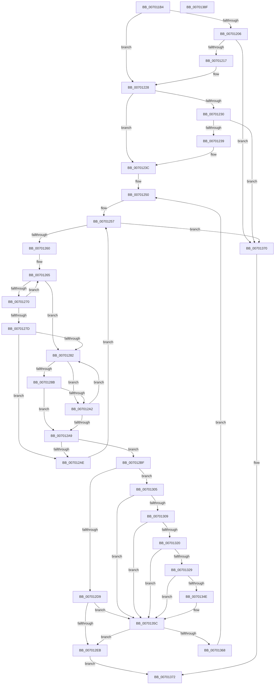

# MiScrubLargePageRegions

- RVA: `0x007011B4`–`0x00701390` (길이 `476` bytes)
- VA: `0x00000001407011B4`
- 실행 섹션: `PAGE`
- PDB 이름 있음: `예`; PDB Function 태그: `아니요`
- unwind 정보 RVA: `0x00075C18`
- 디코드: `137`개 명령, `476/476` bytes 표시
- 미해석 바이트: `0` (있으면 어셈블리에 `.byte`로 보존)

> 이 문서는 커널 이미지의 기계어와 PDB 기호를 분석해 생성했습니다. 4번과 5번은 함수 원형과 자료형을 바이너리 사용 방식에서 추정한 C 해석이며 원본 소스 복구 결과는 아닙니다.

## 1. Dependencies

- 직접 호출 지점: **5**; 고유 호출 대상: **5**
- 직접 호출자로 확인된 함수: **1**
- RIP 상대 이미지 참조: **1**

### Outgoing calls
- `0x00701299` → [MiGetPfnPageSizeIndex](../../text/31/MiGetPfnPageSizeIndex_function_0031C710.md) (function, `0x0031C710`)
- `0x007012E2` → [MiScrubLargePage](../../text/69/MiScrubLargePage_function_006942E8.md) (function, `0x006942E8`)
- `0x0070133A` → [MiGetLeafVa](../../text/27/MiGetLeafVa_function_0027C0A0.md) (function, `0x0027C0A0`)
- `0x00701357` → [MiScrubActiveLargePage](../80/MiScrubActiveLargePage_function_0080ED58.md) (function, `0x0080ED58`)
- `0x0070135F` → [MiScrubInterrupted](../../text/49/MiScrubInterrupted_function_00495894.md) (function, `0x00495894`)

### Direct callers
- [MiScrubNode](../A4/MiScrubNode_function_00A46098.md) at `0x00A462A9`

### Static image references
- `0x00701250` → RVA `0x00011C60` (`.rdata`; read)

## 2. Other-region calls and transfers

- 다른 실행 섹션으로 향하는 call: **4**
  - `0x00701299` → [MiGetPfnPageSizeIndex](../../text/31/MiGetPfnPageSizeIndex_function_0031C710.md) (`PAGE` → `.text`)
  - `0x007012E2` → [MiScrubLargePage](../../text/69/MiScrubLargePage_function_006942E8.md) (`PAGE` → `.text`)
  - `0x0070133A` → [MiGetLeafVa](../../text/27/MiGetLeafVa_function_0027C0A0.md) (`PAGE` → `.text`)
  - `0x0070135F` → [MiScrubInterrupted](../../text/49/MiScrubInterrupted_function_00495894.md) (`PAGE` → `.text`)
- 별도 외부 분기/꼬리 이동을 확인하지 못했습니다.

## 3. Assembly (complete function range)

```asm
007011B4  48 89 5C 24 08                  mov qword ptr [rsp + 8], rbx
007011B9  48 89 6C 24 10                  mov qword ptr [rsp + 0x10], rbp
007011BE  48 89 74 24 18                  mov qword ptr [rsp + 0x18], rsi
007011C3  57                              push rdi
007011C4  41 54                           push r12
007011C6  41 55                           push r13
007011C8  41 56                           push r14
007011CA  41 57                           push r15
007011CC  48 83 EC 20                     sub rsp, 0x20
007011D0  49 8B F8                        mov rdi, r8
007011D3  48 8B DA                        mov rbx, rdx
007011D6  4C 8B F9                        mov r15, rcx
007011D9  4C 8B E2                        mov r12, rdx
007011DC  48 B8 00 00 00 00 00 DE FF FF   movabs rax, 0xffffde0000000000
007011E6  48 8B F2                        mov rsi, rdx
007011E9  48 2B F0                        sub rsi, rax
007011EC  48 B8 AB AA AA AA AA AA AA AA   movabs rax, 0xaaaaaaaaaaaaaaab
007011F6  48 C1 FE 04                     sar rsi, 4
007011FA  48 0F AF F0                     imul rsi, rax
007011FE  48 8B C6                        mov rax, rsi
00701201  83 E0 0F                        and eax, 0xf
00701204  74 22                           je 0x140701228
00701206  B9 10 00 00 00                  mov ecx, 0x10
0070120B  48 2B C8                        sub rcx, rax
0070120E  49 3B C8                        cmp rcx, r8
00701211  0F 83 59 01 00 00               jae 0x140701370
00701217  48 8D 04 49                     lea rax, [rcx + rcx*2]
0070121B  48 03 F1                        add rsi, rcx
0070121E  48 C1 E0 04                     shl rax, 4
00701222  48 03 D8                        add rbx, rax
00701225  48 2B F9                        sub rdi, rcx
00701228  48 8B C7                        mov rax, rdi
0070122B  83 E0 0F                        and eax, 0xf
0070122E  74 0C                           je 0x14070123c
00701230  48 3B C7                        cmp rax, rdi
00701233  0F 83 37 01 00 00               jae 0x140701370
00701239  48 2B F8                        sub rdi, rax
0070123C  48 8D 04 7F                     lea rax, [rdi + rdi*2]
00701240  41 BD 02 00 00 00               mov r13d, 2
00701246  48 C1 E0 04                     shl rax, 4
0070124A  48 03 D8                        add rbx, rax
0070124D  48 03 F7                        add rsi, rdi
00701250  4C 8D 35 09 0A 91 FF            lea r14, [rip - 0x6ef5f7]
00701257  48 85 FF                        test rdi, rdi
0070125A  0F 84 10 01 00 00               je 0x140701370
00701260  33 ED                           xor ebp, ebp
00701262  49 8B CE                        mov rcx, r14
00701265  48 8B 01                        mov rax, qword ptr [rcx]
00701268  48 FF C8                        dec rax
0070126B  48 85 C6                        test rsi, rax
0070126E  74 12                           je 0x140701282
00701270  FF C5                           inc ebp
00701272  48 83 C1 08                     add rcx, 8
00701276  8B C5                           mov eax, ebp
00701278  41 3B ED                        cmp ebp, r13d
0070127B  72 E8                           jb 0x140701265
0070127D  41 3B C5                        cmp eax, r13d
00701280  77 2C                           ja 0x1407012ae
00701282  49 8B 0C EE                     mov rcx, qword ptr [r14 + rbp*8]
00701286  48 3B CF                        cmp rcx, rdi
00701289  77 17                           ja 0x1407012a2
0070128B  48 8D 04 49                     lea rax, [rcx + rcx*2]
0070128F  48 8B CB                        mov rcx, rbx
00701292  48 C1 E0 04                     shl rax, 4
00701296  48 2B C8                        sub rcx, rax
00701299  E8 72 B4 C1 FF                  call 0x14031c710
0070129E  3B C5                           cmp eax, ebp
007012A0  74 07                           je 0x1407012a9
007012A2  FF C5                           inc ebp
007012A4  41 3B ED                        cmp ebp, r13d
007012A7  76 D9                           jbe 0x140701282
007012A9  41 3B ED                        cmp ebp, r13d
007012AC  76 11                           jbe 0x1407012bf
007012AE  48 83 EF 10                     sub rdi, 0x10
007012B2  48 81 EB 00 03 00 00            sub rbx, 0x300
007012B9  48 83 EE 10                     sub rsi, 0x10
007012BD  EB 98                           jmp 0x140701257
007012BF  0F AE E8                        lfence
007012C2  4D 8B 34 EE                     mov r14, qword ptr [r14 + rbp*8]
007012C6  49 6B C6 D0                     imul rax, r14, -0x30
007012CA  49 2B F6                        sub rsi, r14
007012CD  48 03 D8                        add rbx, rax
007012D0  8A 43 22                        mov al, byte ptr [rbx + 0x22]
007012D3  24 07                           and al, 7
007012D5  3C 01                           cmp al, 1
007012D7  77 2C                           ja 0x140701305
007012D9  44 8B C5                        mov r8d, ebp
007012DC  48 8B D6                        mov rdx, rsi
007012DF  49 8B CF                        mov rcx, r15
007012E2  E8 01 30 F9 FF                  call 0x1406942e8
007012E7  85 C0                           test eax, eax
007012E9  75 71                           jne 0x14070135c
007012EB  49 2B DC                        sub rbx, r12
007012EE  48 B8 AB AA AA AA AA AA AA AA   movabs rax, 0xaaaaaaaaaaaaaaab
007012F8  48 C1 FB 04                     sar rbx, 4
007012FC  48 0F AF C3                     imul rax, rbx
00701300  49 03 C6                        add rax, r14
00701303  EB 6D                           jmp 0x140701372
00701305  3C 06                           cmp al, 6
00701307  75 53                           jne 0x14070135c
00701309  48 8B 43 18                     mov rax, qword ptr [rbx + 0x18]
0070130D  48 B9 FF FF FF FF FF FF FF 3F   movabs rcx, 0x3fffffffffffffff
00701317  48 23 C1                        and rax, rcx
0070131A  48 83 F8 01                     cmp rax, 1
0070131E  75 3C                           jne 0x14070135c
00701320  8B 43 20                        mov eax, dword ptr [rbx + 0x20]
00701323  66 41 3B C5                     cmp ax, r13w
00701327  75 33                           jne 0x14070135c
00701329  48 8B 4B 08                     mov rcx, qword ptr [rbx + 8]
0070132D  48 B8 00 00 00 00 00 00 00 80   movabs rax, 0x8000000000000000
00701337  48 0B C8                        or rcx, rax
0070133A  E8 61 AD B7 FF                  call 0x14027c0a0
0070133F  48 B9 FF FF FE FF FF 7F 00 00   movabs rcx, 0x7ffffffeffff
00701349  48 3B C1                        cmp rax, rcx
0070134C  77 0E                           ja 0x14070135c
0070134E  44 8B C5                        mov r8d, ebp
00701351  48 8B D6                        mov rdx, rsi
00701354  49 8B CF                        mov rcx, r15
00701357  E8 FC D9 10 00                  call 0x14080ed58
0070135C  49 8B CF                        mov rcx, r15
0070135F  E8 30 45 D9 FF                  call 0x140495894
00701364  85 C0                           test eax, eax
00701366  75 83                           jne 0x1407012eb
00701368  49 2B FE                        sub rdi, r14
0070136B  E9 E0 FE FF FF                  jmp 0x140701250
00701370  33 C0                           xor eax, eax
00701372  48 8B 5C 24 50                  mov rbx, qword ptr [rsp + 0x50]
00701377  48 8B 6C 24 58                  mov rbp, qword ptr [rsp + 0x58]
0070137C  48 8B 74 24 60                  mov rsi, qword ptr [rsp + 0x60]
00701381  48 83 C4 20                     add rsp, 0x20
00701385  41 5F                           pop r15
00701387  41 5E                           pop r14
00701389  41 5D                           pop r13
0070138B  41 5C                           pop r12
0070138D  5F                              pop rdi
0070138E  C3                              ret
0070138F  CC                              int3
```

## 4. C-style interpretation (structured pseudocode)

```c
__int64 __fastcall MiScrubLargePageRegions(__int64 a1, __int64 a2, __int64 a3)
{
    __int64 result;
    __int64 v_rbp;
    __int64 v_rbx;
    __int64 v_rdi;
    __int64 v_rsi;
    __int64 v_rsp;
    unsigned __int64 v_stack_p10;
    unsigned __int64 v_stack_p18;
    unsigned __int64 v_stack_p8;

    v_stack_p8 = v_rbx;
    v_stack_p10 = v_rbp;
    v_stack_p18 = v_rsi;
    v_rsp = (v_rsp) - (32);
    v_rsi = (a2) - (result);
    v_rsi = (v_rsi) >> (4);
    v_rsi = (v_rsi) * (result);
    result = (unsigned int)((v_rsi) & (15));
    if (condition_is_equal) goto loc_00701228;
    a1 = (16) - (result);
    if (a1 >= a3) goto loc_00701370;
    v_rsi = (v_rsi) + (a1);
    result = (a1 + a1 * 2) << (4);
    v_rbx = (a2) + (result);
    v_rdi = (a3) - (a1);
loc_00701228:
    result = (unsigned int)((v_rdi) & (15));
    if (condition_is_equal) goto loc_0070123C;
    if (result >= v_rdi) goto loc_00701370;
    v_rdi = (v_rdi) - (result);
loc_0070123C:
    result = (v_rdi + v_rdi * 2) << (4);
    v_rbx = (v_rbx) + (result);
    v_rsi = (v_rsi) + (v_rdi);
loc_00701250:
loc_00701257:
    if (v_rdi == 0) goto loc_00701370;
    v_rbp = 0;
loc_00701265:
    result = (*(unsigned __int64 *)(v_rip - 7271927)) - 1;
    if (((v_rsi) & (result)) == 0) goto loc_00701282;
    v_rbp = (unsigned int)((v_rbp) + 1);
    a1 = (v_rip - 7271927) + (8);
    if (((unsigned int)(v_rbp)) < 2) goto loc_00701265;
    if (((unsigned int)((unsigned int)((unsigned int)(v_rbp)))) > 2) goto loc_007012AE;
loc_00701282:
    if ((*(unsigned __int64 *)(v_rip - 7271927 + v_rbp * 8)) > v_rdi) goto loc_007012A2;
    result = (*(unsigned __int64 *)(v_rip - 7271927 + v_rbp * 8) + *(unsigned __int64 *)(v_rip - 7271927 + v_rbp * 8) * 2) << (4);
    a1 = (v_rbx) - (result);
    result = MiGetPfnPageSizeIndex(a1, a2, a3, a4);
    if (((unsigned int)(result)) == ((unsigned int)(v_rbp))) goto loc_007012A9;
loc_007012A2:
    v_rbp = (unsigned int)((v_rbp) + 1);
    if (((unsigned int)(v_rbp)) <= 2) goto loc_00701282;
loc_007012A9:
    if (((unsigned int)(v_rbp)) <= 2) goto loc_007012BF;
loc_007012AE:
    v_rdi = (v_rdi) - (16);
    v_rbx = (v_rbx) - (768);
    v_rsi = (v_rsi) - (16);
    goto loc_00701257;
loc_007012BF:
    result = (result) * (*(unsigned __int64 *)(v_rip - 7271927 + v_rbp * 8));
    v_rsi = (v_rsi) - (*(unsigned __int64 *)(v_rip - 7271927 + v_rbp * 8));
    v_rbx = (v_rbx) + (result);
    result = (unsigned __int8)((*(unsigned __int8 *)(v_rbx + 34)) & (7));
    if (((unsigned __int8)(result)) > 1) goto loc_00701305;
    result = MiScrubLargePage(a1, v_rsi, (unsigned int)((unsigned int)(v_rbp)), a4);
    if ((unsigned int)(result) != 0) goto loc_0070135C;
loc_007012EB:
    v_rbx = (v_rbx) - (a2);
    v_rbx = (v_rbx) >> (4);
    result = (result) * (v_rbx);
    result = (result) + (*(unsigned __int64 *)(v_rip - 7271927 + v_rbp * 8));
    goto loc_00701372;
loc_00701305:
    if (((unsigned __int8)(result)) != 6) goto loc_0070135C;
    result = (*(unsigned __int64 *)(v_rbx + 24)) & (a1);
    if (result != 1) goto loc_0070135C;
    if (((unsigned __int16)((unsigned int)(*(unsigned int *)(v_rbx + 32)))) != 2) goto loc_0070135C;
    a1 = (*(unsigned __int64 *)(v_rbx + 8)) | ((unsigned int)(*(unsigned int *)(v_rbx + 32)));
    result = MiGetLeafVa(a1, v_rsi, (unsigned int)((unsigned int)(v_rbp)), a4);
    if (result <= a1) {
        a3 = (unsigned int)(v_rbp);
        a2 = v_rsi;
        a1 = a1;
        result = MiScrubActiveLargePage(a1, a2, a3, a4);
    }
    result = MiScrubInterrupted(a1, a2, a3, a4);
    if ((unsigned int)(result) != 0) goto loc_007012EB;
    v_rdi = (v_rdi) - (*(unsigned __int64 *)(v_rip - 7271927 + v_rbp * 8));
    goto loc_00701250;
loc_00701370:
    result = 0;
loc_00701372:
    v_rsp = (v_rsp) + (32);
    return result;
}
```

## 5. (Beta) C Style

```c
int64_t MiScrubLargePageRegions(int64_t Arg1, void *Arg2, void *Arg3)
{
    uint8_t *arg2 = (uint8_t *)Arg2;
    uint8_t *arg3 = (uint8_t *)Arg3;

    int64_t result;
    int64_t local_rbp;
    int64_t local_rbx;
    int64_t local_rdi;
    int64_t local_rsi;
    int64_t local_rsp;
    uint64_t v_stack_p10;
    uint64_t v_stack_p18;
    uint64_t v_stack_p8;

    v_stack_p8 = local_rbx;
    v_stack_p10 = local_rbp;
    v_stack_p18 = local_rsi;
    local_rsp = (local_rsp) - (32);
    local_rsi = (Arg2) - (result);
    local_rsi = (local_rsi) >> (4);
    local_rsi = (local_rsi) * (result);
    result = (uint32_t)((local_rsi) & (15));
    if (condition_is_equal) goto loc_00701228;
    Arg1 = (16) - (result);
    if (Arg1 >= Arg3) goto loc_00701370;
    local_rsi = (local_rsi) + (Arg1);
    result = (Arg1 + Arg1 * 2) << (4);
    local_rbx = (Arg2) + (result);
    local_rdi = (Arg3) - (Arg1);
loc_00701228:
    result = (uint32_t)((local_rdi) & (15));
    if (condition_is_equal) goto loc_0070123C;
    if (result >= local_rdi) goto loc_00701370;
    local_rdi = (local_rdi) - (result);
loc_0070123C:
    result = (local_rdi + local_rdi * 2) << (4);
    local_rbx = (local_rbx) + (result);
    local_rsi = (local_rsi) + (local_rdi);
loc_00701250:
loc_00701257:
    if (local_rdi == 0) goto loc_00701370;
    local_rbp = 0;
loc_00701265:
    result = (*(uint64_t *)(v_rip - 0x6EF5F7)) - 1;
    if (((local_rsi) & (result)) == 0) goto loc_00701282;
    local_rbp = (uint32_t)((local_rbp) + 1);
    Arg1 = (v_rip - 7271927) + (8);
    if (((uint32_t)(local_rbp)) < 2) goto loc_00701265;
    if (((uint32_t)((uint32_t)((uint32_t)(local_rbp)))) > 2) goto loc_007012AE;
loc_00701282:
    if ((*(uint64_t *)(v_rip - 0x6EF5F7 + local_rbp * 8)) > local_rdi) goto loc_007012A2;
    result = (*(uint64_t *)(v_rip - 0x6EF5F7 + local_rbp * 8) + *(uint64_t *)(v_rip - 0x6EF5F7 + local_rbp * 8) * 2) << (4);
    Arg1 = (local_rbx) - (result);
    result = MiGetPfnPageSizeIndex(Arg1, Arg2, Arg3, a4);
    if (((uint32_t)(result)) == ((uint32_t)(local_rbp))) goto loc_007012A9;
loc_007012A2:
    local_rbp = (uint32_t)((local_rbp) + 1);
    if (((uint32_t)(local_rbp)) <= 2) goto loc_00701282;
loc_007012A9:
    if (((uint32_t)(local_rbp)) <= 2) goto loc_007012BF;
loc_007012AE:
    local_rdi = (local_rdi) - (16);
    local_rbx = (local_rbx) - (768);
    local_rsi = (local_rsi) - (16);
    goto loc_00701257;
loc_007012BF:
    result = (result) * (*(uint64_t *)(v_rip - 0x6EF5F7 + local_rbp * 8));
    local_rsi = (local_rsi) - (*(uint64_t *)(v_rip - 0x6EF5F7 + local_rbp * 8));
    local_rbx = (local_rbx) + (result);
    result = (uint8_t)((*(uint8_t *)(local_rbx + 0x22)) & (7));
    if (((uint8_t)(result)) > 1) goto loc_00701305;
    result = MiScrubLargePage(Arg1, local_rsi, (uint32_t)((uint32_t)(local_rbp)), a4);
    if ((uint32_t)(result) != 0) goto loc_0070135C;
loc_007012EB:
    local_rbx = (local_rbx) - (Arg2);
    local_rbx = (local_rbx) >> (4);
    result = (result) * (local_rbx);
    result = (result) + (*(uint64_t *)(v_rip - 0x6EF5F7 + local_rbp * 8));
    goto loc_00701372;
loc_00701305:
    if (((uint8_t)(result)) != 6) goto loc_0070135C;
    result = (*(uint64_t *)(local_rbx + 0x18)) & (Arg1);
    if (result != 1) goto loc_0070135C;
    if (((uint16_t)((uint32_t)(*(uint32_t *)(local_rbx + 0x20)))) != 2) goto loc_0070135C;
    Arg1 = (*(uint64_t *)(local_rbx + 0x8)) | ((uint32_t)(*(uint32_t *)(local_rbx + 0x20)));
    result = MiGetLeafVa(Arg1, local_rsi, (uint32_t)((uint32_t)(local_rbp)), a4);
    if (result <= Arg1) {
        Arg3 = (uint32_t)(local_rbp);
        Arg2 = local_rsi;
        Arg1 = Arg1;
        result = MiScrubActiveLargePage(Arg1, Arg2, Arg3, a4);
    }
    result = MiScrubInterrupted(Arg1, Arg2, Arg3, a4);
    if ((uint32_t)(result) != 0) goto loc_007012EB;
    local_rdi = (local_rdi) - (*(uint64_t *)(v_rip - 0x6EF5F7 + local_rbp * 8));
    goto loc_00701250;
loc_00701370:
    result = 0;
loc_00701372:
    local_rsp = (local_rsp) + (32);
    return result;
}
```

### 관측된 메모리 오프셋

구조체 형식이 확인되지 않은 접근은 인자 기준의 오프셋으로만 기록했습니다.

| 기준 인자 | 오프셋 표현 | 폭 (bit) | 접근 |
|---|---:|---:|---|
| `Arg2` | `+ 0x8` | `64` | `R` |
| `Arg2` | `+ 0x18` | `64` | `R` |
| `Arg2` | `+ 0x20` | `32` | `R` |
| `Arg2` | `+ 0x22` | `8` | `R` |
| `Arg3` | `+ 0x0 + rdi*2` | `64` | `R` |

## 6. Execution-region graph

[열기: 2D/3D 그래프와 함수 탐색 컨트롤 패널](../../../control-panel.html?section=page&rva=0x007011B4&view=graph)

- 2D 그래프는 위에서 아래로 흐르고, 3D 그래프는 빈 공간을 드래그해 회전합니다. Shift+드래그는 이동, 휠은 확대·축소, 함수 노드 선택은 대상 보고서 이동입니다.

### Static fallback


