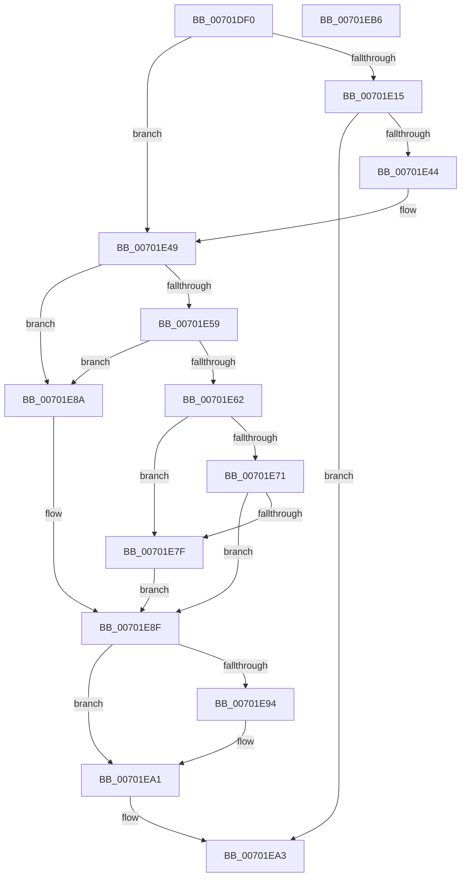

# MmGetSectionStrongImageReference

- RVA: `0x00701DF0`–`0x00701EB7` (길이 `199` bytes)
- VA: `0x0000000140701DF0`
- 실행 섹션: `PAGE`
- PDB 이름 있음: `예`; PDB Function 태그: `아니요`
- unwind 정보 RVA: `0x000BEB4C`
- 디코드: `60`개 명령, `199/199` bytes 표시
- 미해석 바이트: `0` (있으면 어셈블리에 `.byte`로 보존)

> 이 문서는 커널 이미지의 기계어와 PDB 기호를 분석해 생성했습니다. 4번과 5번은 함수 원형과 자료형을 바이너리 사용 방식에서 추정한 C 해석이며 원본 소스 복구 결과는 아닙니다.

## 1. Dependencies

- 직접 호출 지점: **4**; 고유 호출 대상: **4**
- 직접 호출자로 확인된 함수: **3**
- RIP 상대 이미지 참조: **1**

### Outgoing calls
- `0x00701E3B` → [ObpReferenceObjectByHandleWithTag](../86/ObpReferenceObjectByHandleWithTag_function_00869650.md) (function, `0x00869650`)
- `0x00701E4C` → [MiSectionControlArea](../../text/29/MiSectionControlArea_function_00294CB0.md) (function, `0x00294CB0`)
- `0x00701E74` → [MiGetSectionStrongImageReference](../93/MiGetSectionStrongImageReference_function_0093E9C0.md) (function, `0x0093E9C0`)
- `0x00701E9C` → [ObfDereferenceObjectWithTag](../../text/2F/ObfDereferenceObjectWithTag_function_002F78E0.md) (function, `0x002F78E0`)

### Direct callers
- [PsDispatchIumService](../../text/4A/PsDispatchIumService_function_004A2F0C.md) at `0x004A3237`
- [sub_006F88AE](../../text/6F/Unknown_function_006F88AE.md) at `0x006F8FE7`
- [PspAllocateProcess](../A1/PspAllocateProcess_function_00A13B3C.md) at `0x00A1628C`

### Static image references
- `0x00701E26` → RVA `0x00FC6BD8` (`ALMOSTRO`; read)

## 2. Other-region calls and transfers

- 다른 실행 섹션으로 향하는 call: **2**
  - `0x00701E4C` → [MiSectionControlArea](../../text/29/MiSectionControlArea_function_00294CB0.md) (`PAGE` → `.text`)
  - `0x00701E9C` → [ObfDereferenceObjectWithTag](../../text/2F/ObfDereferenceObjectWithTag_function_002F78E0.md) (`PAGE` → `.text`)
- 별도 외부 분기/꼬리 이동을 확인하지 못했습니다.

## 3. Assembly (complete function range)

```asm
00701DF0  4C 8B DC                        mov r11, rsp
00701DF3  49 89 5B 08                     mov qword ptr [r11 + 8], rbx
00701DF7  49 89 6B 10                     mov qword ptr [r11 + 0x10], rbp
00701DFB  4D 89 43 18                     mov qword ptr [r11 + 0x18], r8
00701DFF  56                              push rsi
00701E00  57                              push rdi
00701E01  41 56                           push r14
00701E03  48 83 EC 40                     sub rsp, 0x40
00701E07  4D 8B F1                        mov r14, r9
00701E0A  49 8B F0                        mov rsi, r8
00701E0D  48 8B E9                        mov rbp, rcx
00701E10  48 85 C9                        test rcx, rcx
00701E13  74 34                           je 0x140701e49
00701E15  49 83 63 E0 00                  and qword ptr [r11 - 0x20], 0
00701E1A  49 8D 43 18                     lea rax, [r11 + 0x18]
00701E1E  49 83 63 D8 00                  and qword ptr [r11 - 0x28], 0
00701E23  44 8A CA                        mov r9b, dl
00701E26  4C 8B 05 AB 4D 8C 00            mov r8, qword ptr [rip + 0x8c4dab]
00701E2D  33 D2                           xor edx, edx
00701E2F  49 89 43 D0                     mov qword ptr [r11 - 0x30], rax
00701E33  C7 44 24 20 4D 6D 53 63         mov dword ptr [rsp + 0x20], 0x63536d4d
00701E3B  E8 10 78 16 00                  call 0x140869650
00701E40  85 C0                           test eax, eax
00701E42  78 5F                           js 0x140701ea3
00701E44  48 8B 74 24 70                  mov rsi, qword ptr [rsp + 0x70]
00701E49  48 8B CE                        mov rcx, rsi
00701E4C  E8 5F 2E B9 FF                  call 0x140294cb0
00701E51  8B 48 38                        mov ecx, dword ptr [rax + 0x38]
00701E54  F6 C1 20                        test cl, 0x20
00701E57  74 31                           je 0x140701e8a
00701E59  F7 40 5C 00 00 0C 00            test dword ptr [rax + 0x5c], 0xc0000
00701E60  74 28                           je 0x140701e8a
00701E62  48 8B 78 60                     mov rdi, qword ptr [rax + 0x60]
00701E66  48 83 E7 F8                     and rdi, 0xfffffffffffffff8
00701E6A  48 83 7F 40 00                  cmp qword ptr [rdi + 0x40], 0
00701E6F  75 0E                           jne 0x140701e7f
00701E71  48 8B CF                        mov rcx, rdi
00701E74  E8 47 CB 23 00                  call 0x14093e9c0
00701E79  8B D8                           mov ebx, eax
00701E7B  85 C0                           test eax, eax
00701E7D  78 10                           js 0x140701e8f
00701E7F  48 8B 47 40                     mov rax, qword ptr [rdi + 0x40]
00701E83  33 DB                           xor ebx, ebx
00701E85  49 89 06                        mov qword ptr [r14], rax
00701E88  EB 05                           jmp 0x140701e8f
00701E8A  BB 0D 00 00 C0                  mov ebx, 0xc000000d
00701E8F  48 85 ED                        test rbp, rbp
00701E92  74 0D                           je 0x140701ea1
00701E94  BA 4D 6D 53 63                  mov edx, 0x63536d4d
00701E99  48 8B CE                        mov rcx, rsi
00701E9C  E8 3F 5A BF FF                  call 0x1402f78e0
00701EA1  8B C3                           mov eax, ebx
00701EA3  48 8B 5C 24 60                  mov rbx, qword ptr [rsp + 0x60]
00701EA8  48 8B 6C 24 68                  mov rbp, qword ptr [rsp + 0x68]
00701EAD  48 83 C4 40                     add rsp, 0x40
00701EB1  41 5E                           pop r14
00701EB3  5F                              pop rdi
00701EB4  5E                              pop rsi
00701EB5  C3                              ret
00701EB6  CC                              int3
```

## 4. C-style interpretation (structured pseudocode)

```c
__int64 __fastcall MmGetSectionStrongImageReference(__int64 a1, int a2, __int64 a3, __int64 a4)
{
    __int64 result;
    __int64 v_rbx;
    __int64 v_rdi;
    __int64 v_rsp;
    unsigned int v_stack_m38;
    unsigned __int64 v_stack_p10;
    unsigned __int64 v_stack_p18;
    unsigned __int64 v_stack_p8;

    *(unsigned __int64 *)(v_rsp + 8) = v_rbx;
    *(unsigned __int64 *)(v_rsp + 16) = v_rbp;
    *(unsigned __int64 *)(v_rsp + 24) = a3;
    v_rsp = (v_rsp) - (64);
    if (a1 == 0) goto loc_00701E49;
    a2 = 0;
    *(unsigned __int64 *)(v_rsp - 48) = v_rsp + 24;
    v_stack_m38 = 0x63536D4DULL;
    result = ObpReferenceObjectByHandleWithTag(a1, a2, *(unsigned __int64 *)(v_rip + 9194923), (unsigned __int8)(a2));
    if (sign_flag) goto loc_00701EA3;
loc_00701E49:
    result = MiSectionControlArea(v_stack_p18, a2, *(unsigned __int64 *)(v_rip + 9194923), (unsigned __int8)(a2));
    if ((((unsigned __int8)((unsigned int)(*(unsigned int *)(result + 56)))) & (32)) == 0) goto loc_00701E8A;
    if (((*(unsigned int *)(result + 92)) & (0xC0000ULL)) == 0) goto loc_00701E8A;
    v_rdi = (*(unsigned __int64 *)(result + 96)) & (-8);
    if ((*(unsigned __int64 *)(v_rdi + 64)) != 0) goto loc_00701E7F;
    result = MiGetSectionStrongImageReference(v_rdi, a2, *(unsigned __int64 *)(v_rip + 9194923), (unsigned __int8)(a2));
    if (sign_flag) goto loc_00701E8F;
loc_00701E7F:
    v_rbx = 0;
    *(unsigned __int64 *)(a4) = *(unsigned __int64 *)(v_rdi + 64);
    goto loc_00701E8F;
loc_00701E8A:
loc_00701E8F:
    result = *(unsigned __int64 *)(v_rdi + 64);
    if (a1 != 0) {
        a2 = 0x63536D4DULL;
        a1 = v_stack_p18;
        result = ObfDereferenceObjectWithTag(a1, a2, *(unsigned __int64 *)(v_rip + 9194923), (unsigned __int8)(a2));
    }
loc_00701EA3:
    v_rsp = (v_rsp) + (64);
    return (unsigned int)((unsigned int)((unsigned int)(0xC000000DULL)));
}
```

## 5. (Beta) C Style

```c
int64_t MmGetSectionStrongImageReference(int64_t Arg1, int32_t Arg2, int64_t Arg3, void *Arg4)
{
    uint8_t *arg4 = (uint8_t *)Arg4;

    int64_t result;
    int64_t local_rbx;
    int64_t local_rdi;
    int64_t local_rsp;
    uint32_t v_stack_m38;
    uint64_t v_stack_p10;
    uint64_t v_stack_p18;
    uint64_t v_stack_p8;

    *(uint64_t *)(local_rsp + 0x8) = local_rbx;
    *(uint64_t *)(local_rsp + 0x10) = local_rbp;
    *(uint64_t *)(local_rsp + 0x18) = Arg3;
    local_rsp = (local_rsp) - (64);
    if (Arg1 == 0) goto loc_00701E49;
    Arg2 = 0;
    *(uint64_t *)(local_rsp - 0x30) = local_rsp + 24;
    v_stack_m38 = 0x63536D4DULL;
    result = ObpReferenceObjectByHandleWithTag(Arg1, Arg2, *(uint64_t *)(v_rip + 0x8C4DAB), (uint8_t)(Arg2));
    if (sign_flag) goto loc_00701EA3;
loc_00701E49:
    result = MiSectionControlArea(v_stack_p18, Arg2, *(uint64_t *)(v_rip + 0x8C4DAB), (uint8_t)(Arg2));
    if ((((uint8_t)((uint32_t)(*(uint32_t *)(result + 0x38)))) & (32)) == 0) goto loc_00701E8A;
    if (((*(uint32_t *)(result + 0x5C)) & (0xC0000ULL)) == 0) goto loc_00701E8A;
    local_rdi = (*(uint64_t *)(result + 0x60)) & (-8);
    if ((*(uint64_t *)(local_rdi + 0x40)) != 0) goto loc_00701E7F;
    result = MiGetSectionStrongImageReference(local_rdi, Arg2, *(uint64_t *)(v_rip + 0x8C4DAB), (uint8_t)(Arg2));
    if (sign_flag) goto loc_00701E8F;
loc_00701E7F:
    local_rbx = 0;
    *(uint64_t *)(arg4) = *(uint64_t *)(local_rdi + 0x40);
    goto loc_00701E8F;
loc_00701E8A:
loc_00701E8F:
    result = *(uint64_t *)(local_rdi + 0x40);
    if (Arg1 != 0) {
        Arg2 = 0x63536D4DULL;
        Arg1 = v_stack_p18;
        result = ObfDereferenceObjectWithTag(Arg1, Arg2, *(uint64_t *)(v_rip + 0x8C4DAB), (uint8_t)(Arg2));
    }
loc_00701EA3:
    local_rsp = (local_rsp) + (64);
    return (uint32_t)((uint32_t)((uint32_t)(0xC000000DULL)));
}
```

### 관측된 메모리 오프셋

구조체 형식이 확인되지 않은 접근은 인자 기준의 오프셋으로만 기록했습니다.

| 기준 인자 | 오프셋 표현 | 폭 (bit) | 접근 |
|---|---:|---:|---|
| `Arg4` | `+ 0x0` | `64` | `W` |

## 6. Execution-region graph

[열기: 2D/3D 그래프와 함수 탐색 컨트롤 패널](../../../control-panel.html?section=page&rva=0x00701DF0&view=graph)

- 2D 그래프는 위에서 아래로 흐르고, 3D 그래프는 빈 공간을 드래그해 회전합니다. Shift+드래그는 이동, 휠은 확대·축소, 함수 노드 선택은 대상 보고서 이동입니다.

### Static fallback


