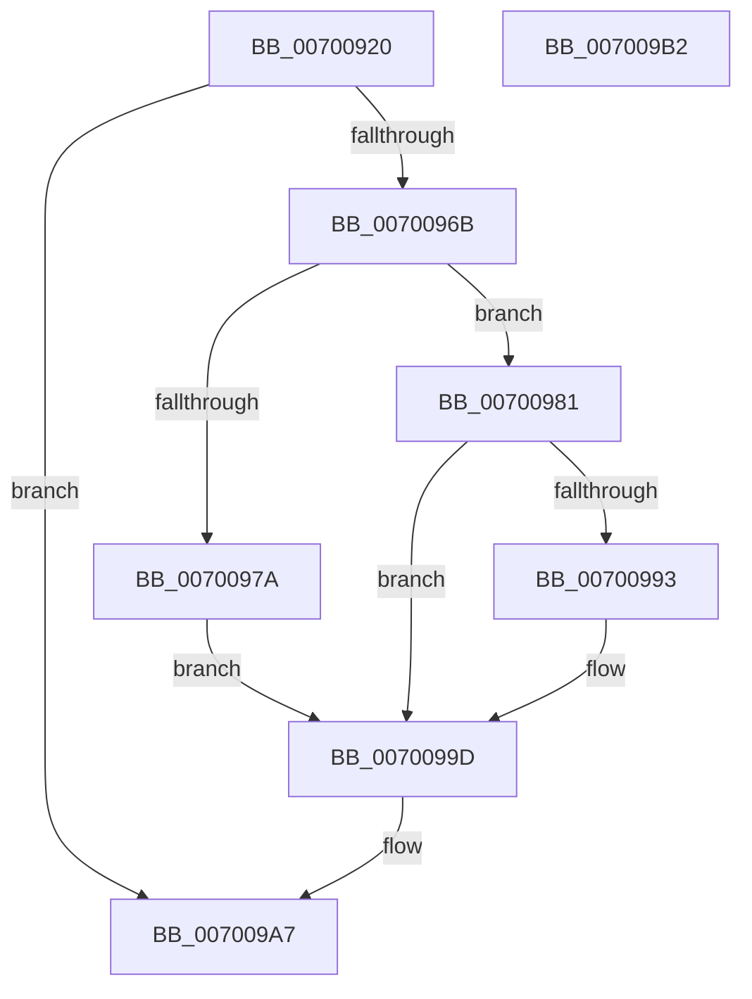

# NtDeletePrivateNamespace

- RVA: `0x00700920`–`0x007009B3` (길이 `147` bytes)
- VA: `0x0000000140700920`
- 실행 섹션: `PAGE`
- PDB 이름 있음: `예`; PDB Function 태그: `아니요`
- unwind 정보 RVA: `0x00084AC0`
- 디코드: `38`개 명령, `147/147` bytes 표시
- 미해석 바이트: `0` (있으면 어셈블리에 `.byte`로 보존)

> 이 문서는 커널 이미지의 기계어와 PDB 기호를 분석해 생성했습니다. 4번과 5번은 함수 원형과 자료형을 바이너리 사용 방식에서 추정한 C 해석이며 원본 소스 복구 결과는 아닙니다.

## 1. Dependencies

- 직접 호출 지점: **4**; 고유 호출 대상: **4**
- 직접 호출자로 확인된 함수: **0**
- RIP 상대 이미지 참조: **1**

### Outgoing calls
- `0x00700962` → [ObReferenceObjectByHandle](../86/ObReferenceObjectByHandle_function_00868DB0.md) (function, `0x00868DB0`)
- `0x00700988` → [ObpVerifyCreatorAccessCheck](../9C/ObpVerifyCreatorAccessCheck_function_009CA524.md) (function, `0x009CA524`)
- `0x00700996` → [ObpRemoveNamespaceFromTable](../A2/ObpRemoveNamespaceFromTable_function_00A2131C.md) (function, `0x00A2131C`)
- `0x007009A0` → [ObfDereferenceObject](../../text/2F/ObfDereferenceObject_function_002F9350.md) (function, `0x002F9350`)

### Direct callers
- 이 함수 시작 RVA로 연결되는 직접 call은 확인되지 않았습니다. 간접 호출은 완전히 역산할 수 없습니다.

### Static image references
- `0x0070093A` → RVA `0x00F0F650` (`.data`; read)

## 2. Other-region calls and transfers

- 다른 실행 섹션으로 향하는 call: **1**
  - `0x007009A0` → [ObfDereferenceObject](../../text/2F/ObfDereferenceObject_function_002F9350.md) (`PAGE` → `.text`)
- 별도 외부 분기/꼬리 이동을 확인하지 못했습니다.

## 3. Assembly (complete function range)

```asm
00700920  4C 8B DC                        mov r11, rsp
00700923  49 89 5B 08                     mov qword ptr [r11 + 8], rbx
00700927  57                              push rdi
00700928  48 83 EC 30                     sub rsp, 0x30
0070092C  65 48 8B 04 25 88 01 00 00      mov rax, qword ptr gs:[0x188]
00700935  BA 00 00 01 00                  mov edx, 0x10000
0070093A  4C 8B 05 0F ED 80 00            mov r8, qword ptr [rip + 0x80ed0f]
00700941  49 83 63 18 00                  and qword ptr [r11 + 0x18], 0
00700946  49 83 63 10 00                  and qword ptr [r11 + 0x10], 0
0070094B  44 8A 88 32 02 00 00            mov r9b, byte ptr [rax + 0x232]
00700952  49 8D 43 18                     lea rax, [r11 + 0x18]
00700956  49 89 43 F0                     mov qword ptr [r11 - 0x10], rax
0070095A  49 8D 43 10                     lea rax, [r11 + 0x10]
0070095E  49 89 43 E8                     mov qword ptr [r11 - 0x18], rax
00700962  E8 49 84 16 00                  call 0x140868db0
00700967  85 C0                           test eax, eax
00700969  78 3C                           js 0x1407009a7
0070096B  48 8B 5C 24 48                  mov rbx, qword ptr [rsp + 0x48]
00700970  48 83 BB 40 01 00 00 00         cmp qword ptr [rbx + 0x140], 0
00700978  75 07                           jne 0x140700981
0070097A  BF 08 00 00 C0                  mov edi, 0xc0000008
0070097F  EB 1C                           jmp 0x14070099d
00700981  48 8D 8B 88 01 00 00            lea rcx, [rbx + 0x188]
00700988  E8 97 9B 2C 00                  call 0x1409ca524
0070098D  8B F8                           mov edi, eax
0070098F  85 C0                           test eax, eax
00700991  78 0A                           js 0x14070099d
00700993  48 8B CB                        mov rcx, rbx
00700996  E8 81 09 32 00                  call 0x140a2131c
0070099B  8B F8                           mov edi, eax
0070099D  48 8B CB                        mov rcx, rbx
007009A0  E8 AB 89 BF FF                  call 0x1402f9350
007009A5  8B C7                           mov eax, edi
007009A7  48 8B 5C 24 40                  mov rbx, qword ptr [rsp + 0x40]
007009AC  48 83 C4 30                     add rsp, 0x30
007009B0  5F                              pop rdi
007009B1  C3                              ret
007009B2  CC                              int3
```

## 4. C-style interpretation (structured pseudocode)

```c
__int64 __fastcall NtDeletePrivateNamespace(void)
{
    __int64 result;
    __int64 v_rdi;
    __int64 v_rsp;
    unsigned __int64 v_stack_p10;
    unsigned __int64 v_stack_p8;

    *(unsigned __int64 *)(v_rsp + 8) = v_rbx;
    v_rsp = (v_rsp) - (48);
    *(unsigned __int64 *)(v_rsp - 16) = v_rsp + 24;
    *(unsigned __int64 *)(v_rsp - 24) = v_rsp + 16;
    result = ObReferenceObjectByHandle(a1, (unsigned int)(0x10000ULL), *(unsigned __int64 *)(v_rip + 8449295), *(unsigned __int8 *)(*(unsigned __int64 *)(gs_base + (0 + 392)) + 562));
    if (sign_flag) goto loc_007009A7;
    if ((*(unsigned __int64 *)(v_stack_p10 + 320)) != 0) goto loc_00700981;
    goto loc_0070099D;
loc_00700981:
    result = ObpVerifyCreatorAccessCheck(v_stack_p10 + 392, (unsigned int)(0x10000ULL), *(unsigned __int64 *)(v_rip + 8449295), *(unsigned __int8 *)(*(unsigned __int64 *)(gs_base + (0 + 392)) + 562));
    v_rdi = (unsigned int)((unsigned int)(result));
    if (!(sign_flag)) {
        a1 = v_stack_p10;
        result = ObpRemoveNamespaceFromTable(a1, (unsigned int)(0x10000ULL), *(unsigned __int64 *)(v_rip + 8449295), *(unsigned __int8 *)(*(unsigned __int64 *)(gs_base + (0 + 392)) + 562));
        v_rdi = (unsigned int)(result);
    }
    result = ObfDereferenceObject(v_stack_p10, (unsigned int)(0x10000ULL), *(unsigned __int64 *)(v_rip + 8449295), *(unsigned __int8 *)(*(unsigned __int64 *)(gs_base + (0 + 392)) + 562));
loc_007009A7:
    v_rsp = (v_rsp) + (48);
    return (unsigned int)((unsigned int)(v_rdi));
}
```

## 5. (Beta) C Style

```c
void NtDeletePrivateNamespace(void)
{
    int64_t result;
    int64_t local_rdi;
    int64_t local_rsp;
    uint64_t v_stack_p10;
    uint64_t v_stack_p8;

    *(uint64_t *)(local_rsp + 0x8) = local_rbx;
    local_rsp = (local_rsp) - (48);
    *(uint64_t *)(local_rsp - 0x10) = local_rsp + 24;
    *(uint64_t *)(local_rsp - 0x18) = local_rsp + 16;
    result = ObReferenceObjectByHandle(a1, (uint32_t)(0x10000ULL), *(uint64_t *)(v_rip + 0x80ED0F), *(uint8_t *)(*(uint64_t *)(gs_base + (0 + 0x188)) + 0x232));
    if (sign_flag) goto loc_007009A7;
    if ((*(uint64_t *)(v_stack_p10 + 0x140)) != 0) goto loc_00700981;
    goto loc_0070099D;
loc_00700981:
    result = ObpVerifyCreatorAccessCheck(v_stack_p10 + 392, (uint32_t)(0x10000ULL), *(uint64_t *)(v_rip + 0x80ED0F), *(uint8_t *)(*(uint64_t *)(gs_base + (0 + 0x188)) + 0x232));
    local_rdi = (uint32_t)((uint32_t)(result));
    if (!(sign_flag)) {
        a1 = v_stack_p10;
        result = ObpRemoveNamespaceFromTable(a1, (uint32_t)(0x10000ULL), *(uint64_t *)(v_rip + 0x80ED0F), *(uint8_t *)(*(uint64_t *)(gs_base + (0 + 0x188)) + 0x232));
        local_rdi = (uint32_t)(result);
    }
    result = ObfDereferenceObject(v_stack_p10, (uint32_t)(0x10000ULL), *(uint64_t *)(v_rip + 0x80ED0F), *(uint8_t *)(*(uint64_t *)(gs_base + (0 + 0x188)) + 0x232));
loc_007009A7:
    local_rsp = (local_rsp) + (48);
    return (uint32_t)((uint32_t)(local_rdi));
}
```

## 6. Execution-region graph

[열기: 2D/3D 그래프와 함수 탐색 컨트롤 패널](../../../control-panel.html?section=page&rva=0x00700920&view=graph)

- 2D 그래프는 위에서 아래로 흐르고, 3D 그래프는 빈 공간을 드래그해 회전합니다. Shift+드래그는 이동, 휠은 확대·축소, 함수 노드 선택은 대상 보고서 이동입니다.

### Static fallback


