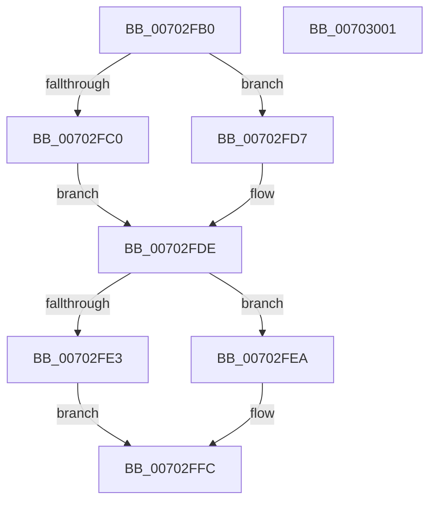

# NtOpenKeyTransactedEx_Stub

- RVA: `0x00702FB0`–`0x00703002` (길이 `82` bytes)
- VA: `0x0000000140702FB0`
- 실행 섹션: `PAGE`
- PDB 이름 있음: `예`; PDB Function 태그: `아니요`
- unwind 정보 RVA: `0x0005D2F4`
- 디코드: `20`개 명령, `82/82` bytes 표시
- 미해석 바이트: `0` (있으면 어셈블리에 `.byte`로 보존)

> 이 문서는 커널 이미지의 기계어와 PDB 기호를 분석해 생성했습니다. 4번과 5번은 함수 원형과 자료형을 바이너리 사용 방식에서 추정한 C 해석이며 원본 소스 복구 결과는 아닙니다.

## 1. Dependencies

- 직접 호출 지점: **1**; 고유 호출 대상: **1**
- 직접 호출자로 확인된 함수: **1**
- RIP 상대 이미지 참조: **5**

### Outgoing calls
- `0x00702FF7` → [guard_dispatch_icall](../../text/6B/guard_dispatch_icall_function_006BAAD0.md) (function, `0x006BAAD0`)

### Direct callers
- [sub_008EF91D](../8E/Unknown_function_008EF91D.md) at `0x008EF92D`

### Static image references
- `0x00702FB4` → RVA `0x00EEFFE0` (`.data`; read)
- `0x00702FC0` → RVA `0x006AF690` (`ZwOpenKeyTransactedEx`; read)
- `0x00702FC7` → RVA `0x00EEFFE0` (`.data`; write)
- `0x00702FCE` → RVA `0x00EEFFC8` (`.data`; write)
- `0x00702FD7` → RVA `0x00EEFFC8` (`.data`; read)

## 2. Other-region calls and transfers

- 다른 실행 섹션으로 향하는 call: **1**
  - `0x00702FF7` → [guard_dispatch_icall](../../text/6B/guard_dispatch_icall_function_006BAAD0.md) (`PAGE` → `.text`)
- 별도 외부 분기/꼬리 이동을 확인하지 못했습니다.

## 3. Assembly (complete function range)

```asm
00702FB0  48 83 EC 38                     sub rsp, 0x38
00702FB4  80 3D 25 D0 7E 00 00            cmp byte ptr [rip + 0x7ed025], 0
00702FBB  4C 8B D1                        mov r10, rcx
00702FBE  75 17                           jne 0x140702fd7
00702FC0  48 8D 05 C9 C6 FA FF            lea rax, [rip - 0x53937]
00702FC7  C6 05 12 D0 7E 00 01            mov byte ptr [rip + 0x7ed012], 1
00702FCE  48 89 05 F3 CF 7E 00            mov qword ptr [rip + 0x7ecff3], rax
00702FD5  EB 07                           jmp 0x140702fde
00702FD7  48 8B 05 EA CF 7E 00            mov rax, qword ptr [rip + 0x7ecfea]
00702FDE  48 85 C0                        test rax, rax
00702FE1  75 07                           jne 0x140702fea
00702FE3  B8 7A 00 00 C0                  mov eax, 0xc000007a
00702FE8  EB 12                           jmp 0x140702ffc
00702FEA  48 8B 4C 24 60                  mov rcx, qword ptr [rsp + 0x60]
00702FEF  48 89 4C 24 20                  mov qword ptr [rsp + 0x20], rcx
00702FF4  49 8B CA                        mov rcx, r10
00702FF7  E8 D4 7A FB FF                  call 0x1406baad0
00702FFC  48 83 C4 38                     add rsp, 0x38
00703000  C3                              ret
00703001  CC                              int3
```

## 4. C-style interpretation (structured pseudocode)

```c
__int64 __fastcall NtOpenKeyTransactedEx_Stub(__int64 a1, __int64 a2, __int64 a3, __int64 a4, __int64 a5)
{
    __int64 result;
    __int64 v_rsp;
    unsigned __int64 v_stack_m18;

    v_rsp = (v_rsp) - (56);
    if ((*(unsigned __int8 *)(v_rip + 8310821)) != 0) goto loc_00702FD7;
    *(unsigned __int8 *)(v_rip + 8310802) = 1;
    *(unsigned __int64 *)(v_rip + 8310771) = v_rip - 342327;
    goto loc_00702FDE;
loc_00702FD7:
loc_00702FDE:
    if (*(unsigned __int64 *)(v_rip + 8310762) != 0) goto loc_00702FEA;
    goto loc_00702FFC;
loc_00702FEA:
    v_stack_m18 = a5;
    result = guard_dispatch_icall(a1, a2, a3, a4);
loc_00702FFC:
    v_rsp = (v_rsp) + (56);
    return result;
}
```

## 5. (Beta) C Style

```c
int64_t NtOpenKeyTransactedEx_Stub(int64_t Arg1, int64_t Arg2, int64_t Arg3, int64_t Arg4, int64_t Arg5)
{
    int64_t result;
    int64_t local_rsp;
    uint64_t v_stack_m18;

    local_rsp = (local_rsp) - (56);
    if ((*(uint8_t *)(v_rip + 0x7ED025)) != 0) goto loc_00702FD7;
    *(uint8_t *)(v_rip + 0x7ED012) = 1;
    *(uint64_t *)(v_rip + 0x7ECFF3) = v_rip - 342327;
    goto loc_00702FDE;
loc_00702FD7:
loc_00702FDE:
    if (*(uint64_t *)(v_rip + 0x7ECFEA) != 0) goto loc_00702FEA;
    goto loc_00702FFC;
loc_00702FEA:
    v_stack_m18 = Arg5;
    result = guard_dispatch_icall(Arg1, Arg2, Arg3, Arg4);
loc_00702FFC:
    local_rsp = (local_rsp) + (56);
    return result;
}
```

## 6. Execution-region graph

[열기: 2D/3D 그래프와 함수 탐색 컨트롤 패널](../../../control-panel.html?section=page&rva=0x00702FB0&view=graph)

- 2D 그래프는 위에서 아래로 흐르고, 3D 그래프는 빈 공간을 드래그해 회전합니다. Shift+드래그는 이동, 휠은 확대·축소, 함수 노드 선택은 대상 보고서 이동입니다.

### Static fallback


