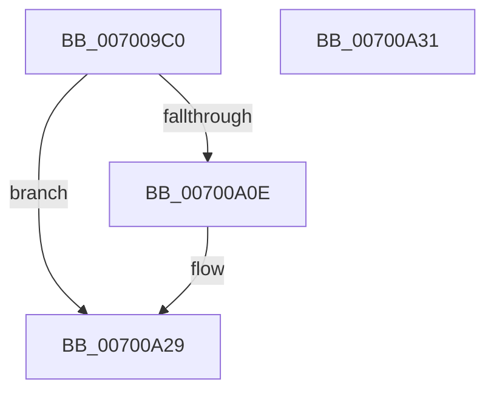

# NtResumeProcess

- RVA: `0x007009C0`–`0x00700A32` (길이 `114` bytes)
- VA: `0x00000001407009C0`
- 실행 섹션: `PAGE`
- PDB 이름 있음: `예`; PDB Function 태그: `아니요`
- unwind 정보 RVA: `0x0007F554`
- 디코드: `28`개 명령, `114/114` bytes 표시
- 미해석 바이트: `0` (있으면 어셈블리에 `.byte`로 보존)

> 이 문서는 커널 이미지의 기계어와 PDB 기호를 분석해 생성했습니다. 4번과 5번은 함수 원형과 자료형을 바이너리 사용 방식에서 추정한 C 해석이며 원본 소스 복구 결과는 아닙니다.

## 1. Dependencies

- 직접 호출 지점: **3**; 고유 호출 대상: **3**
- 직접 호출자로 확인된 함수: **0**
- RIP 상대 이미지 참조: **1**

### Outgoing calls
- `0x00700A03` → [ObpReferenceObjectByHandleWithTag](../86/ObpReferenceObjectByHandleWithTag_function_00869650.md) (function, `0x00869650`)
- `0x00700A13` → [PsMultiResumeProcess](../../text/4A/PsMultiResumeProcess_function_004A2B3C.md) (function, `0x004A2B3C`)
- `0x00700A24` → [ObfDereferenceObjectWithTag](../../text/2F/ObfDereferenceObjectWithTag_function_002F78E0.md) (function, `0x002F78E0`)

### Direct callers
- 이 함수 시작 RVA로 연결되는 직접 call은 확인되지 않았습니다. 간접 호출은 완전히 역산할 수 없습니다.

### Static image references
- `0x007009E0` → RVA `0x00FC6A98` (`ALMOSTRO`; read)

## 2. Other-region calls and transfers

- 다른 실행 섹션으로 향하는 call: **2**
  - `0x00700A13` → [PsMultiResumeProcess](../../text/4A/PsMultiResumeProcess_function_004A2B3C.md) (`PAGE` → `.text`)
  - `0x00700A24` → [ObfDereferenceObjectWithTag](../../text/2F/ObfDereferenceObjectWithTag_function_002F78E0.md) (`PAGE` → `.text`)
- 별도 외부 분기/꼬리 이동을 확인하지 못했습니다.

## 3. Assembly (complete function range)

```asm
007009C0  4C 8B DC                        mov r11, rsp
007009C3  53                              push rbx
007009C4  48 83 EC 40                     sub rsp, 0x40
007009C8  65 48 8B 04 25 88 01 00 00      mov rax, qword ptr gs:[0x188]
007009D1  BA 00 08 00 00                  mov edx, 0x800
007009D6  49 83 63 F0 00                  and qword ptr [r11 - 0x10], 0
007009DB  49 83 63 E8 00                  and qword ptr [r11 - 0x18], 0
007009E0  4C 8B 05 B1 60 8C 00            mov r8, qword ptr [rip + 0x8c60b1]
007009E7  44 8A 88 32 02 00 00            mov r9b, byte ptr [rax + 0x232]
007009EE  49 8D 43 10                     lea rax, [r11 + 0x10]
007009F2  49 83 63 10 00                  and qword ptr [r11 + 0x10], 0
007009F7  49 89 43 E0                     mov qword ptr [r11 - 0x20], rax
007009FB  C7 44 24 20 50 73 53 75         mov dword ptr [rsp + 0x20], 0x75537350
00700A03  E8 48 8C 16 00                  call 0x140869650
00700A08  8B D8                           mov ebx, eax
00700A0A  85 C0                           test eax, eax
00700A0C  78 1B                           js 0x140700a29
00700A0E  48 8B 4C 24 58                  mov rcx, qword ptr [rsp + 0x58]
00700A13  E8 24 21 DA FF                  call 0x1404a2b3c
00700A18  48 8B 4C 24 58                  mov rcx, qword ptr [rsp + 0x58]
00700A1D  BA 50 73 53 75                  mov edx, 0x75537350
00700A22  8B D8                           mov ebx, eax
00700A24  E8 B7 6E BF FF                  call 0x1402f78e0
00700A29  8B C3                           mov eax, ebx
00700A2B  48 83 C4 40                     add rsp, 0x40
00700A2F  5B                              pop rbx
00700A30  C3                              ret
00700A31  CC                              int3
```

## 4. C-style interpretation (structured pseudocode)

```c
__int64 __fastcall NtResumeProcess(void)
{
    __int64 result;
    __int64 v_rbx;
    __int64 v_rsp;
    unsigned int v_stack_m28;
    unsigned __int64 v_stack_p10;

    v_rsp = (v_rsp) - (64);
    *(unsigned __int64 *)(v_rsp - 32) = v_rsp + 16;
    v_stack_m28 = 0x75537350ULL;
    result = ObpReferenceObjectByHandleWithTag(a1, (unsigned int)(0x800ULL), *(unsigned __int64 *)(v_rip + 9199793), *(unsigned __int8 *)(*(unsigned __int64 *)(gs_base + (0 + 392)) + 562));
    v_rbx = (unsigned int)((unsigned int)(result));
    if (!(sign_flag)) {
        a1 = v_stack_p10;
        result = PsMultiResumeProcess(a1, (unsigned int)(0x800ULL), *(unsigned __int64 *)(v_rip + 9199793), *(unsigned __int8 *)(*(unsigned __int64 *)(gs_base + (0 + 392)) + 562));
        a1 = v_stack_p10;
        a2 = 0x75537350ULL;
        v_rbx = (unsigned int)(result);
        result = ObfDereferenceObjectWithTag(a1, a2, *(unsigned __int64 *)(v_rip + 9199793), *(unsigned __int8 *)(*(unsigned __int64 *)(gs_base + (0 + 392)) + 562));
    }
    v_rsp = (v_rsp) + (64);
    return (unsigned int)((unsigned int)(v_rbx));
}
```

## 5. (Beta) C Style

```c
void NtResumeProcess(void)
{
    int64_t result;
    int64_t local_rbx;
    int64_t local_rsp;
    uint32_t v_stack_m28;
    uint64_t v_stack_p10;

    local_rsp = (local_rsp) - (64);
    *(uint64_t *)(local_rsp - 0x20) = local_rsp + 16;
    v_stack_m28 = 0x75537350ULL;
    result = ObpReferenceObjectByHandleWithTag(a1, (uint32_t)(0x800ULL), *(uint64_t *)(v_rip + 0x8C60B1), *(uint8_t *)(*(uint64_t *)(gs_base + (0 + 0x188)) + 0x232));
    local_rbx = (uint32_t)((uint32_t)(result));
    if (!(sign_flag)) {
        a1 = v_stack_p10;
        result = PsMultiResumeProcess(a1, (uint32_t)(0x800ULL), *(uint64_t *)(v_rip + 0x8C60B1), *(uint8_t *)(*(uint64_t *)(gs_base + (0 + 0x188)) + 0x232));
        a1 = v_stack_p10;
        a2 = 0x75537350ULL;
        local_rbx = (uint32_t)(result);
        result = ObfDereferenceObjectWithTag(a1, a2, *(uint64_t *)(v_rip + 0x8C60B1), *(uint8_t *)(*(uint64_t *)(gs_base + (0 + 0x188)) + 0x232));
    }
    local_rsp = (local_rsp) + (64);
    return (uint32_t)((uint32_t)(local_rbx));
}
```

## 6. Execution-region graph

[열기: 2D/3D 그래프와 함수 탐색 컨트롤 패널](../../../control-panel.html?section=page&rva=0x007009C0&view=graph)

- 2D 그래프는 위에서 아래로 흐르고, 3D 그래프는 빈 공간을 드래그해 회전합니다. Shift+드래그는 이동, 휠은 확대·축소, 함수 노드 선택은 대상 보고서 이동입니다.

### Static fallback


