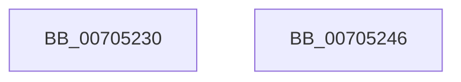

# ObCreateObjectType

- RVA: `0x00705230`–`0x00705247` (길이 `23` bytes)
- VA: `0x0000000140705230`
- 실행 섹션: `PAGE`
- PDB 이름 있음: `예`; PDB Function 태그: `아니요`
- unwind 정보 RVA: `0x0005D2F4`
- 디코드: `7`개 명령, `23/23` bytes 표시
- 미해석 바이트: `0` (있으면 어셈블리에 `.byte`로 보존)

> 이 문서는 커널 이미지의 기계어와 PDB 기호를 분석해 생성했습니다. 4번과 5번은 함수 원형과 자료형을 바이너리 사용 방식에서 추정한 C 해석이며 원본 소스 복구 결과는 아닙니다.

## 1. Dependencies

- 직접 호출 지점: **1**; 고유 호출 대상: **1**
- 직접 호출자로 확인된 함수: **25**
- RIP 상대 이미지 참조: **0**

### Outgoing calls
- `0x0070523C` → [ObCreateObjectTypeEx](../AB/ObCreateObjectTypeEx_function_00AB46D0.md) (function, `0x00AB46D0`)

### Direct callers
- [HalpDmaInitializeObjectType](../../text/55/HalpDmaInitializeObjectType_function_00552480.md) at `0x00552510`
- [DbgkpInitializePhase0](../../init/C2/DbgkpInitializePhase0_function_00C26268.md) at `0x00C26371`
- [IoCreateObjectTypes](../../init/C2/IoCreateObjectTypes_function_00C2A854.md) at `0x00C2A8E6`
- [IoCreateObjectTypes](../../init/C2/IoCreateObjectTypes_function_00C2A854.md) at `0x00C2A91E`
- [IoCreateObjectTypes](../../init/C2/IoCreateObjectTypes_function_00C2A854.md) at `0x00C2A982`
- [IoCreateObjectTypes](../../init/C2/IoCreateObjectTypes_function_00C2A854.md) at `0x00C2A9E0`
- [IoCreateObjectTypes](../../init/C2/IoCreateObjectTypes_function_00C2A854.md) at `0x00C2AA53`
- [IoCreateObjectTypes](../../init/C2/IoCreateObjectTypes_function_00C2A854.md) at `0x00C2AABC`
- [IopCreateIoRingObjectType](../../init/C2/IopCreateIoRingObjectType_function_00C2E2D4.md) at `0x00C2E36E`
- [PopPowerRequestInitialize](../../init/C3/PopPowerRequestInitialize_function_00C3E2AC.md) at `0x00C3E34E`
- [PopEtInit](../../init/C4/PopEtInit_function_00C43018.md) at `0x00C432D2`
- [PspInitializeSiloStructures](../../init/C4/PspInitializeSiloStructures_function_00C461B0.md) at `0x00C462E3`
- [PspInitializeSiloStructures](../../init/C4/PspInitializeSiloStructures_function_00C461B0.md) at `0x00C4630C`
- [SepTokenInitialization](../../init/C4/SepTokenInitialization_function_00C4B34C.md) at `0x00C4B3D9`
- [WmipInitializeSecurity](../../init/C4/WmipInitializeSecurity_function_00C4D840.md) at `0x00C4DAA8`
- [EtwpInitializeRegistration](../../init/C4/EtwpInitializeRegistration_function_00C4ECEC.md) at `0x00C4EDC6`
- [EtwpInitializeRealTimeConnection](../../init/C4/EtwpInitializeRealTimeConnection_function_00C4F4FC.md) at `0x00C4F5A9`
- [EtwpInitializeCoverageSampler](../../init/C4/EtwpInitializeCoverageSampler_function_00C4F5D4.md) at `0x00C4F6A3`
- [ExpInitializeCallbacks](../../init/C5/ExpInitializeCallbacks_function_00C532CC.md) at `0x00C53393`
- [ExpWin32Initialization](../../init/C5/ExpWin32Initialization_function_00C534C0.md) at `0x00C53582`
- [ExpWin32Initialization](../../init/C5/ExpWin32Initialization_function_00C534C0.md) at `0x00C535C7`
- [ExpWin32Initialization](../../init/C5/ExpWin32Initialization_function_00C534C0.md) at `0x00C53617`
- [ExpWin32Initialization](../../init/C5/ExpWin32Initialization_function_00C534C0.md) at `0x00C53663`
- [ExpWin32Initialization](../../init/C5/ExpWin32Initialization_function_00C534C0.md) at `0x00C536AC`
- [ExpWin32Initialization](../../init/C5/ExpWin32Initialization_function_00C534C0.md) at `0x00C536F8`
- [ExpTimerInitialization](../../init/C5/ExpTimerInitialization_function_00C5372C.md) at `0x00C537E0`
- [ExpTimerInitialization](../../init/C5/ExpTimerInitialization_function_00C5372C.md) at `0x00C53823`
- [ExpEventInitialization](../../init/C5/ExpEventInitialization_function_00C538E4.md) at `0x00C53973`
- [ExpSemaphoreInitialization](../../init/C5/ExpSemaphoreInitialization_function_00C53DBC.md) at `0x00C53E4B`
- [ExpWorkerFactoryInitialization](../../init/C5/ExpWorkerFactoryInitialization_function_00C54250.md) at `0x00C543D9`
- [ExpProfileInitialization](../../init/C5/ExpProfileInitialization_function_00C54448.md) at `0x00C544EF`
- [ExpMutantInitialization](../../init/C5/ExpMutantInitialization_function_00C54520.md) at `0x00C545DC`
- [ExpKeyedEventInitialization](../../init/C5/ExpKeyedEventInitialization_function_00C5460C.md) at `0x00C546D8`
- [CmpCreateObjectTypes](../../init/C5/CmpCreateObjectTypes_function_00C57780.md) at `0x00C57857`
- [MiSectionInitialization](../../init/C6/MiSectionInitialization_function_00C644A4.md) at `0x00C64591`
- [ObInitSystem](../../init/C7/ObInitSystem_function_00C71C7C.md) at `0x00C71EF2`
- [ObInitSystem](../../init/C7/ObInitSystem_function_00C71C7C.md) at `0x00C71F60`
- [ObInitSystem](../../init/C7/ObInitSystem_function_00C71C7C.md) at `0x00C71FE2`
- [PspInitPhase0](../../init/C7/PspInitPhase0_function_00C77E2C.md) at `0x00C78211`
- [PspInitPhase0](../../init/C7/PspInitPhase0_function_00C77E2C.md) at `0x00C7828B`
- [PspInitPhase0](../../init/C7/PspInitPhase0_function_00C77E2C.md) at `0x00C78325`
- [PspInitPhase0](../../init/C7/PspInitPhase0_function_00C77E2C.md) at `0x00C783BE`
- [PspInitPhase0](../../init/C7/PspInitPhase0_function_00C77E2C.md) at `0x00C78468`
- [PspInitPhase0](../../init/C7/PspInitPhase0_function_00C77E2C.md) at `0x00C784F0`
- [PspInitPhase0](../../init/C7/PspInitPhase0_function_00C77E2C.md) at `0x00C7857B`
- [PspInitPhase0](../../init/C7/PspInitPhase0_function_00C77E2C.md) at `0x00C78604`
- [PspInitPhase0](../../init/C7/PspInitPhase0_function_00C77E2C.md) at `0x00C78683`
- [PspInitPhase0](../../init/C7/PspInitPhase0_function_00C77E2C.md) at `0x00C78705`
- [PspInitPhase0](../../init/C7/PspInitPhase0_function_00C77E2C.md) at `0x00C78787`

### Static image references
- 디코드된 RIP-relative 메모리 참조가 없습니다.

## 2. Other-region calls and transfers

- 다른 실행 섹션으로 향하는 call: **0**
- 별도 외부 분기/꼬리 이동을 확인하지 못했습니다.

## 3. Assembly (complete function range)

```asm
00705230  48 83 EC 38                     sub rsp, 0x38
00705234  4C 89 4C 24 20                  mov qword ptr [rsp + 0x20], r9
00705239  45 33 C9                        xor r9d, r9d
0070523C  E8 8F F4 3A 00                  call 0x140ab46d0
00705241  48 83 C4 38                     add rsp, 0x38
00705245  C3                              ret
00705246  CC                              int3
```

## 4. C-style interpretation (structured pseudocode)

```c
__int64 __fastcall ObCreateObjectType(__int64 a1, __int64 a2, __int64 a3, __int64 a4)
{
    __int64 result;
    __int64 v_rsp;
    unsigned __int64 v_stack_m18;

    v_rsp = (v_rsp) - (56);
    v_stack_m18 = a4;
    a4 = 0;
    result = ObCreateObjectTypeEx(a1, a2, a3, a4);
    v_rsp = (v_rsp) + (56);
    return result;
}
```

## 5. (Beta) C Style

```c
int64_t ObCreateObjectType(int64_t Arg1, int64_t Arg2, int64_t Arg3, int64_t Arg4)
{
    int64_t result;
    int64_t local_rsp;
    uint64_t v_stack_m18;

    local_rsp = (local_rsp) - (56);
    v_stack_m18 = Arg4;
    Arg4 = 0;
    result = ObCreateObjectTypeEx(Arg1, Arg2, Arg3, Arg4);
    local_rsp = (local_rsp) + (56);
    return result;
}
```

## 6. Execution-region graph

[열기: 2D/3D 그래프와 함수 탐색 컨트롤 패널](../../../control-panel.html?section=page&rva=0x00705230&view=graph)

- 2D 그래프는 위에서 아래로 흐르고, 3D 그래프는 빈 공간을 드래그해 회전합니다. Shift+드래그는 이동, 휠은 확대·축소, 함수 노드 선택은 대상 보고서 이동입니다.

### Static fallback


