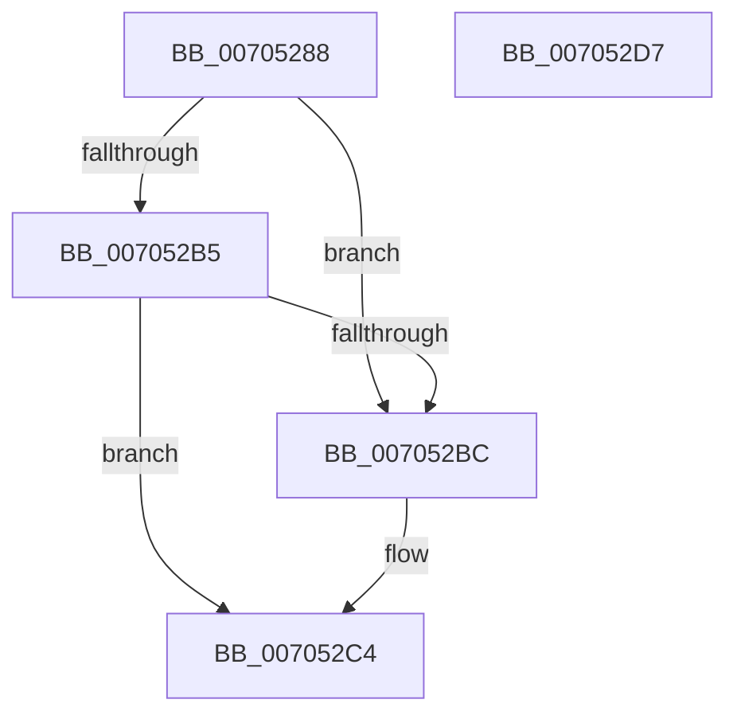

# PdcReleaseRwLockExclusive

- RVA: `0x00705288`–`0x007052D8` (길이 `80` bytes)
- VA: `0x0000000140705288`
- 실행 섹션: `PAGE`
- PDB 이름 있음: `예`; PDB Function 태그: `아니요`
- unwind 정보 RVA: `0x0005CF00`
- 디코드: `25`개 명령, `80/80` bytes 표시
- 미해석 바이트: `0` (있으면 어셈블리에 `.byte`로 보존)

> 이 문서는 커널 이미지의 기계어와 PDB 기호를 분석해 생성했습니다. 4번과 5번은 함수 원형과 자료형을 바이너리 사용 방식에서 추정한 C 해석이며 원본 소스 복구 결과는 아닙니다.

## 1. Dependencies

- 직접 호출 지점: **3**; 고유 호출 대상: **3**
- 직접 호출자로 확인된 함수: **1**
- RIP 상대 이미지 참조: **0**

### Outgoing calls
- `0x007052BF` → [ExfReleasePushLock](../../text/26/ExfReleasePushLock_function_002638D0.md) (function, `0x002638D0`)
- `0x007052C7` → [KeAbPostRelease](../../text/2E/KeAbPostRelease_function_002E1600.md) (function, `0x002E1600`)
- `0x007052CC` → [KeLeaveCriticalRegion](../../text/25/KeLeaveCriticalRegion_function_0025D8B0.md) (function, `0x0025D8B0`)

### Direct callers
- [sub_00B49A44](../B4/Unknown_function_00B49A44.md) at `0x00B49A97`

### Static image references
- 디코드된 RIP-relative 메모리 참조가 없습니다.

## 2. Other-region calls and transfers

- 다른 실행 섹션으로 향하는 call: **3**
  - `0x007052BF` → [ExfReleasePushLock](../../text/26/ExfReleasePushLock_function_002638D0.md) (`PAGE` → `.text`)
  - `0x007052C7` → [KeAbPostRelease](../../text/2E/KeAbPostRelease_function_002E1600.md) (`PAGE` → `.text`)
  - `0x007052CC` → [KeLeaveCriticalRegion](../../text/25/KeLeaveCriticalRegion_function_0025D8B0.md) (`PAGE` → `.text`)
- 별도 외부 분기/꼬리 이동을 확인하지 못했습니다.

## 3. Assembly (complete function range)

```asm
00705288  40 53                           push rbx
0070528A  48 83 EC 20                     sub rsp, 0x20
0070528E  45 33 C0                        xor r8d, r8d
00705291  48 8B D9                        mov rbx, rcx
00705294  4C 89 41 08                     mov qword ptr [rcx + 8], r8
00705298  0F 0D 09                        prefetchw byte ptr [rcx]
0070529B  48 8B 01                        mov rax, qword ptr [rcx]
0070529E  48 8B D0                        mov rdx, rax
007052A1  48 83 E2 F0                     and rdx, 0xfffffffffffffff0
007052A5  48 83 FA 10                     cmp rdx, 0x10
007052A9  48 8D 48 F0                     lea rcx, [rax - 0x10]
007052AD  49 0F 46 C8                     cmovbe rcx, r8
007052B1  A8 02                           test al, 2
007052B3  75 07                           jne 0x1407052bc
007052B5  F0 48 0F B1 0B                  lock cmpxchg qword ptr [rbx], rcx
007052BA  74 08                           je 0x1407052c4
007052BC  48 8B CB                        mov rcx, rbx
007052BF  E8 0C E6 B5 FF                  call 0x1402638d0
007052C4  48 8B CB                        mov rcx, rbx
007052C7  E8 34 C3 BD FF                  call 0x1402e1600
007052CC  E8 DF 85 B5 FF                  call 0x14025d8b0
007052D1  48 83 C4 20                     add rsp, 0x20
007052D5  5B                              pop rbx
007052D6  C3                              ret
007052D7  CC                              int3
```

## 4. C-style interpretation (structured pseudocode)

```c
__int64 __fastcall PdcReleaseRwLockExclusive(__int64 a1, __int64 a2, int a3)
{
    __int64 result;
    __int64 v_rsp;

    v_rsp = (v_rsp) - (32);
    a3 = 0;
    *(unsigned __int64 *)(a1 + 8) = 0;
    a2 = (*(unsigned __int64 *)(a1)) & (-16);
    a1 = *(unsigned __int64 *)(a1) - 16;
    if (a2 <= 16) { a1 = 0; }
    if ((((unsigned __int8)(*(unsigned __int64 *)(a1))) & (2)) != 0) goto loc_007052BC;
    result = *(unsigned __int64 *)(a1);
    if ((((unsigned __int8)(*(unsigned __int64 *)(a1))) & (2)) != 0) {
        a1 = a1;
        result = ExfReleasePushLock(a1, a2, a3, a4);
    }
    result = KeAbPostRelease(a1, a2, a3, a4);
    result = KeLeaveCriticalRegion(a1, a2, a3, a4);
    v_rsp = (v_rsp) + (32);
    return result;
}
```

## 5. (Beta) C Style

```c
int64_t PdcReleaseRwLockExclusive(void *Arg1, int64_t Arg2, int32_t Arg3)
{
    uint8_t *arg1 = (uint8_t *)Arg1;

    int64_t result;
    int64_t local_rsp;

    local_rsp = (local_rsp) - (32);
    Arg3 = 0;
    *(uint64_t *)(arg1 + 0x8) = 0;
    Arg2 = (*(uint64_t *)(arg1)) & (-16);
    Arg1 = *(uint64_t *)(arg1) - 16;
    if (Arg2 <= 16) { Arg1 = 0; }
    if ((((uint8_t)(*(uint64_t *)(arg1))) & (2)) != 0) goto loc_007052BC;
    result = *(uint64_t *)(arg1);
    if ((((uint8_t)(*(uint64_t *)(arg1))) & (2)) != 0) {
        Arg1 = Arg1;
        result = ExfReleasePushLock(Arg1, Arg2, Arg3, a4);
    }
    result = KeAbPostRelease(Arg1, Arg2, Arg3, a4);
    result = KeLeaveCriticalRegion(Arg1, Arg2, Arg3, a4);
    local_rsp = (local_rsp) + (32);
    return result;
}
```

### 관측된 메모리 오프셋

구조체 형식이 확인되지 않은 접근은 인자 기준의 오프셋으로만 기록했습니다.

| 기준 인자 | 오프셋 표현 | 폭 (bit) | 접근 |
|---|---:|---:|---|
| `Arg1` | `+ 0x0` | `8` | `R` |
| `Arg1` | `+ 0x0` | `64` | `R` |
| `Arg1` | `+ 0x8` | `64` | `W` |

## 6. Execution-region graph

[열기: 2D/3D 그래프와 함수 탐색 컨트롤 패널](../../../control-panel.html?section=page&rva=0x00705288&view=graph)

- 2D 그래프는 위에서 아래로 흐르고, 3D 그래프는 빈 공간을 드래그해 회전합니다. Shift+드래그는 이동, 휠은 확대·축소, 함수 노드 선택은 대상 보고서 이동입니다.

### Static fallback


