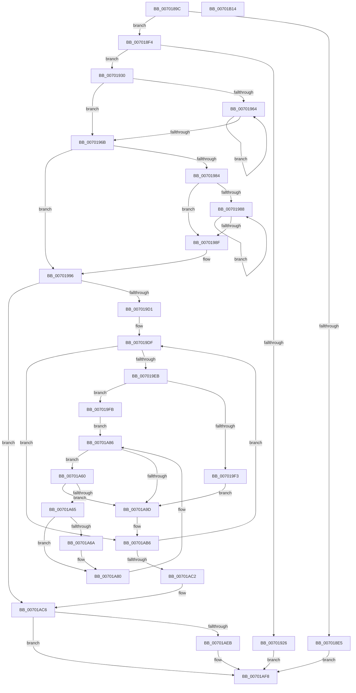

# PfpRpCHashGrow

- RVA: `0x0070189C`–`0x00701B15` (길이 `633` bytes)
- VA: `0x000000014070189C`
- 실행 섹션: `PAGE`
- PDB 이름 있음: `예`; PDB Function 태그: `아니요`
- unwind 정보 RVA: `0x000BF5F8`
- 디코드: `195`개 명령, `633/633` bytes 표시
- 미해석 바이트: `0` (있으면 어셈블리에 `.byte`로 보존)

> 이 문서는 커널 이미지의 기계어와 PDB 기호를 분석해 생성했습니다. 4번과 5번은 함수 원형과 자료형을 바이너리 사용 방식에서 추정한 C 해석이며 원본 소스 복구 결과는 아닙니다.

## 1. Dependencies

- 직접 호출 지점: **7**; 고유 호출 대상: **5**
- 직접 호출자로 확인된 함수: **1**
- RIP 상대 이미지 참조: **0**

### Outgoing calls
- `0x007018D2` → [FsRtlAcquirePushLockExclusive](../../text/4A/FsRtlAcquirePushLockExclusive_function_004A05F4.md) (function, `0x004A05F4`)
- `0x007018EA` → [FsRtlAcquirePushLockExclusive](../../text/4A/FsRtlAcquirePushLockExclusive_function_004A05F4.md) (function, `0x004A05F4`)
- `0x00701913` → [ExAllocatePool2](../../poolcode/B8/ExAllocatePool2_function_00B820F0.md) (function, `0x00B820F0`)
- `0x007019B2` → [memset](../../text/6C/memset_function_006C6C40.md) (function, `0x006C6C40`)
- `0x00701AA6` → [memcpy](../../text/6C/memcpy_function_006C6840.md) (function, `0x006C6840`)
- `0x00701ACA` → [FsRtlAcquirePushLockExclusive](../../text/4A/FsRtlAcquirePushLockExclusive_function_004A05F4.md) (function, `0x004A05F4`)
- `0x00701AFC` → [PfLockExclusiveRelease](../../text/49/PfLockExclusiveRelease_function_00491D88.md) (function, `0x00491D88`)

### Direct callers
- [PfpRpCHashAddEntries](../A7/PfpRpCHashAddEntries_function_00A7D43C.md) at `0x00A7D5DA`

### Static image references
- 디코드된 RIP-relative 메모리 참조가 없습니다.

## 2. Other-region calls and transfers

- 다른 실행 섹션으로 향하는 call: **7**
  - `0x007018D2` → [FsRtlAcquirePushLockExclusive](../../text/4A/FsRtlAcquirePushLockExclusive_function_004A05F4.md) (`PAGE` → `.text`)
  - `0x007018EA` → [FsRtlAcquirePushLockExclusive](../../text/4A/FsRtlAcquirePushLockExclusive_function_004A05F4.md) (`PAGE` → `.text`)
  - `0x00701913` → [ExAllocatePool2](../../poolcode/B8/ExAllocatePool2_function_00B820F0.md) (`PAGE` → `POOLCODE`)
  - `0x007019B2` → [memset](../../text/6C/memset_function_006C6C40.md) (`PAGE` → `.text`)
  - `0x00701AA6` → [memcpy](../../text/6C/memcpy_function_006C6840.md) (`PAGE` → `.text`)
  - `0x00701ACA` → [FsRtlAcquirePushLockExclusive](../../text/4A/FsRtlAcquirePushLockExclusive_function_004A05F4.md) (`PAGE` → `.text`)
  - `0x00701AFC` → [PfLockExclusiveRelease](../../text/49/PfLockExclusiveRelease_function_00491D88.md) (`PAGE` → `.text`)
- 별도 외부 분기/꼬리 이동을 확인하지 못했습니다.

## 3. Assembly (complete function range)

```asm
0070189C  4C 89 4C 24 20                  mov qword ptr [rsp + 0x20], r9
007018A1  4C 89 44 24 18                  mov qword ptr [rsp + 0x18], r8
007018A6  48 89 54 24 10                  mov qword ptr [rsp + 0x10], rdx
007018AB  55                              push rbp
007018AC  53                              push rbx
007018AD  56                              push rsi
007018AE  57                              push rdi
007018AF  41 54                           push r12
007018B1  41 55                           push r13
007018B3  41 56                           push r14
007018B5  41 57                           push r15
007018B7  48 8B EC                        mov rbp, rsp
007018BA  48 83 EC 78                     sub rsp, 0x78
007018BE  48 8D 81 80 00 00 00            lea rax, [rcx + 0x80]
007018C5  49 8B F0                        mov rsi, r8
007018C8  48 8B C8                        mov rcx, rax
007018CB  48 89 45 B8                     mov qword ptr [rbp - 0x48], rax
007018CF  4C 8B F2                        mov r14, rdx
007018D2  E8 1D ED D9 FF                  call 0x1404a05f4
007018D7  41 8B 46 10                     mov eax, dword ptr [r14 + 0x10]
007018DB  41 8B 7E 0C                     mov edi, dword ptr [r14 + 0xc]
007018DF  03 C0                           add eax, eax
007018E1  3B C7                           cmp eax, edi
007018E3  73 0F                           jae 0x1407018f4
007018E5  33 DB                           xor ebx, ebx
007018E7  48 8B CE                        mov rcx, rsi
007018EA  E8 05 ED D9 FF                  call 0x1404a05f4
007018EF  E9 04 02 00 00                  jmp 0x140701af8
007018F4  41 8B 4E 08                     mov ecx, dword ptr [r14 + 8]
007018F8  03 FF                           add edi, edi
007018FA  B8 08 00 00 00                  mov eax, 8
007018FF  41 B8 50 66 43 48               mov r8d, 0x48436650
00701905  3B F8                           cmp edi, eax
00701907  0F 42 F8                        cmovb edi, eax
0070190A  D3 E7                           shl edi, cl
0070190C  B9 00 01 00 00                  mov ecx, 0x100
00701911  8B D7                           mov edx, edi
00701913  E8 D8 07 48 00                  call 0x140b820f0
00701918  33 DB                           xor ebx, ebx
0070191A  48 89 45 A8                     mov qword ptr [rbp - 0x58], rax
0070191E  4C 8B C8                        mov r9, rax
00701921  48 85 C0                        test rax, rax
00701924  75 0A                           jne 0x140701930
00701926  BB 9A 00 00 C0                  mov ebx, 0xc000009a
0070192B  E9 C8 01 00 00                  jmp 0x140701af8
00701930  41 0F 10 0E                     movups xmm1, xmmword ptr [r14]
00701934  83 CA FF                        or edx, 0xffffffff
00701937  89 5D C8                        mov dword ptr [rbp - 0x38], ebx
0070193A  41 B8 01 00 00 00               mov r8d, 1
00701940  48 89 5D D0                     mov qword ptr [rbp - 0x30], rbx
00701944  0F 11 4D D8                     movups xmmword ptr [rbp - 0x28], xmm1
00701948  41 8B F0                        mov esi, r8d
0070194B  F3 41 0F 7E 4E 08               movq xmm1, qword ptr [r14 + 8]
00701951  66 0F 7E C9                     movd ecx, xmm1
00701955  66 0F 7E 4D 48                  movd dword ptr [rbp + 0x48], xmm1
0070195A  D3 E6                           shl esi, cl
0070195C  8B CA                           mov ecx, edx
0070195E  8B C6                           mov eax, esi
00701960  85 F6                           test esi, esi
00701962  74 07                           je 0x14070196b
00701964  41 03 C8                        add ecx, r8d
00701967  D1 E8                           shr eax, 1
00701969  75 F9                           jne 0x140701964
0070196B  8D 46 FF                        lea eax, [rsi - 1]
0070196E  85 C6                           test esi, eax
00701970  44 8D 61 01                     lea r12d, [rcx + 1]
00701974  44 0F 44 E1                     cmove r12d, ecx
00701978  41 8B CC                        mov ecx, r12d
0070197B  D3 EF                           shr edi, cl
0070197D  8D 47 FF                        lea eax, [rdi - 1]
00701980  85 C7                           test edi, eax
00701982  74 12                           je 0x140701996
00701984  85 FF                           test edi, edi
00701986  74 07                           je 0x14070198f
00701988  41 03 D0                        add edx, r8d
0070198B  D1 EF                           shr edi, 1
0070198D  75 F9                           jne 0x140701988
0070198F  8B CA                           mov ecx, edx
00701991  41 8B F8                        mov edi, r8d
00701994  D3 E7                           shl edi, cl
00701996  41 8B CC                        mov ecx, r12d
00701999  44 8B C7                        mov r8d, edi
0070199C  49 D3 E0                        shl r8, cl
0070199F  33 D2                           xor edx, edx
007019A1  49 8B C9                        mov rcx, r9
007019A4  89 5D D0                        mov dword ptr [rbp - 0x30], ebx
007019A7  44 89 65 C8                     mov dword ptr [rbp - 0x38], r12d
007019AB  89 7D CC                        mov dword ptr [rbp - 0x34], edi
007019AE  4C 89 4D C0                     mov qword ptr [rbp - 0x40], r9
007019B2  E8 89 52 FC FF                  call 0x1406c6c40
007019B7  4C 8B 7D D8                     mov r15, qword ptr [rbp - 0x28]
007019BB  44 8B 6D E4                     mov r13d, dword ptr [rbp - 0x1c]
007019BF  8B 4D 48                        mov ecx, dword ptr [rbp + 0x48]
007019C2  49 D3 E5                        shl r13, cl
007019C5  4D 03 EF                        add r13, r15
007019C8  4D 3B FD                        cmp r15, r13
007019CB  0F 83 F5 00 00 00               jae 0x140701ac6
007019D1  44 8B D6                        mov r10d, esi
007019D4  44 8B F3                        mov r14d, ebx
007019D7  48 8B 75 A8                     mov rsi, qword ptr [rbp - 0x58]
007019DB  4C 89 55 B0                     mov qword ptr [rbp - 0x50], r10
007019DF  4D 8B 07                        mov r8, qword ptr [r15]
007019E2  4D 85 C0                        test r8, r8
007019E5  0F 84 CB 00 00 00               je 0x140701ab6
007019EB  4C 89 45 48                     mov qword ptr [rbp + 0x48], r8
007019EF  85 FF                           test edi, edi
007019F1  75 08                           jne 0x1407019fb
007019F3  48 8B C3                        mov rax, rbx
007019F6  E9 A2 00 00 00                  jmp 0x140701a9d
007019FB  41 0F B6 C0                     movzx eax, r8b
007019FF  44 8D 5F FF                     lea r11d, [rdi - 1]
00701A03  48 05 CB 5D B1 00               add rax, 0xb15dcb
00701A09  45 8B CB                        mov r9d, r11d
00701A0C  48 6B C8 25                     imul rcx, rax, 0x25
00701A10  0F B6 45 49                     movzx eax, byte ptr [rbp + 0x49]
00701A14  48 03 C8                        add rcx, rax
00701A17  0F B6 45 4A                     movzx eax, byte ptr [rbp + 0x4a]
00701A1B  48 6B D1 25                     imul rdx, rcx, 0x25
00701A1F  48 03 D0                        add rdx, rax
00701A22  0F B6 45 4B                     movzx eax, byte ptr [rbp + 0x4b]
00701A26  48 6B CA 25                     imul rcx, rdx, 0x25
00701A2A  48 03 C8                        add rcx, rax
00701A2D  0F B6 45 4C                     movzx eax, byte ptr [rbp + 0x4c]
00701A31  48 6B D1 25                     imul rdx, rcx, 0x25
00701A35  48 03 D0                        add rdx, rax
00701A38  0F B6 45 4D                     movzx eax, byte ptr [rbp + 0x4d]
00701A3C  48 6B CA 25                     imul rcx, rdx, 0x25
00701A40  48 03 C8                        add rcx, rax
00701A43  0F B6 45 4E                     movzx eax, byte ptr [rbp + 0x4e]
00701A47  48 6B D1 25                     imul rdx, rcx, 0x25
00701A4B  48 03 D0                        add rdx, rax
00701A4E  0F B6 45 4F                     movzx eax, byte ptr [rbp + 0x4f]
00701A52  48 6B CA 25                     imul rcx, rdx, 0x25
00701A56  48 8B D3                        mov rdx, rbx
00701A59  48 03 C1                        add rax, rcx
00701A5C  8B C0                           mov eax, eax
00701A5E  EB 26                           jmp 0x140701a86
00701A60  49 3B C8                        cmp rcx, r8
00701A63  74 38                           je 0x140701a9d
00701A65  48 85 D2                        test rdx, rdx
00701A68  75 16                           jne 0x140701a80
00701A6A  B9 B1 79 37 9E                  mov ecx, 0x9e3779b1
00701A6F  49 8B C0                        mov rax, r8
00701A72  48 0F AF C1                     imul rax, rcx
00701A76  A8 01                           test al, 1
00701A78  48 8D 50 01                     lea rdx, [rax + 1]
00701A7C  48 0F 45 D0                     cmovne rdx, rax
00701A80  4C 03 CA                        add r9, rdx
00701A83  41 8B C3                        mov eax, r11d
00701A86  4C 23 C8                        and r9, rax
00701A89  41 8B CC                        mov ecx, r12d
00701A8C  49 8B C1                        mov rax, r9
00701A8F  48 D3 E0                        shl rax, cl
00701A92  48 03 C6                        add rax, rsi
00701A95  48 8B 08                        mov rcx, qword ptr [rax]
00701A98  48 85 C9                        test rcx, rcx
00701A9B  75 C3                           jne 0x140701a60
00701A9D  4D 8B C2                        mov r8, r10
00701AA0  49 8B D7                        mov rdx, r15
00701AA3  48 8B C8                        mov rcx, rax
00701AA6  E8 95 4D FC FF                  call 0x1406c6840
00701AAB  4C 8B 55 B0                     mov r10, qword ptr [rbp - 0x50]
00701AAF  41 FF C6                        inc r14d
00701AB2  44 89 75 D0                     mov dword ptr [rbp - 0x30], r14d
00701AB6  4D 03 FA                        add r15, r10
00701AB9  4D 3B FD                        cmp r15, r13
00701ABC  0F 82 1D FF FF FF               jb 0x1407019df
00701AC2  4C 8B 75 50                     mov r14, qword ptr [rbp + 0x50]
00701AC6  48 8B 4D 58                     mov rcx, qword ptr [rbp + 0x58]
00701ACA  E8 25 EB D9 FF                  call 0x1404a05f4
00701ACF  0F 10 45 C0                     movups xmm0, xmmword ptr [rbp - 0x40]
00701AD3  48 8B 45 D8                     mov rax, qword ptr [rbp - 0x28]
00701AD7  F2 0F 10 4D D0                  movsd xmm1, qword ptr [rbp - 0x30]
00701ADC  41 0F 11 06                     movups xmmword ptr [r14], xmm0
00701AE0  F2 41 0F 11 4E 10               movsd qword ptr [r14 + 0x10], xmm1
00701AE6  48 85 C0                        test rax, rax
00701AE9  74 0D                           je 0x140701af8
00701AEB  4C 8B 45 60                     mov r8, qword ptr [rbp + 0x60]
00701AEF  49 8B 10                        mov rdx, qword ptr [r8]
00701AF2  48 89 10                        mov qword ptr [rax], rdx
00701AF5  49 89 00                        mov qword ptr [r8], rax
00701AF8  48 8B 4D B8                     mov rcx, qword ptr [rbp - 0x48]
00701AFC  E8 87 02 D9 FF                  call 0x140491d88
00701B01  8B C3                           mov eax, ebx
00701B03  48 83 C4 78                     add rsp, 0x78
00701B07  41 5F                           pop r15
00701B09  41 5E                           pop r14
00701B0B  41 5D                           pop r13
00701B0D  41 5C                           pop r12
00701B0F  5F                              pop rdi
00701B10  5E                              pop rsi
00701B11  5B                              pop rbx
00701B12  5D                              pop rbp
00701B13  C3                              ret
00701B14  CC                              int3
```

## 4. C-style interpretation (structured pseudocode)

```c
__int64 __fastcall PfpRpCHashGrow(__int64 a1, __int64 a2, __int64 a3, __int64 a4)
{
    __int64 result;
    __int64 v_r12;
    __int64 v_r13;
    __int64 v_r14;
    __int64 v_r15;
    __int64 v_rbx;
    __int64 v_rdi;
    __int64 v_rsi;
    __int64 v_rsp;
    unsigned int v_stack_m5C;
    unsigned __int64 v_stack_m68;
    unsigned __int64 v_stack_m70;
    unsigned int v_stack_m74;
    unsigned int v_stack_m78;
    unsigned __int64 v_stack_m80;
    unsigned __int64 v_stack_m88;
    unsigned __int64 v_stack_m90;
    unsigned __int64 v_stack_m98;
    unsigned __int64 v_stack_p10;
    unsigned __int64 v_stack_p18;
    unsigned __int64 v_stack_p20;
    unsigned int v_stack_p8;
    unsigned __int8 v_stack_p9;
    unsigned __int8 v_stack_pA;
    unsigned __int8 v_stack_pB;
    unsigned __int8 v_stack_pC;
    unsigned __int8 v_stack_pD;
    unsigned __int8 v_stack_pE;
    unsigned __int8 v_stack_pF;

    v_stack_p20 = a4;
    v_stack_p18 = a3;
    v_stack_p10 = a2;
    v_rsp = (v_rsp) - (120);
    v_stack_m88 = a1 + 128;
    result = FsRtlAcquirePushLockExclusive(a1 + 128, a2, a3, a4);
    result = (unsigned int)(((unsigned int)(*(unsigned int *)(a2 + 16))) + ((unsigned int)((unsigned int)(*(unsigned int *)(a2 + 16)))));
    if (((unsigned int)(result)) >= ((unsigned int)((unsigned int)(*(unsigned int *)(a2 + 12))))) goto loc_007018F4;
    v_rbx = 0;
    result = FsRtlAcquirePushLockExclusive(a3, a2, a3, a4);
    goto loc_00701AF8;
loc_007018F4:
    v_rdi = (unsigned int)(((unsigned int)(*(unsigned int *)(a2 + 12))) + ((unsigned int)((unsigned int)(*(unsigned int *)(a2 + 12)))));
    if (((unsigned int)(v_rdi)) < 8) { v_rdi = 8; }
    v_rdi = (unsigned int)((v_rdi) << ((unsigned __int8)((unsigned int)(*(unsigned int *)(a2 + 8)))));
    result = ExAllocatePool2(256, (unsigned int)((unsigned int)(v_rdi)), (unsigned int)(0x48436650ULL), a4);
    v_rbx = 0;
    v_stack_m98 = result;
    if (result != 0) goto loc_00701930;
    goto loc_00701AF8;
loc_00701930:
    a2 = (unsigned int)(((unsigned int)((unsigned int)(v_rdi))) | (0xFFFFFFFFULL));
    v_stack_m78 = (unsigned int)((unsigned int)(0xC000009AULL));
    v_stack_m70 = (unsigned int)(0xC000009AULL);
    v_stack_m68 = v_xmm1;
    v_stack_p8 = v_xmm1;
    v_rsi = (unsigned int)((1) << (256));
    if ((unsigned int)(v_rsi) == 0) goto loc_0070196B;
loc_00701964:
    a1 = (unsigned int)(((unsigned int)((unsigned int)(a2))) + (1));
    result = (unsigned int)(((unsigned int)((unsigned int)(v_rsi))) >> (1));
    if (condition_is_not_equal) goto loc_00701964;
loc_0070196B:
    v_r12 = a1 + 1;
    if ((((unsigned int)(v_rsi)) & ((unsigned int)(v_rsi - 1))) == 0) { v_r12 = (unsigned int)(a1); }
    v_rdi = (unsigned int)((v_rdi) >> ((unsigned __int8)((unsigned int)((unsigned int)(v_r12)))));
    if ((((unsigned int)(v_rdi)) & ((unsigned int)(v_rdi - 1))) == 0) goto loc_00701996;
    if ((unsigned int)(v_rdi) == 0) goto loc_0070198F;
loc_00701988:
    a2 = (unsigned int)((a2) + (1));
    v_rdi = (unsigned int)((v_rdi) >> (1));
    if (condition_is_not_equal) goto loc_00701988;
loc_0070198F:
    v_rdi = (unsigned int)((1) << ((unsigned __int8)((unsigned int)((unsigned int)(a2)))));
loc_00701996:
    a3 = ((unsigned int)((unsigned int)(v_rdi))) << ((unsigned __int8)((unsigned int)((unsigned int)(v_r12))));
    a2 = 0;
    v_stack_m70 = (unsigned int)((unsigned int)(0xC000009AULL));
    v_stack_m78 = (unsigned int)(v_r12);
    v_stack_m74 = (unsigned int)(v_rdi);
    v_stack_m80 = result;
    result = memset(result, a2, a3, result);
    v_r13 = ((unsigned int)(v_stack_m5C)) << ((unsigned __int8)((unsigned int)(v_stack_p8)));
    v_r13 = (v_r13) + (v_stack_m68);
    if (v_stack_m68 >= v_r13) goto loc_00701AC6;
    v_stack_m90 = (unsigned int)((unsigned int)(v_rsi));
loc_007019DF:
    if (*(unsigned __int64 *)(v_stack_m68) == 0) goto loc_00701AB6;
    v_stack_p8 = *(unsigned __int64 *)(v_stack_m68);
    if ((unsigned int)(v_rdi) != 0) goto loc_007019FB;
    goto loc_00701A9D;
loc_007019FB:
    result = ((unsigned __int8)(*(unsigned __int64 *)(v_stack_m68))) + (0xB15DCBULL);
    a1 = ((unsigned int)(v_stack_p8)) * (result);
    a1 = (a1) + (v_stack_p9);
    a2 = (a2) * (a1);
    a2 = (a2) + (v_stack_pA);
    a1 = (a1) * (a2);
    a1 = (a1) + (v_stack_pB);
    a2 = (a2) * (a1);
    a2 = (a2) + (v_stack_pC);
    a1 = (a1) * (a2);
    a1 = (a1) + (v_stack_pD);
    a2 = (a2) * (a1);
    a2 = (a2) + (v_stack_pE);
    a1 = (a1) * (a2);
    result = (v_stack_pF) + (a1);
    goto loc_00701A86;
loc_00701A60:
    if (a1 == (*(unsigned __int64 *)(v_stack_m68))) goto loc_00701A9D;
    result = (unsigned int)((unsigned int)(result));
    if ((unsigned int)(0xC000009AULL) == 0) {
        a1 = 0x9E3779B1ULL;
        result = *(unsigned __int64 *)(v_stack_m68);
        result = (result) * (a1);
        a2 = result + 1;
        if ((((unsigned __int8)(result)) & (1)) != 0) { a2 = result; }
    }
    a4 = ((unsigned int)((unsigned int)(v_rdi - 1))) + (a2);
loc_00701A86:
    a4 = (a4) & ((unsigned int)((unsigned int)(v_rdi - 1)));
    result = (a4) << ((unsigned __int8)((unsigned int)((unsigned int)(v_r12))));
    result = (result) + (v_stack_m98);
    if (*(unsigned __int64 *)(result) != 0) goto loc_00701A60;
loc_00701A9D:
    result = memcpy(result, v_stack_m68, (unsigned int)((unsigned int)(v_rsi)), a4);
    v_r14 = (unsigned int)(((unsigned int)((unsigned int)((unsigned int)(0xC000009AULL)))) + 1);
    v_stack_m70 = (unsigned int)(v_r14);
loc_00701AB6:
    v_r15 = (v_stack_m68) + (v_stack_m90);
    if (v_r15 < v_r13) goto loc_007019DF;
loc_00701AC6:
    result = FsRtlAcquirePushLockExclusive(v_stack_p18, v_stack_m68, (unsigned int)((unsigned int)(v_rsi)), a4);
    *(unsigned __int64 *)(v_stack_p10) = v_xmm0;
    *(unsigned __int64 *)(v_stack_p10 + 16) = v_xmm1;
    if (v_stack_m68 != 0) {
        a3 = v_stack_p20;
        a2 = *(unsigned __int64 *)(a3);
        *(unsigned __int64 *)(v_stack_m68) = a2;
        *(unsigned __int64 *)(a3) = v_stack_m68;
    }
    result = PfLockExclusiveRelease(v_stack_m88, a2, a3, a4);
    v_rsp = (v_rsp) + (120);
    return (unsigned int)((unsigned int)((unsigned int)(0xC000009AULL)));
}
```

## 5. (Beta) C Style

```c
int64_t PfpRpCHashGrow(void *Arg1, void *Arg2, int64_t Arg3, int64_t Arg4)
{
    uint8_t *arg1 = (uint8_t *)Arg1;
    uint8_t *arg2 = (uint8_t *)Arg2;

    int64_t result;
    int64_t local_r12;
    int64_t local_r13;
    int64_t local_r14;
    int64_t local_r15;
    int64_t local_rbx;
    int64_t local_rdi;
    int64_t local_rsi;
    int64_t local_rsp;
    uint32_t v_stack_m5C;
    uint64_t v_stack_m68;
    uint64_t v_stack_m70;
    uint32_t v_stack_m74;
    uint32_t v_stack_m78;
    uint64_t v_stack_m80;
    uint64_t v_stack_m88;
    uint64_t v_stack_m90;
    uint64_t v_stack_m98;
    uint64_t v_stack_p10;
    uint64_t v_stack_p18;
    uint64_t v_stack_p20;
    uint32_t v_stack_p8;
    uint8_t v_stack_p9;
    uint8_t v_stack_pA;
    uint8_t v_stack_pB;
    uint8_t v_stack_pC;
    uint8_t v_stack_pD;
    uint8_t v_stack_pE;
    uint8_t v_stack_pF;

    v_stack_p20 = Arg4;
    v_stack_p18 = Arg3;
    v_stack_p10 = Arg2;
    local_rsp = (local_rsp) - (120);
    v_stack_m88 = Arg1 + 128;
    result = FsRtlAcquirePushLockExclusive(Arg1 + 128, Arg2, Arg3, Arg4);
    result = (uint32_t)(((uint32_t)(*(uint32_t *)(arg2 + 0x10))) + ((uint32_t)((uint32_t)(*(uint32_t *)(arg2 + 0x10)))));
    if (((uint32_t)(result)) >= ((uint32_t)((uint32_t)(*(uint32_t *)(arg2 + 0xC))))) goto loc_007018F4;
    local_rbx = 0;
    result = FsRtlAcquirePushLockExclusive(Arg3, Arg2, Arg3, Arg4);
    goto loc_00701AF8;
loc_007018F4:
    local_rdi = (uint32_t)(((uint32_t)(*(uint32_t *)(arg2 + 0xC))) + ((uint32_t)((uint32_t)(*(uint32_t *)(arg2 + 0xC)))));
    if (((uint32_t)(local_rdi)) < 8) { local_rdi = 8; }
    local_rdi = (uint32_t)((local_rdi) << ((uint8_t)((uint32_t)(*(uint32_t *)(arg2 + 0x8)))));
    result = ExAllocatePool2(256, (uint32_t)((uint32_t)(local_rdi)), (uint32_t)(0x48436650ULL), Arg4);
    local_rbx = 0;
    v_stack_m98 = result;
    if (result != 0) goto loc_00701930;
    goto loc_00701AF8;
loc_00701930:
    Arg2 = (uint32_t)(((uint32_t)((uint32_t)(local_rdi))) | (0xFFFFFFFFULL));
    v_stack_m78 = (uint32_t)((uint32_t)(0xC000009AULL));
    v_stack_m70 = (uint32_t)(0xC000009AULL);
    v_stack_m68 = v_xmm1;
    v_stack_p8 = v_xmm1;
    local_rsi = (uint32_t)((1) << (256));
    if ((uint32_t)(local_rsi) == 0) goto loc_0070196B;
loc_00701964:
    Arg1 = (uint32_t)(((uint32_t)((uint32_t)(Arg2))) + (1));
    result = (uint32_t)(((uint32_t)((uint32_t)(local_rsi))) >> (1));
    if (condition_is_not_equal) goto loc_00701964;
loc_0070196B:
    local_r12 = Arg1 + 1;
    if ((((uint32_t)(local_rsi)) & ((uint32_t)(local_rsi - 1))) == 0) { local_r12 = (uint32_t)(Arg1); }
    local_rdi = (uint32_t)((local_rdi) >> ((uint8_t)((uint32_t)((uint32_t)(local_r12)))));
    if ((((uint32_t)(local_rdi)) & ((uint32_t)(local_rdi - 1))) == 0) goto loc_00701996;
    if ((uint32_t)(local_rdi) == 0) goto loc_0070198F;
loc_00701988:
    Arg2 = (uint32_t)((Arg2) + (1));
    local_rdi = (uint32_t)((local_rdi) >> (1));
    if (condition_is_not_equal) goto loc_00701988;
loc_0070198F:
    local_rdi = (uint32_t)((1) << ((uint8_t)((uint32_t)((uint32_t)(Arg2)))));
loc_00701996:
    Arg3 = ((uint32_t)((uint32_t)(local_rdi))) << ((uint8_t)((uint32_t)((uint32_t)(local_r12))));
    Arg2 = 0;
    v_stack_m70 = (uint32_t)((uint32_t)(0xC000009AULL));
    v_stack_m78 = (uint32_t)(local_r12);
    v_stack_m74 = (uint32_t)(local_rdi);
    v_stack_m80 = result;
    result = memset(result, Arg2, Arg3, result);
    local_r13 = ((uint32_t)(v_stack_m5C)) << ((uint8_t)((uint32_t)(v_stack_p8)));
    local_r13 = (local_r13) + (v_stack_m68);
    if (v_stack_m68 >= local_r13) goto loc_00701AC6;
    v_stack_m90 = (uint32_t)((uint32_t)(local_rsi));
loc_007019DF:
    if (*(uint64_t *)(v_stack_m68) == 0) goto loc_00701AB6;
    v_stack_p8 = *(uint64_t *)(v_stack_m68);
    if ((uint32_t)(local_rdi) != 0) goto loc_007019FB;
    goto loc_00701A9D;
loc_007019FB:
    result = ((uint8_t)(*(uint64_t *)(v_stack_m68))) + (0xB15DCBULL);
    Arg1 = ((uint32_t)(v_stack_p8)) * (result);
    Arg1 = (Arg1) + (v_stack_p9);
    Arg2 = (Arg2) * (Arg1);
    Arg2 = (Arg2) + (v_stack_pA);
    Arg1 = (Arg1) * (Arg2);
    Arg1 = (Arg1) + (v_stack_pB);
    Arg2 = (Arg2) * (Arg1);
    Arg2 = (Arg2) + (v_stack_pC);
    Arg1 = (Arg1) * (Arg2);
    Arg1 = (Arg1) + (v_stack_pD);
    Arg2 = (Arg2) * (Arg1);
    Arg2 = (Arg2) + (v_stack_pE);
    Arg1 = (Arg1) * (Arg2);
    result = (v_stack_pF) + (Arg1);
    goto loc_00701A86;
loc_00701A60:
    if (Arg1 == (*(uint64_t *)(v_stack_m68))) goto loc_00701A9D;
    result = (uint32_t)((uint32_t)(result));
    if ((uint32_t)(0xC000009AULL) == 0) {
        Arg1 = 0x9E3779B1ULL;
        result = *(uint64_t *)(v_stack_m68);
        result = (result) * (Arg1);
        Arg2 = result + 1;
        if ((((uint8_t)(result)) & (1)) != 0) { Arg2 = result; }
    }
    Arg4 = ((uint32_t)((uint32_t)(local_rdi - 1))) + (Arg2);
loc_00701A86:
    Arg4 = (Arg4) & ((uint32_t)((uint32_t)(local_rdi - 1)));
    result = (Arg4) << ((uint8_t)((uint32_t)((uint32_t)(local_r12))));
    result = (result) + (v_stack_m98);
    if (*(uint64_t *)(result) != 0) goto loc_00701A60;
loc_00701A9D:
    result = memcpy(result, v_stack_m68, (uint32_t)((uint32_t)(local_rsi)), Arg4);
    local_r14 = (uint32_t)(((uint32_t)((uint32_t)((uint32_t)(0xC000009AULL)))) + 1);
    v_stack_m70 = (uint32_t)(local_r14);
loc_00701AB6:
    local_r15 = (v_stack_m68) + (v_stack_m90);
    if (local_r15 < local_r13) goto loc_007019DF;
loc_00701AC6:
    result = FsRtlAcquirePushLockExclusive(v_stack_p18, v_stack_m68, (uint32_t)((uint32_t)(local_rsi)), Arg4);
    *(uint64_t *)(v_stack_p10) = v_xmm0;
    *(uint64_t *)(v_stack_p10 + 0x10) = v_xmm1;
    if (v_stack_m68 != 0) {
        Arg3 = v_stack_p20;
        Arg2 = *(uint64_t *)(Arg3);
        *(void **)(v_stack_m68) = Arg2;
        *(uint64_t *)(Arg3) = v_stack_m68;
    }
    result = PfLockExclusiveRelease(v_stack_m88, Arg2, Arg3, Arg4);
    local_rsp = (local_rsp) + (120);
    return (uint32_t)((uint32_t)((uint32_t)(0xC000009AULL)));
}
```

### 관측된 메모리 오프셋

구조체 형식이 확인되지 않은 접근은 인자 기준의 오프셋으로만 기록했습니다.

| 기준 인자 | 오프셋 표현 | 폭 (bit) | 접근 |
|---|---:|---:|---|
| `Arg1` | `+ 0x80` | `64` | `R` |
| `Arg2` | `+ 0x0` | `128` | `R` |
| `Arg2` | `+ 0x8` | `32` | `R` |
| `Arg2` | `+ 0x8` | `64` | `R` |
| `Arg2` | `+ 0xC` | `32` | `R` |
| `Arg2` | `+ 0x10` | `32` | `R` |

## 6. Execution-region graph

[열기: 2D/3D 그래프와 함수 탐색 컨트롤 패널](../../../control-panel.html?section=page&rva=0x0070189C&view=graph)

- 2D 그래프는 위에서 아래로 흐르고, 3D 그래프는 빈 공간을 드래그해 회전합니다. Shift+드래그는 이동, 휠은 확대·축소, 함수 노드 선택은 대상 보고서 이동입니다.

### Static fallback


