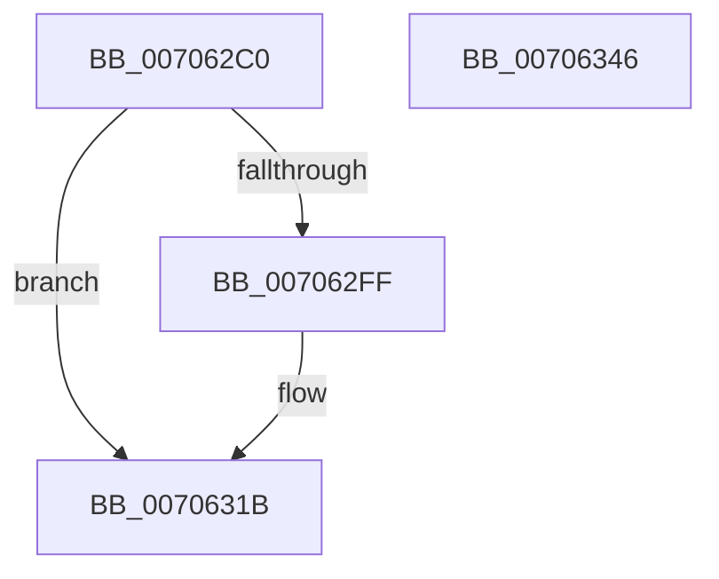

# Phase1Initialization

- RVA: `0x007062C0`–`0x00706347` (길이 `135` bytes)
- VA: `0x00000001407062C0`
- 실행 섹션: `PAGE`
- PDB 이름 있음: `예`; PDB Function 태그: `아니요`
- unwind 정보 RVA: `0x0006E5F8`
- 디코드: `36`개 명령, `135/135` bytes 표시
- 미해석 바이트: `0` (있으면 어셈블리에 `.byte`로 보존)

> 이 문서는 커널 이미지의 기계어와 PDB 기호를 분석해 생성했습니다. 4번과 5번은 함수 원형과 자료형을 바이너리 사용 방식에서 추정한 C 해석이며 원본 소스 복구 결과는 아닙니다.

## 1. Dependencies

- 직접 호출 지점: **7**; 고유 호출 대상: **7**
- 직접 호출자로 확인된 함수: **0**
- RIP 상대 이미지 참조: **4**

### Outgoing calls
- `0x007062CF` → [KeQueryPerformanceCounter](../../text/37/KeQueryPerformanceCounter_function_0037E7E0.md) (function, `0x0037E7E0`)
- `0x007062DE` → [Phase1InitializationDiscard](../../init/C1/Phase1InitializationDiscard_function_00C1C728.md) (function, `0x00C1C728`)
- `0x007062EE` → [InbvSetProgressBarSubset](../../text/4F/InbvSetProgressBarSubset_function_004FC340.md) (function, `0x004FC340`)
- `0x007062F6` → [IoInitSystem](../../init/C2/IoInitSystem_function_00C2ABB8.md) (function, `0x00C2ABB8`)
- `0x00706315` → [KeBugCheckEx](../../text/4F/KeBugCheckEx_function_004FD660.md) (function, `0x004FD660`)
- `0x00706321` → [Phase1InitializationIoReady](../../init/C7/Phase1InitializationIoReady_function_00C70458.md) (function, `0x00C70458`)
- `0x0070632F` → [MmEnumerateSystemImages](../../text/4F/MmEnumerateSystemImages_function_004FC7B0.md) (function, `0x004FC7B0`)

### Direct callers
- 이 함수 시작 RVA로 연결되는 직접 call은 확인되지 않았습니다. 간접 호출은 완전히 역산할 수 없습니다.

### Static image references
- `0x007062D7` → RVA `0x010087B0` (`INITDATA`; write)
- `0x007062FF` → RVA `0x00F8D8D0` (`.data`; read)
- `0x00706328` → RVA `0x007F8880` (`MiFreeBootDriverInitializationCode`; read)
- `0x00706339` → RVA `0x00E2D92D` (`.data`; write)

## 2. Other-region calls and transfers

- 다른 실행 섹션으로 향하는 call: **7**
  - `0x007062CF` → [KeQueryPerformanceCounter](../../text/37/KeQueryPerformanceCounter_function_0037E7E0.md) (`PAGE` → `.text`)
  - `0x007062DE` → [Phase1InitializationDiscard](../../init/C1/Phase1InitializationDiscard_function_00C1C728.md) (`PAGE` → `INIT`)
  - `0x007062EE` → [InbvSetProgressBarSubset](../../text/4F/InbvSetProgressBarSubset_function_004FC340.md) (`PAGE` → `.text`)
  - `0x007062F6` → [IoInitSystem](../../init/C2/IoInitSystem_function_00C2ABB8.md) (`PAGE` → `INIT`)
  - `0x00706315` → [KeBugCheckEx](../../text/4F/KeBugCheckEx_function_004FD660.md) (`PAGE` → `.text`)
  - `0x00706321` → [Phase1InitializationIoReady](../../init/C7/Phase1InitializationIoReady_function_00C70458.md) (`PAGE` → `INIT`)
  - `0x0070632F` → [MmEnumerateSystemImages](../../text/4F/MmEnumerateSystemImages_function_004FC7B0.md) (`PAGE` → `.text`)
- 별도 외부 분기/꼬리 이동을 확인하지 못했습니다.

## 3. Assembly (complete function range)

```asm
007062C0  48 89 5C 24 08                  mov qword ptr [rsp + 8], rbx
007062C5  57                              push rdi
007062C6  48 83 EC 30                     sub rsp, 0x30
007062CA  48 8B D9                        mov rbx, rcx
007062CD  33 C9                           xor ecx, ecx
007062CF  E8 0C 85 C7 FF                  call 0x14037e7e0
007062D4  48 8B CB                        mov rcx, rbx
007062D7  48 89 05 D2 24 90 00            mov qword ptr [rip + 0x9024d2], rax
007062DE  E8 45 64 51 00                  call 0x140c1c728
007062E3  BA 4B 00 00 00                  mov edx, 0x4b
007062E8  40 8A F8                        mov dil, al
007062EB  8D 4A CE                        lea ecx, [rdx - 0x32]
007062EE  E8 4D 60 DF FF                  call 0x1404fc340
007062F3  48 8B CB                        mov rcx, rbx
007062F6  E8 BD 48 52 00                  call 0x140c2abb8
007062FB  85 C0                           test eax, eax
007062FD  79 1C                           jns 0x14070631b
007062FF  8B 15 CB 75 88 00               mov edx, dword ptr [rip + 0x8875cb]
00706305  45 33 C9                        xor r9d, r9d
00706308  48 83 64 24 20 00               and qword ptr [rsp + 0x20], 0
0070630E  44 8B C0                        mov r8d, eax
00706311  41 8D 49 69                     lea ecx, [r9 + 0x69]
00706315  E8 46 73 DF FF                  call 0x1404fd660
0070631A  CC                              int3
0070631B  40 8A D7                        mov dl, dil
0070631E  48 8B CB                        mov rcx, rbx
00706321  E8 32 A1 56 00                  call 0x140c70458
00706326  33 D2                           xor edx, edx
00706328  48 8D 0D 51 25 0F 00            lea rcx, [rip + 0xf2551]
0070632F  E8 7C 64 DF FF                  call 0x1404fc7b0
00706334  48 8B 5C 24 40                  mov rbx, qword ptr [rsp + 0x40]
00706339  C6 05 ED 75 72 00 01            mov byte ptr [rip + 0x7275ed], 1
00706340  48 83 C4 30                     add rsp, 0x30
00706344  5F                              pop rdi
00706345  C3                              ret
00706346  CC                              int3
```

## 4. C-style interpretation (structured pseudocode)

```c
__int64 __fastcall Phase1Initialization(__int64 a1, __int64 a2, __int64 a3, int a4)
{
    __int64 result;
    __int64 v_rsp;
    unsigned __int64 v_stack_m18;
    unsigned __int64 v_stack_p8;

    v_stack_p8 = v_rbx;
    v_rsp = (v_rsp) - (48);
    a1 = 0;
    result = KeQueryPerformanceCounter(a1, a2, a3, a4);
    *(unsigned __int64 *)(v_rip + 9446610) = result;
    result = Phase1InitializationDiscard(0, a2, a3, a4);
    result = InbvSetProgressBarSubset(75 - 50, 75, a3, a4);
    result = IoInitSystem(0, 75, a3, a4);
    if (sign_flag) {
        a2 = *(unsigned int *)(v_rip + 8943051);
        a4 = 0;
        a3 = (unsigned int)(result);
        a1 = a4 + 105;
        result = KeBugCheckEx(a1, a2, a3, a4);
    }
    result = Phase1InitializationIoReady(a1, (unsigned __int8)((unsigned __int8)(result)), a3, a4);
    a2 = 0;
    result = MmEnumerateSystemImages(v_rip + 992593, a2, a3, a4);
    *(unsigned __int8 *)(v_rip + 7501293) = 1;
    v_rsp = (v_rsp) + (48);
    return result;
}
```

## 5. (Beta) C Style

```c
int64_t Phase1Initialization(int64_t Arg1, int64_t Arg2, int64_t Arg3, int32_t Arg4)
{
    int64_t result;
    int64_t local_rsp;
    uint64_t v_stack_m18;
    uint64_t v_stack_p8;

    v_stack_p8 = local_rbx;
    local_rsp = (local_rsp) - (48);
    Arg1 = 0;
    result = KeQueryPerformanceCounter(Arg1, Arg2, Arg3, Arg4);
    *(uint64_t *)(v_rip + 0x9024D2) = result;
    result = Phase1InitializationDiscard(0, Arg2, Arg3, Arg4);
    result = InbvSetProgressBarSubset(75 - 50, 75, Arg3, Arg4);
    result = IoInitSystem(0, 75, Arg3, Arg4);
    if (sign_flag) {
        Arg2 = *(uint32_t *)(v_rip + 0x8875CB);
        Arg4 = 0;
        Arg3 = (uint32_t)(result);
        Arg1 = Arg4 + 105;
        result = KeBugCheckEx(Arg1, Arg2, Arg3, Arg4);
    }
    result = Phase1InitializationIoReady(Arg1, (uint8_t)((uint8_t)(result)), Arg3, Arg4);
    Arg2 = 0;
    result = MmEnumerateSystemImages(v_rip + 992593, Arg2, Arg3, Arg4);
    *(uint8_t *)(v_rip + 0x7275ED) = 1;
    local_rsp = (local_rsp) + (48);
    return result;
}
```

## 6. Execution-region graph

[열기: 2D/3D 그래프와 함수 탐색 컨트롤 패널](../../../control-panel.html?section=page&rva=0x007062C0&view=graph)

- 2D 그래프는 위에서 아래로 흐르고, 3D 그래프는 빈 공간을 드래그해 회전합니다. Shift+드래그는 이동, 휠은 확대·축소, 함수 노드 선택은 대상 보고서 이동입니다.

### Static fallback


