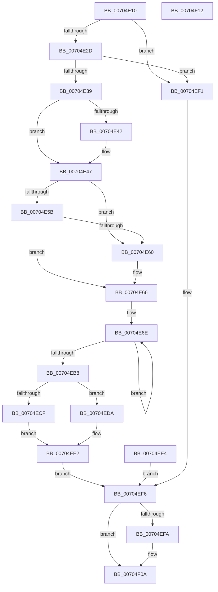

# PiCMCaptureProblemInputData

- RVA: `0x00704E10`–`0x00704F13` (길이 `259` bytes)
- VA: `0x0000000140704E10`
- 실행 섹션: `PAGE`
- PDB 이름 있음: `예`; PDB Function 태그: `아니요`
- unwind 정보 RVA: `0x000BFA58`
- 디코드: `72`개 명령, `259/259` bytes 표시
- 미해석 바이트: `0` (있으면 어셈블리에 `.byte`로 보존)

> 이 문서는 커널 이미지의 기계어와 PDB 기호를 분석해 생성했습니다. 4번과 5번은 함수 원형과 자료형을 바이너리 사용 방식에서 추정한 C 해석이며 원본 소스 복구 결과는 아닙니다.

## 1. Dependencies

- 직접 호출 지점: **2**; 고유 호출 대상: **2**
- 직접 호출자로 확인된 함수: **1**
- RIP 상대 이미지 참조: **0**

### Outgoing calls
- `0x00704E42` → [ExRaiseDatatypeMisalignment](../89/ExRaiseDatatypeMisalignment_function_00899FD0.md) (function, `0x00899FD0`)
- `0x00704F05` → [memset](../../text/6C/memset_function_006C6C40.md) (function, `0x006C6C40`)

### Direct callers
- [PiCMSetDeviceProblem](../AD/PiCMSetDeviceProblem_function_00ADA9E0.md) at `0x00ADAA37`

### Static image references
- 디코드된 RIP-relative 메모리 참조가 없습니다.

## 2. Other-region calls and transfers

- 다른 실행 섹션으로 향하는 call: **1**
  - `0x00704F05` → [memset](../../text/6C/memset_function_006C6C40.md) (`PAGE` → `.text`)
- 별도 외부 분기/꼬리 이동을 확인하지 못했습니다.

## 3. Assembly (complete function range)

```asm
00704E10  4C 89 4C 24 20                  mov qword ptr [rsp + 0x20], r9
00704E15  53                              push rbx
00704E16  48 83 EC 30                     sub rsp, 0x30
00704E1A  45 33 C0                        xor r8d, r8d
00704E1D  41 8B D8                        mov ebx, r8d
00704E20  89 5C 24 20                     mov dword ptr [rsp + 0x20], ebx
00704E24  48 85 C9                        test rcx, rcx
00704E27  0F 84 C4 00 00 00               je 0x140704ef1
00704E2D  81 FA A0 01 00 00               cmp edx, 0x1a0
00704E33  0F 82 B8 00 00 00               jb 0x140704ef1
00704E39  45 8D 50 03                     lea r10d, [r8 + 3]
00704E3D  41 84 CA                        test r10b, cl
00704E40  74 05                           je 0x140704e47
00704E42  E8 89 51 19 00                  call 0x140899fd0
00704E47  8B D2                           mov edx, edx
00704E49  48 03 D1                        add rdx, rcx
00704E4C  48 B8 00 00 FF FF FF 7F 00 00   movabs rax, 0x7fffffff0000
00704E56  48 3B D0                        cmp rdx, rax
00704E59  77 05                           ja 0x140704e60
00704E5B  48 3B D1                        cmp rdx, rcx
00704E5E  73 06                           jae 0x140704e66
00704E60  8A 00                           mov al, byte ptr [rax]
00704E62  8B 5C 24 20                     mov ebx, dword ptr [rsp + 0x20]
00704E66  49 8B C1                        mov rax, r9
00704E69  BA 80 00 00 00                  mov edx, 0x80
00704E6E  0F 10 01                        movups xmm0, xmmword ptr [rcx]
00704E71  0F 11 00                        movups xmmword ptr [rax], xmm0
00704E74  0F 10 49 10                     movups xmm1, xmmword ptr [rcx + 0x10]
00704E78  0F 11 48 10                     movups xmmword ptr [rax + 0x10], xmm1
00704E7C  0F 10 41 20                     movups xmm0, xmmword ptr [rcx + 0x20]
00704E80  0F 11 40 20                     movups xmmword ptr [rax + 0x20], xmm0
00704E84  0F 10 49 30                     movups xmm1, xmmword ptr [rcx + 0x30]
00704E88  0F 11 48 30                     movups xmmword ptr [rax + 0x30], xmm1
00704E8C  0F 10 41 40                     movups xmm0, xmmword ptr [rcx + 0x40]
00704E90  0F 11 40 40                     movups xmmword ptr [rax + 0x40], xmm0
00704E94  0F 10 49 50                     movups xmm1, xmmword ptr [rcx + 0x50]
00704E98  0F 11 48 50                     movups xmmword ptr [rax + 0x50], xmm1
00704E9C  0F 10 41 60                     movups xmm0, xmmword ptr [rcx + 0x60]
00704EA0  0F 11 40 60                     movups xmmword ptr [rax + 0x60], xmm0
00704EA4  48 03 C2                        add rax, rdx
00704EA7  0F 10 49 70                     movups xmm1, xmmword ptr [rcx + 0x70]
00704EAB  0F 11 48 F0                     movups xmmword ptr [rax - 0x10], xmm1
00704EAF  48 03 CA                        add rcx, rdx
00704EB2  49 83 EA 01                     sub r10, 1
00704EB6  75 B6                           jne 0x140704e6e
00704EB8  0F 10 01                        movups xmm0, xmmword ptr [rcx]
00704EBB  0F 11 00                        movups xmmword ptr [rax], xmm0
00704EBE  0F 10 49 10                     movups xmm1, xmmword ptr [rcx + 0x10]
00704EC2  0F 11 48 10                     movups xmmword ptr [rax + 0x10], xmm1
00704EC6  41 81 39 A0 01 00 00            cmp dword ptr [r9], 0x1a0
00704ECD  74 0B                           je 0x140704eda
00704ECF  BB 0D 00 00 C0                  mov ebx, 0xc000000d
00704ED4  89 5C 24 20                     mov dword ptr [rsp + 0x20], ebx
00704ED8  EB 08                           jmp 0x140704ee2
00704EDA  66 45 89 81 96 01 00 00         mov word ptr [r9 + 0x196], r8w
00704EE2  EB 12                           jmp 0x140704ef6
00704EE4  8B D8                           mov ebx, eax
00704EE6  89 44 24 20                     mov dword ptr [rsp + 0x20], eax
00704EEA  4C 8B 4C 24 58                  mov r9, qword ptr [rsp + 0x58]
00704EEF  EB 05                           jmp 0x140704ef6
00704EF1  BB 0D 00 00 C0                  mov ebx, 0xc000000d
00704EF6  85 DB                           test ebx, ebx
00704EF8  79 10                           jns 0x140704f0a
00704EFA  33 D2                           xor edx, edx
00704EFC  41 B8 A0 01 00 00               mov r8d, 0x1a0
00704F02  49 8B C9                        mov rcx, r9
00704F05  E8 36 1D FC FF                  call 0x1406c6c40
00704F0A  8B C3                           mov eax, ebx
00704F0C  48 83 C4 30                     add rsp, 0x30
00704F10  5B                              pop rbx
00704F11  C3                              ret
00704F12  CC                              int3
```

## 4. C-style interpretation (structured pseudocode)

```c
__int64 __fastcall PiCMCaptureProblemInputData(__int64 a1, int a2, int a3, __int64 a4)
{
    __int64 result;
    __int64 v_r10;
    __int64 v_rbx;
    __int64 v_rsp;
    unsigned int v_stack_m18;
    unsigned __int64 v_stack_p20;

    v_stack_p20 = a4;
    v_rsp = (v_rsp) - (48);
    a3 = 0;
    v_stack_m18 = 0;
    if (a1 == 0) goto loc_00704EF1;
    if (a2 < 416) goto loc_00704EF1;
    if ((((unsigned __int8)(a3 + 3)) & ((unsigned __int8)(a1))) != 0) {
        result = ExRaiseDatatypeMisalignment(a1, a2, a3, a4);
    }
    a2 = ((unsigned int)(a2)) + (a1);
    if (a2 > result) goto loc_00704E60;
    v_rbx = 0;
    if (a2 < a1) {
        result = *(unsigned __int8 *)(result);
        v_rbx = v_stack_m18;
    }
loc_00704E6E:
    *(unsigned __int64 *)(a4) = v_xmm0;
    *(unsigned __int64 *)(a4 + 16) = v_xmm1;
    *(unsigned __int64 *)(a4 + 32) = v_xmm0;
    *(unsigned __int64 *)(a4 + 48) = v_xmm1;
    *(unsigned __int64 *)(a4 + 64) = v_xmm0;
    *(unsigned __int64 *)(a4 + 80) = v_xmm1;
    *(unsigned __int64 *)(a4 + 96) = v_xmm0;
    result = (a4) + (128);
    *(unsigned __int64 *)(result - 16) = v_xmm1;
    a1 = (a1) + (128);
    v_r10 = (a3 + 3) - (1);
    if (condition_is_not_equal) goto loc_00704E6E;
    *(unsigned __int64 *)(result) = v_xmm0;
    *(unsigned __int64 *)(result + 16) = v_xmm1;
    if ((*(unsigned int *)(a4)) == 416) goto loc_00704EDA;
    v_stack_m18 = (unsigned int)((unsigned int)(0xC000000DULL));
    goto loc_00704EE2;
loc_00704EDA:
    *(unsigned __int16 *)(a4 + 406) = 0;
loc_00704EE2:
    goto loc_00704EF6;
loc_00704EF1:
loc_00704EF6:
    if (sign_flag) {
        a2 = 0;
        a3 = 416;
        a1 = a4;
        result = memset(a1, a2, a3, a4);
    }
    v_rsp = (v_rsp) + (48);
    return (unsigned int)((unsigned int)((unsigned int)(0xC000000DULL)));
}
```

## 5. (Beta) C Style

```c
int64_t PiCMCaptureProblemInputData(int64_t Arg1, int32_t Arg2, int32_t Arg3, int64_t Arg4)
{
    int64_t result;
    int64_t local_r10;
    int64_t local_rbx;
    int64_t local_rsp;
    uint32_t v_stack_m18;
    uint64_t v_stack_p20;

    v_stack_p20 = Arg4;
    local_rsp = (local_rsp) - (48);
    Arg3 = 0;
    v_stack_m18 = 0;
    if (Arg1 == 0) goto loc_00704EF1;
    if (Arg2 < 416) goto loc_00704EF1;
    if ((((uint8_t)(Arg3 + 3)) & ((uint8_t)(Arg1))) != 0) {
        result = ExRaiseDatatypeMisalignment(Arg1, Arg2, Arg3, Arg4);
    }
    Arg2 = ((uint32_t)(Arg2)) + (Arg1);
    if (Arg2 > result) goto loc_00704E60;
    local_rbx = 0;
    if (Arg2 < Arg1) {
        result = *(uint8_t *)(result);
        local_rbx = v_stack_m18;
    }
loc_00704E6E:
    *(uint64_t *)(Arg4) = v_xmm0;
    *(uint64_t *)(Arg4 + 0x10) = v_xmm1;
    *(uint64_t *)(Arg4 + 0x20) = v_xmm0;
    *(uint64_t *)(Arg4 + 0x30) = v_xmm1;
    *(uint64_t *)(Arg4 + 0x40) = v_xmm0;
    *(uint64_t *)(Arg4 + 0x50) = v_xmm1;
    *(uint64_t *)(Arg4 + 0x60) = v_xmm0;
    result = (Arg4) + (128);
    *(uint64_t *)(result - 0x10) = v_xmm1;
    Arg1 = (Arg1) + (128);
    local_r10 = (Arg3 + 3) - (1);
    if (condition_is_not_equal) goto loc_00704E6E;
    *(uint64_t *)(result) = v_xmm0;
    *(uint64_t *)(result + 0x10) = v_xmm1;
    if ((*(uint32_t *)(Arg4)) == 416) goto loc_00704EDA;
    v_stack_m18 = (uint32_t)((uint32_t)(0xC000000DULL));
    goto loc_00704EE2;
loc_00704EDA:
    *(uint16_t *)(Arg4 + 0x196) = 0;
loc_00704EE2:
    goto loc_00704EF6;
loc_00704EF1:
loc_00704EF6:
    if (sign_flag) {
        Arg2 = 0;
        Arg3 = 416;
        Arg1 = Arg4;
        result = memset(Arg1, Arg2, Arg3, Arg4);
    }
    local_rsp = (local_rsp) + (48);
    return (uint32_t)((uint32_t)((uint32_t)(0xC000000DULL)));
}
```

## 6. Execution-region graph

[열기: 2D/3D 그래프와 함수 탐색 컨트롤 패널](../../../control-panel.html?section=page&rva=0x00704E10&view=graph)

- 2D 그래프는 위에서 아래로 흐르고, 3D 그래프는 빈 공간을 드래그해 회전합니다. Shift+드래그는 이동, 휠은 확대·축소, 함수 노드 선택은 대상 보고서 이동입니다.

### Static fallback


