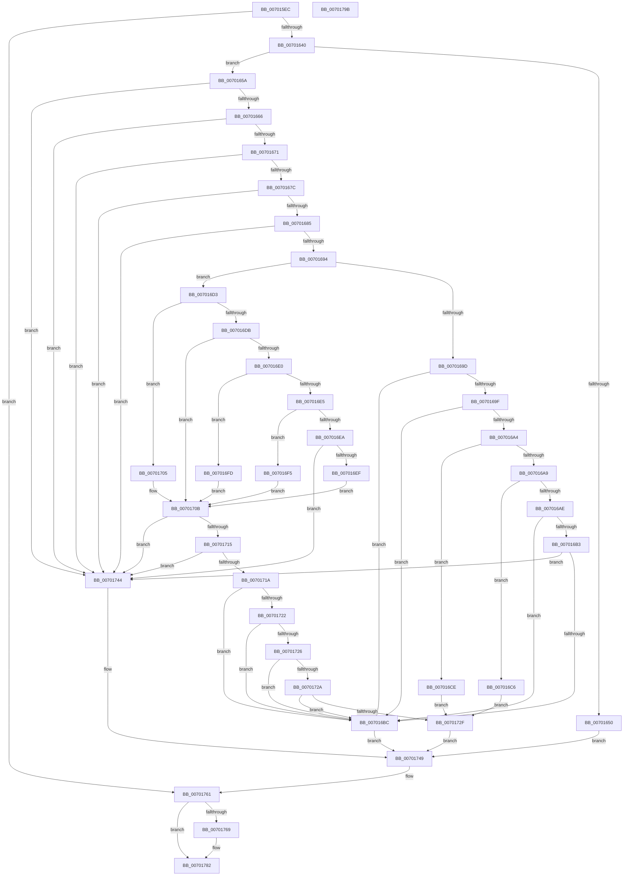

# PiCMCreateObject

- RVA: `0x007015EC`–`0x0070179C` (길이 `432` bytes)
- VA: `0x00000001407015EC`
- 실행 섹션: `PAGE`
- PDB 이름 있음: `예`; PDB Function 태그: `아니요`
- unwind 정보 RVA: `0x000BF580`
- 디코드: `117`개 명령, `432/432` bytes 표시
- 미해석 바이트: `0` (있으면 어셈블리에 `.byte`로 보존)

> 이 문서는 커널 이미지의 기계어와 PDB 기호를 분석해 생성했습니다. 4번과 5번은 함수 원형과 자료형을 바이너리 사용 방식에서 추정한 C 해석이며 원본 소스 복구 결과는 아닙니다.

## 1. Dependencies

- 직접 호출 지점: **5**; 고유 호출 대상: **5**
- 직접 호출자로 확인된 함수: **1**
- RIP 상대 이미지 참조: **1**

### Outgoing calls
- `0x00701631` → [PiCMCaptureObjectInputData](../8E/PiCMCaptureObjectInputData_function_008E8220.md) (function, `0x008E8220`)
- `0x00701647` → [PiAuDoesClientHaveAccess](../96/PiAuDoesClientHaveAccess_function_00962940.md) (function, `0x00962940`)
- `0x0070173D` → [PnpCreateObject](../82/PnpCreateObject_function_0082C27C.md) (function, `0x0082C27C`)
- `0x0070175A` → [PiCMReturnBasicResultData](../8E/PiCMReturnBasicResultData_function_008E86E8.md) (function, `0x008E86E8`)
- `0x0070177D` → [PiControlFreeUserModeCallersBuffer](../../text/44/PiControlFreeUserModeCallersBuffer_function_00448990.md) (function, `0x00448990`)

### Direct callers
- [PiCMHandleIoctl](../8E/PiCMHandleIoctl_function_008EB880.md) at `0x008EC1A9`

### Static image references
- `0x0070170B` → RVA `0x00E663D0` (`.data`; read)

## 2. Other-region calls and transfers

- 다른 실행 섹션으로 향하는 call: **1**
  - `0x0070177D` → [PiControlFreeUserModeCallersBuffer](../../text/44/PiControlFreeUserModeCallersBuffer_function_00448990.md) (`PAGE` → `.text`)
- 별도 외부 분기/꼬리 이동을 확인하지 못했습니다.

## 3. Assembly (complete function range)

```asm
007015EC  4C 8B DC                        mov r11, rsp
007015EF  49 89 5B 08                     mov qword ptr [r11 + 8], rbx
007015F3  49 89 6B 10                     mov qword ptr [r11 + 0x10], rbp
007015F7  49 89 73 18                     mov qword ptr [r11 + 0x18], rsi
007015FB  41 56                           push r14
007015FD  48 83 EC 70                     sub rsp, 0x70
00701601  4C 8B B4 24 A8 00 00 00         mov r14, qword ptr [rsp + 0xa8]
00701609  0F 57 C0                        xorps xmm0, xmm0
0070160C  33 C0                           xor eax, eax
0070160E  41 8B E9                        mov ebp, r9d
00701611  49 8B F0                        mov rsi, r8
00701614  4D 8D 4B C8                     lea r9, [r11 - 0x38]
00701618  44 8B 84 24 A0 00 00 00         mov r8d, dword ptr [rsp + 0xa0]
00701620  41 21 06                        and dword ptr [r14], eax
00701623  0F 11 44 24 40                  movups xmmword ptr [rsp + 0x40], xmm0
00701628  0F 11 44 24 50                  movups xmmword ptr [rsp + 0x50], xmm0
0070162D  49 89 43 E8                     mov qword ptr [r11 - 0x18], rax
00701631  E8 EA 6B 1E 00                  call 0x1408e8220
00701636  8B D8                           mov ebx, eax
00701638  85 C0                           test eax, eax
0070163A  0F 88 21 01 00 00               js 0x140701761
00701640  BB 02 00 00 00                  mov ebx, 2
00701645  8B CB                           mov ecx, ebx
00701647  E8 F4 12 26 00                  call 0x140962940
0070164C  84 C0                           test al, al
0070164E  75 0A                           jne 0x14070165a
00701650  B8 22 00 00 C0                  mov eax, 0xc0000022
00701655  E9 EF 00 00 00                  jmp 0x140701749
0070165A  48 83 7C 24 50 00               cmp qword ptr [rsp + 0x50], 0
00701660  0F 84 DE 00 00 00               je 0x140701744
00701666  83 7C 24 44 00                  cmp dword ptr [rsp + 0x44], 0
0070166B  0F 85 D3 00 00 00               jne 0x140701744
00701671  83 7C 24 5C 00                  cmp dword ptr [rsp + 0x5c], 0
00701676  0F 85 C8 00 00 00               jne 0x140701744
0070167C  48 85 F6                        test rsi, rsi
0070167F  0F 84 BF 00 00 00               je 0x140701744
00701685  41 B8 08 00 00 00               mov r8d, 8
0070168B  41 3B E8                        cmp ebp, r8d
0070168E  0F 82 B0 00 00 00               jb 0x140701744
00701694  8B 4C 24 48                     mov ecx, dword ptr [rsp + 0x48]
00701698  83 F9 06                        cmp ecx, 6
0070169B  7F 36                           jg 0x1407016d3
0070169D  74 1D                           je 0x1407016bc
0070169F  83 E9 01                        sub ecx, 1
007016A2  74 18                           je 0x1407016bc
007016A4  83 E9 01                        sub ecx, 1
007016A7  74 25                           je 0x1407016ce
007016A9  83 E9 01                        sub ecx, 1
007016AC  74 18                           je 0x1407016c6
007016AE  83 E9 01                        sub ecx, 1
007016B1  74 09                           je 0x1407016bc
007016B3  83 F9 01                        cmp ecx, 1
007016B6  0F 85 88 00 00 00               jne 0x140701744
007016BC  B8 BB 00 00 C0                  mov eax, 0xc00000bb
007016C1  E9 83 00 00 00                  jmp 0x140701749
007016C6  41 B8 04 00 00 00               mov r8d, 4
007016CC  EB 61                           jmp 0x14070172f
007016CE  44 8B C3                        mov r8d, ebx
007016D1  EB 5C                           jmp 0x14070172f
007016D3  81 E9 01 00 01 00               sub ecx, 0x10001
007016D9  74 2A                           je 0x140701705
007016DB  83 E9 01                        sub ecx, 1
007016DE  74 2B                           je 0x14070170b
007016E0  83 E9 01                        sub ecx, 1
007016E3  74 18                           je 0x1407016fd
007016E5  83 E9 01                        sub ecx, 1
007016E8  74 0B                           je 0x1407016f5
007016EA  83 F9 01                        cmp ecx, 1
007016ED  75 55                           jne 0x140701744
007016EF  44 8D 41 0A                     lea r8d, [rcx + 0xa]
007016F3  EB 16                           jmp 0x14070170b
007016F5  41 B8 0A 00 00 00               mov r8d, 0xa
007016FB  EB 0E                           jmp 0x14070170b
007016FD  41 B8 09 00 00 00               mov r8d, 9
00701703  EB 06                           jmp 0x14070170b
00701705  41 B8 07 00 00 00               mov r8d, 7
0070170B  48 83 3D BD 4C 76 00 00         cmp qword ptr [rip + 0x764cbd], 0
00701713  74 2F                           je 0x140701744
00701715  45 85 C0                        test r8d, r8d
00701718  74 2A                           je 0x140701744
0070171A  41 8B C8                        mov ecx, r8d
0070171D  83 E9 01                        sub ecx, 1
00701720  74 9A                           je 0x1407016bc
00701722  2B CB                           sub ecx, ebx
00701724  74 96                           je 0x1407016bc
00701726  2B CB                           sub ecx, ebx
00701728  74 92                           je 0x1407016bc
0070172A  83 F9 01                        cmp ecx, 1
0070172D  74 8D                           je 0x1407016bc
0070172F  48 83 64 24 20 00               and qword ptr [rsp + 0x20], 0
00701735  45 33 C9                        xor r9d, r9d
00701738  48 8B 54 24 50                  mov rdx, qword ptr [rsp + 0x50]
0070173D  E8 3A AB 12 00                  call 0x14082c27c
00701742  EB 05                           jmp 0x140701749
00701744  B8 0D 00 00 C0                  mov eax, 0xc000000d
00701749  8B 54 24 60                     mov edx, dword ptr [rsp + 0x60]
0070174D  44 8B CD                        mov r9d, ebp
00701750  4C 8B C6                        mov r8, rsi
00701753  4C 89 74 24 20                  mov qword ptr [rsp + 0x20], r14
00701758  8B C8                           mov ecx, eax
0070175A  E8 89 6F 1E 00                  call 0x1408e86e8
0070175F  8B D8                           mov ebx, eax
00701761  48 83 7C 24 50 00               cmp qword ptr [rsp + 0x50], 0
00701767  74 19                           je 0x140701782
00701769  65 48 8B 0C 25 88 01 00 00      mov rcx, qword ptr gs:[0x188]
00701772  48 8B 54 24 50                  mov rdx, qword ptr [rsp + 0x50]
00701777  8A 89 32 02 00 00               mov cl, byte ptr [rcx + 0x232]
0070177D  E8 0E 72 D4 FF                  call 0x140448990
00701782  4C 8D 5C 24 70                  lea r11, [rsp + 0x70]
00701787  8B C3                           mov eax, ebx
00701789  49 8B 5B 10                     mov rbx, qword ptr [r11 + 0x10]
0070178D  49 8B 6B 18                     mov rbp, qword ptr [r11 + 0x18]
00701791  49 8B 73 20                     mov rsi, qword ptr [r11 + 0x20]
00701795  49 8B E3                        mov rsp, r11
00701798  41 5E                           pop r14
0070179A  C3                              ret
0070179B  CC                              int3
```

## 4. C-style interpretation (structured pseudocode)

```c
__int64 __fastcall PiCMCreateObject(__int64 a1, __int64 a2, __int64 a3, int a4, unsigned int a5, __int64 a6)
{
    __int64 result;
    __int64 v_rsp;
    unsigned int v_stack_m18;
    unsigned int v_stack_m1C;
    unsigned __int64 v_stack_m28;
    unsigned int v_stack_m30;
    unsigned int v_stack_m34;
    unsigned __int64 v_stack_m38;
    unsigned __int64 v_stack_m58;
    unsigned __int64 v_stack_m8;

    *(unsigned __int64 *)(v_rsp + 8) = v_rbx;
    *(unsigned __int64 *)(v_rsp + 16) = v_rbp;
    *(unsigned __int64 *)(v_rsp + 24) = v_rsi;
    v_rsp = (v_rsp) - (112);
    result = 0;
    v_stack_m38 = v_xmm0;
    v_stack_m28 = v_xmm0;
    *(unsigned __int64 *)(v_rsp - 24) = 0;
    result = PiCMCaptureObjectInputData(a1, a2, (unsigned int)(a5), v_rsp - 56);
    if (sign_flag) goto loc_00701761;
    result = PiAuDoesClientHaveAccess(2, a2, (unsigned int)(a5), v_rsp - 56);
    if ((unsigned __int8)(result) != 0) goto loc_0070165A;
    goto loc_00701749;
loc_0070165A:
    if (v_stack_m28 == 0) goto loc_00701744;
    if (v_stack_m34 != 0) goto loc_00701744;
    if (v_stack_m1C != 0) goto loc_00701744;
    if (a3 == 0) goto loc_00701744;
    if (((unsigned int)((unsigned int)(a4))) < 8) goto loc_00701744;
    if (((unsigned int)((unsigned int)(v_stack_m30))) > 6) goto loc_007016D3;
    if (((unsigned int)((unsigned int)(v_stack_m30))) == 6) goto loc_007016BC;
    a1 = (unsigned int)(((unsigned int)(v_stack_m30)) - (1));
    if (condition_is_equal) goto loc_007016BC;
    a1 = (unsigned int)((a1) - (1));
    if (condition_is_equal) goto loc_007016CE;
    a1 = (unsigned int)((a1) - (1));
    if (condition_is_equal) goto loc_007016C6;
    a1 = (unsigned int)((a1) - (1));
    if (condition_is_equal) goto loc_007016BC;
    if (((unsigned int)(a1)) != 1) goto loc_00701744;
loc_007016BC:
    goto loc_00701749;
loc_007016C6:
    goto loc_0070172F;
loc_007016CE:
    goto loc_0070172F;
loc_007016D3:
    a1 = (unsigned int)((a1) - (0x10001ULL));
    if (condition_is_equal) goto loc_00701705;
    a1 = (unsigned int)((a1) - (1));
    if (condition_is_equal) goto loc_0070170B;
    a1 = (unsigned int)((a1) - (1));
    if (condition_is_equal) goto loc_007016FD;
    a1 = (unsigned int)((a1) - (1));
    if (condition_is_equal) goto loc_007016F5;
    if (((unsigned int)(a1)) != 1) goto loc_00701744;
    goto loc_0070170B;
loc_007016F5:
    goto loc_0070170B;
loc_007016FD:
    goto loc_0070170B;
loc_00701705:
loc_0070170B:
    if ((*(unsigned __int64 *)(v_rip + 7752893)) == 0) goto loc_00701744;
    if (7 == 0) goto loc_00701744;
    a1 = (unsigned int)((7) - (1));
    if (condition_is_equal) goto loc_007016BC;
    a1 = (unsigned int)((a1) - (2));
    if (condition_is_equal) goto loc_007016BC;
    a1 = (unsigned int)((a1) - (2));
    if (condition_is_equal) goto loc_007016BC;
    if (((unsigned int)(a1)) == 1) goto loc_007016BC;
loc_0070172F:
    a4 = 0;
    result = PnpCreateObject(a1, v_stack_m28, 7, a4);
    goto loc_00701749;
loc_00701744:
loc_00701749:
    v_stack_m58 = a6;
    result = PiCMReturnBasicResultData((unsigned int)((unsigned int)((unsigned int)(0xC000000DULL))), (unsigned int)(v_stack_m18), a3, (unsigned int)((unsigned int)((unsigned int)(a4))));
loc_00701761:
    if (v_stack_m28 != 0) {
        a1 = *(unsigned __int64 *)(gs_base + (0 + 392));
        a2 = v_stack_m28;
        a1 = *(unsigned __int8 *)(a1 + 562);
        result = PiControlFreeUserModeCallersBuffer(a1, a2, a3, (unsigned int)((unsigned int)((unsigned int)(a4))));
    }
    return (unsigned int)((unsigned int)((unsigned int)((unsigned int)(result))));
}
```

## 5. (Beta) C Style

```c
int64_t PiCMCreateObject(int64_t Arg1, int64_t Arg2, int64_t Arg3, int32_t Arg4, uint32_t Arg5, void *Arg6)
{
    uint8_t *arg6 = (uint8_t *)Arg6;

    int64_t result;
    int64_t local_rsp;
    uint32_t v_stack_m18;
    uint32_t v_stack_m1C;
    uint64_t v_stack_m28;
    uint32_t v_stack_m30;
    uint32_t v_stack_m34;
    uint64_t v_stack_m38;
    uint64_t v_stack_m58;
    uint64_t v_stack_m8;

    *(uint64_t *)(local_rsp + 0x8) = local_rbx;
    *(uint64_t *)(local_rsp + 0x10) = local_rbp;
    *(uint64_t *)(local_rsp + 0x18) = local_rsi;
    local_rsp = (local_rsp) - (112);
    result = 0;
    v_stack_m38 = v_xmm0;
    v_stack_m28 = v_xmm0;
    *(uint64_t *)(local_rsp - 0x18) = 0;
    result = PiCMCaptureObjectInputData(Arg1, Arg2, (uint32_t)(Arg5), local_rsp - 56);
    if (sign_flag) goto loc_00701761;
    result = PiAuDoesClientHaveAccess(2, Arg2, (uint32_t)(Arg5), local_rsp - 56);
    if ((uint8_t)(result) != 0) goto loc_0070165A;
    goto loc_00701749;
loc_0070165A:
    if (v_stack_m28 == 0) goto loc_00701744;
    if (v_stack_m34 != 0) goto loc_00701744;
    if (v_stack_m1C != 0) goto loc_00701744;
    if (Arg3 == 0) goto loc_00701744;
    if (((uint32_t)((uint32_t)(Arg4))) < 8) goto loc_00701744;
    if (((uint32_t)((uint32_t)(v_stack_m30))) > 6) goto loc_007016D3;
    if (((uint32_t)((uint32_t)(v_stack_m30))) == 6) goto loc_007016BC;
    Arg1 = (uint32_t)(((uint32_t)(v_stack_m30)) - (1));
    if (condition_is_equal) goto loc_007016BC;
    Arg1 = (uint32_t)((Arg1) - (1));
    if (condition_is_equal) goto loc_007016CE;
    Arg1 = (uint32_t)((Arg1) - (1));
    if (condition_is_equal) goto loc_007016C6;
    Arg1 = (uint32_t)((Arg1) - (1));
    if (condition_is_equal) goto loc_007016BC;
    if (((uint32_t)(Arg1)) != 1) goto loc_00701744;
loc_007016BC:
    goto loc_00701749;
loc_007016C6:
    goto loc_0070172F;
loc_007016CE:
    goto loc_0070172F;
loc_007016D3:
    Arg1 = (uint32_t)((Arg1) - (0x10001ULL));
    if (condition_is_equal) goto loc_00701705;
    Arg1 = (uint32_t)((Arg1) - (1));
    if (condition_is_equal) goto loc_0070170B;
    Arg1 = (uint32_t)((Arg1) - (1));
    if (condition_is_equal) goto loc_007016FD;
    Arg1 = (uint32_t)((Arg1) - (1));
    if (condition_is_equal) goto loc_007016F5;
    if (((uint32_t)(Arg1)) != 1) goto loc_00701744;
    goto loc_0070170B;
loc_007016F5:
    goto loc_0070170B;
loc_007016FD:
    goto loc_0070170B;
loc_00701705:
loc_0070170B:
    if ((*(uint64_t *)(v_rip + 0x764CBD)) == 0) goto loc_00701744;
    if (7 == 0) goto loc_00701744;
    Arg1 = (uint32_t)((7) - (1));
    if (condition_is_equal) goto loc_007016BC;
    Arg1 = (uint32_t)((Arg1) - (2));
    if (condition_is_equal) goto loc_007016BC;
    Arg1 = (uint32_t)((Arg1) - (2));
    if (condition_is_equal) goto loc_007016BC;
    if (((uint32_t)(Arg1)) == 1) goto loc_007016BC;
loc_0070172F:
    Arg4 = 0;
    result = PnpCreateObject(Arg1, v_stack_m28, 7, Arg4);
    goto loc_00701749;
loc_00701744:
loc_00701749:
    v_stack_m58 = Arg6;
    result = PiCMReturnBasicResultData((uint32_t)((uint32_t)((uint32_t)(0xC000000DULL))), (uint32_t)(v_stack_m18), Arg3, (uint32_t)((uint32_t)((uint32_t)(Arg4))));
loc_00701761:
    if (v_stack_m28 != 0) {
        Arg1 = *(uint64_t *)(gs_base + (0 + 0x188));
        Arg2 = v_stack_m28;
        Arg1 = *(uint8_t *)(Arg1 + 0x232);
        result = PiControlFreeUserModeCallersBuffer(Arg1, Arg2, Arg3, (uint32_t)((uint32_t)((uint32_t)(Arg4))));
    }
    return (uint32_t)((uint32_t)((uint32_t)((uint32_t)(result))));
}
```

### 관측된 메모리 오프셋

구조체 형식이 확인되지 않은 접근은 인자 기준의 오프셋으로만 기록했습니다.

| 기준 인자 | 오프셋 표현 | 폭 (bit) | 접근 |
|---|---:|---:|---|
| `Arg6` | `+ 0x0` | `32` | `R/W` |

## 6. Execution-region graph

[열기: 2D/3D 그래프와 함수 탐색 컨트롤 패널](../../../control-panel.html?section=page&rva=0x007015EC&view=graph)

- 2D 그래프는 위에서 아래로 흐르고, 3D 그래프는 빈 공간을 드래그해 회전합니다. Shift+드래그는 이동, 휠은 확대·축소, 함수 노드 선택은 대상 보고서 이동입니다.

### Static fallback


