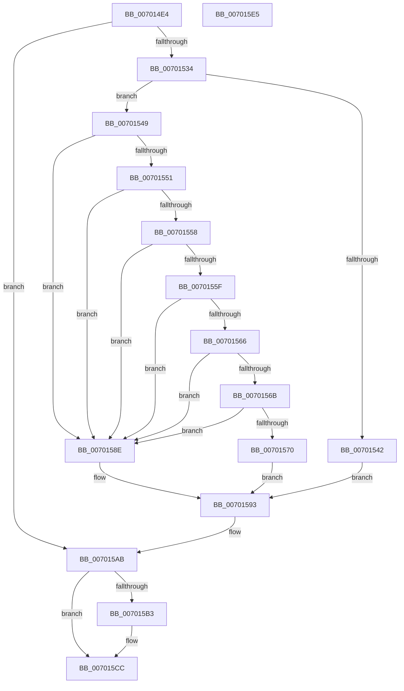

# PiCMDeleteDeviceInterfaceKey

- RVA: `0x007014E4`–`0x007015E6` (길이 `258` bytes)
- VA: `0x00000001407014E4`
- 실행 섹션: `PAGE`
- PDB 이름 있음: `예`; PDB Function 태그: `아니요`
- unwind 정보 RVA: `0x000BF568`
- 디코드: `68`개 명령, `258/258` bytes 표시
- 미해석 바이트: `0` (있으면 어셈블리에 `.byte`로 보존)

> 이 문서는 커널 이미지의 기계어와 PDB 기호를 분석해 생성했습니다. 4번과 5번은 함수 원형과 자료형을 바이너리 사용 방식에서 추정한 C 해석이며 원본 소스 복구 결과는 아닙니다.

## 1. Dependencies

- 직접 호출 지점: **5**; 고유 호출 대상: **5**
- 직접 호출자로 확인된 함수: **1**
- RIP 상대 이미지 참조: **1**

### Outgoing calls
- `0x00701529` → [PiCMCaptureObjectInputData](../8E/PiCMCaptureObjectInputData_function_008E8220.md) (function, `0x008E8220`)
- `0x00701539` → [PiAuDoesClientHaveAccess](../96/PiAuDoesClientHaveAccess_function_00962940.md) (function, `0x00962940`)
- `0x00701587` → [CmDeleteDeviceInterfaceRegKey](../82/CmDeleteDeviceInterfaceRegKey_function_00829CE4.md) (function, `0x00829CE4`)
- `0x007015A4` → [PiCMReturnBasicResultData](../8E/PiCMReturnBasicResultData_function_008E86E8.md) (function, `0x008E86E8`)
- `0x007015C7` → [PiControlFreeUserModeCallersBuffer](../../text/44/PiControlFreeUserModeCallersBuffer_function_00448990.md) (function, `0x00448990`)

### Direct callers
- [PiCMHandleIoctl](../8E/PiCMHandleIoctl_function_008EB880.md) at `0x008EC2CB`

### Static image references
- `0x0070157B` → RVA `0x00E66398` (`.data`; read)

## 2. Other-region calls and transfers

- 다른 실행 섹션으로 향하는 call: **1**
  - `0x007015C7` → [PiControlFreeUserModeCallersBuffer](../../text/44/PiControlFreeUserModeCallersBuffer_function_00448990.md) (`PAGE` → `.text`)
- 별도 외부 분기/꼬리 이동을 확인하지 못했습니다.

## 3. Assembly (complete function range)

```asm
007014E4  4C 8B DC                        mov r11, rsp
007014E7  49 89 6B 08                     mov qword ptr [r11 + 8], rbp
007014EB  49 89 73 10                     mov qword ptr [r11 + 0x10], rsi
007014EF  49 89 7B 18                     mov qword ptr [r11 + 0x18], rdi
007014F3  41 56                           push r14
007014F5  48 83 EC 60                     sub rsp, 0x60
007014F9  4C 8B B4 24 98 00 00 00         mov r14, qword ptr [rsp + 0x98]
00701501  0F 57 C0                        xorps xmm0, xmm0
00701504  33 C0                           xor eax, eax
00701506  41 8B F1                        mov esi, r9d
00701509  49 8B E8                        mov rbp, r8
0070150C  4D 8D 4B C8                     lea r9, [r11 - 0x38]
00701510  44 8B 84 24 90 00 00 00         mov r8d, dword ptr [rsp + 0x90]
00701518  41 21 06                        and dword ptr [r14], eax
0070151B  0F 11 44 24 30                  movups xmmword ptr [rsp + 0x30], xmm0
00701520  0F 11 44 24 40                  movups xmmword ptr [rsp + 0x40], xmm0
00701525  49 89 43 E8                     mov qword ptr [r11 - 0x18], rax
00701529  E8 F2 6C 1E 00                  call 0x1408e8220
0070152E  8B F8                           mov edi, eax
00701530  85 C0                           test eax, eax
00701532  78 77                           js 0x1407015ab
00701534  B9 02 00 00 00                  mov ecx, 2
00701539  E8 02 14 26 00                  call 0x140962940
0070153E  84 C0                           test al, al
00701540  75 07                           jne 0x140701549
00701542  B8 22 00 00 C0                  mov eax, 0xc0000022
00701547  EB 4A                           jmp 0x140701593
00701549  48 83 7C 24 40 00               cmp qword ptr [rsp + 0x40], 0
0070154F  74 3D                           je 0x14070158e
00701551  83 7C 24 34 00                  cmp dword ptr [rsp + 0x34], 0
00701556  75 36                           jne 0x14070158e
00701558  83 7C 24 38 04                  cmp dword ptr [rsp + 0x38], 4
0070155D  75 2F                           jne 0x14070158e
0070155F  83 7C 24 4C 00                  cmp dword ptr [rsp + 0x4c], 0
00701564  75 28                           jne 0x14070158e
00701566  48 85 ED                        test rbp, rbp
00701569  74 23                           je 0x14070158e
0070156B  83 FE 08                        cmp esi, 8
0070156E  72 1E                           jb 0x14070158e
00701570  48 8B 54 24 40                  mov rdx, qword ptr [rsp + 0x40]
00701575  41 B8 32 00 00 00               mov r8d, 0x32
0070157B  48 8B 0D 16 4E 76 00            mov rcx, qword ptr [rip + 0x764e16]
00701582  C6 44 24 20 01                  mov byte ptr [rsp + 0x20], 1
00701587  E8 58 87 12 00                  call 0x140829ce4
0070158C  EB 05                           jmp 0x140701593
0070158E  B8 0D 00 00 C0                  mov eax, 0xc000000d
00701593  8B 54 24 50                     mov edx, dword ptr [rsp + 0x50]
00701597  44 8B CE                        mov r9d, esi
0070159A  4C 8B C5                        mov r8, rbp
0070159D  4C 89 74 24 20                  mov qword ptr [rsp + 0x20], r14
007015A2  8B C8                           mov ecx, eax
007015A4  E8 3F 71 1E 00                  call 0x1408e86e8
007015A9  8B F8                           mov edi, eax
007015AB  48 83 7C 24 40 00               cmp qword ptr [rsp + 0x40], 0
007015B1  74 19                           je 0x1407015cc
007015B3  65 48 8B 0C 25 88 01 00 00      mov rcx, qword ptr gs:[0x188]
007015BC  48 8B 54 24 40                  mov rdx, qword ptr [rsp + 0x40]
007015C1  8A 89 32 02 00 00               mov cl, byte ptr [rcx + 0x232]
007015C7  E8 C4 73 D4 FF                  call 0x140448990
007015CC  4C 8D 5C 24 60                  lea r11, [rsp + 0x60]
007015D1  8B C7                           mov eax, edi
007015D3  49 8B 6B 10                     mov rbp, qword ptr [r11 + 0x10]
007015D7  49 8B 73 18                     mov rsi, qword ptr [r11 + 0x18]
007015DB  49 8B 7B 20                     mov rdi, qword ptr [r11 + 0x20]
007015DF  49 8B E3                        mov rsp, r11
007015E2  41 5E                           pop r14
007015E4  C3                              ret
007015E5  CC                              int3
```

## 4. C-style interpretation (structured pseudocode)

```c
__int64 __fastcall PiCMDeleteDeviceInterfaceKey(__int64 a1, __int64 a2, __int64 a3, int a4, unsigned int a5, __int64 a6)
{
    __int64 result;
    __int64 v_rsp;
    unsigned int v_stack_m18;
    unsigned int v_stack_m1C;
    unsigned __int64 v_stack_m28;
    unsigned int v_stack_m30;
    unsigned int v_stack_m34;
    unsigned __int64 v_stack_m38;
    unsigned __int8 v_stack_m48;
    unsigned __int64 v_stack_m8;

    *(unsigned __int64 *)(v_rsp + 8) = v_rbp;
    *(unsigned __int64 *)(v_rsp + 16) = v_rsi;
    *(unsigned __int64 *)(v_rsp + 24) = v_rdi;
    v_rsp = (v_rsp) - (96);
    result = 0;
    v_stack_m38 = v_xmm0;
    v_stack_m28 = v_xmm0;
    *(unsigned __int64 *)(v_rsp - 24) = 0;
    result = PiCMCaptureObjectInputData(a1, a2, (unsigned int)(a5), v_rsp - 56);
    if (sign_flag) goto loc_007015AB;
    result = PiAuDoesClientHaveAccess(2, a2, (unsigned int)(a5), v_rsp - 56);
    if ((unsigned __int8)(result) != 0) goto loc_00701549;
    goto loc_00701593;
loc_00701549:
    if (v_stack_m28 == 0) goto loc_0070158E;
    if (v_stack_m34 != 0) goto loc_0070158E;
    if (v_stack_m30 != 4) goto loc_0070158E;
    if (v_stack_m1C != 0) goto loc_0070158E;
    if (a3 == 0) goto loc_0070158E;
    if (((unsigned int)((unsigned int)(a4))) < 8) goto loc_0070158E;
    v_stack_m48 = 1;
    result = CmDeleteDeviceInterfaceRegKey(*(unsigned __int64 *)(v_rip + 7753238), v_stack_m28, 50, v_rsp - 56);
    goto loc_00701593;
loc_0070158E:
loc_00701593:
    v_stack_m48 = a6;
    result = PiCMReturnBasicResultData((unsigned int)((unsigned int)((unsigned int)(0xC000000DULL))), (unsigned int)(v_stack_m18), a3, (unsigned int)((unsigned int)((unsigned int)(a4))));
loc_007015AB:
    if (v_stack_m28 != 0) {
        a1 = *(unsigned __int64 *)(gs_base + (0 + 392));
        a2 = v_stack_m28;
        a1 = *(unsigned __int8 *)(a1 + 562);
        result = PiControlFreeUserModeCallersBuffer(a1, a2, a3, (unsigned int)((unsigned int)((unsigned int)(a4))));
    }
    return (unsigned int)((unsigned int)((unsigned int)((unsigned int)(result))));
}
```

## 5. (Beta) C Style

```c
int64_t PiCMDeleteDeviceInterfaceKey(int64_t Arg1, int64_t Arg2, int64_t Arg3, int32_t Arg4, uint32_t Arg5, void *Arg6)
{
    uint8_t *arg6 = (uint8_t *)Arg6;

    int64_t result;
    int64_t local_rsp;
    uint32_t v_stack_m18;
    uint32_t v_stack_m1C;
    uint64_t v_stack_m28;
    uint32_t v_stack_m30;
    uint32_t v_stack_m34;
    uint64_t v_stack_m38;
    uint8_t v_stack_m48;
    uint64_t v_stack_m8;

    *(uint64_t *)(local_rsp + 0x8) = local_rbp;
    *(uint64_t *)(local_rsp + 0x10) = local_rsi;
    *(uint64_t *)(local_rsp + 0x18) = local_rdi;
    local_rsp = (local_rsp) - (96);
    result = 0;
    v_stack_m38 = v_xmm0;
    v_stack_m28 = v_xmm0;
    *(uint64_t *)(local_rsp - 0x18) = 0;
    result = PiCMCaptureObjectInputData(Arg1, Arg2, (uint32_t)(Arg5), local_rsp - 56);
    if (sign_flag) goto loc_007015AB;
    result = PiAuDoesClientHaveAccess(2, Arg2, (uint32_t)(Arg5), local_rsp - 56);
    if ((uint8_t)(result) != 0) goto loc_00701549;
    goto loc_00701593;
loc_00701549:
    if (v_stack_m28 == 0) goto loc_0070158E;
    if (v_stack_m34 != 0) goto loc_0070158E;
    if (v_stack_m30 != 4) goto loc_0070158E;
    if (v_stack_m1C != 0) goto loc_0070158E;
    if (Arg3 == 0) goto loc_0070158E;
    if (((uint32_t)((uint32_t)(Arg4))) < 8) goto loc_0070158E;
    v_stack_m48 = 1;
    result = CmDeleteDeviceInterfaceRegKey(*(uint64_t *)(v_rip + 0x764E16), v_stack_m28, 50, local_rsp - 56);
    goto loc_00701593;
loc_0070158E:
loc_00701593:
    v_stack_m48 = Arg6;
    result = PiCMReturnBasicResultData((uint32_t)((uint32_t)((uint32_t)(0xC000000DULL))), (uint32_t)(v_stack_m18), Arg3, (uint32_t)((uint32_t)((uint32_t)(Arg4))));
loc_007015AB:
    if (v_stack_m28 != 0) {
        Arg1 = *(uint64_t *)(gs_base + (0 + 0x188));
        Arg2 = v_stack_m28;
        Arg1 = *(uint8_t *)(Arg1 + 0x232);
        result = PiControlFreeUserModeCallersBuffer(Arg1, Arg2, Arg3, (uint32_t)((uint32_t)((uint32_t)(Arg4))));
    }
    return (uint32_t)((uint32_t)((uint32_t)((uint32_t)(result))));
}
```

### 관측된 메모리 오프셋

구조체 형식이 확인되지 않은 접근은 인자 기준의 오프셋으로만 기록했습니다.

| 기준 인자 | 오프셋 표현 | 폭 (bit) | 접근 |
|---|---:|---:|---|
| `Arg6` | `+ 0x0` | `32` | `R/W` |

## 6. Execution-region graph

[열기: 2D/3D 그래프와 함수 탐색 컨트롤 패널](../../../control-panel.html?section=page&rva=0x007014E4&view=graph)

- 2D 그래프는 위에서 아래로 흐르고, 3D 그래프는 빈 공간을 드래그해 회전합니다. Shift+드래그는 이동, 휠은 확대·축소, 함수 노드 선택은 대상 보고서 이동입니다.

### Static fallback


