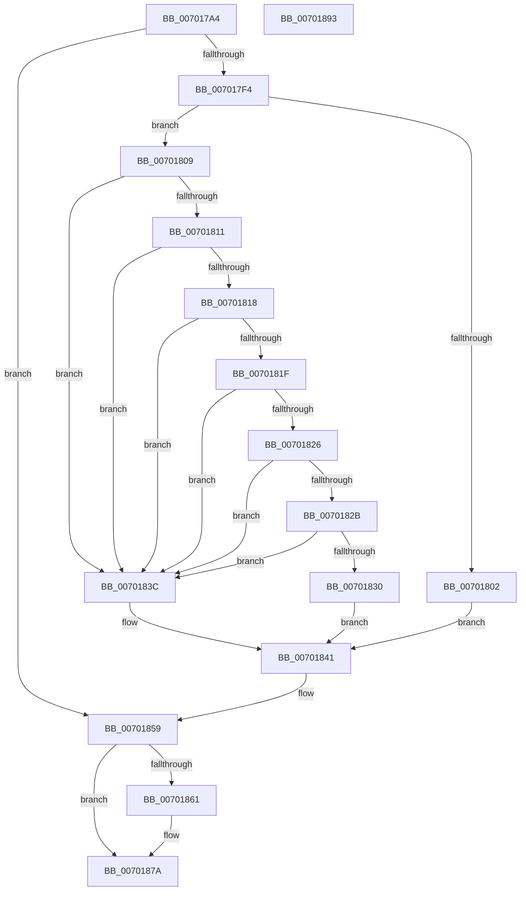

# PiCMDeleteDevice

- RVA: `0x007017A4`–`0x00701894` (길이 `240` bytes)
- VA: `0x00000001407017A4`
- 실행 섹션: `PAGE`
- PDB 이름 있음: `예`; PDB Function 태그: `아니요`
- unwind 정보 RVA: `0x000BF568`
- 디코드: `65`개 명령, `240/240` bytes 표시
- 미해석 바이트: `0` (있으면 어셈블리에 `.byte`로 보존)

> 이 문서는 커널 이미지의 기계어와 PDB 기호를 분석해 생성했습니다. 4번과 5번은 함수 원형과 자료형을 바이너리 사용 방식에서 추정한 C 해석이며 원본 소스 복구 결과는 아닙니다.

## 1. Dependencies

- 직접 호출 지점: **5**; 고유 호출 대상: **5**
- 직접 호출자로 확인된 함수: **1**
- RIP 상대 이미지 참조: **0**

### Outgoing calls
- `0x007017E9` → [PiCMCaptureObjectInputData](../8E/PiCMCaptureObjectInputData_function_008E8220.md) (function, `0x008E8220`)
- `0x007017F9` → [PiAuDoesClientHaveAccess](../96/PiAuDoesClientHaveAccess_function_00962940.md) (function, `0x00962940`)
- `0x00701835` → [PiCMDeleteDeviceWorker](../73/PiCMDeleteDeviceWorker_function_0073B420.md) (function, `0x0073B420`)
- `0x00701852` → [PiCMReturnBasicResultData](../8E/PiCMReturnBasicResultData_function_008E86E8.md) (function, `0x008E86E8`)
- `0x00701875` → [PiControlFreeUserModeCallersBuffer](../../text/44/PiControlFreeUserModeCallersBuffer_function_00448990.md) (function, `0x00448990`)

### Direct callers
- [PiCMHandleIoctl](../8E/PiCMHandleIoctl_function_008EB880.md) at `0x008EC28F`

### Static image references
- 디코드된 RIP-relative 메모리 참조가 없습니다.

## 2. Other-region calls and transfers

- 다른 실행 섹션으로 향하는 call: **1**
  - `0x00701875` → [PiControlFreeUserModeCallersBuffer](../../text/44/PiControlFreeUserModeCallersBuffer_function_00448990.md) (`PAGE` → `.text`)
- 별도 외부 분기/꼬리 이동을 확인하지 못했습니다.

## 3. Assembly (complete function range)

```asm
007017A4  4C 8B DC                        mov r11, rsp
007017A7  49 89 6B 08                     mov qword ptr [r11 + 8], rbp
007017AB  49 89 73 10                     mov qword ptr [r11 + 0x10], rsi
007017AF  49 89 7B 18                     mov qword ptr [r11 + 0x18], rdi
007017B3  41 56                           push r14
007017B5  48 83 EC 60                     sub rsp, 0x60
007017B9  4C 8B B4 24 98 00 00 00         mov r14, qword ptr [rsp + 0x98]
007017C1  0F 57 C0                        xorps xmm0, xmm0
007017C4  33 C0                           xor eax, eax
007017C6  41 8B F1                        mov esi, r9d
007017C9  49 8B E8                        mov rbp, r8
007017CC  4D 8D 4B C8                     lea r9, [r11 - 0x38]
007017D0  44 8B 84 24 90 00 00 00         mov r8d, dword ptr [rsp + 0x90]
007017D8  41 21 06                        and dword ptr [r14], eax
007017DB  0F 11 44 24 30                  movups xmmword ptr [rsp + 0x30], xmm0
007017E0  0F 11 44 24 40                  movups xmmword ptr [rsp + 0x40], xmm0
007017E5  49 89 43 E8                     mov qword ptr [r11 - 0x18], rax
007017E9  E8 32 6A 1E 00                  call 0x1408e8220
007017EE  8B F8                           mov edi, eax
007017F0  85 C0                           test eax, eax
007017F2  78 65                           js 0x140701859
007017F4  B9 02 00 00 00                  mov ecx, 2
007017F9  E8 42 11 26 00                  call 0x140962940
007017FE  84 C0                           test al, al
00701800  75 07                           jne 0x140701809
00701802  B8 22 00 00 C0                  mov eax, 0xc0000022
00701807  EB 38                           jmp 0x140701841
00701809  48 83 7C 24 40 00               cmp qword ptr [rsp + 0x40], 0
0070180F  74 2B                           je 0x14070183c
00701811  83 7C 24 34 00                  cmp dword ptr [rsp + 0x34], 0
00701816  75 24                           jne 0x14070183c
00701818  83 7C 24 38 01                  cmp dword ptr [rsp + 0x38], 1
0070181D  75 1D                           jne 0x14070183c
0070181F  83 7C 24 4C 00                  cmp dword ptr [rsp + 0x4c], 0
00701824  75 16                           jne 0x14070183c
00701826  48 85 ED                        test rbp, rbp
00701829  74 11                           je 0x14070183c
0070182B  83 FE 08                        cmp esi, 8
0070182E  72 0C                           jb 0x14070183c
00701830  48 8B 4C 24 40                  mov rcx, qword ptr [rsp + 0x40]
00701835  E8 E6 9B 03 00                  call 0x14073b420
0070183A  EB 05                           jmp 0x140701841
0070183C  B8 0D 00 00 C0                  mov eax, 0xc000000d
00701841  8B 54 24 50                     mov edx, dword ptr [rsp + 0x50]
00701845  44 8B CE                        mov r9d, esi
00701848  4C 8B C5                        mov r8, rbp
0070184B  4C 89 74 24 20                  mov qword ptr [rsp + 0x20], r14
00701850  8B C8                           mov ecx, eax
00701852  E8 91 6E 1E 00                  call 0x1408e86e8
00701857  8B F8                           mov edi, eax
00701859  48 83 7C 24 40 00               cmp qword ptr [rsp + 0x40], 0
0070185F  74 19                           je 0x14070187a
00701861  65 48 8B 0C 25 88 01 00 00      mov rcx, qword ptr gs:[0x188]
0070186A  48 8B 54 24 40                  mov rdx, qword ptr [rsp + 0x40]
0070186F  8A 89 32 02 00 00               mov cl, byte ptr [rcx + 0x232]
00701875  E8 16 71 D4 FF                  call 0x140448990
0070187A  4C 8D 5C 24 60                  lea r11, [rsp + 0x60]
0070187F  8B C7                           mov eax, edi
00701881  49 8B 6B 10                     mov rbp, qword ptr [r11 + 0x10]
00701885  49 8B 73 18                     mov rsi, qword ptr [r11 + 0x18]
00701889  49 8B 7B 20                     mov rdi, qword ptr [r11 + 0x20]
0070188D  49 8B E3                        mov rsp, r11
00701890  41 5E                           pop r14
00701892  C3                              ret
00701893  CC                              int3
```

## 4. C-style interpretation (structured pseudocode)

```c
__int64 __fastcall PiCMDeleteDevice(__int64 a1, __int64 a2, __int64 a3, int a4, unsigned int a5, __int64 a6)
{
    __int64 result;
    __int64 v_rsp;
    unsigned int v_stack_m18;
    unsigned int v_stack_m1C;
    unsigned __int64 v_stack_m28;
    unsigned int v_stack_m30;
    unsigned int v_stack_m34;
    unsigned __int64 v_stack_m38;
    unsigned __int64 v_stack_m48;
    unsigned __int64 v_stack_m8;

    *(unsigned __int64 *)(v_rsp + 8) = v_rbp;
    *(unsigned __int64 *)(v_rsp + 16) = v_rsi;
    *(unsigned __int64 *)(v_rsp + 24) = v_rdi;
    v_rsp = (v_rsp) - (96);
    result = 0;
    v_stack_m38 = v_xmm0;
    v_stack_m28 = v_xmm0;
    *(unsigned __int64 *)(v_rsp - 24) = 0;
    result = PiCMCaptureObjectInputData(a1, a2, (unsigned int)(a5), v_rsp - 56);
    if (sign_flag) goto loc_00701859;
    result = PiAuDoesClientHaveAccess(2, a2, (unsigned int)(a5), v_rsp - 56);
    if ((unsigned __int8)(result) != 0) goto loc_00701809;
    goto loc_00701841;
loc_00701809:
    if (v_stack_m28 == 0) goto loc_0070183C;
    if (v_stack_m34 != 0) goto loc_0070183C;
    if (v_stack_m30 != 1) goto loc_0070183C;
    if (v_stack_m1C != 0) goto loc_0070183C;
    if (a3 == 0) goto loc_0070183C;
    if (((unsigned int)((unsigned int)(a4))) < 8) goto loc_0070183C;
    result = PiCMDeleteDeviceWorker(v_stack_m28, a2, (unsigned int)(a5), v_rsp - 56);
    goto loc_00701841;
loc_0070183C:
loc_00701841:
    v_stack_m48 = a6;
    result = PiCMReturnBasicResultData((unsigned int)((unsigned int)((unsigned int)(0xC000000DULL))), (unsigned int)(v_stack_m18), a3, (unsigned int)((unsigned int)((unsigned int)(a4))));
loc_00701859:
    if (v_stack_m28 != 0) {
        a1 = *(unsigned __int64 *)(gs_base + (0 + 392));
        a2 = v_stack_m28;
        a1 = *(unsigned __int8 *)(a1 + 562);
        result = PiControlFreeUserModeCallersBuffer(a1, a2, a3, (unsigned int)((unsigned int)((unsigned int)(a4))));
    }
    return (unsigned int)((unsigned int)((unsigned int)((unsigned int)(result))));
}
```

## 5. (Beta) C Style

```c
int64_t PiCMDeleteDevice(int64_t Arg1, int64_t Arg2, int64_t Arg3, int32_t Arg4, uint32_t Arg5, void *Arg6)
{
    uint8_t *arg6 = (uint8_t *)Arg6;

    int64_t result;
    int64_t local_rsp;
    uint32_t v_stack_m18;
    uint32_t v_stack_m1C;
    uint64_t v_stack_m28;
    uint32_t v_stack_m30;
    uint32_t v_stack_m34;
    uint64_t v_stack_m38;
    uint64_t v_stack_m48;
    uint64_t v_stack_m8;

    *(uint64_t *)(local_rsp + 0x8) = local_rbp;
    *(uint64_t *)(local_rsp + 0x10) = local_rsi;
    *(uint64_t *)(local_rsp + 0x18) = local_rdi;
    local_rsp = (local_rsp) - (96);
    result = 0;
    v_stack_m38 = v_xmm0;
    v_stack_m28 = v_xmm0;
    *(uint64_t *)(local_rsp - 0x18) = 0;
    result = PiCMCaptureObjectInputData(Arg1, Arg2, (uint32_t)(Arg5), local_rsp - 56);
    if (sign_flag) goto loc_00701859;
    result = PiAuDoesClientHaveAccess(2, Arg2, (uint32_t)(Arg5), local_rsp - 56);
    if ((uint8_t)(result) != 0) goto loc_00701809;
    goto loc_00701841;
loc_00701809:
    if (v_stack_m28 == 0) goto loc_0070183C;
    if (v_stack_m34 != 0) goto loc_0070183C;
    if (v_stack_m30 != 1) goto loc_0070183C;
    if (v_stack_m1C != 0) goto loc_0070183C;
    if (Arg3 == 0) goto loc_0070183C;
    if (((uint32_t)((uint32_t)(Arg4))) < 8) goto loc_0070183C;
    result = PiCMDeleteDeviceWorker(v_stack_m28, Arg2, (uint32_t)(Arg5), local_rsp - 56);
    goto loc_00701841;
loc_0070183C:
loc_00701841:
    v_stack_m48 = Arg6;
    result = PiCMReturnBasicResultData((uint32_t)((uint32_t)((uint32_t)(0xC000000DULL))), (uint32_t)(v_stack_m18), Arg3, (uint32_t)((uint32_t)((uint32_t)(Arg4))));
loc_00701859:
    if (v_stack_m28 != 0) {
        Arg1 = *(uint64_t *)(gs_base + (0 + 0x188));
        Arg2 = v_stack_m28;
        Arg1 = *(uint8_t *)(Arg1 + 0x232);
        result = PiControlFreeUserModeCallersBuffer(Arg1, Arg2, Arg3, (uint32_t)((uint32_t)((uint32_t)(Arg4))));
    }
    return (uint32_t)((uint32_t)((uint32_t)((uint32_t)(result))));
}
```

### 관측된 메모리 오프셋

구조체 형식이 확인되지 않은 접근은 인자 기준의 오프셋으로만 기록했습니다.

| 기준 인자 | 오프셋 표현 | 폭 (bit) | 접근 |
|---|---:|---:|---|
| `Arg6` | `+ 0x0` | `32` | `R/W` |

## 6. Execution-region graph

[열기: 2D/3D 그래프와 함수 탐색 컨트롤 패널](../../../control-panel.html?section=page&rva=0x007017A4&view=graph)

- 2D 그래프는 위에서 아래로 흐르고, 3D 그래프는 빈 공간을 드래그해 회전합니다. Shift+드래그는 이동, 휠은 확대·축소, 함수 노드 선택은 대상 보고서 이동입니다.

### Static fallback


