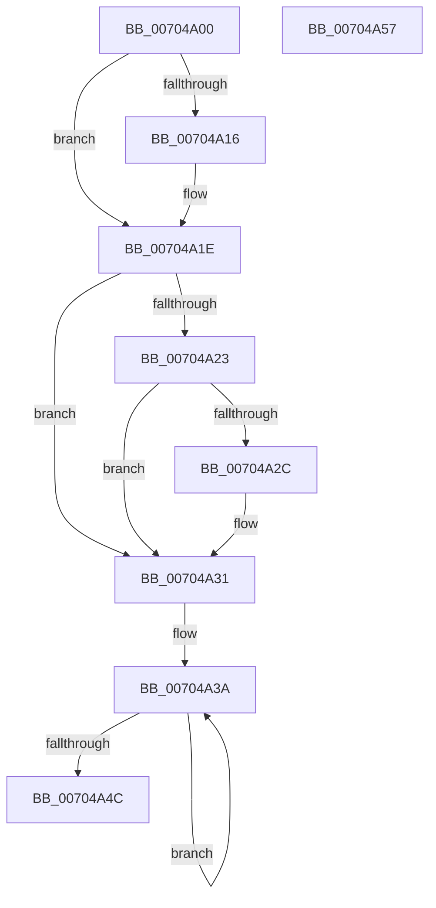

# PiDevCfgFreeDeviceContext

- RVA: `0x00704A00`–`0x00704A58` (길이 `88` bytes)
- VA: `0x0000000140704A00`
- 실행 섹션: `PAGE`
- PDB 이름 있음: `예`; PDB Function 태그: `아니요`
- unwind 정보 RVA: `0x0005CAAC`
- 디코드: `27`개 명령, `88/88` bytes 표시
- 미해석 바이트: `0` (있으면 어셈블리에 `.byte`로 보존)

> 이 문서는 커널 이미지의 기계어와 PDB 기호를 분석해 생성했습니다. 4번과 5번은 함수 원형과 자료형을 바이너리 사용 방식에서 추정한 C 해석이며 원본 소스 복구 결과는 아닙니다.

## 1. Dependencies

- 직접 호출 지점: **4**; 고유 호출 대상: **4**
- 직접 호출자로 확인된 함수: **9**
- RIP 상대 이미지 참조: **0**

### Outgoing calls
- `0x00704A0D` → [Feature_KernelPnP_LogBlockedDrivers__private_IsEnabledDeviceUsageNoInline](../../text/4F/Feature_KernelPnP_LogBlockedDrivers__private_IsEnabledDeviceUsageNoInline_function_004F7944.md) (function, `0x004F7944`)
- `0x00704A19` → [PiDevCfgClearDeviceDrivers](PiDevCfgClearDeviceDrivers_function_00704A60.md) (function, `0x00704A60`)
- `0x00704A2C` → [ZwClose](../../text/6A/ZwClose_function_006AD2B0.md) (function, `0x006AD2B0`)
- `0x00704A3D` → [RtlFreeAnsiString](../9C/RtlFreeAnsiString_function_009C0800.md) (function, `0x009C0800`)

### Direct callers
- [PiDevCfgInitDeviceCallback](../73/PiDevCfgInitDeviceCallback_function_00733800.md) at `0x00733924`
- [PiDevCfgProcessDeviceCallback](../73/PiDevCfgProcessDeviceCallback_function_00734080.md) at `0x0073432D`
- [PpDevCfgCheckDeviceNeedsUpdate](../73/PpDevCfgCheckDeviceNeedsUpdate_function_007367AC.md) at `0x00736801`
- [PpDevCfgProcessDeviceClass](../73/PpDevCfgProcessDeviceClass_function_00736824.md) at `0x00736BF0`
- [PpDevCfgProcessDeviceExtensions](../73/PpDevCfgProcessDeviceExtensions_function_00736C2C.md) at `0x00737382`
- [PpDevCfgProcessDeviceReset](../96/PpDevCfgProcessDeviceReset_function_00965498.md) at `0x00965748`
- [PiDevCfgProcessDevice](../97/PiDevCfgProcessDevice_function_00976D34.md) at `0x00976FEF`
- [PiDevCfgInitDeviceContext](../97/PiDevCfgInitDeviceContext_function_00977518.md) at `0x0097765C`
- [PpDevCfgProcessDeviceOperations](../A9/PpDevCfgProcessDeviceOperations_function_00A97CFC.md) at `0x00A97DB6`

### Static image references
- 디코드된 RIP-relative 메모리 참조가 없습니다.

## 2. Other-region calls and transfers

- 다른 실행 섹션으로 향하는 call: **2**
  - `0x00704A0D` → [Feature_KernelPnP_LogBlockedDrivers__private_IsEnabledDeviceUsageNoInline](../../text/4F/Feature_KernelPnP_LogBlockedDrivers__private_IsEnabledDeviceUsageNoInline_function_004F7944.md) (`PAGE` → `.text`)
  - `0x00704A2C` → [ZwClose](../../text/6A/ZwClose_function_006AD2B0.md) (`PAGE` → `.text`)
- 별도 외부 분기/꼬리 이동을 확인하지 못했습니다.

## 3. Assembly (complete function range)

```asm
00704A00  48 89 5C 24 08                  mov qword ptr [rsp + 8], rbx
00704A05  57                              push rdi
00704A06  48 83 EC 20                     sub rsp, 0x20
00704A0A  48 8B D9                        mov rbx, rcx
00704A0D  E8 32 2F DF FF                  call 0x1404f7944
00704A12  85 C0                           test eax, eax
00704A14  74 08                           je 0x140704a1e
00704A16  48 8B CB                        mov rcx, rbx
00704A19  E8 42 00 00 00                  call 0x140704a60
00704A1E  83 3B 00                        cmp dword ptr [rbx], 0
00704A21  7D 0E                           jge 0x140704a31
00704A23  48 8B 4B 10                     mov rcx, qword ptr [rbx + 0x10]
00704A27  48 85 C9                        test rcx, rcx
00704A2A  74 05                           je 0x140704a31
00704A2C  E8 7F 88 FA FF                  call 0x1406ad2b0
00704A31  48 83 C3 28                     add rbx, 0x28
00704A35  BF 03 00 00 00                  mov edi, 3
00704A3A  48 8B CB                        mov rcx, rbx
00704A3D  E8 BE BD 2B 00                  call 0x1409c0800
00704A42  48 83 C3 10                     add rbx, 0x10
00704A46  48 83 EF 01                     sub rdi, 1
00704A4A  75 EE                           jne 0x140704a3a
00704A4C  48 8B 5C 24 30                  mov rbx, qword ptr [rsp + 0x30]
00704A51  48 83 C4 20                     add rsp, 0x20
00704A55  5F                              pop rdi
00704A56  C3                              ret
00704A57  CC                              int3
```

## 4. C-style interpretation (structured pseudocode)

```c
__int64 __fastcall PiDevCfgFreeDeviceContext(__int64 a1)
{
    __int64 result;
    __int64 v_rbx;
    __int64 v_rdi;
    __int64 v_rsp;
    unsigned __int64 v_stack_p8;

    v_stack_p8 = v_rbx;
    v_rsp = (v_rsp) - (32);
    result = Feature_KernelPnP_LogBlockedDrivers__private_IsEnabledDeviceUsageNoInline(a1, a2, a3, a4);
    if ((unsigned int)(result) != 0) {
        a1 = a1;
        result = PiDevCfgClearDeviceDrivers(a1, a2, a3, a4);
    }
    if ((*(unsigned int *)(a1)) >= 0) goto loc_00704A31;
    if (*(unsigned __int64 *)(a1 + 16) != 0) {
        result = ZwClose(*(unsigned __int64 *)(a1 + 16), a2, a3, a4);
    }
    v_rbx = (a1) + (40);
loc_00704A3A:
    result = RtlFreeAnsiString(v_rbx, a2, a3, a4);
    v_rbx = (v_rbx) + (16);
    v_rdi = (3) - (1);
    if (condition_is_not_equal) goto loc_00704A3A;
    v_rsp = (v_rsp) + (32);
    return result;
}
```

## 5. (Beta) C Style

```c
int64_t PiDevCfgFreeDeviceContext(void *Arg1)
{
    uint8_t *arg1 = (uint8_t *)Arg1;

    int64_t result;
    int64_t local_rbx;
    int64_t local_rdi;
    int64_t local_rsp;
    uint64_t v_stack_p8;

    v_stack_p8 = local_rbx;
    local_rsp = (local_rsp) - (32);
    result = Feature_KernelPnP_LogBlockedDrivers__private_IsEnabledDeviceUsageNoInline(Arg1, a2, a3, a4);
    if ((uint32_t)(result) != 0) {
        Arg1 = Arg1;
        result = PiDevCfgClearDeviceDrivers(Arg1, a2, a3, a4);
    }
    if ((*(uint32_t *)(arg1)) >= 0) goto loc_00704A31;
    if (*(uint64_t *)(arg1 + 0x10) != 0) {
        result = ZwClose(*(uint64_t *)(arg1 + 0x10), a2, a3, a4);
    }
    local_rbx = (Arg1) + (40);
loc_00704A3A:
    result = RtlFreeAnsiString(local_rbx, a2, a3, a4);
    local_rbx = (local_rbx) + (16);
    local_rdi = (3) - (1);
    if (condition_is_not_equal) goto loc_00704A3A;
    local_rsp = (local_rsp) + (32);
    return result;
}
```

### 관측된 메모리 오프셋

구조체 형식이 확인되지 않은 접근은 인자 기준의 오프셋으로만 기록했습니다.

| 기준 인자 | 오프셋 표현 | 폭 (bit) | 접근 |
|---|---:|---:|---|
| `Arg1` | `+ 0x0` | `32` | `R` |
| `Arg1` | `+ 0x10` | `64` | `R` |

## 6. Execution-region graph

[열기: 2D/3D 그래프와 함수 탐색 컨트롤 패널](../../../control-panel.html?section=page&rva=0x00704A00&view=graph)

- 2D 그래프는 위에서 아래로 흐르고, 3D 그래프는 빈 공간을 드래그해 회전합니다. Shift+드래그는 이동, 휠은 확대·축소, 함수 노드 선택은 대상 보고서 이동입니다.

### Static fallback


