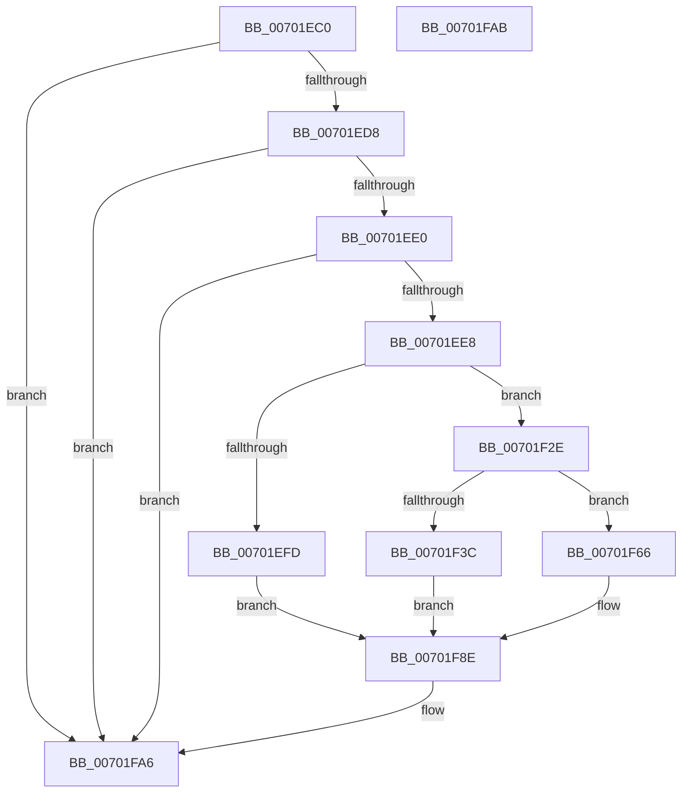

# PiDevCfgLogDeviceMigrated

- RVA: `0x00701EC0`–`0x00701FAC` (길이 `236` bytes)
- VA: `0x0000000140701EC0`
- 실행 섹션: `PAGE`
- PDB 이름 있음: `예`; PDB Function 태그: `아니요`
- unwind 정보 RVA: `0x0006C2A4`
- 디코드: `54`개 명령, `236/236` bytes 표시
- 미해석 바이트: `0` (있으면 어셈블리에 `.byte`로 보존)

> 이 문서는 커널 이미지의 기계어와 PDB 기호를 분석해 생성했습니다. 4번과 5번은 함수 원형과 자료형을 바이너리 사용 방식에서 추정한 C 해석이며 원본 소스 복구 결과는 아닙니다.

## 1. Dependencies

- 직접 호출 지점: **1**; 고유 호출 대상: **1**
- 직접 호출자로 확인된 함수: **1**
- RIP 상대 이미지 참조: **5**

### Outgoing calls
- `0x00701FA1` → [McTemplateK0zzjzitd_EtwWriteTransfer](../../text/42/McTemplateK0zzjzitd_EtwWriteTransfer_function_00423218.md) (function, `0x00423218`)

### Direct callers
- [PiDevCfgMigrateDevice](../96/PiDevCfgMigrateDevice_function_00963E60.md) at `0x0096408F`

### Static image references
- `0x00701EC4` → RVA `0x00EF012A` (`.data`; read)
- `0x00701EED` → RVA `0x00B53AB4` (` ?? ::LBKOJDO::`string'`; read)
- `0x00701F25` → RVA `0x00027470` (`.rdata`; read)
- `0x00701F5D` → RVA `0x000270C0` (`.rdata`; read)
- `0x00701F87` → RVA `0x00027130` (`.rdata`; read)

## 2. Other-region calls and transfers

- 다른 실행 섹션으로 향하는 call: **1**
  - `0x00701FA1` → [McTemplateK0zzjzitd_EtwWriteTransfer](../../text/42/McTemplateK0zzjzitd_EtwWriteTransfer_function_00423218.md) (`PAGE` → `.text`)
- 별도 외부 분기/꼬리 이동을 확인하지 못했습니다.

## 3. Assembly (complete function range)

```asm
00701EC0  48 83 EC 58                     sub rsp, 0x58
00701EC4  8A 05 60 E2 7E 00               mov al, byte ptr [rip + 0x7ee260]
00701ECA  45 8B C8                        mov r9d, r8d
00701ECD  4C 8B D1                        mov r10, rcx
00701ED0  A8 10                           test al, 0x10
00701ED2  0F 84 CE 00 00 00               je 0x140701fa6
00701ED8  A8 40                           test al, 0x40
00701EDA  0F 84 C6 00 00 00               je 0x140701fa6
00701EE0  A8 20                           test al, 0x20
00701EE2  0F 84 BE 00 00 00               je 0x140701fa6
00701EE8  44 89 4C 24 48                  mov dword ptr [rsp + 0x48], r9d
00701EED  4C 8D 05 C0 1B 45 00            lea r8, [rip + 0x451bc0]
00701EF4  48 8D 4A 50                     lea rcx, [rdx + 0x50]
00701EF8  45 85 C9                        test r9d, r9d
00701EFB  78 31                           js 0x140701f2e
00701EFD  48 8B 82 98 00 00 00            mov rax, qword ptr [rdx + 0x98]
00701F04  48 85 C0                        test rax, rax
00701F07  4C 0F 45 C0                     cmovne r8, rax
00701F0B  8B 82 B0 00 00 00               mov eax, dword ptr [rdx + 0xb0]
00701F11  89 44 24 40                     mov dword ptr [rsp + 0x40], eax
00701F15  48 8B 82 B8 00 00 00            mov rax, qword ptr [rdx + 0xb8]
00701F1C  48 89 44 24 38                  mov qword ptr [rsp + 0x38], rax
00701F21  48 8B 42 20                     mov rax, qword ptr [rdx + 0x20]
00701F25  48 8D 15 44 55 92 FF            lea rdx, [rip - 0x6daabc]
00701F2C  EB 60                           jmp 0x140701f8e
00701F2E  8B 42 10                        mov eax, dword ptr [rdx + 0x10]
00701F31  A8 03                           test al, 3
00701F33  48 8B 82 98 00 00 00            mov rax, qword ptr [rdx + 0x98]
00701F3A  74 2A                           je 0x140701f66
00701F3C  48 85 C0                        test rax, rax
00701F3F  4C 0F 45 C0                     cmovne r8, rax
00701F43  8B 82 B0 00 00 00               mov eax, dword ptr [rdx + 0xb0]
00701F49  89 44 24 40                     mov dword ptr [rsp + 0x40], eax
00701F4D  48 8B 82 B8 00 00 00            mov rax, qword ptr [rdx + 0xb8]
00701F54  48 89 44 24 38                  mov qword ptr [rsp + 0x38], rax
00701F59  48 8B 42 20                     mov rax, qword ptr [rdx + 0x20]
00701F5D  48 8D 15 5C 51 92 FF            lea rdx, [rip - 0x6daea4]
00701F64  EB 28                           jmp 0x140701f8e
00701F66  48 85 C0                        test rax, rax
00701F69  4C 0F 45 C0                     cmovne r8, rax
00701F6D  8B 82 B0 00 00 00               mov eax, dword ptr [rdx + 0xb0]
00701F73  89 44 24 40                     mov dword ptr [rsp + 0x40], eax
00701F77  48 8B 82 B8 00 00 00            mov rax, qword ptr [rdx + 0xb8]
00701F7E  48 89 44 24 38                  mov qword ptr [rsp + 0x38], rax
00701F83  48 8B 42 20                     mov rax, qword ptr [rdx + 0x20]
00701F87  48 8D 15 A2 51 92 FF            lea rdx, [rip - 0x6dae5e]
00701F8E  4D 8B 4A 08                     mov r9, qword ptr [r10 + 8]
00701F92  4C 89 44 24 30                  mov qword ptr [rsp + 0x30], r8
00701F97  48 89 4C 24 28                  mov qword ptr [rsp + 0x28], rcx
00701F9C  48 89 44 24 20                  mov qword ptr [rsp + 0x20], rax
00701FA1  E8 72 12 D2 FF                  call 0x140423218
00701FA6  48 83 C4 58                     add rsp, 0x58
00701FAA  C3                              ret
00701FAB  CC                              int3
```

## 4. C-style interpretation (structured pseudocode)

```c
__int64 __fastcall PiDevCfgLogDeviceMigrated(__int64 a1, __int64 a2, int a3)
{
    __int64 result;
    __int64 v_rsp;
    unsigned int v_stack_m10;
    unsigned int v_stack_m18;
    unsigned __int64 v_stack_m20;
    unsigned __int64 v_stack_m28;
    unsigned __int64 v_stack_m30;
    unsigned __int64 v_stack_m38;

    v_rsp = (v_rsp) - (88);
    if ((((unsigned __int8)(*(unsigned __int8 *)(v_rip + 8315488))) & (16)) == 0) goto loc_00701FA6;
    if ((((unsigned __int8)(*(unsigned __int8 *)(v_rip + 8315488))) & (64)) == 0) goto loc_00701FA6;
    if ((((unsigned __int8)(*(unsigned __int8 *)(v_rip + 8315488))) & (32)) == 0) goto loc_00701FA6;
    v_stack_m10 = (unsigned int)((unsigned int)(a3));
    if (sign_flag) goto loc_00701F2E;
    a3 = v_rip + 4529088;
    if (*(unsigned __int64 *)(a2 + 152) != 0) { a3 = *(unsigned __int64 *)(a2 + 152); }
    v_stack_m18 = (unsigned int)((unsigned int)(*(unsigned int *)(a2 + 176)));
    v_stack_m20 = *(unsigned __int64 *)(a2 + 184);
    goto loc_00701F8E;
loc_00701F2E:
    if ((((unsigned __int8)((unsigned int)(*(unsigned int *)(v_rip - 7187132 + 16)))) & (3)) == 0) goto loc_00701F66;
    if (*(unsigned __int64 *)(v_rip - 7187132 + 152) != 0) { a3 = *(unsigned __int64 *)(v_rip - 7187132 + 152); }
    v_stack_m18 = (unsigned int)((unsigned int)(*(unsigned int *)(v_rip - 7187132 + 176)));
    v_stack_m20 = *(unsigned __int64 *)(v_rip - 7187132 + 184);
    goto loc_00701F8E;
loc_00701F66:
    if (*(unsigned __int64 *)(v_rip - 7187132 + 32) != 0) { a3 = *(unsigned __int64 *)(v_rip - 7187132 + 32); }
    v_stack_m18 = (unsigned int)((unsigned int)(*(unsigned int *)(v_rip - 7188132 + 176)));
    v_stack_m20 = *(unsigned __int64 *)(v_rip - 7188132 + 184);
loc_00701F8E:
    v_stack_m28 = a3;
    v_stack_m30 = a2 + 80;
    v_stack_m38 = *(unsigned __int64 *)(v_rip - 7188132 + 32);
    result = McTemplateK0zzjzitd_EtwWriteTransfer(a2 + 80, v_rip - 7188062, a3, *(unsigned __int64 *)(a1 + 8));
loc_00701FA6:
    v_rsp = (v_rsp) + (88);
    return result;
}
```

## 5. (Beta) C Style

```c
int64_t PiDevCfgLogDeviceMigrated(void *Arg1, void *Arg2, int32_t Arg3)
{
    uint8_t *arg1 = (uint8_t *)Arg1;
    uint8_t *arg2 = (uint8_t *)Arg2;

    int64_t result;
    int64_t local_rsp;
    uint32_t v_stack_m10;
    uint32_t v_stack_m18;
    uint64_t v_stack_m20;
    uint64_t v_stack_m28;
    uint64_t v_stack_m30;
    uint64_t v_stack_m38;

    local_rsp = (local_rsp) - (88);
    if ((((uint8_t)(*(uint8_t *)(v_rip + 0x7EE260))) & (16)) == 0) goto loc_00701FA6;
    if ((((uint8_t)(*(uint8_t *)(v_rip + 0x7EE260))) & (64)) == 0) goto loc_00701FA6;
    if ((((uint8_t)(*(uint8_t *)(v_rip + 0x7EE260))) & (32)) == 0) goto loc_00701FA6;
    v_stack_m10 = (uint32_t)((uint32_t)(Arg3));
    if (sign_flag) goto loc_00701F2E;
    Arg3 = v_rip + 4529088;
    if (*(uint64_t *)(arg2 + 0x98) != 0) { Arg3 = *(uint64_t *)(arg2 + 0x98); }
    v_stack_m18 = (uint32_t)((uint32_t)(*(uint32_t *)(arg2 + 0xB0)));
    v_stack_m20 = *(uint64_t *)(arg2 + 0xB8);
    goto loc_00701F8E;
loc_00701F2E:
    if ((((uint8_t)((uint32_t)(*(uint32_t *)(v_rip - 0x6DAABC + 0x10)))) & (3)) == 0) goto loc_00701F66;
    if (*(uint64_t *)(v_rip - 0x6DAABC + 0x98) != 0) { Arg3 = *(uint64_t *)(v_rip - 0x6DAABC + 0x98); }
    v_stack_m18 = (uint32_t)((uint32_t)(*(uint32_t *)(v_rip - 0x6DAABC + 0xB0)));
    v_stack_m20 = *(uint64_t *)(v_rip - 0x6DAABC + 0xB8);
    goto loc_00701F8E;
loc_00701F66:
    if (*(uint64_t *)(v_rip - 0x6DAABC + 0x20) != 0) { Arg3 = *(uint64_t *)(v_rip - 0x6DAABC + 0x20); }
    v_stack_m18 = (uint32_t)((uint32_t)(*(uint32_t *)(v_rip - 0x6DAEA4 + 0xB0)));
    v_stack_m20 = *(uint64_t *)(v_rip - 0x6DAEA4 + 0xB8);
loc_00701F8E:
    v_stack_m28 = Arg3;
    v_stack_m30 = Arg2 + 80;
    v_stack_m38 = *(uint64_t *)(v_rip - 0x6DAEA4 + 0x20);
    result = McTemplateK0zzjzitd_EtwWriteTransfer(Arg2 + 80, v_rip - 7188062, Arg3, *(uint64_t *)(arg1 + 0x8));
loc_00701FA6:
    local_rsp = (local_rsp) + (88);
    return result;
}
```

### 관측된 메모리 오프셋

구조체 형식이 확인되지 않은 접근은 인자 기준의 오프셋으로만 기록했습니다.

| 기준 인자 | 오프셋 표현 | 폭 (bit) | 접근 |
|---|---:|---:|---|
| `Arg1` | `+ 0x8` | `64` | `R` |
| `Arg2` | `+ 0x10` | `32` | `R` |
| `Arg2` | `+ 0x20` | `64` | `R` |
| `Arg2` | `+ 0x50` | `64` | `R` |
| `Arg2` | `+ 0x98` | `64` | `R` |
| `Arg2` | `+ 0xB0` | `32` | `R` |
| `Arg2` | `+ 0xB8` | `64` | `R` |

## 6. Execution-region graph

[열기: 2D/3D 그래프와 함수 탐색 컨트롤 패널](../../../control-panel.html?section=page&rva=0x00701EC0&view=graph)

- 2D 그래프는 위에서 아래로 흐르고, 3D 그래프는 빈 공간을 드래그해 회전합니다. Shift+드래그는 이동, 휠은 확대·축소, 함수 노드 선택은 대상 보고서 이동입니다.

### Static fallback


