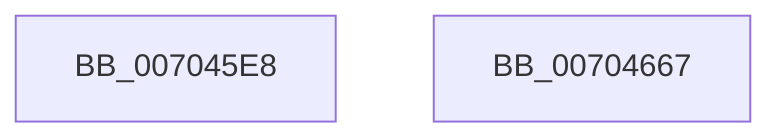

# PiDmListRemoveObject

- RVA: `0x007045E8`–`0x00704668` (길이 `128` bytes)
- VA: `0x00000001407045E8`
- 실행 섹션: `PAGE`
- PDB 이름 있음: `예`; PDB Function 태그: `아니요`
- unwind 정보 RVA: `0x0005D7BC`
- 디코드: `36`개 명령, `128/128` bytes 표시
- 미해석 바이트: `0` (있으면 어셈블리에 `.byte`로 보존)

> 이 문서는 커널 이미지의 기계어와 PDB 기호를 분석해 생성했습니다. 4번과 5번은 함수 원형과 자료형을 바이너리 사용 방식에서 추정한 C 해석이며 원본 소스 복구 결과는 아닙니다.

## 1. Dependencies

- 직접 호출 지점: **6**; 고유 호출 대상: **5**
- 직접 호출자로 확인된 함수: **2**
- RIP 상대 이미지 참조: **0**

### Outgoing calls
- `0x0070460F` → [PiDmGetObjectManagerForObjectType](../95/PiDmGetObjectManagerForObjectType_function_00951140.md) (function, `0x00951140`)
- `0x0070461A` → [CmpLockSiloKeyLockTrackerExclusive](../8F/CmpLockSiloKeyLockTrackerExclusive_function_008F9EF8.md) (function, `0x008F9EF8`)
- `0x00704622` → [PiDmObjectAcquireSharedLock](../8E/PiDmObjectAcquireSharedLock_function_008E38B8.md) (function, `0x008E38B8`)
- `0x00704637` → [PiDmListRemoveObjectWorker](../A8/PiDmListRemoveObjectWorker_function_00A88748.md) (function, `0x00A88748`)
- `0x0070463F` → [PiDmObjectReleaseLock](../8E/PiDmObjectReleaseLock_function_008E5584.md) (function, `0x008E5584`)
- `0x00704647` → [PiDmObjectReleaseLock](../8E/PiDmObjectReleaseLock_function_008E5584.md) (function, `0x008E5584`)

### Direct callers
- [PiPnpRtlCmActionCallback](../8E/PiPnpRtlCmActionCallback_function_008EF110.md) at `0x008EF31E`
- [sub_00B1DC0E](../B1/Unknown_function_00B1DC0E.md) at `0x00B1DE31`
- [sub_00B1DC0E](../B1/Unknown_function_00B1DC0E.md) at `0x00B1DE48`
- [sub_00B1DC0E](../B1/Unknown_function_00B1DC0E.md) at `0x00B1DE60`
- [sub_00B1DC0E](../B1/Unknown_function_00B1DC0E.md) at `0x00B1E0A7`
- [sub_00B1DC0E](../B1/Unknown_function_00B1DC0E.md) at `0x00B1E0F7`

### Static image references
- 디코드된 RIP-relative 메모리 참조가 없습니다.

## 2. Other-region calls and transfers

- 다른 실행 섹션으로 향하는 call: **0**
- 별도 외부 분기/꼬리 이동을 확인하지 못했습니다.

## 3. Assembly (complete function range)

```asm
007045E8  48 8B C4                        mov rax, rsp
007045EB  48 89 58 08                     mov qword ptr [rax + 8], rbx
007045EF  48 89 68 10                     mov qword ptr [rax + 0x10], rbp
007045F3  48 89 70 18                     mov qword ptr [rax + 0x18], rsi
007045F7  48 89 78 20                     mov qword ptr [rax + 0x20], rdi
007045FB  41 56                           push r14
007045FD  48 83 EC 30                     sub rsp, 0x30
00704601  8B F1                           mov esi, ecx
00704603  49 8B F9                        mov rdi, r9
00704606  8B 4A 1C                        mov ecx, dword ptr [rdx + 0x1c]
00704609  49 8B E8                        mov rbp, r8
0070460C  4C 8B F2                        mov r14, rdx
0070460F  E8 2C CB 24 00                  call 0x140951140
00704614  48 8B CA                        mov rcx, rdx
00704617  48 8B D8                        mov rbx, rax
0070461A  E8 D9 58 1F 00                  call 0x1408f9ef8
0070461F  48 8B CD                        mov rcx, rbp
00704622  E8 91 F2 1D 00                  call 0x1408e38b8
00704627  4C 8B CD                        mov r9, rbp
0070462A  48 89 7C 24 20                  mov qword ptr [rsp + 0x20], rdi
0070462F  4D 8B C6                        mov r8, r14
00704632  48 8B D3                        mov rdx, rbx
00704635  8B CE                           mov ecx, esi
00704637  E8 0C 41 38 00                  call 0x140a88748
0070463C  48 8B CD                        mov rcx, rbp
0070463F  E8 40 0F 1E 00                  call 0x1408e5584
00704644  49 8B CE                        mov rcx, r14
00704647  E8 38 0F 1E 00                  call 0x1408e5584
0070464C  48 8B 5C 24 40                  mov rbx, qword ptr [rsp + 0x40]
00704651  48 8B 6C 24 48                  mov rbp, qword ptr [rsp + 0x48]
00704656  48 8B 74 24 50                  mov rsi, qword ptr [rsp + 0x50]
0070465B  48 8B 7C 24 58                  mov rdi, qword ptr [rsp + 0x58]
00704660  48 83 C4 30                     add rsp, 0x30
00704664  41 5E                           pop r14
00704666  C3                              ret
00704667  CC                              int3
```

## 4. C-style interpretation (structured pseudocode)

```c
__int64 __fastcall PiDmListRemoveObject(int a1, __int64 a2, __int64 a3, __int64 a4)
{
    __int64 result;
    __int64 v_rsp;
    unsigned __int64 v_stack_m18;
    unsigned __int64 v_stack_p10;
    unsigned __int64 v_stack_p18;
    unsigned __int64 v_stack_p20;
    unsigned __int64 v_stack_p8;

    *(unsigned __int64 *)(v_rsp + 8) = v_rbx;
    *(unsigned __int64 *)(v_rsp + 16) = v_rbp;
    *(unsigned __int64 *)(v_rsp + 24) = v_rsi;
    *(unsigned __int64 *)(v_rsp + 32) = v_rdi;
    v_rsp = (v_rsp) - (48);
    result = PiDmGetObjectManagerForObjectType((unsigned int)(*(unsigned int *)(a2 + 28)), a2, a3, a4);
    result = CmpLockSiloKeyLockTrackerExclusive(a2, a2, a3, a4);
    result = PiDmObjectAcquireSharedLock(a3, a2, a3, a4);
    v_stack_m18 = a4;
    result = PiDmListRemoveObjectWorker((unsigned int)((unsigned int)((unsigned int)(a1))), result, a2, a3);
    result = PiDmObjectReleaseLock(a3, result, a2, a3);
    result = PiDmObjectReleaseLock(a2, result, a2, a3);
    v_rsp = (v_rsp) + (48);
    return result;
}
```

## 5. (Beta) C Style

```c
int64_t PiDmListRemoveObject(int32_t Arg1, void *Arg2, int64_t Arg3, int64_t Arg4)
{
    uint8_t *arg2 = (uint8_t *)Arg2;

    int64_t result;
    int64_t local_rsp;
    uint64_t v_stack_m18;
    uint64_t v_stack_p10;
    uint64_t v_stack_p18;
    uint64_t v_stack_p20;
    uint64_t v_stack_p8;

    *(uint64_t *)(local_rsp + 0x8) = local_rbx;
    *(uint64_t *)(local_rsp + 0x10) = local_rbp;
    *(uint64_t *)(local_rsp + 0x18) = local_rsi;
    *(uint64_t *)(local_rsp + 0x20) = local_rdi;
    local_rsp = (local_rsp) - (48);
    result = PiDmGetObjectManagerForObjectType((uint32_t)(*(uint32_t *)(arg2 + 0x1C)), Arg2, Arg3, Arg4);
    result = CmpLockSiloKeyLockTrackerExclusive(Arg2, Arg2, Arg3, Arg4);
    result = PiDmObjectAcquireSharedLock(Arg3, Arg2, Arg3, Arg4);
    v_stack_m18 = Arg4;
    result = PiDmListRemoveObjectWorker((uint32_t)((uint32_t)((uint32_t)(Arg1))), result, Arg2, Arg3);
    result = PiDmObjectReleaseLock(Arg3, result, Arg2, Arg3);
    result = PiDmObjectReleaseLock(Arg2, result, Arg2, Arg3);
    local_rsp = (local_rsp) + (48);
    return result;
}
```

### 관측된 메모리 오프셋

구조체 형식이 확인되지 않은 접근은 인자 기준의 오프셋으로만 기록했습니다.

| 기준 인자 | 오프셋 표현 | 폭 (bit) | 접근 |
|---|---:|---:|---|
| `Arg2` | `+ 0x1C` | `32` | `R` |

## 6. Execution-region graph

[열기: 2D/3D 그래프와 함수 탐색 컨트롤 패널](../../../control-panel.html?section=page&rva=0x007045E8&view=graph)

- 2D 그래프는 위에서 아래로 흐르고, 3D 그래프는 빈 공간을 드래그해 회전합니다. Shift+드래그는 이동, 휠은 확대·축소, 함수 노드 선택은 대상 보고서 이동입니다.

### Static fallback


