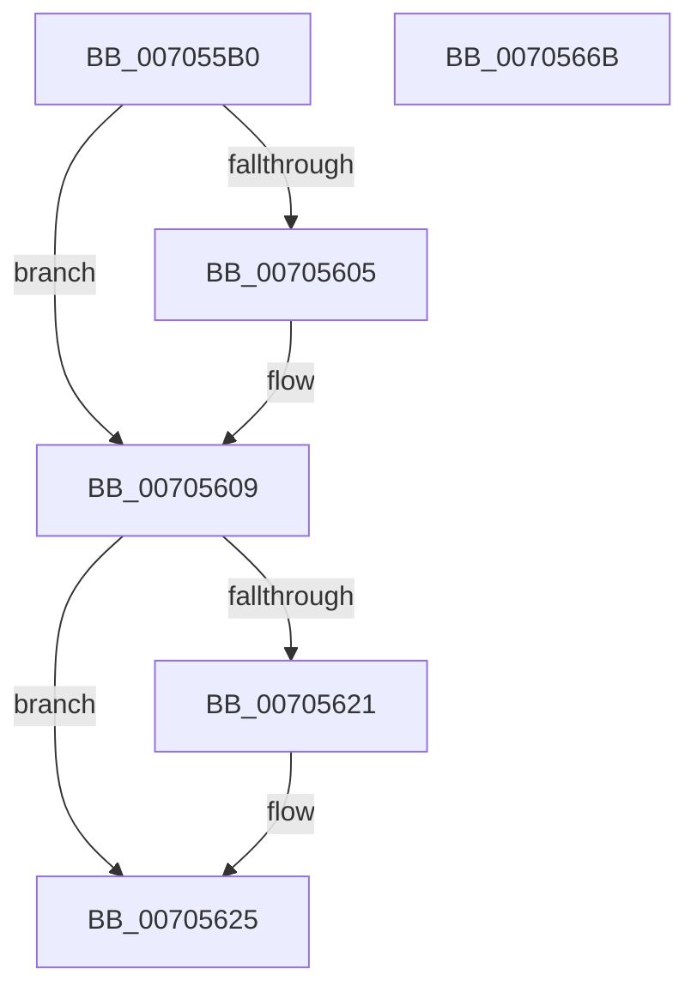

# PiDqSameUserHive

- RVA: `0x007055B0`–`0x0070566C` (길이 `188` bytes)
- VA: `0x00000001407055B0`
- 실행 섹션: `PAGE`
- PDB 이름 있음: `예`; PDB Function 태그: `아니요`
- unwind 정보 RVA: `0x000BFA90`
- 디코드: `51`개 명령, `188/188` bytes 표시
- 미해석 바이트: `0` (있으면 어셈블리에 `.byte`로 보존)

> 이 문서는 커널 이미지의 기계어와 PDB 기호를 분석해 생성했습니다. 4번과 5번은 함수 원형과 자료형을 바이너리 사용 방식에서 추정한 C 해석이며 원본 소스 복구 결과는 아닙니다.

## 1. Dependencies

- 직접 호출 지점: **6**; 고유 호출 대상: **4**
- 직접 호출자로 확인된 함수: **1**
- RIP 상대 이미지 참조: **1**

### Outgoing calls
- `0x007055E9` → [memset](../../text/6C/memset_function_006C6C40.md) (function, `0x006C6C40`)
- `0x007055F8` → [memset](../../text/6C/memset_function_006C6C40.md) (function, `0x006C6C40`)
- `0x00705614` → [SeQueryUserSidToken](../99/SeQueryUserSidToken_function_00990950.md) (function, `0x00990950`)
- `0x00705630` → [SeQueryUserSidToken](../99/SeQueryUserSidToken_function_00990950.md) (function, `0x00990950`)
- `0x0070563F` → [RtlEqualSid](../../text/40/RtlEqualSid_function_00400AD0.md) (function, `0x00400AD0`)
- `0x00705653` → [_security_check_cookie](../../text/6A/_security_check_cookie_function_006AC640.md) (function, `0x006AC640`)

### Direct callers
- [PiDqQueryApplyObjectEvent](../8D/PiDqQueryApplyObjectEvent_function_008DDACC.md) at `0x008DDFDC`

### Static image references
- `0x007055BF` → RVA `0x00E0A740` (`.data`; read)

## 2. Other-region calls and transfers

- 다른 실행 섹션으로 향하는 call: **4**
  - `0x007055E9` → [memset](../../text/6C/memset_function_006C6C40.md) (`PAGE` → `.text`)
  - `0x007055F8` → [memset](../../text/6C/memset_function_006C6C40.md) (`PAGE` → `.text`)
  - `0x0070563F` → [RtlEqualSid](../../text/40/RtlEqualSid_function_00400AD0.md) (`PAGE` → `.text`)
  - `0x00705653` → [_security_check_cookie](../../text/6A/_security_check_cookie_function_006AC640.md) (`PAGE` → `.text`)
- 별도 외부 분기/꼬리 이동을 확인하지 못했습니다.

## 3. Assembly (complete function range)

```asm
007055B0  48 89 5C 24 20                  mov qword ptr [rsp + 0x20], rbx
007055B5  55                              push rbp
007055B6  56                              push rsi
007055B7  57                              push rdi
007055B8  48 81 EC D0 00 00 00            sub rsp, 0xd0
007055BF  48 8B 05 7A 51 70 00            mov rax, qword ptr [rip + 0x70517a]
007055C6  48 33 C4                        xor rax, rsp
007055C9  48 89 84 24 C0 00 00 00         mov qword ptr [rsp + 0xc0], rax
007055D1  49 8B F0                        mov rsi, r8
007055D4  48 8B DA                        mov rbx, rdx
007055D7  48 8B F9                        mov rdi, rcx
007055DA  BD 44 00 00 00                  mov ebp, 0x44
007055DF  44 8B C5                        mov r8d, ebp
007055E2  48 8D 4C 24 70                  lea rcx, [rsp + 0x70]
007055E7  33 D2                           xor edx, edx
007055E9  E8 52 16 FC FF                  call 0x1406c6c40
007055EE  44 8B C5                        mov r8d, ebp
007055F1  48 8D 4C 24 20                  lea rcx, [rsp + 0x20]
007055F6  33 D2                           xor edx, edx
007055F8  E8 43 16 FC FF                  call 0x1406c6c40
007055FD  48 8B 0F                        mov rcx, qword ptr [rdi]
00705600  48 85 C9                        test rcx, rcx
00705603  75 04                           jne 0x140705609
00705605  48 8B 4F 10                     mov rcx, qword ptr [rdi + 0x10]
00705609  45 33 C9                        xor r9d, r9d
0070560C  48 8D 54 24 70                  lea rdx, [rsp + 0x70]
00705611  44 8B C5                        mov r8d, ebp
00705614  E8 37 B3 28 00                  call 0x140990950
00705619  48 8B 0B                        mov rcx, qword ptr [rbx]
0070561C  48 85 C9                        test rcx, rcx
0070561F  75 04                           jne 0x140705625
00705621  48 8B 4B 10                     mov rcx, qword ptr [rbx + 0x10]
00705625  45 33 C9                        xor r9d, r9d
00705628  48 8D 54 24 20                  lea rdx, [rsp + 0x20]
0070562D  44 8B C5                        mov r8d, ebp
00705630  E8 1B B3 28 00                  call 0x140990950
00705635  48 8D 54 24 20                  lea rdx, [rsp + 0x20]
0070563A  48 8D 4C 24 70                  lea rcx, [rsp + 0x70]
0070563F  E8 8C B4 CF FF                  call 0x140400ad0
00705644  88 06                           mov byte ptr [rsi], al
00705646  33 C0                           xor eax, eax
00705648  48 8B 8C 24 C0 00 00 00         mov rcx, qword ptr [rsp + 0xc0]
00705650  48 33 CC                        xor rcx, rsp
00705653  E8 E8 6F FA FF                  call 0x1406ac640
00705658  48 8B 9C 24 08 01 00 00         mov rbx, qword ptr [rsp + 0x108]
00705660  48 81 C4 D0 00 00 00            add rsp, 0xd0
00705667  5F                              pop rdi
00705668  5E                              pop rsi
00705669  5D                              pop rbp
0070566A  C3                              ret
0070566B  CC                              int3
```

## 4. C-style interpretation (structured pseudocode)

```c
__int64 __fastcall PiDqSameUserHive(__int64 a1, __int64 a2, __int64 a3, int a4)
{
    __int64 result;
    __int64 v_rsp;
    unsigned __int64 v_stack_m28;
    unsigned __int64 v_stack_m78;
    unsigned __int64 v_stack_mC8;
    unsigned __int64 v_stack_p20;

    v_stack_p20 = v_rbx;
    v_rsp = (v_rsp) - (208);
    result = (*(unsigned __int64 *)(v_rip + 7360890)) ^ (v_rsp);
    v_stack_m28 = result;
    a2 = 0;
    result = memset(v_stack_m78, a2, 68, a4);
    a2 = 0;
    result = memset(v_stack_mC8, a2, 68, a4);
    if (*(unsigned __int64 *)(a1) == 0) {
        a1 = *(unsigned __int64 *)(a1 + 16);
    }
    a4 = 0;
    result = SeQueryUserSidToken(a1, v_stack_m78, 68, a4);
    if (*(unsigned __int64 *)(a2) == 0) {
        a1 = *(unsigned __int64 *)(a2 + 16);
    }
    a4 = 0;
    result = SeQueryUserSidToken(a1, v_stack_mC8, 68, a4);
    result = RtlEqualSid(v_stack_m78, v_stack_mC8, 68, a4);
    *(unsigned __int8 *)(a3) = (unsigned __int8)(result);
    result = 0;
    a1 = (v_stack_m28) ^ (v_rsp);
    result = _security_check_cookie(a1, v_stack_mC8, 68, a4);
    v_rsp = (v_rsp) + (208);
    return result;
}
```

## 5. (Beta) C Style

```c
int64_t PiDqSameUserHive(void *Arg1, void *Arg2, void *Arg3, int32_t Arg4)
{
    uint8_t *arg1 = (uint8_t *)Arg1;
    uint8_t *arg2 = (uint8_t *)Arg2;
    uint8_t *arg3 = (uint8_t *)Arg3;

    int64_t result;
    int64_t local_rsp;
    uint64_t v_stack_m28;
    uint64_t v_stack_m78;
    uint64_t v_stack_mC8;
    uint64_t v_stack_p20;

    v_stack_p20 = local_rbx;
    local_rsp = (local_rsp) - (208);
    result = (*(uint64_t *)(v_rip + 0x70517A)) ^ (local_rsp);
    v_stack_m28 = result;
    Arg2 = 0;
    result = memset(v_stack_m78, Arg2, 68, Arg4);
    Arg2 = 0;
    result = memset(v_stack_mC8, Arg2, 68, Arg4);
    if (*(uint64_t *)(arg1) == 0) {
        Arg1 = *(uint64_t *)(arg1 + 0x10);
    }
    Arg4 = 0;
    result = SeQueryUserSidToken(Arg1, v_stack_m78, 68, Arg4);
    if (*(uint64_t *)(arg2) == 0) {
        Arg1 = *(uint64_t *)(arg2 + 0x10);
    }
    Arg4 = 0;
    result = SeQueryUserSidToken(Arg1, v_stack_mC8, 68, Arg4);
    result = RtlEqualSid(v_stack_m78, v_stack_mC8, 68, Arg4);
    *(uint8_t *)(arg3) = (uint8_t)(result);
    result = 0;
    Arg1 = (v_stack_m28) ^ (local_rsp);
    result = _security_check_cookie(Arg1, v_stack_mC8, 68, Arg4);
    local_rsp = (local_rsp) + (208);
    return result;
}
```

### 관측된 메모리 오프셋

구조체 형식이 확인되지 않은 접근은 인자 기준의 오프셋으로만 기록했습니다.

| 기준 인자 | 오프셋 표현 | 폭 (bit) | 접근 |
|---|---:|---:|---|
| `Arg1` | `+ 0x0` | `64` | `R` |
| `Arg1` | `+ 0x10` | `64` | `R` |
| `Arg2` | `+ 0x0` | `64` | `R` |
| `Arg2` | `+ 0x10` | `64` | `R` |
| `Arg3` | `+ 0x0` | `8` | `W` |

## 6. Execution-region graph

[열기: 2D/3D 그래프와 함수 탐색 컨트롤 패널](../../../control-panel.html?section=page&rva=0x007055B0&view=graph)

- 2D 그래프는 위에서 아래로 흐르고, 3D 그래프는 빈 공간을 드래그해 회전합니다. Shift+드래그는 이동, 휠은 확대·축소, 함수 노드 선택은 대상 보고서 이동입니다.

### Static fallback


