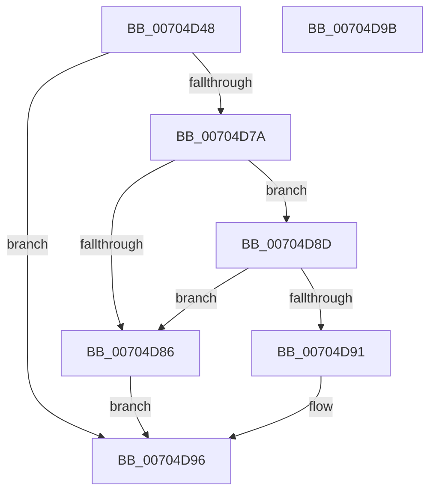

# PiDrvDbUnmountNode

- RVA: `0x00704D48`–`0x00704D9C` (길이 `84` bytes)
- VA: `0x0000000140704D48`
- 실행 섹션: `PAGE`
- PDB 이름 있음: `예`; PDB Function 태그: `아니요`
- unwind 정보 RVA: `0x0005D2F4`
- 디코드: `24`개 명령, `84/84` bytes 표시
- 미해석 바이트: `0` (있으면 어셈블리에 `.byte`로 보존)

> 이 문서는 커널 이미지의 기계어와 PDB 기호를 분석해 생성했습니다. 4번과 5번은 함수 원형과 자료형을 바이너리 사용 방식에서 추정한 C 해석이며 원본 소스 복구 결과는 아닙니다.

## 1. Dependencies

- 직접 호출 지점: **3**; 고유 호출 대상: **3**
- 직접 호출자로 확인된 함수: **2**
- RIP 상대 이미지 참조: **0**

### Outgoing calls
- `0x00704D62` → [RtlInitUnicodeString](../../text/42/RtlInitUnicodeString_function_0042A780.md) (function, `0x0042A780`)
- `0x00704D71` → [PiDrvDbFindNode](../../text/4F/PiDrvDbFindNode_function_004F8E60.md) (function, `0x004F8E60`)
- `0x00704D91` → [PiDrvDbUnregisterNode](../74/PiDrvDbUnregisterNode_function_00743EF8.md) (function, `0x00743EF8`)

### Direct callers
- [sub_008E369D](../8E/Unknown_function_008E369D.md) at `0x008E36B7`
- [sub_008E37B7](../8E/Unknown_function_008E37B7.md) at `0x008E37EA`

### Static image references
- 디코드된 RIP-relative 메모리 참조가 없습니다.

## 2. Other-region calls and transfers

- 다른 실행 섹션으로 향하는 call: **2**
  - `0x00704D62` → [RtlInitUnicodeString](../../text/42/RtlInitUnicodeString_function_0042A780.md) (`PAGE` → `.text`)
  - `0x00704D71` → [PiDrvDbFindNode](../../text/4F/PiDrvDbFindNode_function_004F8E60.md) (`PAGE` → `.text`)
- 별도 외부 분기/꼬리 이동을 확인하지 못했습니다.

## 3. Assembly (complete function range)

```asm
00704D48  48 83 EC 38                     sub rsp, 0x38
00704D4C  48 83 64 24 48 00               and qword ptr [rsp + 0x48], 0
00704D52  0F 57 C0                        xorps xmm0, xmm0
00704D55  48 8B D1                        mov rdx, rcx
00704D58  48 8D 4C 24 20                  lea rcx, [rsp + 0x20]
00704D5D  0F 11 44 24 20                  movups xmmword ptr [rsp + 0x20], xmm0
00704D62  E8 19 5A D2 FF                  call 0x14042a780
00704D67  48 8D 54 24 48                  lea rdx, [rsp + 0x48]
00704D6C  48 8D 4C 24 20                  lea rcx, [rsp + 0x20]
00704D71  E8 EA 40 DF FF                  call 0x1404f8e60
00704D76  85 C0                           test eax, eax
00704D78  78 1C                           js 0x140704d96
00704D7A  48 8B 4C 24 48                  mov rcx, qword ptr [rsp + 0x48]
00704D7F  8B 41 40                        mov eax, dword ptr [rcx + 0x40]
00704D82  A8 01                           test al, 1
00704D84  74 07                           je 0x140704d8d
00704D86  B8 22 00 00 C0                  mov eax, 0xc0000022
00704D8B  EB 09                           jmp 0x140704d96
00704D8D  A8 10                           test al, 0x10
00704D8F  74 F5                           je 0x140704d86
00704D91  E8 62 F1 03 00                  call 0x140743ef8
00704D96  48 83 C4 38                     add rsp, 0x38
00704D9A  C3                              ret
00704D9B  CC                              int3
```

## 4. C-style interpretation (structured pseudocode)

```c
__int64 __fastcall PiDrvDbUnmountNode(__int64 a1)
{
    __int64 result;
    __int64 v_rsp;
    unsigned __int64 v_stack_m18;
    unsigned __int64 v_stack_p10;

    v_rsp = (v_rsp) - (56);
    v_stack_m18 = v_xmm0;
    result = RtlInitUnicodeString(v_stack_m18, a1, a3, a4);
    result = PiDrvDbFindNode(v_stack_m18, v_stack_p10, a3, a4);
    if (sign_flag) goto loc_00704D96;
    if ((((unsigned __int8)((unsigned int)(*(unsigned int *)(v_stack_p10 + 64)))) & (1)) == 0) goto loc_00704D8D;
loc_00704D86:
    goto loc_00704D96;
loc_00704D8D:
    if ((((unsigned __int8)((unsigned int)(0xC0000022ULL))) & (16)) == 0) goto loc_00704D86;
    result = PiDrvDbUnregisterNode(v_stack_p10, v_stack_p10, a3, a4);
loc_00704D96:
    v_rsp = (v_rsp) + (56);
    return result;
}
```

## 5. (Beta) C Style

```c
int64_t PiDrvDbUnmountNode(int64_t Arg1)
{
    int64_t result;
    int64_t local_rsp;
    uint64_t v_stack_m18;
    uint64_t v_stack_p10;

    local_rsp = (local_rsp) - (56);
    v_stack_m18 = v_xmm0;
    result = RtlInitUnicodeString(v_stack_m18, Arg1, a3, a4);
    result = PiDrvDbFindNode(v_stack_m18, v_stack_p10, a3, a4);
    if (sign_flag) goto loc_00704D96;
    if ((((uint8_t)((uint32_t)(*(uint32_t *)(v_stack_p10 + 0x40)))) & (1)) == 0) goto loc_00704D8D;
loc_00704D86:
    goto loc_00704D96;
loc_00704D8D:
    if ((((uint8_t)((uint32_t)(0xC0000022ULL))) & (16)) == 0) goto loc_00704D86;
    result = PiDrvDbUnregisterNode(v_stack_p10, v_stack_p10, a3, a4);
loc_00704D96:
    local_rsp = (local_rsp) + (56);
    return result;
}
```

## 6. Execution-region graph

[열기: 2D/3D 그래프와 함수 탐색 컨트롤 패널](../../../control-panel.html?section=page&rva=0x00704D48&view=graph)

- 2D 그래프는 위에서 아래로 흐르고, 3D 그래프는 빈 공간을 드래그해 회전합니다. Shift+드래그는 이동, 휠은 확대·축소, 함수 노드 선택은 대상 보고서 이동입니다.

### Static fallback


