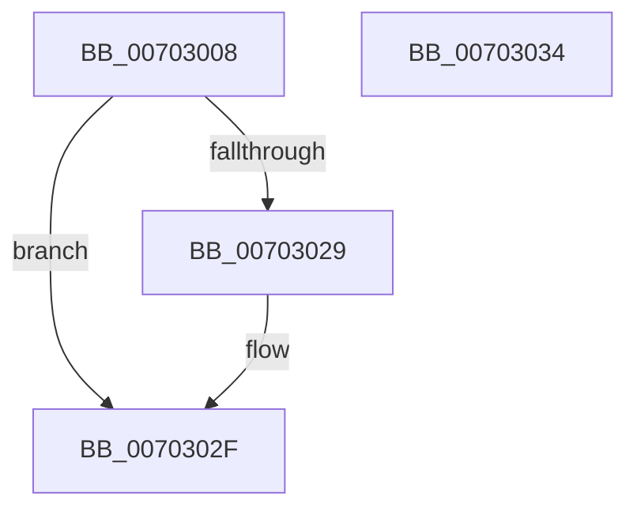

# PiEnumerateDependentListEntry

- RVA: `0x00703008`–`0x00703035` (길이 `45` bytes)
- VA: `0x0000000140703008`
- 실행 섹션: `PAGE`
- PDB 이름 있음: `예`; PDB Function 태그: `아니요`
- unwind 정보 RVA: `0x0005C788`
- 디코드: `14`개 명령, `45/45` bytes 표시
- 미해석 바이트: `0` (있으면 어셈블리에 `.byte`로 보존)

> 이 문서는 커널 이미지의 기계어와 PDB 기호를 분석해 생성했습니다. 4번과 5번은 함수 원형과 자료형을 바이너리 사용 방식에서 추정한 C 해석이며 원본 소스 복구 결과는 아닙니다.

## 1. Dependencies

- 직접 호출 지점: **1**; 고유 호출 대상: **1**
- 직접 호출자로 확인된 함수: **2**
- RIP 상대 이미지 참조: **0**

### Outgoing calls
- `0x00703014` → [PiListEntryToDependencyEdge](../../text/4F/PiListEntryToDependencyEdge_function_004F9648.md) (function, `0x004F9648`)

### Direct callers
- [PipVisitDeviceObjectListEntry](../A0/PipVisitDeviceObjectListEntry_function_00A06F88.md) at `0x00A07092`
- [PnpProcessDependencyRelations](../A0/PnpProcessDependencyRelations_function_00A07548.md) at `0x00A075E9`

### Static image references
- 디코드된 RIP-relative 메모리 참조가 없습니다.

## 2. Other-region calls and transfers

- 다른 실행 섹션으로 향하는 call: **1**
  - `0x00703014` → [PiListEntryToDependencyEdge](../../text/4F/PiListEntryToDependencyEdge_function_004F9648.md) (`PAGE` → `.text`)
- 별도 외부 분기/꼬리 이동을 확인하지 못했습니다.

## 3. Assembly (complete function range)

```asm
00703008  48 83 EC 28                     sub rsp, 0x28
0070300C  4C 8B D2                        mov r10, rdx
0070300F  BA 01 00 00 00                  mov edx, 1
00703014  E8 2F 66 DF FF                  call 0x1404f9648
00703019  48 8B 48 28                     mov rcx, qword ptr [rax + 0x28]
0070301D  4C 8B 49 30                     mov r9, qword ptr [rcx + 0x30]
00703021  4D 89 0A                        mov qword ptr [r10], r9
00703024  4D 85 C0                        test r8, r8
00703027  74 06                           je 0x14070302f
00703029  8B 40 30                        mov eax, dword ptr [rax + 0x30]
0070302C  41 89 00                        mov dword ptr [r8], eax
0070302F  48 83 C4 28                     add rsp, 0x28
00703033  C3                              ret
00703034  CC                              int3
```

## 4. C-style interpretation (structured pseudocode)

```c
__int64 __fastcall PiEnumerateDependentListEntry(__int64 a1, __int64 a2, __int64 a3)
{
    __int64 result;
    __int64 v_rsp;

    v_rsp = (v_rsp) - (40);
    result = PiListEntryToDependencyEdge(a1, 1, a3, a4);
    *(unsigned __int64 *)(a2) = *(unsigned __int64 *)(*(unsigned __int64 *)(result + 40) + 48);
    if (a3 != 0) {
        result = *(unsigned int *)(result + 48);
        *(unsigned int *)(a3) = (unsigned int)(result);
    }
    v_rsp = (v_rsp) + (40);
    return result;
}
```

## 5. (Beta) C Style

```c
int64_t PiEnumerateDependentListEntry(int64_t Arg1, int64_t Arg2, int64_t Arg3)
{
    int64_t result;
    int64_t local_rsp;

    local_rsp = (local_rsp) - (40);
    result = PiListEntryToDependencyEdge(Arg1, 1, Arg3, a4);
    *(uint64_t *)(Arg2) = *(uint64_t *)(*(uint64_t *)(result + 0x28) + 0x30);
    if (Arg3 != 0) {
        result = *(uint32_t *)(result + 0x30);
        *(uint32_t *)(Arg3) = (uint32_t)(result);
    }
    local_rsp = (local_rsp) + (40);
    return result;
}
```

## 6. Execution-region graph

[열기: 2D/3D 그래프와 함수 탐색 컨트롤 패널](../../../control-panel.html?section=page&rva=0x00703008&view=graph)

- 2D 그래프는 위에서 아래로 흐르고, 3D 그래프는 빈 공간을 드래그해 회전합니다. Shift+드래그는 이동, 휠은 확대·축소, 함수 노드 선택은 대상 보고서 이동입니다.

### Static fallback


