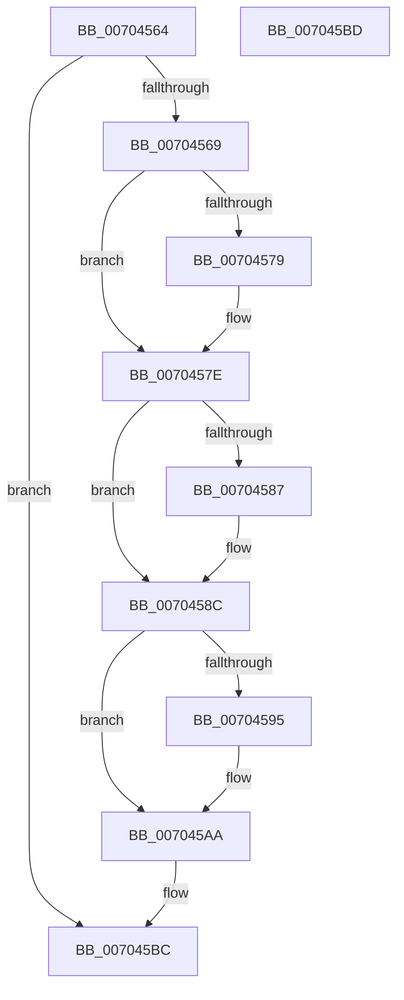

# PiPnpRtlFreeInstallerClassChangeInfo

- RVA: `0x00704564`–`0x007045BE` (길이 `90` bytes)
- VA: `0x0000000140704564`
- 실행 섹션: `PAGE`
- PDB 이름 있음: `예`; PDB Function 태그: `아니요`
- unwind 정보 RVA: `0x000805BC`
- 디코드: `28`개 명령, `90/90` bytes 표시
- 미해석 바이트: `0` (있으면 어셈블리에 `.byte`로 보존)

> 이 문서는 커널 이미지의 기계어와 PDB 기호를 분석해 생성했습니다. 4번과 5번은 함수 원형과 자료형을 바이너리 사용 방식에서 추정한 C 해석이며 원본 소스 복구 결과는 아닙니다.

## 1. Dependencies

- 직접 호출 지점: **5**; 고유 호출 대상: **3**
- 직접 호출자로 확인된 함수: **2**
- RIP 상대 이미지 참조: **0**

### Outgoing calls
- `0x00704579` → [PiDmObjectRelease](../8E/PiDmObjectRelease_function_008E4F70.md) (function, `0x008E4F70`)
- `0x00704587` → [PiDmObjectRelease](../8E/PiDmObjectRelease_function_008E4F70.md) (function, `0x008E4F70`)
- `0x0070459C` → [PiDmRemoveCacheReferenceForObject](../95/PiDmRemoveCacheReferenceForObject_function_00950F24.md) (function, `0x00950F24`)
- `0x007045A5` → [PiDmObjectRelease](../8E/PiDmObjectRelease_function_008E4F70.md) (function, `0x008E4F70`)
- `0x007045B2` → [ExFreePoolWithTag](../../poolcode/B8/ExFreePoolWithTag_function_00B82870.md) (function, `0x00B82870`)

### Direct callers
- [PiPnpRtlCmActionCallback](../8E/PiPnpRtlCmActionCallback_function_008EF110.md) at `0x008EF333`
- [PiPnpRtlGatherInstallerClassChangeInfo](../AD/PiPnpRtlGatherInstallerClassChangeInfo_function_00AD26FC.md) at `0x00AD284C`

### Static image references
- 디코드된 RIP-relative 메모리 참조가 없습니다.

## 2. Other-region calls and transfers

- 다른 실행 섹션으로 향하는 call: **1**
  - `0x007045B2` → [ExFreePoolWithTag](../../poolcode/B8/ExFreePoolWithTag_function_00B82870.md) (`PAGE` → `POOLCODE`)
- 별도 외부 분기/꼬리 이동을 확인하지 못했습니다.

## 3. Assembly (complete function range)

```asm
00704564  48 85 C9                        test rcx, rcx
00704567  74 53                           je 0x1407045bc
00704569  53                              push rbx
0070456A  48 83 EC 20                     sub rsp, 0x20
0070456E  48 8B D9                        mov rbx, rcx
00704571  48 8B 09                        mov rcx, qword ptr [rcx]
00704574  48 85 C9                        test rcx, rcx
00704577  74 05                           je 0x14070457e
00704579  E8 F2 09 1E 00                  call 0x1408e4f70
0070457E  48 8B 4B 08                     mov rcx, qword ptr [rbx + 8]
00704582  48 85 C9                        test rcx, rcx
00704585  74 05                           je 0x14070458c
00704587  E8 E4 09 1E 00                  call 0x1408e4f70
0070458C  48 8B 4B 10                     mov rcx, qword ptr [rbx + 0x10]
00704590  48 85 C9                        test rcx, rcx
00704593  74 15                           je 0x1407045aa
00704595  48 8B 51 10                     mov rdx, qword ptr [rcx + 0x10]
00704599  8B 49 1C                        mov ecx, dword ptr [rcx + 0x1c]
0070459C  E8 83 C9 24 00                  call 0x140950f24
007045A1  48 8B 4B 10                     mov rcx, qword ptr [rbx + 0x10]
007045A5  E8 C6 09 1E 00                  call 0x1408e4f70
007045AA  BA 50 6E 70 47                  mov edx, 0x47706e50
007045AF  48 8B CB                        mov rcx, rbx
007045B2  E8 B9 E2 47 00                  call 0x140b82870
007045B7  48 83 C4 20                     add rsp, 0x20
007045BB  5B                              pop rbx
007045BC  C3                              ret
007045BD  CC                              int3
```

## 4. C-style interpretation (structured pseudocode)

```c
__int64 __fastcall PiPnpRtlFreeInstallerClassChangeInfo(__int64 a1)
{
    __int64 result;
    __int64 v_rsp;

    if (a1 == 0) goto loc_007045BC;
    v_rsp = (v_rsp) - (32);
    if (*(unsigned __int64 *)(a1) != 0) {
        result = PiDmObjectRelease(*(unsigned __int64 *)(a1), a2, a3, a4);
    }
    if (*(unsigned __int64 *)(a1 + 8) != 0) {
        result = PiDmObjectRelease(*(unsigned __int64 *)(a1 + 8), a2, a3, a4);
    }
    if (*(unsigned __int64 *)(a1 + 16) != 0) {
        a2 = *(unsigned __int64 *)(*(unsigned __int64 *)(a1 + 16) + 16);
        a1 = *(unsigned int *)(*(unsigned __int64 *)(a1 + 16) + 28);
        result = PiDmRemoveCacheReferenceForObject(a1, a2, a3, a4);
        a1 = *(unsigned __int64 *)(a1 + 16);
        result = PiDmObjectRelease(a1, a2, a3, a4);
    }
    result = ExFreePoolWithTag(a1, (unsigned int)(0x47706E50ULL), a3, a4);
    v_rsp = (v_rsp) + (32);
loc_007045BC:
    return result;
}
```

## 5. (Beta) C Style

```c
int64_t PiPnpRtlFreeInstallerClassChangeInfo(int64_t Arg1)
{
    int64_t result;
    int64_t local_rsp;

    if (Arg1 == 0) goto loc_007045BC;
    local_rsp = (local_rsp) - (32);
    if (*(uint64_t *)(Arg1) != 0) {
        result = PiDmObjectRelease(*(uint64_t *)(Arg1), a2, a3, a4);
    }
    if (*(uint64_t *)(Arg1 + 0x8) != 0) {
        result = PiDmObjectRelease(*(uint64_t *)(Arg1 + 0x8), a2, a3, a4);
    }
    if (*(uint64_t *)(Arg1 + 0x10) != 0) {
        a2 = *(uint64_t *)(*(uint64_t *)(Arg1 + 0x10) + 0x10);
        Arg1 = *(uint32_t *)(*(uint64_t *)(Arg1 + 0x10) + 0x1C);
        result = PiDmRemoveCacheReferenceForObject(Arg1, a2, a3, a4);
        Arg1 = *(uint64_t *)(Arg1 + 0x10);
        result = PiDmObjectRelease(Arg1, a2, a3, a4);
    }
    result = ExFreePoolWithTag(Arg1, (uint32_t)(0x47706E50ULL), a3, a4);
    local_rsp = (local_rsp) + (32);
loc_007045BC:
    return result;
}
```

## 6. Execution-region graph

[열기: 2D/3D 그래프와 함수 탐색 컨트롤 패널](../../../control-panel.html?section=page&rva=0x00704564&view=graph)

- 2D 그래프는 위에서 아래로 흐르고, 3D 그래프는 빈 공간을 드래그해 회전합니다. Shift+드래그는 이동, 휠은 확대·축소, 함수 노드 선택은 대상 보고서 이동입니다.

### Static fallback


