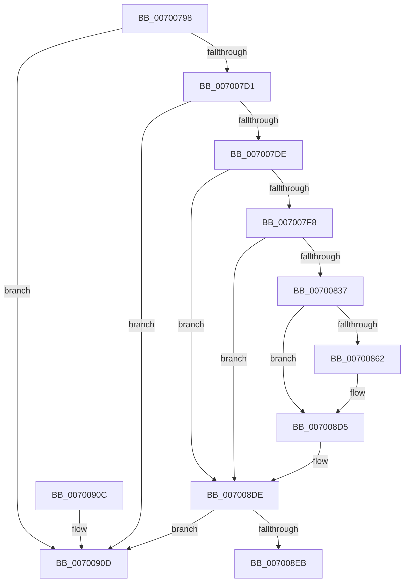

# PiUEventMovePendingEventToSynchronousQueue

- RVA: `0x00700798`–`0x00700914` (길이 `380` bytes)
- VA: `0x0000000140700798`
- 실행 섹션: `PAGE`
- PDB 이름 있음: `예`; PDB Function 태그: `아니요`
- unwind 정보 RVA: `0x000BF434`
- 디코드: `91`개 명령, `380/380` bytes 표시
- 미해석 바이트: `0` (있으면 어셈블리에 `.byte`로 보존)

> 이 문서는 커널 이미지의 기계어와 PDB 기호를 분석해 생성했습니다. 4번과 5번은 함수 원형과 자료형을 바이너리 사용 방식에서 추정한 C 해석이며 원본 소스 복구 결과는 아닙니다.

## 1. Dependencies

- 직접 호출 지점: **4**; 고유 호출 대상: **4**
- 직접 호출자로 확인된 함수: **1**
- RIP 상대 이미지 참조: **3**

### Outgoing calls
- `0x00700847` → [PiUEventGatherEventData](../A6/PiUEventGatherEventData_function_00A6EBAC.md) (function, `0x00A6EBAC`)
- `0x00700854` → [PiUEventGetProcessImagePath](../AB/PiUEventGetProcessImagePath_function_00AB76F0.md) (function, `0x00AB76F0`)
- `0x007008D0` → [McTemplateK0qqzqqjqzjztx_EtwWriteTransfer](../../text/5A/McTemplateK0qqzqqjqzjztx_EtwWriteTransfer_function_005A7548.md) (function, `0x005A7548`)
- `0x007008D9` → [PiUEventFreeProcessImagePath](../AC/PiUEventFreeProcessImagePath_function_00AC8C44.md) (function, `0x00AC8C44`)

### Direct callers
- [PiUEventHandleGetEvent](../9C/PiUEventHandleGetEvent_function_009C2C30.md) at `0x009C2E5C`

### Static image references
- `0x007007EB` → RVA `0x00EF012D` (`.data`; read)
- `0x00700827` → RVA `0x00E0AA0C` (`.data`; read)
- `0x007008AB` → RVA `0x00026CC0` (`.rdata`; read)

## 2. Other-region calls and transfers

- 다른 실행 섹션으로 향하는 call: **1**
  - `0x007008D0` → [McTemplateK0qqzqqjqzjztx_EtwWriteTransfer](../../text/5A/McTemplateK0qqzqqjqzjztx_EtwWriteTransfer_function_005A7548.md) (`PAGE` → `.text`)
- 별도 외부 분기/꼬리 이동을 확인하지 못했습니다.

## 3. Assembly (complete function range)

```asm
00700798  48 89 5C 24 08                  mov qword ptr [rsp + 8], rbx
0070079D  55                              push rbp
0070079E  56                              push rsi
0070079F  57                              push rdi
007007A0  48 8D 6C 24 B9                  lea rbp, [rsp - 0x47]
007007A5  48 81 EC 90 00 00 00            sub rsp, 0x90
007007AC  33 C0                           xor eax, eax
007007AE  48 8B F9                        mov rdi, rcx
007007B1  48 8B 0A                        mov rcx, qword ptr [rdx]
007007B4  48 8B DA                        mov rbx, rdx
007007B7  48 89 45 37                     mov qword ptr [rbp + 0x37], rax
007007BB  48 89 45 7F                     mov qword ptr [rbp + 0x7f], rax
007007BF  48 89 45 77                     mov qword ptr [rbp + 0x77], rax
007007C3  48 89 45 6F                     mov qword ptr [rbp + 0x6f], rax
007007C7  48 39 51 08                     cmp qword ptr [rcx + 8], rdx
007007CB  0F 85 3C 01 00 00               jne 0x14070090d
007007D1  48 8B 42 08                     mov rax, qword ptr [rdx + 8]
007007D5  48 39 10                        cmp qword ptr [rax], rdx
007007D8  0F 85 2F 01 00 00               jne 0x14070090d
007007DE  48 89 08                        mov qword ptr [rax], rcx
007007E1  48 89 41 08                     mov qword ptr [rcx + 8], rax
007007E5  FF 8F 80 00 00 00               dec dword ptr [rdi + 0x80]
007007EB  F6 05 3B F9 7E 00 01            test byte ptr [rip + 0x7ef93b], 1
007007F2  0F 84 E6 00 00 00               je 0x1407008de
007007F8  48 B9 14 00 00 00 80 F7 FF FF   movabs rcx, 0xfffff78000000014
00700802  48 B8 4B 59 86 38 D6 C5 6D 34   movabs rax, 0x346dc5d63886594b
0070080C  48 8B 09                        mov rcx, qword ptr [rcx]
0070080F  48 2B 4A 10                     sub rcx, qword ptr [rdx + 0x10]
00700813  48 F7 E9                        imul rcx
00700816  48 8B F2                        mov rsi, rdx
00700819  48 C1 FE 0B                     sar rsi, 0xb
0070081D  48 8B C6                        mov rax, rsi
00700820  48 C1 E8 3F                     shr rax, 0x3f
00700824  48 03 F0                        add rsi, rax
00700827  0F B7 05 DE A1 70 00            movzx eax, word ptr [rip + 0x70a1de]
0070082E  48 3B F0                        cmp rsi, rax
00700831  0F 8E A7 00 00 00               jle 0x1407008de
00700837  48 8B 4B 18                     mov rcx, qword ptr [rbx + 0x18]
0070083B  4C 8D 4D 77                     lea r9, [rbp + 0x77]
0070083F  4C 8D 45 7F                     lea r8, [rbp + 0x7f]
00700843  48 8D 55 37                     lea rdx, [rbp + 0x37]
00700847  E8 60 E3 36 00                  call 0x140a6ebac
0070084C  48 8B 4F 30                     mov rcx, qword ptr [rdi + 0x30]
00700850  48 8D 55 6F                     lea rdx, [rbp + 0x6f]
00700854  E8 97 6E 3B 00                  call 0x140ab76f0
00700859  F6 05 CD F8 7E 00 01            test byte ptr [rip + 0x7ef8cd], 1
00700860  74 73                           je 0x1407008d5
00700862  48 8B 4B 18                     mov rcx, qword ptr [rbx + 0x18]
00700866  44 8B 8F 84 00 00 00            mov r9d, dword ptr [rdi + 0x84]
0070086D  48 89 74 24 70                  mov qword ptr [rsp + 0x70], rsi
00700872  0F B6 41 4C                     movzx eax, byte ptr [rcx + 0x4c]
00700876  48 8D 51 50                     lea rdx, [rcx + 0x50]
0070087A  89 44 24 68                     mov dword ptr [rsp + 0x68], eax
0070087E  48 8B 45 77                     mov rax, qword ptr [rbp + 0x77]
00700882  48 89 44 24 60                  mov qword ptr [rsp + 0x60], rax
00700887  48 8B 45 7F                     mov rax, qword ptr [rbp + 0x7f]
0070088B  48 89 44 24 58                  mov qword ptr [rsp + 0x58], rax
00700890  48 8B 45 37                     mov rax, qword ptr [rbp + 0x37]
00700894  48 89 44 24 50                  mov qword ptr [rsp + 0x50], rax
00700899  8B 41 60                        mov eax, dword ptr [rcx + 0x60]
0070089C  89 44 24 48                     mov dword ptr [rsp + 0x48], eax
007008A0  8B 87 88 00 00 00               mov eax, dword ptr [rdi + 0x88]
007008A6  48 89 54 24 40                  mov qword ptr [rsp + 0x40], rdx
007008AB  48 8D 15 0E 64 92 FF            lea rdx, [rip - 0x6d9bf2]
007008B2  89 44 24 38                     mov dword ptr [rsp + 0x38], eax
007008B6  8B 87 80 00 00 00               mov eax, dword ptr [rdi + 0x80]
007008BC  89 44 24 30                     mov dword ptr [rsp + 0x30], eax
007008C0  48 8B 45 6F                     mov rax, qword ptr [rbp + 0x6f]
007008C4  48 89 44 24 28                  mov qword ptr [rsp + 0x28], rax
007008C9  8B 47 30                        mov eax, dword ptr [rdi + 0x30]
007008CC  89 44 24 20                     mov dword ptr [rsp + 0x20], eax
007008D0  E8 73 6C EA FF                  call 0x1405a7548
007008D5  48 8D 4D 6F                     lea rcx, [rbp + 0x6f]
007008D9  E8 66 83 3C 00                  call 0x140ac8c44
007008DE  48 8D 47 60                     lea rax, [rdi + 0x60]
007008E2  48 8B 48 08                     mov rcx, qword ptr [rax + 8]
007008E6  48 39 01                        cmp qword ptr [rcx], rax
007008E9  75 22                           jne 0x14070090d
007008EB  48 89 03                        mov qword ptr [rbx], rax
007008EE  48 89 4B 08                     mov qword ptr [rbx + 8], rcx
007008F2  48 89 19                        mov qword ptr [rcx], rbx
007008F5  48 89 58 08                     mov qword ptr [rax + 8], rbx
007008F9  48 8B 9C 24 B0 00 00 00         mov rbx, qword ptr [rsp + 0xb0]
00700901  48 81 C4 90 00 00 00            add rsp, 0x90
00700908  5F                              pop rdi
00700909  5E                              pop rsi
0070090A  5D                              pop rbp
0070090B  C3                              ret
0070090C  CC                              int3
0070090D  B9 03 00 00 00                  mov ecx, 3
00700912  CD 29                           int 0x29
```

## 4. C-style interpretation (structured pseudocode)

```c
__int64 __fastcall PiUEventMovePendingEventToSynchronousQueue(__int64 a1, __int64 a2)
{
    __int64 result;
    __int64 v_rsi;
    __int64 v_rsp;
    unsigned __int64 v_stack_m28;
    unsigned __int64 v_stack_m38;
    unsigned int v_stack_m40;
    unsigned __int64 v_stack_m48;
    unsigned __int64 v_stack_m50;
    unsigned __int64 v_stack_m58;
    unsigned __int64 v_stack_m5F;
    unsigned int v_stack_m60;
    unsigned __int64 v_stack_m68;
    unsigned int v_stack_m70;
    unsigned int v_stack_m78;
    unsigned __int64 v_stack_m80;
    unsigned int v_stack_m88;
    unsigned __int64 v_stack_p10;
    unsigned __int64 v_stack_p18;
    unsigned __int64 v_stack_p20;
    unsigned __int64 v_stack_p8;

    v_stack_p8 = v_rbx;
    v_rsp = (v_rsp) - (144);
    result = 0;
    v_stack_m28 = 0;
    v_stack_p20 = 0;
    v_stack_p18 = 0;
    v_stack_p10 = 0;
    if ((*(unsigned __int64 *)(*(unsigned __int64 *)(a2) + 8)) != a2) goto loc_0070090D;
    if ((*(unsigned __int64 *)(*(unsigned __int64 *)(a2 + 8))) != a2) goto loc_0070090D;
    *(unsigned __int64 *)(*(unsigned __int64 *)(a2 + 8)) = *(unsigned __int64 *)(a2);
    *(unsigned __int64 *)(*(unsigned __int64 *)(a2) + 8) = *(unsigned __int64 *)(a2 + 8);
    if (((*(unsigned __int8 *)(v_rip + 8321339)) & (1)) == 0) goto loc_007008DE;
    a1 = (*(unsigned __int64 *)(*(unsigned __int64 *)(a2))) - (*(unsigned __int64 *)(a2 + 16));
    v_rsi = (a2) >> (11);
    result = (v_rsi) >> (63);
    v_rsi = (v_rsi) + (result);
    if (v_rsi <= (*(unsigned __int16 *)(v_rip + 7381470))) goto loc_007008DE;
    result = PiUEventGatherEventData(*(unsigned __int64 *)(a2 + 24), v_stack_m28, v_stack_p20, v_stack_p18);
    result = PiUEventGetProcessImagePath(*(unsigned __int64 *)(a1 + 48), v_stack_p10, v_stack_p20, v_stack_p18);
    if (((*(unsigned __int8 *)(v_rip + 8321229)) & (1)) != 0) {
        a1 = *(unsigned __int64 *)(a2 + 24);
        a4 = *(unsigned int *)(a1 + 132);
        v_stack_m38 = v_rsi;
        result = *(unsigned __int8 *)(a1 + 76);
        a2 = a1 + 80;
        v_stack_m40 = (unsigned int)(result);
        result = v_stack_p18;
        v_stack_m48 = result;
        result = v_stack_p20;
        v_stack_m50 = result;
        result = v_stack_m28;
        v_stack_m58 = result;
        result = *(unsigned int *)(a1 + 96);
        v_stack_m60 = (unsigned int)(result);
        result = *(unsigned int *)(a1 + 136);
        v_stack_m68 = a2;
        a2 = v_rip - 7183346;
        v_stack_m70 = (unsigned int)(result);
        result = *(unsigned int *)(a1 + 128);
        v_stack_m78 = (unsigned int)(result);
        result = v_stack_p10;
        v_stack_m80 = result;
        result = *(unsigned int *)(a1 + 48);
        v_stack_m88 = (unsigned int)(result);
        result = McTemplateK0qqzqqjqzjztx_EtwWriteTransfer(a1, a2, v_stack_p20, a4);
    }
    result = PiUEventFreeProcessImagePath(v_stack_p10, a2, v_stack_p20, a4);
loc_007008DE:
    if ((*(unsigned __int64 *)(*(unsigned __int64 *)(a1 + 96 + 8))) != (a1 + 96)) goto loc_0070090D;
    *(unsigned __int64 *)(a2) = a1 + 96;
    *(unsigned __int64 *)(a2 + 8) = *(unsigned __int64 *)(a1 + 96 + 8);
    *(unsigned __int64 *)(*(unsigned __int64 *)(a1 + 96 + 8)) = a2;
    *(unsigned __int64 *)(a1 + 96 + 8) = a2;
    v_rsp = (v_rsp) + (144);
    return a1 + 96;
loc_0070090D:
    return a1 + 96;
}
```

## 5. (Beta) C Style

```c
void *PiUEventMovePendingEventToSynchronousQueue(void *Arg1, void *Arg2)
{
    uint8_t *arg1 = (uint8_t *)Arg1;
    uint8_t *arg2 = (uint8_t *)Arg2;

    int64_t result;
    int64_t local_rsi;
    int64_t local_rsp;
    uint64_t v_stack_m28;
    uint64_t v_stack_m38;
    uint32_t v_stack_m40;
    uint64_t v_stack_m48;
    uint64_t v_stack_m50;
    uint64_t v_stack_m58;
    uint64_t v_stack_m5F;
    uint32_t v_stack_m60;
    uint64_t v_stack_m68;
    uint32_t v_stack_m70;
    uint32_t v_stack_m78;
    uint64_t v_stack_m80;
    uint32_t v_stack_m88;
    uint64_t v_stack_p10;
    uint64_t v_stack_p18;
    uint64_t v_stack_p20;
    uint64_t v_stack_p8;

    v_stack_p8 = local_rbx;
    local_rsp = (local_rsp) - (144);
    result = 0;
    v_stack_m28 = 0;
    v_stack_p20 = 0;
    v_stack_p18 = 0;
    v_stack_p10 = 0;
    if ((*(uint64_t *)(*(uint64_t *)(arg2) + 0x8)) != Arg2) goto loc_0070090D;
    if ((*(uint64_t *)(*(uint64_t *)(arg2 + 0x8))) != Arg2) goto loc_0070090D;
    *(uint64_t *)(*(uint64_t *)(arg2 + 0x8)) = *(uint64_t *)(arg2);
    *(uint64_t *)(*(uint64_t *)(arg2) + 0x8) = *(uint64_t *)(arg2 + 0x8);
    if (((*(uint8_t *)(v_rip + 0x7EF93B)) & (1)) == 0) goto loc_007008DE;
    Arg1 = (*(uint64_t *)(*(uint64_t *)(arg2))) - (*(uint64_t *)(arg2 + 0x10));
    local_rsi = (Arg2) >> (11);
    result = (local_rsi) >> (63);
    local_rsi = (local_rsi) + (result);
    if (local_rsi <= (*(uint16_t *)(v_rip + 0x70A1DE))) goto loc_007008DE;
    result = PiUEventGatherEventData(*(uint64_t *)(arg2 + 0x18), v_stack_m28, v_stack_p20, v_stack_p18);
    result = PiUEventGetProcessImagePath(*(uint64_t *)(arg1 + 0x30), v_stack_p10, v_stack_p20, v_stack_p18);
    if (((*(uint8_t *)(v_rip + 0x7EF8CD)) & (1)) != 0) {
        Arg1 = *(uint64_t *)(arg2 + 0x18);
        a4 = *(uint32_t *)(arg1 + 0x84);
        v_stack_m38 = local_rsi;
        result = *(uint8_t *)(arg1 + 0x4C);
        Arg2 = Arg1 + 80;
        v_stack_m40 = (uint32_t)(result);
        result = v_stack_p18;
        v_stack_m48 = result;
        result = v_stack_p20;
        v_stack_m50 = result;
        result = v_stack_m28;
        v_stack_m58 = result;
        result = *(uint32_t *)(arg1 + 0x60);
        v_stack_m60 = (uint32_t)(result);
        result = *(uint32_t *)(arg1 + 0x88);
        v_stack_m68 = Arg2;
        Arg2 = v_rip - 7183346;
        v_stack_m70 = (uint32_t)(result);
        result = *(uint32_t *)(arg1 + 0x80);
        v_stack_m78 = (uint32_t)(result);
        result = v_stack_p10;
        v_stack_m80 = result;
        result = *(uint32_t *)(arg1 + 0x30);
        v_stack_m88 = (uint32_t)(result);
        result = McTemplateK0qqzqqjqzjztx_EtwWriteTransfer(Arg1, Arg2, v_stack_p20, a4);
    }
    result = PiUEventFreeProcessImagePath(v_stack_p10, Arg2, v_stack_p20, a4);
loc_007008DE:
    if ((*(uint64_t *)(*(uint64_t *)(arg1 + 0x60 + 0x8))) != (Arg1 + 96)) goto loc_0070090D;
    *(void **)(arg2) = Arg1 + 96;
    *(uint64_t *)(arg2 + 0x8) = *(uint64_t *)(arg1 + 0x60 + 0x8);
    *(void **)(*(uint64_t *)(arg1 + 0x60 + 0x8)) = Arg2;
    *(void **)(arg1 + 0x60 + 0x8) = Arg2;
    local_rsp = (local_rsp) + (144);
    return Arg1 + 96;
loc_0070090D:
    return Arg1 + 96;
}
```

### 관측된 메모리 오프셋

구조체 형식이 확인되지 않은 접근은 인자 기준의 오프셋으로만 기록했습니다.

| 기준 인자 | 오프셋 표현 | 폭 (bit) | 접근 |
|---|---:|---:|---|
| `Arg1` | `+ 0x8` | `64` | `R` |
| `Arg1` | `+ 0x8` | `64` | `W` |
| `Arg1` | `+ 0x30` | `32` | `R` |
| `Arg1` | `+ 0x30` | `64` | `R` |
| `Arg1` | `+ 0x60` | `64` | `R` |
| `Arg1` | `+ 0x80` | `32` | `R` |
| `Arg1` | `+ 0x80` | `32` | `R/W` |
| `Arg1` | `+ 0x84` | `32` | `R` |
| `Arg1` | `+ 0x88` | `32` | `R` |
| `Arg2` | `+ 0x0` | `64` | `R` |
| `Arg2` | `+ 0x0` | `64` | `W` |
| `Arg2` | `+ 0x8` | `64` | `R` |
| `Arg2` | `+ 0x8` | `64` | `W` |
| `Arg2` | `+ 0x10` | `64` | `R` |
| `Arg2` | `+ 0x18` | `64` | `R` |

## 6. Execution-region graph

[열기: 2D/3D 그래프와 함수 탐색 컨트롤 패널](../../../control-panel.html?section=page&rva=0x00700798&view=graph)

- 2D 그래프는 위에서 아래로 흐르고, 3D 그래프는 빈 공간을 드래그해 회전합니다. Shift+드래그는 이동, 휠은 확대·축소, 함수 노드 선택은 대상 보고서 이동입니다.

### Static fallback


