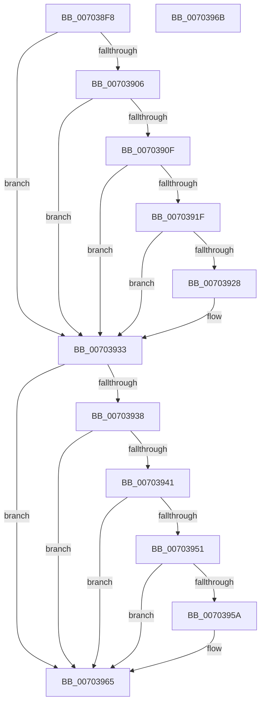

# PipNotifyDependenciesChanged

- RVA: `0x007038F8`–`0x0070396C` (길이 `116` bytes)
- VA: `0x00000001407038F8`
- 실행 섹션: `PAGE`
- PDB 이름 있음: `예`; PDB Function 태그: `아니요`
- unwind 정보 RVA: `0x0005CF00`
- 디코드: `35`개 명령, `116/116` bytes 표시
- 미해석 바이트: `0` (있으면 어셈블리에 `.byte`로 보존)

> 이 문서는 커널 이미지의 기계어와 PDB 기호를 분석해 생성했습니다. 4번과 5번은 함수 원형과 자료형을 바이너리 사용 방식에서 추정한 C 해석이며 원본 소스 복구 결과는 아닙니다.

## 1. Dependencies

- 직접 호출 지점: **2**; 고유 호출 대상: **1**
- 직접 호출자로 확인된 함수: **4**
- RIP 상대 이미지 참조: **0**

### Outgoing calls
- `0x0070392E` → [PnpRaiseNtPlugPlayDevicePropertyChangeEvent](../8F/PnpRaiseNtPlugPlayDevicePropertyChangeEvent_function_008F7D80.md) (function, `0x008F7D80`)
- `0x00703960` → [PnpRaiseNtPlugPlayDevicePropertyChangeEvent](../8F/PnpRaiseNtPlugPlayDevicePropertyChangeEvent_function_008F7D80.md) (function, `0x008F7D80`)

### Direct callers
- [PipFreeDependencyEdge](../../text/4D/PipFreeDependencyEdge_function_004D7658.md) at `0x004D7705`
- [PipCreateNewDependencyEdge](../../text/5A/PipCreateNewDependencyEdge_function_005A55BC.md) at `0x005A56B5`
- [PipMergeDependencyEdgeList](../72/PipMergeDependencyEdgeList_function_00727D4C.md) at `0x00727E5B`
- [PnpNewDeviceNodeDependencyCheck](../A0/PnpNewDeviceNodeDependencyCheck_function_00A062A0.md) at `0x00A063A1`
- [PnpNewDeviceNodeDependencyCheck](../A0/PnpNewDeviceNodeDependencyCheck_function_00A062A0.md) at `0x00A063C6`

### Static image references
- 디코드된 RIP-relative 메모리 참조가 없습니다.

## 2. Other-region calls and transfers

- 다른 실행 섹션으로 향하는 call: **0**
- 별도 외부 분기/꼬리 이동을 확인하지 못했습니다.

## 3. Assembly (complete function range)

```asm
007038F8  40 53                           push rbx
007038FA  48 83 EC 20                     sub rsp, 0x20
007038FE  48 8B D9                        mov rbx, rcx
00703901  48 85 D2                        test rdx, rdx
00703904  74 2D                           je 0x140703933
00703906  48 8B 42 30                     mov rax, qword ptr [rdx + 0x30]
0070390A  48 85 C0                        test rax, rax
0070390D  74 24                           je 0x140703933
0070390F  48 8B 80 38 01 00 00            mov rax, qword ptr [rax + 0x138]
00703916  48 8B 50 28                     mov rdx, qword ptr [rax + 0x28]
0070391A  48 85 D2                        test rdx, rdx
0070391D  74 14                           je 0x140703933
0070391F  48 8B 52 30                     mov rdx, qword ptr [rdx + 0x30]
00703923  48 85 D2                        test rdx, rdx
00703926  74 0B                           je 0x140703933
00703928  41 B8 19 00 00 00               mov r8d, 0x19
0070392E  E8 4D 44 1F 00                  call 0x1408f7d80
00703933  48 85 DB                        test rbx, rbx
00703936  74 2D                           je 0x140703965
00703938  48 8B 43 30                     mov rax, qword ptr [rbx + 0x30]
0070393C  48 85 C0                        test rax, rax
0070393F  74 24                           je 0x140703965
00703941  48 8B 80 38 01 00 00            mov rax, qword ptr [rax + 0x138]
00703948  48 8B 50 28                     mov rdx, qword ptr [rax + 0x28]
0070394C  48 85 D2                        test rdx, rdx
0070394F  74 14                           je 0x140703965
00703951  48 8B 52 30                     mov rdx, qword ptr [rdx + 0x30]
00703955  48 85 D2                        test rdx, rdx
00703958  74 0B                           je 0x140703965
0070395A  41 B8 18 00 00 00               mov r8d, 0x18
00703960  E8 1B 44 1F 00                  call 0x1408f7d80
00703965  48 83 C4 20                     add rsp, 0x20
00703969  5B                              pop rbx
0070396A  C3                              ret
0070396B  CC                              int3
```

## 4. C-style interpretation (structured pseudocode)

```c
__int64 __fastcall PipNotifyDependenciesChanged(__int64 a1, __int64 a2)
{
    __int64 result;
    __int64 v_rsp;

    v_rsp = (v_rsp) - (32);
    if (a2 == 0) goto loc_00703933;
    if (*(unsigned __int64 *)(a2 + 48) == 0) goto loc_00703933;
    if (*(unsigned __int64 *)(*(unsigned __int64 *)(*(unsigned __int64 *)(a2 + 48) + 312) + 40) == 0) goto loc_00703933;
    result = *(unsigned __int64 *)(*(unsigned __int64 *)(a2 + 48) + 312);
    if (*(unsigned __int64 *)(*(unsigned __int64 *)(*(unsigned __int64 *)(*(unsigned __int64 *)(a2 + 48) + 312) + 40) + 48) != 0) {
        a3 = 25;
        result = PnpRaiseNtPlugPlayDevicePropertyChangeEvent(a1, *(unsigned __int64 *)(*(unsigned __int64 *)(*(unsigned __int64 *)(*(unsigned __int64 *)(a2 + 48) + 312) + 40) + 48), a3, a4);
    }
    if (a1 == 0) goto loc_00703965;
    if (*(unsigned __int64 *)(a1 + 48) == 0) goto loc_00703965;
    if (*(unsigned __int64 *)(*(unsigned __int64 *)(*(unsigned __int64 *)(a1 + 48) + 312) + 40) == 0) goto loc_00703965;
    result = *(unsigned __int64 *)(*(unsigned __int64 *)(a1 + 48) + 312);
    if (*(unsigned __int64 *)(*(unsigned __int64 *)(*(unsigned __int64 *)(*(unsigned __int64 *)(a1 + 48) + 312) + 40) + 48) != 0) {
        a3 = 24;
        result = PnpRaiseNtPlugPlayDevicePropertyChangeEvent(a1, *(unsigned __int64 *)(*(unsigned __int64 *)(*(unsigned __int64 *)(*(unsigned __int64 *)(a1 + 48) + 312) + 40) + 48), a3, a4);
    }
    v_rsp = (v_rsp) + (32);
    return result;
}
```

## 5. (Beta) C Style

```c
int64_t PipNotifyDependenciesChanged(int64_t Arg1, int64_t Arg2)
{
    int64_t result;
    int64_t local_rsp;

    local_rsp = (local_rsp) - (32);
    if (Arg2 == 0) goto loc_00703933;
    if (*(uint64_t *)(Arg2 + 0x30) == 0) goto loc_00703933;
    if (*(uint64_t *)(*(uint64_t *)(*(uint64_t *)(Arg2 + 0x30) + 0x138) + 0x28) == 0) goto loc_00703933;
    result = *(uint64_t *)(*(uint64_t *)(Arg2 + 0x30) + 0x138);
    if (*(uint64_t *)(*(uint64_t *)(*(uint64_t *)(*(uint64_t *)(Arg2 + 0x30) + 0x138) + 0x28) + 0x30) != 0) {
        a3 = 25;
        result = PnpRaiseNtPlugPlayDevicePropertyChangeEvent(Arg1, *(uint64_t *)(*(uint64_t *)(*(uint64_t *)(*(uint64_t *)(Arg2 + 0x30) + 0x138) + 0x28) + 0x30), a3, a4);
    }
    if (Arg1 == 0) goto loc_00703965;
    if (*(uint64_t *)(Arg1 + 0x30) == 0) goto loc_00703965;
    if (*(uint64_t *)(*(uint64_t *)(*(uint64_t *)(Arg1 + 0x30) + 0x138) + 0x28) == 0) goto loc_00703965;
    result = *(uint64_t *)(*(uint64_t *)(Arg1 + 0x30) + 0x138);
    if (*(uint64_t *)(*(uint64_t *)(*(uint64_t *)(*(uint64_t *)(Arg1 + 0x30) + 0x138) + 0x28) + 0x30) != 0) {
        a3 = 24;
        result = PnpRaiseNtPlugPlayDevicePropertyChangeEvent(Arg1, *(uint64_t *)(*(uint64_t *)(*(uint64_t *)(*(uint64_t *)(Arg1 + 0x30) + 0x138) + 0x28) + 0x30), a3, a4);
    }
    local_rsp = (local_rsp) + (32);
    return result;
}
```

## 6. Execution-region graph

[열기: 2D/3D 그래프와 함수 탐색 컨트롤 패널](../../../control-panel.html?section=page&rva=0x007038F8&view=graph)

- 2D 그래프는 위에서 아래로 흐르고, 3D 그래프는 빈 공간을 드래그해 회전합니다. Shift+드래그는 이동, 휠은 확대·축소, 함수 노드 선택은 대상 보고서 이동입니다.

### Static fallback


