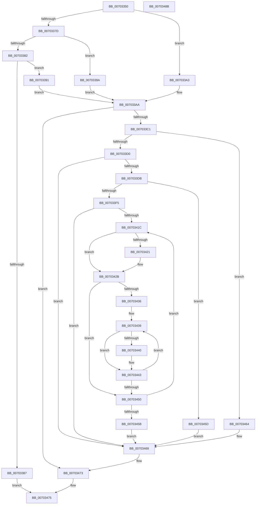

# PnpReadDeviceConfiguration

- RVA: `0x00703350`–`0x0070348C` (길이 `316` bytes)
- VA: `0x0000000140703350`
- 실행 섹션: `PAGE`
- PDB 이름 있음: `예`; PDB Function 태그: `아니요`
- unwind 정보 RVA: `0x000BF8F0`
- 디코드: `91`개 명령, `316/316` bytes 표시
- 미해석 바이트: `0` (있으면 어셈블리에 `.byte`로 보존)

> 이 문서는 커널 이미지의 기계어와 PDB 기호를 분석해 생성했습니다. 4번과 5번은 함수 원형과 자료형을 바이너리 사용 방식에서 추정한 C 해석이며 원본 소스 복구 결과는 아닙니다.

## 1. Dependencies

- 직접 호출 지점: **4**; 고유 호출 대상: **4**
- 직접 호출자로 확인된 함수: **2**
- RIP 상대 이미지 참조: **3**

### Outgoing calls
- `0x007033B2` → [IopGetRegistryValue](../99/IopGetRegistryValue_function_009990EC.md) (function, `0x009990EC`)
- `0x007033E8` → [ExAllocatePool2](../../poolcode/B8/ExAllocatePool2_function_00B820F0.md) (function, `0x00B820F0`)
- `0x00703408` → [memcpy](../../text/6C/memcpy_function_006C6840.md) (function, `0x006C6840`)
- `0x0070346E` → [ExFreePoolWithTag](../../poolcode/B8/ExFreePoolWithTag_function_00B82870.md) (function, `0x00B82870`)

### Direct callers
- [PnpGetDeviceResourcesFromRegistry](../A7/PnpGetDeviceResourcesFromRegistry_function_00A74344.md) at `0x00A7446E`
- [PnpGetDeviceResourcesFromRegistry](../A7/PnpGetDeviceResourcesFromRegistry_function_00A74344.md) at `0x00A744DD`
- [sub_00B40726](../B4/Unknown_function_00B40726.md) at `0x00B40774`

### Static image references
- `0x00703391` → RVA `0x00AFD500` (` ?? ::NNGAKEGL::`string'`; read)
- `0x0070339A` → RVA `0x00B00080` (` ?? ::NNGAKEGL::`string'`; read)
- `0x007033A3` → RVA `0x00AFDF90` (` ?? ::NNGAKEGL::`string'`; read)

## 2. Other-region calls and transfers

- 다른 실행 섹션으로 향하는 call: **3**
  - `0x007033E8` → [ExAllocatePool2](../../poolcode/B8/ExAllocatePool2_function_00B820F0.md) (`PAGE` → `POOLCODE`)
  - `0x00703408` → [memcpy](../../text/6C/memcpy_function_006C6840.md) (`PAGE` → `.text`)
  - `0x0070346E` → [ExFreePoolWithTag](../../poolcode/B8/ExFreePoolWithTag_function_00B82870.md) (`PAGE` → `POOLCODE`)
- 별도 외부 분기/꼬리 이동을 확인하지 못했습니다.

## 3. Assembly (complete function range)

```asm
00703350  48 8B C4                        mov rax, rsp
00703353  48 89 58 08                     mov qword ptr [rax + 8], rbx
00703357  48 89 70 10                     mov qword ptr [rax + 0x10], rsi
0070335B  48 89 78 20                     mov qword ptr [rax + 0x20], rdi
0070335F  41 56                           push r14
00703361  48 83 EC 20                     sub rsp, 0x20
00703365  49 83 20 00                     and qword ptr [r8], 0
00703369  4D 8B F1                        mov r14, r9
0070336C  41 83 21 00                     and dword ptr [r9], 0
00703370  49 8B F0                        mov rsi, r8
00703373  48 83 60 18 00                  and qword ptr [rax + 0x18], 0
00703378  83 EA 01                        sub edx, 1
0070337B  74 26                           je 0x1407033a3
0070337D  83 EA 01                        sub edx, 1
00703380  74 18                           je 0x14070339a
00703382  83 FA 02                        cmp edx, 2
00703385  74 0A                           je 0x140703391
00703387  B8 F0 00 00 C0                  mov eax, 0xc00000f0
0070338C  E9 E4 00 00 00                  jmp 0x140703475
00703391  48 8D 15 68 A1 3F 00            lea rdx, [rip + 0x3fa168]
00703398  EB 10                           jmp 0x1407033aa
0070339A  48 8D 15 DF CC 3F 00            lea rdx, [rip + 0x3fccdf]
007033A1  EB 07                           jmp 0x1407033aa
007033A3  48 8D 15 E6 AB 3F 00            lea rdx, [rip + 0x3fabe6]
007033AA  4C 8D 4C 24 40                  lea r9, [rsp + 0x40]
007033AF  45 33 C0                        xor r8d, r8d
007033B2  E8 35 5D 29 00                  call 0x1409990ec
007033B7  8B F8                           mov edi, eax
007033B9  85 C0                           test eax, eax
007033BB  0F 88 B2 00 00 00               js 0x140703473
007033C1  48 8B 5C 24 40                  mov rbx, qword ptr [rsp + 0x40]
007033C6  83 7B 04 08                     cmp dword ptr [rbx + 4], 8
007033CA  0F 85 94 00 00 00               jne 0x140703464
007033D0  8B 43 0C                        mov eax, dword ptr [rbx + 0xc]
007033D3  85 C0                           test eax, eax
007033D5  0F 84 8E 00 00 00               je 0x140703469
007033DB  8B D0                           mov edx, eax
007033DD  B9 00 01 00 00                  mov ecx, 0x100
007033E2  41 B8 50 6E 70 36               mov r8d, 0x36706e50
007033E8  E8 03 ED 47 00                  call 0x140b820f0
007033ED  48 89 06                        mov qword ptr [rsi], rax
007033F0  48 85 C0                        test rax, rax
007033F3  74 68                           je 0x14070345d
007033F5  8B 43 0C                        mov eax, dword ptr [rbx + 0xc]
007033F8  41 89 06                        mov dword ptr [r14], eax
007033FB  8B 53 08                        mov edx, dword ptr [rbx + 8]
007033FE  44 8B 43 0C                     mov r8d, dword ptr [rbx + 0xc]
00703402  48 03 D3                        add rdx, rbx
00703405  48 8B 0E                        mov rcx, qword ptr [rsi]
00703408  E8 33 34 FC FF                  call 0x1406c6840
0070340D  4C 8B 16                        mov r10, qword ptr [rsi]
00703410  45 33 C0                        xor r8d, r8d
00703413  49 8D 42 04                     lea rax, [r10 + 4]
00703417  45 39 02                        cmp dword ptr [r10], r8d
0070341A  76 4D                           jbe 0x140703469
0070341C  83 38 FF                        cmp dword ptr [rax], -1
0070341F  75 0A                           jne 0x14070342b
00703421  83 60 04 00                     and dword ptr [rax + 4], 0
00703425  C7 00 01 00 00 00               mov dword ptr [rax], 1
0070342B  8B 50 0C                        mov edx, dword ptr [rax + 0xc]
0070342E  48 8D 48 10                     lea rcx, [rax + 0x10]
00703432  85 D2                           test edx, edx
00703434  74 1A                           je 0x140703450
00703436  44 8B CA                        mov r9d, edx
00703439  33 C0                           xor eax, eax
0070343B  80 39 05                        cmp byte ptr [rcx], 5
0070343E  75 03                           jne 0x140703443
00703440  8B 41 04                        mov eax, dword ptr [rcx + 4]
00703443  48 83 C1 14                     add rcx, 0x14
00703447  48 03 C8                        add rcx, rax
0070344A  49 83 E9 01                     sub r9, 1
0070344E  75 E9                           jne 0x140703439
00703450  41 FF C0                        inc r8d
00703453  48 8B C1                        mov rax, rcx
00703456  45 3B 02                        cmp r8d, dword ptr [r10]
00703459  72 C1                           jb 0x14070341c
0070345B  EB 0C                           jmp 0x140703469
0070345D  BF 9A 00 00 C0                  mov edi, 0xc000009a
00703462  EB 05                           jmp 0x140703469
00703464  BF 01 00 00 C0                  mov edi, 0xc0000001
00703469  33 D2                           xor edx, edx
0070346B  48 8B CB                        mov rcx, rbx
0070346E  E8 FD F3 47 00                  call 0x140b82870
00703473  8B C7                           mov eax, edi
00703475  48 8B 5C 24 30                  mov rbx, qword ptr [rsp + 0x30]
0070347A  48 8B 74 24 38                  mov rsi, qword ptr [rsp + 0x38]
0070347F  48 8B 7C 24 48                  mov rdi, qword ptr [rsp + 0x48]
00703484  48 83 C4 20                     add rsp, 0x20
00703488  41 5E                           pop r14
0070348A  C3                              ret
0070348B  CC                              int3
```

## 4. C-style interpretation (structured pseudocode)

```c
__int64 __fastcall PnpReadDeviceConfiguration(__int64 a1, int a2, __int64 a3, __int64 a4)
{
    __int64 result;
    __int64 v_rsp;
    unsigned __int64 v_stack_p10;
    unsigned __int64 v_stack_p18;
    unsigned __int64 v_stack_p20;
    unsigned __int64 v_stack_p8;

    *(unsigned __int64 *)(v_rsp + 8) = v_rbx;
    *(unsigned __int64 *)(v_rsp + 16) = v_rsi;
    *(unsigned __int64 *)(v_rsp + 32) = v_rdi;
    v_rsp = (v_rsp) - (32);
    a2 = (unsigned int)((a2) - (1));
    if (condition_is_equal) goto loc_007033A3;
    a2 = (unsigned int)((a2) - (1));
    if (condition_is_equal) goto loc_0070339A;
    if (a2 == 2) goto loc_00703391;
    goto loc_00703475;
loc_00703391:
    goto loc_007033AA;
loc_0070339A:
    goto loc_007033AA;
loc_007033A3:
loc_007033AA:
    a3 = 0;
    result = IopGetRegistryValue(a1, v_rip + 4172774, a3, v_stack_p18);
    if (sign_flag) goto loc_00703473;
    if ((*(unsigned int *)(v_stack_p18 + 4)) != 8) goto loc_00703464;
    if ((unsigned int)((unsigned int)(*(unsigned int *)(v_stack_p18 + 12))) == 0) goto loc_00703469;
    result = ExAllocatePool2(256, (unsigned int)((unsigned int)((unsigned int)(*(unsigned int *)(v_stack_p18 + 12)))), (unsigned int)(0x36706E50ULL), v_stack_p18);
    *(unsigned __int64 *)(a3) = result;
    if (result == 0) goto loc_0070345D;
    *(unsigned int *)(a4) = (unsigned int)((unsigned int)(*(unsigned int *)(v_stack_p18 + 12)));
    a2 = ((unsigned int)(*(unsigned int *)(v_stack_p18 + 8))) + (v_stack_p18);
    result = memcpy(*(unsigned __int64 *)(a3), a2, (unsigned int)(*(unsigned int *)(v_stack_p18 + 12)), v_stack_p18);
    a3 = 0;
    if ((*(unsigned int *)(*(unsigned __int64 *)(a3))) <= 0) goto loc_00703469;
loc_0070341C:
    if ((*(unsigned int *)(*(unsigned __int64 *)(a3) + 4)) == -1) {
        *(unsigned int *)(*(unsigned __int64 *)(a3) + 4) = 1;
    }
    if ((unsigned int)((unsigned int)(*(unsigned int *)(*(unsigned __int64 *)(a3) + 4 + 12))) == 0) goto loc_00703450;
loc_00703439:
    result = 0;
    if ((*(unsigned __int8 *)(*(unsigned __int64 *)(a3) + 4 + 16)) == 5) {
        result = *(unsigned int *)(*(unsigned __int64 *)(a3) + 4 + 16 + 4);
    }
    a1 = (*(unsigned __int64 *)(a3) + 4 + 16) + (20);
    a1 = (a1) + (result);
    a4 = ((unsigned int)((unsigned int)((unsigned int)(*(unsigned int *)(*(unsigned __int64 *)(a3) + 4 + 12))))) - (1);
    if (condition_is_not_equal) goto loc_00703439;
loc_00703450:
    a3 = (unsigned int)((a3) + 1);
    if (((unsigned int)(a3)) < (*(unsigned int *)(*(unsigned __int64 *)(a3)))) goto loc_0070341C;
    goto loc_00703469;
loc_0070345D:
    goto loc_00703469;
loc_00703464:
loc_00703469:
    a2 = 0;
    result = ExFreePoolWithTag(v_stack_p18, a2, a3, a4);
loc_00703473:
loc_00703475:
    v_rsp = (v_rsp) + (32);
    return (unsigned int)((unsigned int)((unsigned int)(0xC0000001ULL)));
}
```

## 5. (Beta) C Style

```c
int64_t PnpReadDeviceConfiguration(int64_t Arg1, int32_t Arg2, void *Arg3, void *Arg4)
{
    uint8_t *arg3 = (uint8_t *)Arg3;
    uint8_t *arg4 = (uint8_t *)Arg4;

    int64_t result;
    int64_t local_rsp;
    uint64_t v_stack_p10;
    uint64_t v_stack_p18;
    uint64_t v_stack_p20;
    uint64_t v_stack_p8;

    *(uint64_t *)(local_rsp + 0x8) = local_rbx;
    *(uint64_t *)(local_rsp + 0x10) = local_rsi;
    *(uint64_t *)(local_rsp + 0x20) = local_rdi;
    local_rsp = (local_rsp) - (32);
    Arg2 = (uint32_t)((Arg2) - (1));
    if (condition_is_equal) goto loc_007033A3;
    Arg2 = (uint32_t)((Arg2) - (1));
    if (condition_is_equal) goto loc_0070339A;
    if (Arg2 == 2) goto loc_00703391;
    goto loc_00703475;
loc_00703391:
    goto loc_007033AA;
loc_0070339A:
    goto loc_007033AA;
loc_007033A3:
loc_007033AA:
    Arg3 = 0;
    result = IopGetRegistryValue(Arg1, v_rip + 4172774, Arg3, v_stack_p18);
    if (sign_flag) goto loc_00703473;
    if ((*(uint32_t *)(v_stack_p18 + 0x4)) != 8) goto loc_00703464;
    if ((uint32_t)((uint32_t)(*(uint32_t *)(v_stack_p18 + 0xC))) == 0) goto loc_00703469;
    result = ExAllocatePool2(256, (uint32_t)((uint32_t)((uint32_t)(*(uint32_t *)(v_stack_p18 + 0xC)))), (uint32_t)(0x36706E50ULL), v_stack_p18);
    *(uint64_t *)(arg3) = result;
    if (result == 0) goto loc_0070345D;
    *(uint32_t *)(arg4) = (uint32_t)((uint32_t)(*(uint32_t *)(v_stack_p18 + 0xC)));
    Arg2 = ((uint32_t)(*(uint32_t *)(v_stack_p18 + 0x8))) + (v_stack_p18);
    result = memcpy(*(uint64_t *)(arg3), Arg2, (uint32_t)(*(uint32_t *)(v_stack_p18 + 0xC)), v_stack_p18);
    Arg3 = 0;
    if ((*(uint32_t *)(*(uint64_t *)(arg3))) <= 0) goto loc_00703469;
loc_0070341C:
    if ((*(uint32_t *)(*(uint64_t *)(arg3) + 0x4)) == -1) {
        *(uint32_t *)(*(uint64_t *)(arg3) + 0x4) = 1;
    }
    if ((uint32_t)((uint32_t)(*(uint32_t *)(*(uint64_t *)(arg3) + 0x4 + 0xC))) == 0) goto loc_00703450;
loc_00703439:
    result = 0;
    if ((*(uint8_t *)(*(uint64_t *)(arg3) + 0x4 + 0x10)) == 5) {
        result = *(uint32_t *)(*(uint64_t *)(arg3) + 0x4 + 0x10 + 0x4);
    }
    Arg1 = (*(uint64_t *)(arg3) + 4 + 16) + (20);
    Arg1 = (Arg1) + (result);
    Arg4 = ((uint32_t)((uint32_t)((uint32_t)(*(uint32_t *)(*(uint64_t *)(arg3) + 0x4 + 0xC))))) - (1);
    if (condition_is_not_equal) goto loc_00703439;
loc_00703450:
    Arg3 = (uint32_t)((Arg3) + 1);
    if (((uint32_t)(Arg3)) < (*(uint32_t *)(*(uint64_t *)(arg3)))) goto loc_0070341C;
    goto loc_00703469;
loc_0070345D:
    goto loc_00703469;
loc_00703464:
loc_00703469:
    Arg2 = 0;
    result = ExFreePoolWithTag(v_stack_p18, Arg2, Arg3, Arg4);
loc_00703473:
loc_00703475:
    local_rsp = (local_rsp) + (32);
    return (uint32_t)((uint32_t)((uint32_t)(0xC0000001ULL)));
}
```

### 관측된 메모리 오프셋

구조체 형식이 확인되지 않은 접근은 인자 기준의 오프셋으로만 기록했습니다.

| 기준 인자 | 오프셋 표현 | 폭 (bit) | 접근 |
|---|---:|---:|---|
| `Arg3` | `+ 0x0` | `64` | `R` |
| `Arg3` | `+ 0x0` | `64` | `R/W` |
| `Arg3` | `+ 0x0` | `64` | `W` |
| `Arg4` | `+ 0x0` | `32` | `R/W` |
| `Arg4` | `+ 0x0` | `32` | `W` |

## 6. Execution-region graph

[열기: 2D/3D 그래프와 함수 탐색 컨트롤 패널](../../../control-panel.html?section=page&rva=0x00703350&view=graph)

- 2D 그래프는 위에서 아래로 흐르고, 3D 그래프는 빈 공간을 드래그해 회전합니다. Shift+드래그는 이동, 휠은 확대·축소, 함수 노드 선택은 대상 보고서 이동입니다.

### Static fallback


