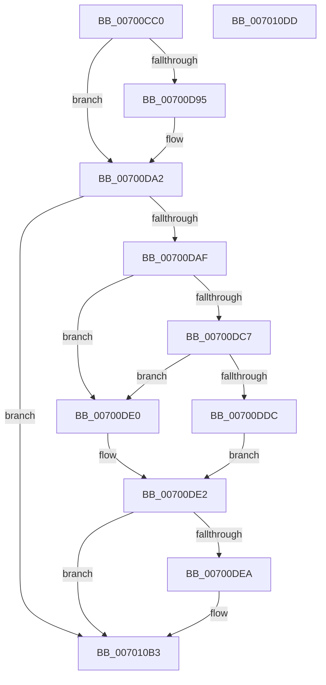

# PnpTraceDeviceConfig

- RVA: `0x00700CC0`–`0x007010DE` (길이 `1,054` bytes)
- VA: `0x0000000140700CC0`
- 실행 섹션: `PAGE`
- PDB 이름 있음: `예`; PDB Function 태그: `아니요`
- unwind 정보 RVA: `0x000BF4F8`
- 디코드: `210`개 명령, `1,054/1,054` bytes 표시
- 미해석 바이트: `0` (있으면 어셈블리에 `.byte`로 보존)

> 이 문서는 커널 이미지의 기계어와 PDB 기호를 분석해 생성했습니다. 4번과 5번은 함수 원형과 자료형을 바이너리 사용 방식에서 추정한 C 해석이며 원본 소스 복구 결과는 아닙니다.

## 1. Dependencies

- 직접 호출 지점: **19**; 고유 호출 대상: **3**
- 직접 호출자로 확인된 함수: **1**
- RIP 상대 이미지 참조: **5**

### Outgoing calls
- `0x00700E94` → [tlgCreate1Sz_wchar_t](../../text/42/tlgCreate1Sz_wchar_t_function_00426198.md) (function, `0x00426198`)
- `0x00700EA0` → [tlgCreate1Sz_wchar_t](../../text/42/tlgCreate1Sz_wchar_t_function_00426198.md) (function, `0x00426198`)
- `0x00700EAC` → [tlgCreate1Sz_wchar_t](../../text/42/tlgCreate1Sz_wchar_t_function_00426198.md) (function, `0x00426198`)
- `0x00700EB8` → [tlgCreate1Sz_wchar_t](../../text/42/tlgCreate1Sz_wchar_t_function_00426198.md) (function, `0x00426198`)
- `0x00700EC4` → [tlgCreate1Sz_wchar_t](../../text/42/tlgCreate1Sz_wchar_t_function_00426198.md) (function, `0x00426198`)
- `0x00700ED3` → [tlgCreate1Sz_wchar_t](../../text/42/tlgCreate1Sz_wchar_t_function_00426198.md) (function, `0x00426198`)
- `0x00700EE2` → [tlgCreate1Sz_wchar_t](../../text/42/tlgCreate1Sz_wchar_t_function_00426198.md) (function, `0x00426198`)
- `0x00700EF1` → [tlgCreate1Sz_wchar_t](../../text/42/tlgCreate1Sz_wchar_t_function_00426198.md) (function, `0x00426198`)
- `0x00700F00` → [tlgCreate1Sz_wchar_t](../../text/42/tlgCreate1Sz_wchar_t_function_00426198.md) (function, `0x00426198`)
- `0x00700F0F` → [tlgCreate1Sz_wchar_t](../../text/42/tlgCreate1Sz_wchar_t_function_00426198.md) (function, `0x00426198`)
- `0x00700F20` → [tlgCreate1Sz_wchar_t](../../text/42/tlgCreate1Sz_wchar_t_function_00426198.md) (function, `0x00426198`)
- `0x00700F31` → [tlgCreate1Sz_wchar_t](../../text/42/tlgCreate1Sz_wchar_t_function_00426198.md) (function, `0x00426198`)
- `0x00700F42` → [tlgCreate1Sz_wchar_t](../../text/42/tlgCreate1Sz_wchar_t_function_00426198.md) (function, `0x00426198`)
- `0x00700F53` → [tlgCreate1Sz_wchar_t](../../text/42/tlgCreate1Sz_wchar_t_function_00426198.md) (function, `0x00426198`)
- `0x00700F63` → [tlgCreate1Sz_wchar_t](../../text/42/tlgCreate1Sz_wchar_t_function_00426198.md) (function, `0x00426198`)
- `0x00700F94` → [tlgCreate1Sz_wchar_t](../../text/42/tlgCreate1Sz_wchar_t_function_00426198.md) (function, `0x00426198`)
- `0x00700FA5` → [tlgCreate1Sz_wchar_t](../../text/42/tlgCreate1Sz_wchar_t_function_00426198.md) (function, `0x00426198`)
- `0x007010AE` → [tlgWriteTransfer_EtwWriteTransfer](../../text/42/tlgWriteTransfer_EtwWriteTransfer_function_004260E0.md) (function, `0x004260E0`)
- `0x007010BD` → [_security_check_cookie](../../text/6A/_security_check_cookie_function_006AC640.md) (function, `0x006AC640`)

### Direct callers
- [PiDevCfgLogDeviceConfigured](../AD/PiDevCfgLogDeviceConfigured_function_00ADCDD4.md) at `0x00ADE09C`

### Static image references
- `0x00700CDF` → RVA `0x00E0A740` (`.data`; read)
- `0x00700DA2` → RVA `0x00E06FC8` (`.data`; read)
- `0x00700DB9` → RVA `0x00E06FD8` (`.data`; read)
- `0x00700DC7` → RVA `0x00E06FE0` (`.data`; read)
- `0x00700FBC` → RVA `0x0004746A` (`.rdata`; read)

## 2. Other-region calls and transfers

- 다른 실행 섹션으로 향하는 call: **19**
  - `0x00700E94` → [tlgCreate1Sz_wchar_t](../../text/42/tlgCreate1Sz_wchar_t_function_00426198.md) (`PAGE` → `.text`)
  - `0x00700EA0` → [tlgCreate1Sz_wchar_t](../../text/42/tlgCreate1Sz_wchar_t_function_00426198.md) (`PAGE` → `.text`)
  - `0x00700EAC` → [tlgCreate1Sz_wchar_t](../../text/42/tlgCreate1Sz_wchar_t_function_00426198.md) (`PAGE` → `.text`)
  - `0x00700EB8` → [tlgCreate1Sz_wchar_t](../../text/42/tlgCreate1Sz_wchar_t_function_00426198.md) (`PAGE` → `.text`)
  - `0x00700EC4` → [tlgCreate1Sz_wchar_t](../../text/42/tlgCreate1Sz_wchar_t_function_00426198.md) (`PAGE` → `.text`)
  - `0x00700ED3` → [tlgCreate1Sz_wchar_t](../../text/42/tlgCreate1Sz_wchar_t_function_00426198.md) (`PAGE` → `.text`)
  - `0x00700EE2` → [tlgCreate1Sz_wchar_t](../../text/42/tlgCreate1Sz_wchar_t_function_00426198.md) (`PAGE` → `.text`)
  - `0x00700EF1` → [tlgCreate1Sz_wchar_t](../../text/42/tlgCreate1Sz_wchar_t_function_00426198.md) (`PAGE` → `.text`)
  - `0x00700F00` → [tlgCreate1Sz_wchar_t](../../text/42/tlgCreate1Sz_wchar_t_function_00426198.md) (`PAGE` → `.text`)
  - `0x00700F0F` → [tlgCreate1Sz_wchar_t](../../text/42/tlgCreate1Sz_wchar_t_function_00426198.md) (`PAGE` → `.text`)
  - `0x00700F20` → [tlgCreate1Sz_wchar_t](../../text/42/tlgCreate1Sz_wchar_t_function_00426198.md) (`PAGE` → `.text`)
  - `0x00700F31` → [tlgCreate1Sz_wchar_t](../../text/42/tlgCreate1Sz_wchar_t_function_00426198.md) (`PAGE` → `.text`)
  - `0x00700F42` → [tlgCreate1Sz_wchar_t](../../text/42/tlgCreate1Sz_wchar_t_function_00426198.md) (`PAGE` → `.text`)
  - `0x00700F53` → [tlgCreate1Sz_wchar_t](../../text/42/tlgCreate1Sz_wchar_t_function_00426198.md) (`PAGE` → `.text`)
  - `0x00700F63` → [tlgCreate1Sz_wchar_t](../../text/42/tlgCreate1Sz_wchar_t_function_00426198.md) (`PAGE` → `.text`)
  - `0x00700F94` → [tlgCreate1Sz_wchar_t](../../text/42/tlgCreate1Sz_wchar_t_function_00426198.md) (`PAGE` → `.text`)
  - `0x00700FA5` → [tlgCreate1Sz_wchar_t](../../text/42/tlgCreate1Sz_wchar_t_function_00426198.md) (`PAGE` → `.text`)
  - `0x007010AE` → [tlgWriteTransfer_EtwWriteTransfer](../../text/42/tlgWriteTransfer_EtwWriteTransfer_function_004260E0.md) (`PAGE` → `.text`)
  - `0x007010BD` → [_security_check_cookie](../../text/6A/_security_check_cookie_function_006AC640.md) (`PAGE` → `.text`)
- 별도 외부 분기/꼬리 이동을 확인하지 못했습니다.

## 3. Assembly (complete function range)

```asm
00700CC0  48 89 5C 24 08                  mov qword ptr [rsp + 8], rbx
00700CC5  55                              push rbp
00700CC6  56                              push rsi
00700CC7  57                              push rdi
00700CC8  41 54                           push r12
00700CCA  41 55                           push r13
00700CCC  41 56                           push r14
00700CCE  41 57                           push r15
00700CD0  48 8D AC 24 30 FE FF FF         lea rbp, [rsp - 0x1d0]
00700CD8  48 81 EC D0 02 00 00            sub rsp, 0x2d0
00700CDF  48 8B 05 5A 9A 70 00            mov rax, qword ptr [rip + 0x709a5a]
00700CE6  48 33 C4                        xor rax, rsp
00700CE9  48 89 85 C0 01 00 00            mov qword ptr [rbp + 0x1c0], rax
00700CF0  48 8B 85 70 02 00 00            mov rax, qword ptr [rbp + 0x270]
00700CF7  4D 8B D1                        mov r10, r9
00700CFA  48 83 64 24 48 00               and qword ptr [rsp + 0x48], 0
00700D00  4D 8B C8                        mov r9, r8
00700D03  4C 8B 9D 30 02 00 00            mov r11, qword ptr [rbp + 0x230]
00700D0A  4C 8B C1                        mov r8, rcx
00700D0D  48 8B 8D E8 02 00 00            mov rcx, qword ptr [rbp + 0x2e8]
00700D14  48 8B 9D 38 02 00 00            mov rbx, qword ptr [rbp + 0x238]
00700D1B  48 8B BD 40 02 00 00            mov rdi, qword ptr [rbp + 0x240]
00700D22  48 8B B5 48 02 00 00            mov rsi, qword ptr [rbp + 0x248]
00700D29  4C 8B B5 50 02 00 00            mov r14, qword ptr [rbp + 0x250]
00700D30  4C 8B BD 58 02 00 00            mov r15, qword ptr [rbp + 0x258]
00700D37  4C 8B A5 60 02 00 00            mov r12, qword ptr [rbp + 0x260]
00700D3E  4C 8B AD 68 02 00 00            mov r13, qword ptr [rbp + 0x268]
00700D45  48 89 44 24 60                  mov qword ptr [rsp + 0x60], rax
00700D4A  48 8B 85 78 02 00 00            mov rax, qword ptr [rbp + 0x278]
00700D51  48 89 44 24 68                  mov qword ptr [rsp + 0x68], rax
00700D56  48 8B 85 80 02 00 00            mov rax, qword ptr [rbp + 0x280]
00700D5D  48 89 44 24 70                  mov qword ptr [rsp + 0x70], rax
00700D62  48 8B 85 88 02 00 00            mov rax, qword ptr [rbp + 0x288]
00700D69  48 89 44 24 78                  mov qword ptr [rsp + 0x78], rax
00700D6E  48 8B 85 90 02 00 00            mov rax, qword ptr [rbp + 0x290]
00700D75  48 89 45 80                     mov qword ptr [rbp - 0x80], rax
00700D79  48 8B 85 A0 02 00 00            mov rax, qword ptr [rbp + 0x2a0]
00700D80  48 89 45 88                     mov qword ptr [rbp - 0x78], rax
00700D84  48 8B 85 A8 02 00 00            mov rax, qword ptr [rbp + 0x2a8]
00700D8B  48 89 44 24 50                  mov qword ptr [rsp + 0x50], rax
00700D90  48 85 C9                        test rcx, rcx
00700D93  74 0D                           je 0x140700da2
00700D95  8B 41 04                        mov eax, dword ptr [rcx + 4]
00700D98  89 44 24 4C                     mov dword ptr [rsp + 0x4c], eax
00700D9C  8B 01                           mov eax, dword ptr [rcx]
00700D9E  89 44 24 48                     mov dword ptr [rsp + 0x48], eax
00700DA2  83 3D 1F 62 70 00 05            cmp dword ptr [rip + 0x70621f], 5
00700DA9  0F 86 04 03 00 00               jbe 0x1407010b3
00700DAF  48 B8 00 00 00 00 00 80 00 00   movabs rax, 0x800000000000
00700DB9  48 85 05 18 62 70 00            test qword ptr [rip + 0x706218], rax
00700DC0  48 89 44 24 40                  mov qword ptr [rsp + 0x40], rax
00700DC5  74 19                           je 0x140700de0
00700DC7  48 8B 05 12 62 70 00            mov rax, qword ptr [rip + 0x706212]
00700DCE  48 23 44 24 40                  and rax, qword ptr [rsp + 0x40]
00700DD3  48 3B 05 06 62 70 00            cmp rax, qword ptr [rip + 0x706206]
00700DDA  75 04                           jne 0x140700de0
00700DDC  B0 01                           mov al, 1
00700DDE  EB 02                           jmp 0x140700de2
00700DE0  32 C0                           xor al, al
00700DE2  84 C0                           test al, al
00700DE4  0F 84 C9 02 00 00               je 0x1407010b3
00700DEA  83 65 BC 00                     and dword ptr [rbp - 0x44], 0
00700DEE  48 8D 44 24 58                  lea rax, [rsp + 0x58]
00700DF3  83 64 24 38 00                  and dword ptr [rsp + 0x38], 0
00700DF8  B9 02 00 00 00                  mov ecx, 2
00700DFD  83 65 CC 00                     and dword ptr [rbp - 0x34], 0
00700E01  83 65 DC 00                     and dword ptr [rbp - 0x24], 0
00700E05  48 89 45 B0                     mov qword ptr [rbp - 0x50], rax
00700E09  48 8D 44 24 38                  lea rax, [rsp + 0x38]
00700E0E  48 89 45 C0                     mov qword ptr [rbp - 0x40], rax
00700E12  48 8D 45 E8                     lea rax, [rbp - 0x18]
00700E16  48 89 45 D0                     mov qword ptr [rbp - 0x30], rax
00700E1A  49 8B 40 08                     mov rax, qword ptr [r8 + 8]
00700E1E  48 89 45 E0                     mov qword ptr [rbp - 0x20], rax
00700E22  41 0F B7 00                     movzx eax, word ptr [r8]
00700E26  45 33 C0                        xor r8d, r8d
00700E29  89 45 E8                        mov dword ptr [rbp - 0x18], eax
00700E2C  48 8D 45 08                     lea rax, [rbp + 8]
00700E30  48 89 45 F0                     mov qword ptr [rbp - 0x10], rax
00700E34  48 8B 42 08                     mov rax, qword ptr [rdx + 8]
00700E38  48 89 45 00                     mov qword ptr [rbp], rax
00700E3C  0F B7 02                        movzx eax, word ptr [rdx]
00700E3F  49 8B D1                        mov rdx, r9
00700E42  89 45 08                        mov dword ptr [rbp + 8], eax
00700E45  48 8D 45 28                     lea rax, [rbp + 0x28]
00700E49  89 4D D8                        mov dword ptr [rbp - 0x28], ecx
00700E4C  48 89 4D F8                     mov qword ptr [rbp - 8], rcx
00700E50  48 89 4D 18                     mov qword ptr [rbp + 0x18], rcx
00700E54  48 8B 8D C0 02 00 00            mov rcx, qword ptr [rbp + 0x2c0]
00700E5B  48 89 45 10                     mov qword ptr [rbp + 0x10], rax
00700E5F  48 C7 44 24 58 00 08 00 00      mov qword ptr [rsp + 0x58], 0x800
00700E68  C7 45 B8 08 00 00 00            mov dword ptr [rbp - 0x48], 8
00700E6F  48 8B 41 08                     mov rax, qword ptr [rcx + 8]
00700E73  48 89 45 20                     mov qword ptr [rbp + 0x20], rax
00700E77  0F B7 01                        movzx eax, word ptr [rcx]
00700E7A  48 8D 4D 30                     lea rcx, [rbp + 0x30]
00700E7E  89 45 28                        mov dword ptr [rbp + 0x28], eax
00700E81  C7 45 C8 04 00 00 00            mov dword ptr [rbp - 0x38], 4
00700E88  44 89 45 EC                     mov dword ptr [rbp - 0x14], r8d
00700E8C  44 89 45 0C                     mov dword ptr [rbp + 0xc], r8d
00700E90  44 89 45 2C                     mov dword ptr [rbp + 0x2c], r8d
00700E94  E8 FF 52 D2 FF                  call 0x140426198
00700E99  49 8B D2                        mov rdx, r10
00700E9C  48 8D 4D 40                     lea rcx, [rbp + 0x40]
00700EA0  E8 F3 52 D2 FF                  call 0x140426198
00700EA5  49 8B D3                        mov rdx, r11
00700EA8  48 8D 4D 50                     lea rcx, [rbp + 0x50]
00700EAC  E8 E7 52 D2 FF                  call 0x140426198
00700EB1  48 8B D3                        mov rdx, rbx
00700EB4  48 8D 4D 60                     lea rcx, [rbp + 0x60]
00700EB8  E8 DB 52 D2 FF                  call 0x140426198
00700EBD  48 8B D7                        mov rdx, rdi
00700EC0  48 8D 4D 70                     lea rcx, [rbp + 0x70]
00700EC4  E8 CF 52 D2 FF                  call 0x140426198
00700EC9  48 8B D6                        mov rdx, rsi
00700ECC  48 8D 8D 80 00 00 00            lea rcx, [rbp + 0x80]
00700ED3  E8 C0 52 D2 FF                  call 0x140426198
00700ED8  49 8B D6                        mov rdx, r14
00700EDB  48 8D 8D 90 00 00 00            lea rcx, [rbp + 0x90]
00700EE2  E8 B1 52 D2 FF                  call 0x140426198
00700EE7  49 8B D7                        mov rdx, r15
00700EEA  48 8D 8D A0 00 00 00            lea rcx, [rbp + 0xa0]
00700EF1  E8 A2 52 D2 FF                  call 0x140426198
00700EF6  49 8B D4                        mov rdx, r12
00700EF9  48 8D 8D B0 00 00 00            lea rcx, [rbp + 0xb0]
00700F00  E8 93 52 D2 FF                  call 0x140426198
00700F05  49 8B D5                        mov rdx, r13
00700F08  48 8D 8D C0 00 00 00            lea rcx, [rbp + 0xc0]
00700F0F  E8 84 52 D2 FF                  call 0x140426198
00700F14  48 8B 54 24 60                  mov rdx, qword ptr [rsp + 0x60]
00700F19  48 8D 8D D0 00 00 00            lea rcx, [rbp + 0xd0]
00700F20  E8 73 52 D2 FF                  call 0x140426198
00700F25  48 8B 54 24 68                  mov rdx, qword ptr [rsp + 0x68]
00700F2A  48 8D 8D E0 00 00 00            lea rcx, [rbp + 0xe0]
00700F31  E8 62 52 D2 FF                  call 0x140426198
00700F36  48 8B 54 24 70                  mov rdx, qword ptr [rsp + 0x70]
00700F3B  48 8D 8D F0 00 00 00            lea rcx, [rbp + 0xf0]
00700F42  E8 51 52 D2 FF                  call 0x140426198
00700F47  48 8B 54 24 78                  mov rdx, qword ptr [rsp + 0x78]
00700F4C  48 8D 8D 00 01 00 00            lea rcx, [rbp + 0x100]
00700F53  E8 40 52 D2 FF                  call 0x140426198
00700F58  48 8B 55 80                     mov rdx, qword ptr [rbp - 0x80]
00700F5C  48 8D 8D 10 01 00 00            lea rcx, [rbp + 0x110]
00700F63  E8 30 52 D2 FF                  call 0x140426198
00700F68  8A 8D 98 02 00 00               mov cl, byte ptr [rbp + 0x298]
00700F6E  48 8D 44 24 30                  lea rax, [rsp + 0x30]
00700F73  48 8B 55 88                     mov rdx, qword ptr [rbp - 0x78]
00700F77  88 4C 24 30                     mov byte ptr [rsp + 0x30], cl
00700F7B  48 8D 8D 30 01 00 00            lea rcx, [rbp + 0x130]
00700F82  48 89 85 20 01 00 00            mov qword ptr [rbp + 0x120], rax
00700F89  48 C7 85 28 01 00 00 01 00 00 00  mov qword ptr [rbp + 0x128], 1
00700F94  E8 FF 51 D2 FF                  call 0x140426198
00700F99  48 8B 54 24 50                  mov rdx, qword ptr [rsp + 0x50]
00700F9E  48 8D 8D 40 01 00 00            lea rcx, [rbp + 0x140]
00700FA5  E8 EE 51 D2 FF                  call 0x140426198
00700FAA  8A 8D B0 02 00 00               mov cl, byte ptr [rbp + 0x2b0]
00700FB0  48 8D 44 24 31                  lea rax, [rsp + 0x31]
00700FB5  48 89 85 50 01 00 00            mov qword ptr [rbp + 0x150], rax
00700FBC  48 8D 15 A7 64 94 FF            lea rdx, [rip - 0x6b9b59]
00700FC3  8A 85 B8 02 00 00               mov al, byte ptr [rbp + 0x2b8]
00700FC9  45 33 C9                        xor r9d, r9d
00700FCC  88 44 24 32                     mov byte ptr [rsp + 0x32], al
00700FD0  45 33 C0                        xor r8d, r8d
00700FD3  48 8D 44 24 32                  lea rax, [rsp + 0x32]
00700FD8  88 4C 24 31                     mov byte ptr [rsp + 0x31], cl
00700FDC  48 89 85 60 01 00 00            mov qword ptr [rbp + 0x160], rax
00700FE3  48 8D 0D DE 5F 70 00            lea rcx, [rip + 0x705fde]
00700FEA  8A 85 C8 02 00 00               mov al, byte ptr [rbp + 0x2c8]
00700FF0  88 44 24 33                     mov byte ptr [rsp + 0x33], al
00700FF4  48 8D 44 24 33                  lea rax, [rsp + 0x33]
00700FF9  48 89 85 70 01 00 00            mov qword ptr [rbp + 0x170], rax
00701000  8A 85 D0 02 00 00               mov al, byte ptr [rbp + 0x2d0]
00701006  88 44 24 34                     mov byte ptr [rsp + 0x34], al
0070100A  48 8D 44 24 34                  lea rax, [rsp + 0x34]
0070100F  48 89 85 80 01 00 00            mov qword ptr [rbp + 0x180], rax
00701016  48 8B 85 D8 02 00 00            mov rax, qword ptr [rbp + 0x2d8]
0070101D  48 89 44 24 50                  mov qword ptr [rsp + 0x50], rax
00701022  48 8D 44 24 50                  lea rax, [rsp + 0x50]
00701027  48 89 85 90 01 00 00            mov qword ptr [rbp + 0x190], rax
0070102E  8B 85 E0 02 00 00               mov eax, dword ptr [rbp + 0x2e0]
00701034  89 44 24 40                     mov dword ptr [rsp + 0x40], eax
00701038  48 8D 44 24 40                  lea rax, [rsp + 0x40]
0070103D  48 89 85 A0 01 00 00            mov qword ptr [rbp + 0x1a0], rax
00701044  48 8D 44 24 48                  lea rax, [rsp + 0x48]
00701049  48 89 85 B0 01 00 00            mov qword ptr [rbp + 0x1b0], rax
00701050  48 8D 45 90                     lea rax, [rbp - 0x70]
00701054  48 89 44 24 28                  mov qword ptr [rsp + 0x28], rax
00701059  C7 44 24 20 23 00 00 00         mov dword ptr [rsp + 0x20], 0x23
00701061  48 C7 85 58 01 00 00 01 00 00 00  mov qword ptr [rbp + 0x158], 1
0070106C  48 C7 85 68 01 00 00 01 00 00 00  mov qword ptr [rbp + 0x168], 1
00701077  48 C7 85 78 01 00 00 01 00 00 00  mov qword ptr [rbp + 0x178], 1
00701082  48 C7 85 88 01 00 00 01 00 00 00  mov qword ptr [rbp + 0x188], 1
0070108D  48 C7 85 98 01 00 00 08 00 00 00  mov qword ptr [rbp + 0x198], 8
00701098  48 C7 85 A8 01 00 00 04 00 00 00  mov qword ptr [rbp + 0x1a8], 4
007010A3  48 C7 85 B8 01 00 00 08 00 00 00  mov qword ptr [rbp + 0x1b8], 8
007010AE  E8 2D 50 D2 FF                  call 0x1404260e0
007010B3  48 8B 8D C0 01 00 00            mov rcx, qword ptr [rbp + 0x1c0]
007010BA  48 33 CC                        xor rcx, rsp
007010BD  E8 7E B5 FA FF                  call 0x1406ac640
007010C2  48 8B 9C 24 10 03 00 00         mov rbx, qword ptr [rsp + 0x310]
007010CA  48 81 C4 D0 02 00 00            add rsp, 0x2d0
007010D1  41 5F                           pop r15
007010D3  41 5E                           pop r14
007010D5  41 5D                           pop r13
007010D7  41 5C                           pop r12
007010D9  5F                              pop rdi
007010DA  5E                              pop rsi
007010DB  5D                              pop rbp
007010DC  C3                              ret
007010DD  CC                              int3
```

## 4. C-style interpretation (structured pseudocode)

```c
__int64 __fastcall PnpTraceDeviceConfig(__int64 a1, __int64 a2, __int64 a3, __int64 a4, __int64 a5, __int64 a6, __int64 a7, __int64 a8, __int64 a9, __int64 a10, __int64 a11, __int64 a12, __int64 a13, __int64 a14, __int64 a15, __int64 a16, __int64 a17, unsigned __int8 a18, __int64 a19, __int64 a20, unsigned __int8 a21, unsigned __int8 a22, __int64 a23, unsigned __int8 a24, unsigned __int8 a25, __int64 a26, unsigned int a27, __int64 a28)
{
    __int64 result;
    __int64 v_rsp;
    unsigned __int64 v_stack_m108;
    unsigned __int64 v_stack_m118;
    unsigned __int64 v_stack_m128;
    unsigned __int64 v_stack_m138;
    unsigned __int64 v_stack_m148;
    unsigned __int64 v_stack_m158;
    unsigned __int64 v_stack_m168;
    unsigned __int64 v_stack_m178;
    unsigned __int64 v_stack_m188;
    unsigned __int64 v_stack_m198;
    unsigned __int64 v_stack_m1A8;
    unsigned __int64 v_stack_m1B8;
    unsigned __int64 v_stack_m1C8;
    unsigned __int64 v_stack_m1D8;
    unsigned int v_stack_m1DC;
    unsigned __int64 v_stack_m1E0;
    unsigned __int64 v_stack_m1E8;
    unsigned __int64 v_stack_m1F0;
    unsigned __int64 v_stack_m1F8;
    unsigned int v_stack_m1FC;
    unsigned __int64 v_stack_m200;
    unsigned __int64 v_stack_m208;
    unsigned __int64 v_stack_m210;
    unsigned __int64 v_stack_m218;
    unsigned int v_stack_m21C;
    unsigned __int64 v_stack_m220;
    unsigned __int64 v_stack_m228;
    unsigned int v_stack_m22C;
    unsigned int v_stack_m230;
    unsigned __int64 v_stack_m238;
    unsigned int v_stack_m23C;
    unsigned int v_stack_m240;
    unsigned __int64 v_stack_m248;
    unsigned int v_stack_m24C;
    unsigned int v_stack_m250;
    unsigned __int64 v_stack_m258;
    unsigned __int64 v_stack_m278;
    unsigned __int64 v_stack_m280;
    unsigned __int64 v_stack_m288;
    unsigned __int64 v_stack_m290;
    unsigned __int64 v_stack_m298;
    unsigned __int64 v_stack_m2A0;
    unsigned __int64 v_stack_m2A8;
    unsigned __int64 v_stack_m2B0;
    unsigned __int64 v_stack_m2B8;
    unsigned int v_stack_m2BC;
    unsigned __int64 v_stack_m2C0;
    unsigned __int64 v_stack_m2C8;
    unsigned int v_stack_m2D0;
    unsigned __int8 v_stack_m2D4;
    unsigned __int8 v_stack_m2D5;
    unsigned __int8 v_stack_m2D6;
    unsigned __int64 v_stack_m2D7;
    unsigned __int64 v_stack_m2D8;
    unsigned __int64 v_stack_m2E0;
    unsigned int v_stack_m2E8;
    unsigned __int64 v_stack_m48;
    unsigned __int64 v_stack_m50;
    unsigned __int64 v_stack_m58;
    unsigned __int64 v_stack_m60;
    unsigned __int64 v_stack_m68;
    unsigned __int64 v_stack_m70;
    unsigned __int64 v_stack_m78;
    unsigned __int64 v_stack_m80;
    unsigned __int64 v_stack_m88;
    unsigned __int64 v_stack_m90;
    unsigned __int64 v_stack_m98;
    unsigned __int64 v_stack_mA0;
    unsigned __int64 v_stack_mA8;
    unsigned __int64 v_stack_mB0;
    unsigned __int64 v_stack_mB8;
    unsigned __int64 v_stack_mC8;
    unsigned __int64 v_stack_mD8;
    unsigned __int64 v_stack_mE0;
    unsigned __int64 v_stack_mE8;
    unsigned __int64 v_stack_mF8;
    unsigned __int64 v_stack_p8;

    v_stack_p8 = v_rbx;
    v_rsp = (v_rsp) - (720);
    result = (*(unsigned __int64 *)(v_rip + 7379546)) ^ (v_rsp);
    v_stack_m48 = result;
    v_stack_m2A8 = a13;
    v_stack_m2A0 = a14;
    v_stack_m298 = a15;
    v_stack_m290 = a16;
    v_stack_m288 = a17;
    v_stack_m280 = a19;
    v_stack_m2B8 = a20;
    result = a20;
    if (a28 != 0) {
        result = *(unsigned int *)(a28 + 4);
        v_stack_m2BC = (unsigned int)(result);
        result = *(unsigned int *)(a28);
        v_stack_m2C0 = (unsigned int)(result);
    }
    if ((*(unsigned int *)(v_rip + 7365151)) <= 5) goto loc_007010B3;
    v_stack_m2C8 = result;
    if (((*(unsigned __int64 *)(v_rip + 7365144)) & (result)) == 0) goto loc_00700DE0;
    result = (*(unsigned __int64 *)(v_rip + 7365138)) & (v_stack_m2C8);
    if (result != (*(unsigned __int64 *)(v_rip + 7365126))) goto loc_00700DE0;
    goto loc_00700DE2;
loc_00700DE0:
    result = 0;
loc_00700DE2:
    if (0 != 0) {
        result = v_stack_m2B0;
        a1 = 2;
        v_stack_m258 = result;
        result = v_stack_m2D0;
        v_stack_m248 = result;
        result = v_stack_m220;
        v_stack_m238 = result;
        result = *(unsigned __int64 *)(a1 + 8);
        v_stack_m228 = result;
        result = *(unsigned __int16 *)(a1);
        a3 = 0;
        v_stack_m220 = (unsigned int)(result);
        result = v_stack_m200;
        v_stack_m218 = result;
        result = *(unsigned __int64 *)(a2 + 8);
        v_stack_m208 = result;
        result = *(unsigned __int16 *)(a2);
        a2 = 0;
        v_stack_m200 = (unsigned int)(result);
        result = v_stack_m1E0;
        v_stack_m230 = (unsigned int)(a1);
        v_stack_m210 = a1;
        v_stack_m1F0 = a1;
        a1 = a23;
        v_stack_m1F8 = result;
        v_stack_m2B0 = 0x800ULL;
        v_stack_m250 = 8;
        result = *(unsigned __int64 *)(a1 + 8);
        v_stack_m1E8 = result;
        result = *(unsigned __int16 *)(a1);
        a1 = v_stack_m1D8;
        v_stack_m1E0 = (unsigned int)(result);
        v_stack_m240 = 4;
        v_stack_m21C = 0;
        v_stack_m1FC = 0;
        v_stack_m1DC = 0;
        result = tlgCreate1Sz_wchar_t(a1, a2, a3, a3);
        a2 = a4;
        a1 = v_stack_m1C8;
        result = tlgCreate1Sz_wchar_t(a1, a2, a3, a3);
        a2 = a5;
        a1 = v_stack_m1B8;
        result = tlgCreate1Sz_wchar_t(a1, a2, a3, a3);
        a2 = a6;
        a1 = v_stack_m1A8;
        result = tlgCreate1Sz_wchar_t(a1, a2, a3, a3);
        a2 = a7;
        a1 = v_stack_m198;
        result = tlgCreate1Sz_wchar_t(a1, a2, a3, a3);
        a2 = a8;
        a1 = v_stack_m188;
        result = tlgCreate1Sz_wchar_t(a1, a2, a3, a3);
        a2 = a9;
        a1 = v_stack_m178;
        result = tlgCreate1Sz_wchar_t(a1, a2, a3, a3);
        a2 = a10;
        a1 = v_stack_m168;
        result = tlgCreate1Sz_wchar_t(a1, a2, a3, a3);
        a2 = a11;
        a1 = v_stack_m158;
        result = tlgCreate1Sz_wchar_t(a1, a2, a3, a3);
        a2 = a12;
        a1 = v_stack_m148;
        result = tlgCreate1Sz_wchar_t(a1, a2, a3, a3);
        a2 = v_stack_m2A8;
        a1 = v_stack_m138;
        result = tlgCreate1Sz_wchar_t(a1, a2, a3, a3);
        a2 = v_stack_m2A0;
        a1 = v_stack_m128;
        result = tlgCreate1Sz_wchar_t(a1, a2, a3, a3);
        a2 = v_stack_m298;
        a1 = v_stack_m118;
        result = tlgCreate1Sz_wchar_t(a1, a2, a3, a3);
        a2 = v_stack_m290;
        a1 = v_stack_m108;
        result = tlgCreate1Sz_wchar_t(a1, a2, a3, a3);
        a2 = v_stack_m288;
        a1 = v_stack_mF8;
        result = tlgCreate1Sz_wchar_t(a1, a2, a3, a3);
        a1 = a18;
        result = v_stack_m2D8;
        a2 = v_stack_m280;
        v_stack_m2D8 = (unsigned __int8)(a1);
        a1 = v_stack_mD8;
        v_stack_mE8 = result;
        v_stack_mE0 = 1;
        result = tlgCreate1Sz_wchar_t(a1, a2, a3, a3);
        a2 = v_stack_m2B8;
        a1 = v_stack_mC8;
        result = tlgCreate1Sz_wchar_t(a1, a2, a3, a3);
        a1 = a21;
        result = v_stack_m2D7;
        v_stack_mB8 = result;
        a2 = v_rip - 7052121;
        result = a22;
        a4 = 0;
        v_stack_m2D6 = (unsigned __int8)(result);
        a3 = 0;
        result = v_stack_m2D6;
        v_stack_m2D7 = (unsigned __int8)(a1);
        v_stack_mA8 = result;
        a1 = v_rip + 7364574;
        result = a24;
        v_stack_m2D5 = (unsigned __int8)(result);
        result = v_stack_m2D5;
        v_stack_m98 = result;
        result = a25;
        v_stack_m2D4 = (unsigned __int8)(result);
        result = v_stack_m2D4;
        v_stack_m88 = result;
        result = a26;
        v_stack_m2B8 = result;
        result = v_stack_m2B8;
        v_stack_m78 = result;
        result = a27;
        v_stack_m2C8 = (unsigned int)(result);
        result = v_stack_m2C8;
        v_stack_m68 = result;
        result = v_stack_m2C0;
        v_stack_m58 = result;
        result = v_stack_m278;
        v_stack_m2E0 = result;
        v_stack_m2E8 = 35;
        v_stack_mB0 = 1;
        v_stack_mA0 = 1;
        v_stack_m90 = 1;
        v_stack_m80 = 1;
        v_stack_m70 = 8;
        v_stack_m60 = 4;
        v_stack_m50 = 8;
        result = tlgWriteTransfer_EtwWriteTransfer(a1, a2, a3, a4);
    }
    a1 = (v_stack_m48) ^ (v_rsp);
    result = _security_check_cookie(a1, a2, a3, a4);
    v_rsp = (v_rsp) + (720);
    return result;
}
```

## 5. (Beta) C Style

```c
int64_t PnpTraceDeviceConfig(void *Arg1, void *Arg2, int64_t Arg3, int64_t Arg4, int64_t Arg5, int64_t Arg6, int64_t Arg7, int64_t Arg8, int64_t Arg9, int64_t Arg10, int64_t Arg11, int64_t Arg12, int64_t Arg13, int64_t Arg14, int64_t Arg15, int64_t Arg16, int64_t Arg17, uint8_t Arg18, int64_t Arg19, int64_t Arg20, uint8_t Arg21, uint8_t Arg22, void *Arg23, uint8_t Arg24, uint8_t Arg25, int64_t Arg26, uint32_t Arg27, int64_t Arg28)
{
    uint8_t *arg1 = (uint8_t *)Arg1;
    uint8_t *arg2 = (uint8_t *)Arg2;
    uint8_t *arg23 = (uint8_t *)Arg23;

    int64_t result;
    int64_t local_rsp;
    uint64_t v_stack_m108;
    uint64_t v_stack_m118;
    uint64_t v_stack_m128;
    uint64_t v_stack_m138;
    uint64_t v_stack_m148;
    uint64_t v_stack_m158;
    uint64_t v_stack_m168;
    uint64_t v_stack_m178;
    uint64_t v_stack_m188;
    uint64_t v_stack_m198;
    uint64_t v_stack_m1A8;
    uint64_t v_stack_m1B8;
    uint64_t v_stack_m1C8;
    uint64_t v_stack_m1D8;
    uint32_t v_stack_m1DC;
    uint64_t v_stack_m1E0;
    uint64_t v_stack_m1E8;
    uint64_t v_stack_m1F0;
    uint64_t v_stack_m1F8;
    uint32_t v_stack_m1FC;
    uint64_t v_stack_m200;
    uint64_t v_stack_m208;
    uint64_t v_stack_m210;
    uint64_t v_stack_m218;
    uint32_t v_stack_m21C;
    uint64_t v_stack_m220;
    uint64_t v_stack_m228;
    uint32_t v_stack_m22C;
    uint32_t v_stack_m230;
    uint64_t v_stack_m238;
    uint32_t v_stack_m23C;
    uint32_t v_stack_m240;
    uint64_t v_stack_m248;
    uint32_t v_stack_m24C;
    uint32_t v_stack_m250;
    uint64_t v_stack_m258;
    uint64_t v_stack_m278;
    uint64_t v_stack_m280;
    uint64_t v_stack_m288;
    uint64_t v_stack_m290;
    uint64_t v_stack_m298;
    uint64_t v_stack_m2A0;
    uint64_t v_stack_m2A8;
    uint64_t v_stack_m2B0;
    uint64_t v_stack_m2B8;
    uint32_t v_stack_m2BC;
    uint64_t v_stack_m2C0;
    uint64_t v_stack_m2C8;
    uint32_t v_stack_m2D0;
    uint8_t v_stack_m2D4;
    uint8_t v_stack_m2D5;
    uint8_t v_stack_m2D6;
    uint64_t v_stack_m2D7;
    uint64_t v_stack_m2D8;
    uint64_t v_stack_m2E0;
    uint32_t v_stack_m2E8;
    uint64_t v_stack_m48;
    uint64_t v_stack_m50;
    uint64_t v_stack_m58;
    uint64_t v_stack_m60;
    uint64_t v_stack_m68;
    uint64_t v_stack_m70;
    uint64_t v_stack_m78;
    uint64_t v_stack_m80;
    uint64_t v_stack_m88;
    uint64_t v_stack_m90;
    uint64_t v_stack_m98;
    uint64_t v_stack_mA0;
    uint64_t v_stack_mA8;
    uint64_t v_stack_mB0;
    uint64_t v_stack_mB8;
    uint64_t v_stack_mC8;
    uint64_t v_stack_mD8;
    uint64_t v_stack_mE0;
    uint64_t v_stack_mE8;
    uint64_t v_stack_mF8;
    uint64_t v_stack_p8;

    v_stack_p8 = local_rbx;
    local_rsp = (local_rsp) - (720);
    result = (*(uint64_t *)(v_rip + 0x709A5A)) ^ (local_rsp);
    v_stack_m48 = result;
    v_stack_m2A8 = Arg13;
    v_stack_m2A0 = Arg14;
    v_stack_m298 = Arg15;
    v_stack_m290 = Arg16;
    v_stack_m288 = Arg17;
    v_stack_m280 = Arg19;
    v_stack_m2B8 = Arg20;
    result = Arg20;
    if (Arg28 != 0) {
        result = *(uint32_t *)(Arg28 + 0x4);
        v_stack_m2BC = (uint32_t)(result);
        result = *(uint32_t *)(Arg28);
        v_stack_m2C0 = (uint32_t)(result);
    }
    if ((*(uint32_t *)(v_rip + 0x70621F)) <= 5) goto loc_007010B3;
    v_stack_m2C8 = result;
    if (((*(uint64_t *)(v_rip + 0x706218)) & (result)) == 0) goto loc_00700DE0;
    result = (*(uint64_t *)(v_rip + 0x706212)) & (v_stack_m2C8);
    if (result != (*(uint64_t *)(v_rip + 0x706206))) goto loc_00700DE0;
    goto loc_00700DE2;
loc_00700DE0:
    result = 0;
loc_00700DE2:
    if (0 != 0) {
        result = v_stack_m2B0;
        Arg1 = 2;
        v_stack_m258 = result;
        result = v_stack_m2D0;
        v_stack_m248 = result;
        result = v_stack_m220;
        v_stack_m238 = result;
        result = *(uint64_t *)(arg1 + 0x8);
        v_stack_m228 = result;
        result = *(uint16_t *)(arg1);
        Arg3 = 0;
        v_stack_m220 = (uint32_t)(result);
        result = v_stack_m200;
        v_stack_m218 = result;
        result = *(uint64_t *)(arg2 + 0x8);
        v_stack_m208 = result;
        result = *(uint16_t *)(arg2);
        Arg2 = 0;
        v_stack_m200 = (uint32_t)(result);
        result = v_stack_m1E0;
        v_stack_m230 = (uint32_t)(Arg1);
        v_stack_m210 = Arg1;
        v_stack_m1F0 = Arg1;
        Arg1 = Arg23;
        v_stack_m1F8 = result;
        v_stack_m2B0 = 0x800ULL;
        v_stack_m250 = 8;
        result = *(uint64_t *)(arg1 + 0x8);
        v_stack_m1E8 = result;
        result = *(uint16_t *)(arg1);
        Arg1 = v_stack_m1D8;
        v_stack_m1E0 = (uint32_t)(result);
        v_stack_m240 = 4;
        v_stack_m21C = 0;
        v_stack_m1FC = 0;
        v_stack_m1DC = 0;
        result = tlgCreate1Sz_wchar_t(Arg1, Arg2, Arg3, Arg3);
        Arg2 = Arg4;
        Arg1 = v_stack_m1C8;
        result = tlgCreate1Sz_wchar_t(Arg1, Arg2, Arg3, Arg3);
        Arg2 = Arg5;
        Arg1 = v_stack_m1B8;
        result = tlgCreate1Sz_wchar_t(Arg1, Arg2, Arg3, Arg3);
        Arg2 = Arg6;
        Arg1 = v_stack_m1A8;
        result = tlgCreate1Sz_wchar_t(Arg1, Arg2, Arg3, Arg3);
        Arg2 = Arg7;
        Arg1 = v_stack_m198;
        result = tlgCreate1Sz_wchar_t(Arg1, Arg2, Arg3, Arg3);
        Arg2 = Arg8;
        Arg1 = v_stack_m188;
        result = tlgCreate1Sz_wchar_t(Arg1, Arg2, Arg3, Arg3);
        Arg2 = Arg9;
        Arg1 = v_stack_m178;
        result = tlgCreate1Sz_wchar_t(Arg1, Arg2, Arg3, Arg3);
        Arg2 = Arg10;
        Arg1 = v_stack_m168;
        result = tlgCreate1Sz_wchar_t(Arg1, Arg2, Arg3, Arg3);
        Arg2 = Arg11;
        Arg1 = v_stack_m158;
        result = tlgCreate1Sz_wchar_t(Arg1, Arg2, Arg3, Arg3);
        Arg2 = Arg12;
        Arg1 = v_stack_m148;
        result = tlgCreate1Sz_wchar_t(Arg1, Arg2, Arg3, Arg3);
        Arg2 = v_stack_m2A8;
        Arg1 = v_stack_m138;
        result = tlgCreate1Sz_wchar_t(Arg1, Arg2, Arg3, Arg3);
        Arg2 = v_stack_m2A0;
        Arg1 = v_stack_m128;
        result = tlgCreate1Sz_wchar_t(Arg1, Arg2, Arg3, Arg3);
        Arg2 = v_stack_m298;
        Arg1 = v_stack_m118;
        result = tlgCreate1Sz_wchar_t(Arg1, Arg2, Arg3, Arg3);
        Arg2 = v_stack_m290;
        Arg1 = v_stack_m108;
        result = tlgCreate1Sz_wchar_t(Arg1, Arg2, Arg3, Arg3);
        Arg2 = v_stack_m288;
        Arg1 = v_stack_mF8;
        result = tlgCreate1Sz_wchar_t(Arg1, Arg2, Arg3, Arg3);
        Arg1 = Arg18;
        result = v_stack_m2D8;
        Arg2 = v_stack_m280;
        v_stack_m2D8 = (uint8_t)(Arg1);
        Arg1 = v_stack_mD8;
        v_stack_mE8 = result;
        v_stack_mE0 = 1;
        result = tlgCreate1Sz_wchar_t(Arg1, Arg2, Arg3, Arg3);
        Arg2 = v_stack_m2B8;
        Arg1 = v_stack_mC8;
        result = tlgCreate1Sz_wchar_t(Arg1, Arg2, Arg3, Arg3);
        Arg1 = Arg21;
        result = v_stack_m2D7;
        v_stack_mB8 = result;
        Arg2 = v_rip - 7052121;
        result = Arg22;
        Arg4 = 0;
        v_stack_m2D6 = (uint8_t)(result);
        Arg3 = 0;
        result = v_stack_m2D6;
        v_stack_m2D7 = (uint8_t)(Arg1);
        v_stack_mA8 = result;
        Arg1 = v_rip + 7364574;
        result = Arg24;
        v_stack_m2D5 = (uint8_t)(result);
        result = v_stack_m2D5;
        v_stack_m98 = result;
        result = Arg25;
        v_stack_m2D4 = (uint8_t)(result);
        result = v_stack_m2D4;
        v_stack_m88 = result;
        result = Arg26;
        v_stack_m2B8 = result;
        result = v_stack_m2B8;
        v_stack_m78 = result;
        result = Arg27;
        v_stack_m2C8 = (uint32_t)(result);
        result = v_stack_m2C8;
        v_stack_m68 = result;
        result = v_stack_m2C0;
        v_stack_m58 = result;
        result = v_stack_m278;
        v_stack_m2E0 = result;
        v_stack_m2E8 = 35;
        v_stack_mB0 = 1;
        v_stack_mA0 = 1;
        v_stack_m90 = 1;
        v_stack_m80 = 1;
        v_stack_m70 = 8;
        v_stack_m60 = 4;
        v_stack_m50 = 8;
        result = tlgWriteTransfer_EtwWriteTransfer(Arg1, Arg2, Arg3, Arg4);
    }
    Arg1 = (v_stack_m48) ^ (local_rsp);
    result = _security_check_cookie(Arg1, Arg2, Arg3, Arg4);
    local_rsp = (local_rsp) + (720);
    return result;
}
```

### 관측된 메모리 오프셋

구조체 형식이 확인되지 않은 접근은 인자 기준의 오프셋으로만 기록했습니다.

| 기준 인자 | 오프셋 표현 | 폭 (bit) | 접근 |
|---|---:|---:|---|
| `Arg1` | `+ 0x0` | `16` | `R` |
| `Arg1` | `+ 0x8` | `64` | `R` |
| `Arg2` | `+ 0x0` | `16` | `R` |
| `Arg2` | `+ 0x8` | `64` | `R` |
| `Arg23` | `+ 0x0` | `16` | `R` |
| `Arg23` | `+ 0x8` | `64` | `R` |

## 6. Execution-region graph

[열기: 2D/3D 그래프와 함수 탐색 컨트롤 패널](../../../control-panel.html?section=page&rva=0x00700CC0&view=graph)

- 2D 그래프는 위에서 아래로 흐르고, 3D 그래프는 빈 공간을 드래그해 회전합니다. Shift+드래그는 이동, 휠은 확대·축소, 함수 노드 선택은 대상 보고서 이동입니다.

### Static fallback


