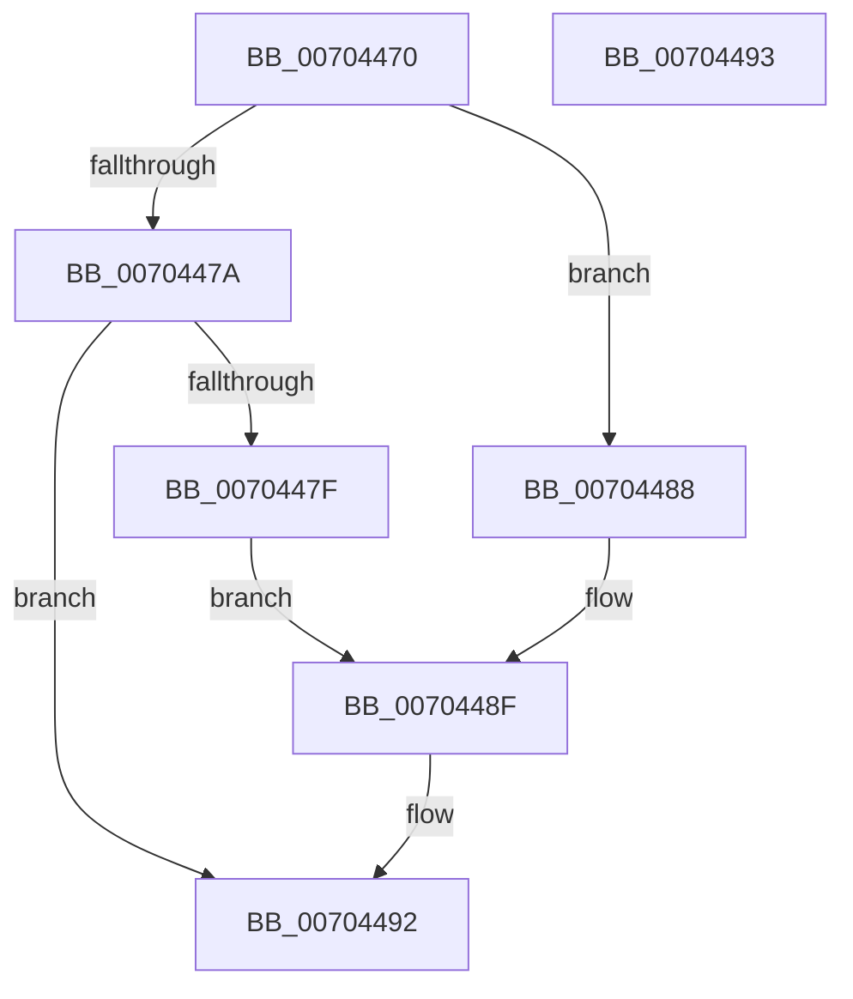

# PoGetThermalRequestSupport

- RVA: `0x00704470`–`0x00704494` (길이 `36` bytes)
- VA: `0x0000000140704470`
- 실행 섹션: `PAGE`
- PDB 이름 있음: `예`; PDB Function 태그: `아니요`
- unwind 정보 RVA: `0x000DB714`
- 디코드: `12`개 명령, `36/36` bytes 표시
- 미해석 바이트: `0` (있으면 어셈블리에 `.byte`로 보존)

> 이 문서는 커널 이미지의 기계어와 PDB 기호를 분석해 생성했습니다. 4번과 5번은 함수 원형과 자료형을 바이너리 사용 방식에서 추정한 C 해석이며 원본 소스 복구 결과는 아닙니다.

## 1. Dependencies

- 직접 호출 지점: **0**; 고유 호출 대상: **0**
- 직접 호출자로 확인된 함수: **1**
- RIP 상대 이미지 참조: **0**

### Outgoing calls
- 직접 디코드된 call 명령이 없습니다.

### Direct callers
- [PoSetThermalActiveCooling](../75/PoSetThermalActiveCooling_function_00756D40.md) at `0x00756D64`

### Static image references
- 디코드된 RIP-relative 메모리 참조가 없습니다.

## 2. Other-region calls and transfers

- 다른 실행 섹션으로 향하는 call: **0**
- 별도 외부 분기/꼬리 이동을 확인하지 못했습니다.

## 3. Assembly (complete function range)

```asm
00704470  4C 8B 41 20                     mov r8, qword ptr [rcx + 0x20]
00704474  33 C0                           xor eax, eax
00704476  85 D2                           test edx, edx
00704478  74 0E                           je 0x140704488
0070447A  83 FA 01                        cmp edx, 1
0070447D  75 13                           jne 0x140704492
0070447F  49 39 80 90 00 00 00            cmp qword ptr [r8 + 0x90], rax
00704486  EB 07                           jmp 0x14070448f
00704488  49 39 80 98 00 00 00            cmp qword ptr [r8 + 0x98], rax
0070448F  0F 95 C0                        setne al
00704492  C3                              ret
00704493  CC                              int3
```

## 4. C-style interpretation (structured pseudocode)

```c
__int64 __fastcall PoGetThermalRequestSupport(__int64 a1, int a2)
{
    __int64 result;

    result = 0;
    if (a2 == 0) goto loc_00704488;
    if (a2 != 1) goto loc_00704492;
    goto loc_0070448F;
loc_00704488:
loc_0070448F:
    result = ((*(unsigned __int64 *)(*(unsigned __int64 *)(a1 + 32) + 152)) != 0) ? 1 : 0;
loc_00704492:
    return result;
}
```

## 5. (Beta) C Style

```c
int64_t PoGetThermalRequestSupport(void *Arg1, int32_t Arg2)
{
    uint8_t *arg1 = (uint8_t *)Arg1;

    int64_t result;

    result = 0;
    if (Arg2 == 0) goto loc_00704488;
    if (Arg2 != 1) goto loc_00704492;
    goto loc_0070448F;
loc_00704488:
loc_0070448F:
    result = ((*(uint64_t *)(*(uint64_t *)(arg1 + 0x20) + 0x98)) != 0) ? 1 : 0;
loc_00704492:
    return result;
}
```

### 관측된 메모리 오프셋

구조체 형식이 확인되지 않은 접근은 인자 기준의 오프셋으로만 기록했습니다.

| 기준 인자 | 오프셋 표현 | 폭 (bit) | 접근 |
|---|---:|---:|---|
| `Arg1` | `+ 0x20` | `64` | `R` |

## 6. Execution-region graph

[열기: 2D/3D 그래프와 함수 탐색 컨트롤 패널](../../../control-panel.html?section=page&rva=0x00704470&view=graph)

- 2D 그래프는 위에서 아래로 흐르고, 3D 그래프는 빈 공간을 드래그해 회전합니다. Shift+드래그는 이동, 휠은 확대·축소, 함수 노드 선택은 대상 보고서 이동입니다.

### Static fallback


