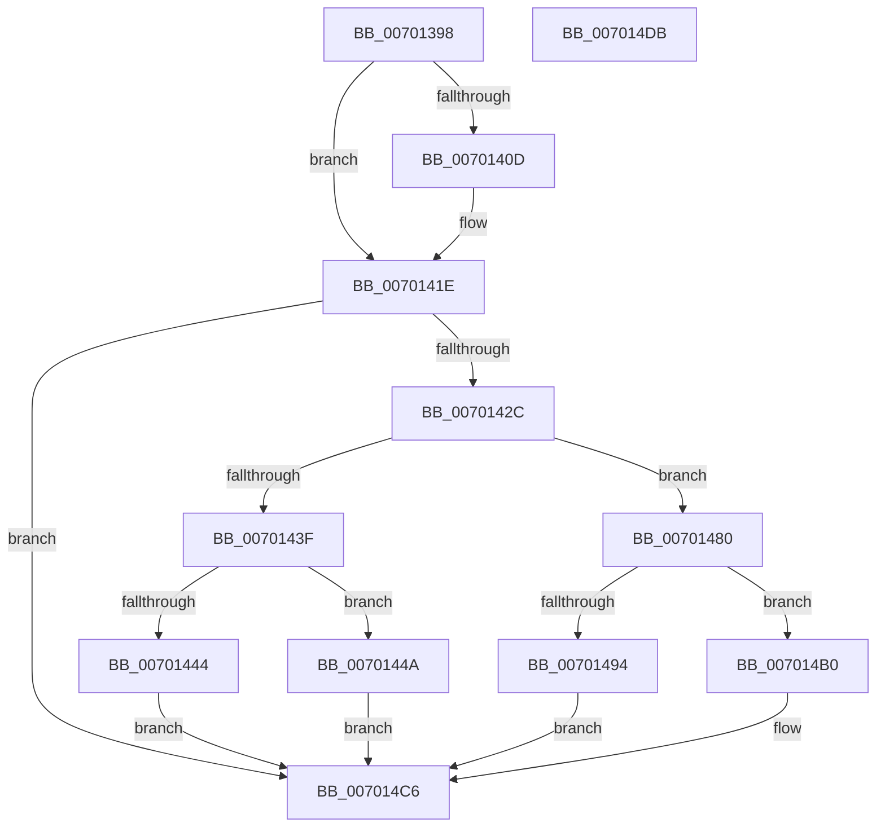

# PopAdaptiveGetSystemInitiatedRebootTargetState

- RVA: `0x00701398`–`0x007014DC` (길이 `324` bytes)
- VA: `0x0000000140701398`
- 실행 섹션: `PAGE`
- PDB 이름 있음: `예`; PDB Function 태그: `아니요`
- unwind 정보 RVA: `0x000689A0`
- 디코드: `83`개 명령, `324/324` bytes 표시
- 미해석 바이트: `0` (있으면 어셈블리에 `.byte`로 보존)

> 이 문서는 커널 이미지의 기계어와 PDB 기호를 분석해 생성했습니다. 4번과 5번은 함수 원형과 자료형을 바이너리 사용 방식에서 추정한 C 해석이며 원본 소스 복구 결과는 아닙니다.

## 1. Dependencies

- 직접 호출 지점: **5**; 고유 호출 대상: **5**
- 직접 호출자로 확인된 함수: **1**
- RIP 상대 이미지 참조: **9**

### Outgoing calls
- `0x007013E5` → [ExAcquireResourceExclusiveLite](../../text/21/ExAcquireResourceExclusiveLite_function_00214E20.md) (function, `0x00214E20`)
- `0x0070141E` → [PopReleaseAdaptiveLock](../91/PopReleaseAdaptiveLock_function_009137DC.md) (function, `0x009137DC`)
- `0x00701431` → [PopPowerAggregatorGetCurrentTargetState](../76/PopPowerAggregatorGetCurrentTargetState_function_00764968.md) (function, `0x00764968`)
- `0x0070148B` → [Feature_ExpandSTEIgnoreReasons__private_IsEnabledDeviceUsageNoInline](../../text/4F/Feature_ExpandSTEIgnoreReasons__private_IsEnabledDeviceUsageNoInline_function_004F7AE8.md) (function, `0x004F7AE8`)
- `0x00701494` → [PopGetCurrentPdcPhase](../../text/5D/PopGetCurrentPdcPhase_function_005D9FB4.md) (function, `0x005D9FB4`)

### Direct callers
- [PopPowerInformationInternal](../A8/PopPowerInformationInternal_function_00A8B7C0.md) at `0x00A8CEBE`

### Static image references
- `0x007013AB` → RVA `0x00F08140` (`.data`; read)
- `0x007013F3` → RVA `0x00FD8200` (`PAGEDATA`; read)
- `0x007013FA` → RVA `0x00FD82A0` (`PAGEDATA`; write)
- `0x00701401` → RVA `0x00F08220` (`.data`; write)
- `0x0070140D` → RVA `0x00FD81F0` (`PAGEDATA`; read)
- `0x00701416` → RVA `0x00FD81F8` (`PAGEDATA`; read)
- `0x0070144F` → RVA `0x00FD87F0` (`PAGEDATA`; read)
- `0x00701469` → RVA `0x00F0CCE8` (`.data`; read)
- `0x007014B0` → RVA `0x00E67550` (`.data`; read)

## 2. Other-region calls and transfers

- 다른 실행 섹션으로 향하는 call: **3**
  - `0x007013E5` → [ExAcquireResourceExclusiveLite](../../text/21/ExAcquireResourceExclusiveLite_function_00214E20.md) (`PAGE` → `.text`)
  - `0x0070148B` → [Feature_ExpandSTEIgnoreReasons__private_IsEnabledDeviceUsageNoInline](../../text/4F/Feature_ExpandSTEIgnoreReasons__private_IsEnabledDeviceUsageNoInline_function_004F7AE8.md) (`PAGE` → `.text`)
  - `0x00701494` → [PopGetCurrentPdcPhase](../../text/5D/PopGetCurrentPdcPhase_function_005D9FB4.md) (`PAGE` → `.text`)
- 별도 외부 분기/꼬리 이동을 확인하지 못했습니다.

## 3. Assembly (complete function range)

```asm
00701398  4C 8B DC                        mov r11, rsp
0070139B  49 89 5B 08                     mov qword ptr [r11 + 8], rbx
0070139F  49 89 73 10                     mov qword ptr [r11 + 0x10], rsi
007013A3  57                              push rdi
007013A4  48 83 EC 70                     sub rsp, 0x70
007013A8  0F 57 C0                        xorps xmm0, xmm0
007013AB  48 8D 0D 8E 6D 80 00            lea rcx, [rip + 0x806d8e]
007013B2  0F 11 44 24 48                  movups xmmword ptr [rsp + 0x48], xmm0
007013B7  33 C0                           xor eax, eax
007013B9  B2 01                           mov dl, 1
007013BB  0F 11 44 24 58                  movups xmmword ptr [rsp + 0x58], xmm0
007013C0  49 89 43 F0                     mov qword ptr [r11 - 0x10], rax
007013C4  33 F6                           xor esi, esi
007013C6  0F 11 44 24 20                  movups xmmword ptr [rsp + 0x20], xmm0
007013CB  0F 11 44 24 30                  movups xmmword ptr [rsp + 0x30], xmm0
007013D0  49 89 43 C8                     mov qword ptr [r11 - 0x38], rax
007013D4  65 48 8B 04 25 88 01 00 00      mov rax, qword ptr gs:[0x188]
007013DD  66 FF 88 E4 01 00 00            dec word ptr [rax + 0x1e4]
007013E4  90                              nop
007013E5  E8 36 3A B1 FF                  call 0x140214e20
007013EA  65 48 8B 04 25 88 01 00 00      mov rax, qword ptr gs:[0x188]
007013F3  48 8B 1D 06 6E 8D 00            mov rbx, qword ptr [rip + 0x8d6e06]
007013FA  48 89 05 9F 6E 8D 00            mov qword ptr [rip + 0x8d6e9f], rax
00701401  40 88 35 18 6E 80 00            mov byte ptr [rip + 0x806e18], sil
00701408  F6 C3 07                        test bl, 7
0070140B  75 11                           jne 0x14070141e
0070140D  40 38 35 DC 6D 8D 00            cmp byte ptr [rip + 0x8d6ddc], sil
00701414  8B DE                           mov ebx, esi
00701416  48 0F 45 1D DA 6D 8D 00         cmovne rbx, qword ptr [rip + 0x8d6dda]
0070141E  E8 B9 23 21 00                  call 0x1409137dc
00701423  F6 C3 07                        test bl, 7
00701426  0F 85 9A 00 00 00               jne 0x1407014c6
0070142C  48 8D 4C 24 20                  lea rcx, [rsp + 0x20]
00701431  E8 32 35 06 00                  call 0x140764968
00701436  8B 4C 24 20                     mov ecx, dword ptr [rsp + 0x20]
0070143A  83 E9 01                        sub ecx, 1
0070143D  74 41                           je 0x140701480
0070143F  83 F9 03                        cmp ecx, 3
00701442  74 06                           je 0x14070144a
00701444  48 83 E3 F8                     and rbx, 0xfffffffffffffff8
00701448  EB 7C                           jmp 0x1407014c6
0070144A  48 63 44 24 40                  movsxd rax, dword ptr [rsp + 0x40]
0070144F  48 8D 0D 9A 73 8D 00            lea rcx, [rip + 0x8d739a]
00701456  48 63 0C 81                     movsxd rcx, dword ptr [rcx + rax*4]
0070145A  48 8B C3                        mov rax, rbx
0070145D  83 E1 07                        and ecx, 7
00701460  48 83 E0 F0                     and rax, 0xfffffffffffffff0
00701464  8B D9                           mov ebx, ecx
00701466  48 33 D8                        xor rbx, rax
00701469  8B 05 79 B8 80 00               mov eax, dword ptr [rip + 0x80b879]
0070146F  F7 D8                           neg eax
00701471  48 1B C9                        sbb rcx, rcx
00701474  48 F7 D1                        not rcx
00701477  48 83 E1 08                     and rcx, 8
0070147B  48 0B D9                        or rbx, rcx
0070147E  EB 46                           jmp 0x1407014c6
00701480  48 83 E3 F9                     and rbx, 0xfffffffffffffff9
00701484  48 83 CB 01                     or rbx, 1
00701488  48 8B FB                        mov rdi, rbx
0070148B  E8 58 66 DF FF                  call 0x1404f7ae8
00701490  85 C0                           test eax, eax
00701492  74 1C                           je 0x1407014b0
00701494  E8 1B 8B ED FF                  call 0x1405d9fb4
00701499  85 C0                           test eax, eax
0070149B  48 8B DE                        mov rbx, rsi
0070149E  BA 08 00 00 00                  mov edx, 8
007014A3  48 0F 4F DA                     cmovg rbx, rdx
007014A7  48 83 E7 F7                     and rdi, 0xfffffffffffffff7
007014AB  48 0B DF                        or rbx, rdi
007014AE  EB 16                           jmp 0x1407014c6
007014B0  39 35 9A 60 76 00               cmp dword ptr [rip + 0x76609a], esi
007014B6  BA 08 00 00 00                  mov edx, 8
007014BB  48 0F 4F F2                     cmovg rsi, rdx
007014BF  48 83 E3 F7                     and rbx, 0xfffffffffffffff7
007014C3  48 0B DE                        or rbx, rsi
007014C6  4C 8D 5C 24 70                  lea r11, [rsp + 0x70]
007014CB  48 8B C3                        mov rax, rbx
007014CE  49 8B 5B 10                     mov rbx, qword ptr [r11 + 0x10]
007014D2  49 8B 73 18                     mov rsi, qword ptr [r11 + 0x18]
007014D6  49 8B E3                        mov rsp, r11
007014D9  5F                              pop rdi
007014DA  C3                              ret
007014DB  CC                              int3
```

## 4. C-style interpretation (structured pseudocode)

```c
__int64 __fastcall PopAdaptiveGetSystemInitiatedRebootTargetState(void)
{
    __int64 result;
    __int64 v_rbx;
    __int64 v_rdi;
    __int64 v_rsi;
    __int64 v_rsp;
    unsigned __int64 v_stack_m20;
    unsigned __int64 v_stack_m30;
    unsigned int v_stack_m38;
    unsigned __int64 v_stack_m48;
    unsigned __int64 v_stack_m58;
    unsigned __int64 v_stack_m8;

    *(unsigned __int64 *)(v_rsp + 8) = v_rbx;
    *(unsigned __int64 *)(v_rsp + 16) = v_rsi;
    v_rsp = (v_rsp) - (112);
    v_stack_m30 = v_xmm0;
    result = 0;
    v_stack_m20 = v_xmm0;
    *(unsigned __int64 *)(v_rsp - 16) = 0;
    v_rsi = 0;
    v_stack_m58 = v_xmm0;
    v_stack_m48 = v_xmm0;
    *(unsigned __int64 *)(v_rsp - 56) = 0;
    result = ExAcquireResourceExclusiveLite(v_rip + 8416654, 1, a3, a4);
    *(unsigned __int64 *)(v_rip + 9268895) = *(unsigned __int64 *)(gs_base + (0 + 392));
    *(unsigned __int8 *)(v_rip + 8416792) = 0;
    v_rbx = *(unsigned __int64 *)(v_rip + 9268742);
    if ((((unsigned __int8)(*(unsigned __int64 *)(v_rip + 9268742))) & (7)) == 0) {
        v_rbx = 0;
        if ((*(unsigned __int8 *)(v_rip + 9268700)) != 0) { v_rbx = *(unsigned __int64 *)(v_rip + 9268698); }
    }
    result = PopReleaseAdaptiveLock(v_rip + 8416654, 1, a3, a4);
    if ((((unsigned __int8)(v_rbx)) & (7)) != 0) goto loc_007014C6;
    result = PopPowerAggregatorGetCurrentTargetState(v_stack_m58, 1, a3, a4);
    a1 = (unsigned int)(((unsigned int)(v_stack_m58)) - (1));
    if (condition_is_equal) goto loc_00701480;
    if (((unsigned int)(a1)) == 3) goto loc_0070144A;
    v_rbx = (v_rbx) & (-8);
    goto loc_007014C6;
loc_0070144A:
    a1 = (unsigned int)(((int)(*(unsigned int *)(v_rip + 9270170 + (int)(v_stack_m38) * 4))) & (7));
    result = (v_rbx) & (-16);
    v_rbx = ((unsigned int)((unsigned int)(a1))) ^ (result);
    result = (unsigned int)(-((unsigned int)(*(unsigned int *)(v_rip + 8435833))));
    a1 = ~(a1);
    a1 = (a1) & (8);
    v_rbx = (v_rbx) | (a1);
    goto loc_007014C6;
loc_00701480:
    v_rbx = (v_rbx) & (-7);
    v_rbx = (v_rbx) | (1);
    result = Feature_ExpandSTEIgnoreReasons__private_IsEnabledDeviceUsageNoInline(a1, 1, a3, a4);
    if ((unsigned int)(result) == 0) goto loc_007014B0;
    result = PopGetCurrentPdcPhase(a1, 1, a3, a4);
    v_rbx = 0;
    if (condition_is_greater) { v_rbx = 8; }
    v_rdi = (v_rbx) & (-9);
    v_rbx = (v_rbx) | (v_rdi);
    goto loc_007014C6;
loc_007014B0:
    if ((*(unsigned int *)(v_rip + 7757978)) > 0) { v_rsi = 8; }
    v_rbx = (v_rbx) & (-9);
    v_rbx = (v_rbx) | (v_rsi);
loc_007014C6:
    return v_rbx;
}
```

## 5. (Beta) C Style

```c
void PopAdaptiveGetSystemInitiatedRebootTargetState(void)
{
    int64_t result;
    int64_t local_rbx;
    int64_t local_rdi;
    int64_t local_rsi;
    int64_t local_rsp;
    uint64_t v_stack_m20;
    uint64_t v_stack_m30;
    uint32_t v_stack_m38;
    uint64_t v_stack_m48;
    uint64_t v_stack_m58;
    uint64_t v_stack_m8;

    *(uint64_t *)(local_rsp + 0x8) = local_rbx;
    *(uint64_t *)(local_rsp + 0x10) = local_rsi;
    local_rsp = (local_rsp) - (112);
    v_stack_m30 = v_xmm0;
    result = 0;
    v_stack_m20 = v_xmm0;
    *(uint64_t *)(local_rsp - 0x10) = 0;
    local_rsi = 0;
    v_stack_m58 = v_xmm0;
    v_stack_m48 = v_xmm0;
    *(uint64_t *)(local_rsp - 0x38) = 0;
    result = ExAcquireResourceExclusiveLite(v_rip + 8416654, 1, a3, a4);
    *(uint64_t *)(v_rip + 0x8D6E9F) = *(uint64_t *)(gs_base + (0 + 0x188));
    *(uint8_t *)(v_rip + 0x806E18) = 0;
    local_rbx = *(uint64_t *)(v_rip + 0x8D6E06);
    if ((((uint8_t)(*(uint64_t *)(v_rip + 0x8D6E06))) & (7)) == 0) {
        local_rbx = 0;
        if ((*(uint8_t *)(v_rip + 0x8D6DDC)) != 0) { local_rbx = *(uint64_t *)(v_rip + 0x8D6DDA); }
    }
    result = PopReleaseAdaptiveLock(v_rip + 8416654, 1, a3, a4);
    if ((((uint8_t)(local_rbx)) & (7)) != 0) goto loc_007014C6;
    result = PopPowerAggregatorGetCurrentTargetState(v_stack_m58, 1, a3, a4);
    a1 = (uint32_t)(((uint32_t)(v_stack_m58)) - (1));
    if (condition_is_equal) goto loc_00701480;
    if (((uint32_t)(a1)) == 3) goto loc_0070144A;
    local_rbx = (local_rbx) & (-8);
    goto loc_007014C6;
loc_0070144A:
    a1 = (uint32_t)(((int32_t)(*(uint32_t *)(v_rip + 0x8D739A + (int32_t)(v_stack_m38) * 4))) & (7));
    result = (local_rbx) & (-16);
    local_rbx = ((uint32_t)((uint32_t)(a1))) ^ (result);
    result = (uint32_t)(-((uint32_t)(*(uint32_t *)(v_rip + 0x80B879))));
    a1 = ~(a1);
    a1 = (a1) & (8);
    local_rbx = (local_rbx) | (a1);
    goto loc_007014C6;
loc_00701480:
    local_rbx = (local_rbx) & (-7);
    local_rbx = (local_rbx) | (1);
    result = Feature_ExpandSTEIgnoreReasons__private_IsEnabledDeviceUsageNoInline(a1, 1, a3, a4);
    if ((uint32_t)(result) == 0) goto loc_007014B0;
    result = PopGetCurrentPdcPhase(a1, 1, a3, a4);
    local_rbx = 0;
    if (condition_is_greater) { local_rbx = 8; }
    local_rdi = (local_rbx) & (-9);
    local_rbx = (local_rbx) | (local_rdi);
    goto loc_007014C6;
loc_007014B0:
    if ((*(uint32_t *)(v_rip + 0x76609A)) > 0) { local_rsi = 8; }
    local_rbx = (local_rbx) & (-9);
    local_rbx = (local_rbx) | (local_rsi);
loc_007014C6:
    return local_rbx;
}
```

## 6. Execution-region graph

[열기: 2D/3D 그래프와 함수 탐색 컨트롤 패널](../../../control-panel.html?section=page&rva=0x00701398&view=graph)

- 2D 그래프는 위에서 아래로 흐르고, 3D 그래프는 빈 공간을 드래그해 회전합니다. Shift+드래그는 이동, 휠은 확대·축소, 함수 노드 선택은 대상 보고서 이동입니다.

### Static fallback


