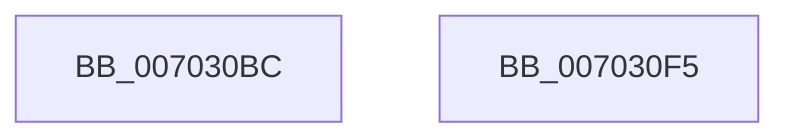

# PopClearSystemShutdownMarker

- RVA: `0x007030BC`–`0x007030F6` (길이 `58` bytes)
- VA: `0x00000001407030BC`
- 실행 섹션: `PAGE`
- PDB 이름 있음: `예`; PDB Function 태그: `아니요`
- unwind 정보 RVA: `0x0005C788`
- 디코드: `12`개 명령, `58/58` bytes 표시
- 미해석 바이트: `0` (있으면 어셈블리에 `.byte`로 보존)

> 이 문서는 커널 이미지의 기계어와 PDB 기호를 분석해 생성했습니다. 4번과 5번은 함수 원형과 자료형을 바이너리 사용 방식에서 추정한 C 해석이며 원본 소스 복구 결과는 아닙니다.

## 1. Dependencies

- 직접 호출 지점: **3**; 고유 호출 대상: **3**
- 직접 호출자로 확인된 함수: **1**
- RIP 상대 이미지 참조: **3**

### Outgoing calls
- `0x007030C7` → [PopAcquireRwLockExclusive](../../text/43/PopAcquireRwLockExclusive_function_00430B44.md) (function, `0x00430B44`)
- `0x007030DF` → [PopBsdHandleRequest](../../text/4B/PopBsdHandleRequest_function_004B27A0.md) (function, `0x004B27A0`)
- `0x007030EB` → [PopReleaseRwLock](../../text/2D/PopReleaseRwLock_function_002DFBBC.md) (function, `0x002DFBBC`)

### Direct callers
- [PopUnlockAfterSleepWorker](../../pagelk/B7/PopUnlockAfterSleepWorker_function_00B782A0.md) at `0x00B78352`

### Static image references
- `0x007030C0` → RVA `0x00F0F1E0` (`.data`; read)
- `0x007030CC` → RVA `0x00E67418` (`.data`; read/write)
- `0x007030D8` → RVA `0x00E673F0` (`.data`; write)

## 2. Other-region calls and transfers

- 다른 실행 섹션으로 향하는 call: **3**
  - `0x007030C7` → [PopAcquireRwLockExclusive](../../text/43/PopAcquireRwLockExclusive_function_00430B44.md) (`PAGE` → `.text`)
  - `0x007030DF` → [PopBsdHandleRequest](../../text/4B/PopBsdHandleRequest_function_004B27A0.md) (`PAGE` → `.text`)
  - `0x007030EB` → [PopReleaseRwLock](../../text/2D/PopReleaseRwLock_function_002DFBBC.md) (`PAGE` → `.text`)
- 별도 외부 분기/꼬리 이동을 확인하지 못했습니다.

## 3. Assembly (complete function range)

```asm
007030BC  48 83 EC 28                     sub rsp, 0x28
007030C0  48 8D 0D 19 C1 80 00            lea rcx, [rip + 0x80c119]
007030C7  E8 78 DA D2 FF                  call 0x140430b44
007030CC  80 25 45 43 76 00 F7            and byte ptr [rip + 0x764345], 0xf7
007030D3  B9 0B 00 00 00                  mov ecx, 0xb
007030D8  C6 05 11 43 76 00 FF            mov byte ptr [rip + 0x764311], 0xff
007030DF  E8 BC F6 DA FF                  call 0x1404b27a0
007030E4  48 8D 0D F5 C0 80 00            lea rcx, [rip + 0x80c0f5]
007030EB  E8 CC CA BD FF                  call 0x1402dfbbc
007030F0  48 83 C4 28                     add rsp, 0x28
007030F4  C3                              ret
007030F5  CC                              int3
```

## 4. C-style interpretation (structured pseudocode)

```c
__int64 __fastcall PopClearSystemShutdownMarker(void)
{
    __int64 result;
    __int64 v_rsp;

    v_rsp = (v_rsp) - (40);
    result = PopAcquireRwLockExclusive(v_rip + 8438041, a2, a3, a4);
    *(unsigned __int8 *)(v_rip + 7750417) = 255;
    result = PopBsdHandleRequest(11, a2, a3, a4);
    result = PopReleaseRwLock(v_rip + 8438005, a2, a3, a4);
    v_rsp = (v_rsp) + (40);
    return result;
}
```

## 5. (Beta) C Style

```c
void PopClearSystemShutdownMarker(void)
{
    int64_t result;
    int64_t local_rsp;

    local_rsp = (local_rsp) - (40);
    result = PopAcquireRwLockExclusive(v_rip + 8438041, a2, a3, a4);
    *(uint8_t *)(v_rip + 0x764311) = 255;
    result = PopBsdHandleRequest(11, a2, a3, a4);
    result = PopReleaseRwLock(v_rip + 8438005, a2, a3, a4);
    local_rsp = (local_rsp) + (40);
    return result;
}
```

## 6. Execution-region graph

[열기: 2D/3D 그래프와 함수 탐색 컨트롤 패널](../../../control-panel.html?section=page&rva=0x007030BC&view=graph)

- 2D 그래프는 위에서 아래로 흐르고, 3D 그래프는 빈 공간을 드래그해 회전합니다. Shift+드래그는 이동, 휠은 확대·축소, 함수 노드 선택은 대상 보고서 이동입니다.

### Static fallback


