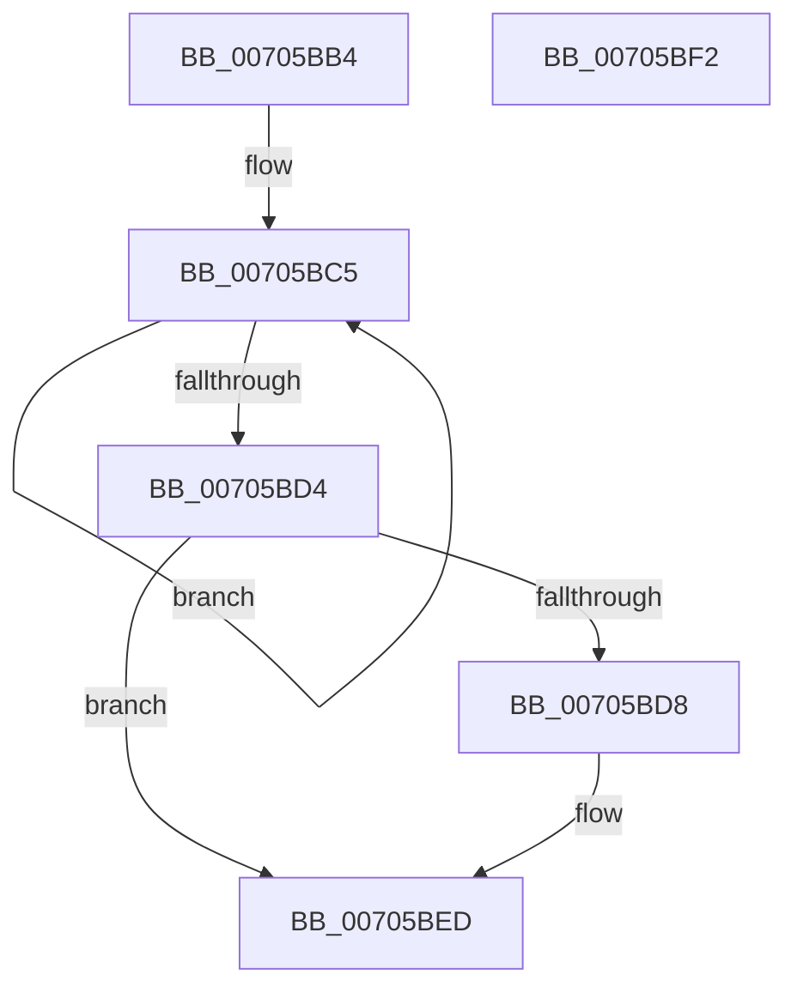

# PopDirectedDripsMarkCandidateDevice

- RVA: `0x00705BB4`–`0x00705BF3` (길이 `63` bytes)
- VA: `0x0000000140705BB4`
- 실행 섹션: `PAGE`
- PDB 이름 있음: `예`; PDB Function 태그: `아니요`
- unwind 정보 RVA: `0x0005C788`
- 디코드: `16`개 명령, `63/63` bytes 표시
- 미해석 바이트: `0` (있으면 어셈블리에 `.byte`로 보존)

> 이 문서는 커널 이미지의 기계어와 PDB 기호를 분석해 생성했습니다. 4번과 5번은 함수 원형과 자료형을 바이너리 사용 방식에서 추정한 C 해석이며 원본 소스 복구 결과는 아닙니다.

## 1. Dependencies

- 직접 호출 지점: **1**; 고유 호출 대상: **1**
- 직접 호출자로 확인된 함수: **2**
- RIP 상대 이미지 참조: **2**

### Outgoing calls
- `0x00705BE8` → [PopDirectedDripsDiagTraceMarkDevice](../A9/PopDirectedDripsDiagTraceMarkDevice_function_00A97DE0.md) (function, `0x00A97DE0`)

### Direct callers
- [PopDripsWatchdogCallbackHandler](../76/PopDripsWatchdogCallbackHandler_function_0076C1C0.md) at `0x0076C2EA`
- [PopDirectedDripsUmMarkTestDevices](../AC/PopDirectedDripsUmMarkTestDevices_function_00ACF828.md) at `0x00ACF8DF`

### Static image references
- `0x00705BD8` → RVA `0x00F0EAF4` (`.data`; read/write)
- `0x00705BDE` → RVA `0x00F0ECF0` (`.data`; read/write)

## 2. Other-region calls and transfers

- 다른 실행 섹션으로 향하는 call: **0**
- 별도 외부 분기/꼬리 이동을 확인하지 못했습니다.

## 3. Assembly (complete function range)

```asm
00705BB4  48 83 EC 28                     sub rsp, 0x28
00705BB8  0F 0D 89 60 03 00 00            prefetchw byte ptr [rcx + 0x360]
00705BBF  8B 81 60 03 00 00               mov eax, dword ptr [rcx + 0x360]
00705BC5  8B D0                           mov edx, eax
00705BC7  83 CA 40                        or edx, 0x40
00705BCA  F0 0F B1 91 60 03 00 00         lock cmpxchg dword ptr [rcx + 0x360], edx
00705BD2  75 F1                           jne 0x140705bc5
00705BD4  A8 40                           test al, 0x40
00705BD6  75 15                           jne 0x140705bed
00705BD8  FF 05 16 8F 80 00               inc dword ptr [rip + 0x808f16]
00705BDE  FF 05 0C 91 80 00               inc dword ptr [rip + 0x80910c]
00705BE4  48 8B 49 30                     mov rcx, qword ptr [rcx + 0x30]
00705BE8  E8 F3 21 39 00                  call 0x140a97de0
00705BED  48 83 C4 28                     add rsp, 0x28
00705BF1  C3                              ret
00705BF2  CC                              int3
```

## 4. C-style interpretation (structured pseudocode)

```c
__int64 __fastcall PopDirectedDripsMarkCandidateDevice(__int64 a1)
{
    __int64 result;
    __int64 v_rsp;

    v_rsp = (v_rsp) - (40);
loc_00705BC5:
    a2 = (unsigned int)(((unsigned int)((unsigned int)((unsigned int)(*(unsigned int *)(a1 + 864))))) | (64));
    if (condition_is_not_equal) goto loc_00705BC5;
    result = (unsigned int)(*(unsigned int *)(a1 + 864));
    if ((((unsigned __int8)((unsigned int)(*(unsigned int *)(a1 + 864)))) & (64)) == 0) {
        a1 = *(unsigned __int64 *)(a1 + 48);
        result = PopDirectedDripsDiagTraceMarkDevice(a1, a2, a3, a4);
    }
    v_rsp = (v_rsp) + (40);
    return result;
}
```

## 5. (Beta) C Style

```c
int64_t PopDirectedDripsMarkCandidateDevice(void *Arg1)
{
    uint8_t *arg1 = (uint8_t *)Arg1;

    int64_t result;
    int64_t local_rsp;

    local_rsp = (local_rsp) - (40);
loc_00705BC5:
    a2 = (uint32_t)(((uint32_t)((uint32_t)((uint32_t)(*(uint32_t *)(arg1 + 0x360))))) | (64));
    if (condition_is_not_equal) goto loc_00705BC5;
    result = (uint32_t)(*(uint32_t *)(arg1 + 0x360));
    if ((((uint8_t)((uint32_t)(*(uint32_t *)(arg1 + 0x360)))) & (64)) == 0) {
        Arg1 = *(uint64_t *)(arg1 + 0x30);
        result = PopDirectedDripsDiagTraceMarkDevice(Arg1, a2, a3, a4);
    }
    local_rsp = (local_rsp) + (40);
    return result;
}
```

### 관측된 메모리 오프셋

구조체 형식이 확인되지 않은 접근은 인자 기준의 오프셋으로만 기록했습니다.

| 기준 인자 | 오프셋 표현 | 폭 (bit) | 접근 |
|---|---:|---:|---|
| `Arg1` | `+ 0x30` | `64` | `R` |
| `Arg1` | `+ 0x360` | `8` | `R` |
| `Arg1` | `+ 0x360` | `32` | `R` |

## 6. Execution-region graph

[열기: 2D/3D 그래프와 함수 탐색 컨트롤 패널](../../../control-panel.html?section=page&rva=0x00705BB4&view=graph)

- 2D 그래프는 위에서 아래로 흐르고, 3D 그래프는 빈 공간을 드래그해 회전합니다. Shift+드래그는 이동, 휠은 확대·축소, 함수 노드 선택은 대상 보고서 이동입니다.

### Static fallback


