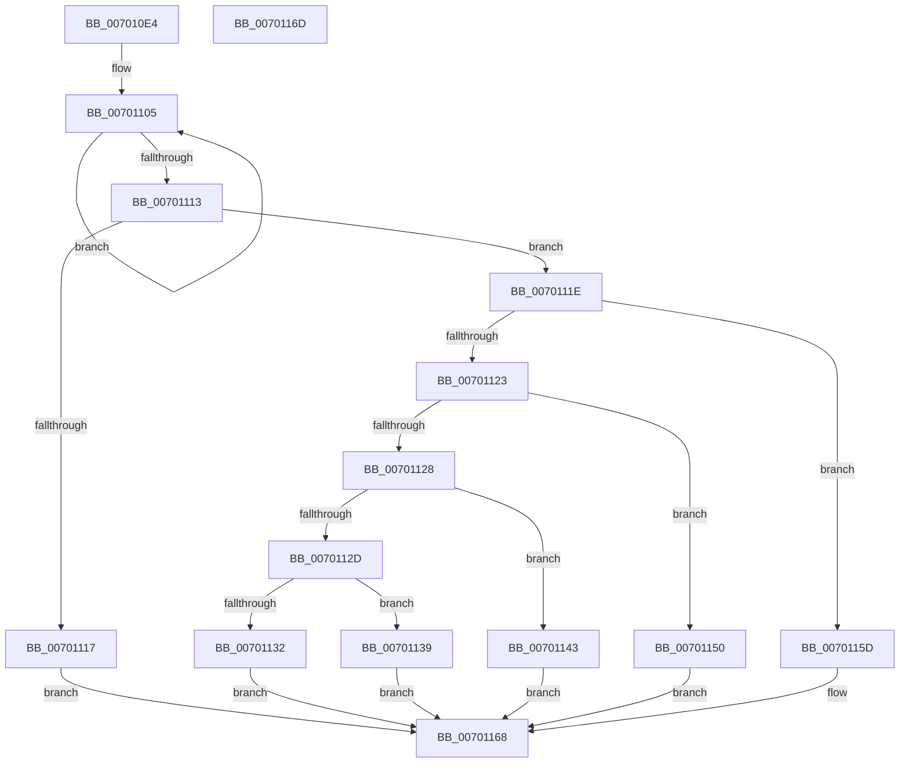

# PopDirectedDripsUmPowerInformationInternal

- RVA: `0x007010E4`–`0x0070116E` (길이 `138` bytes)
- VA: `0x00000001407010E4`
- 실행 섹션: `PAGE`
- PDB 이름 있음: `예`; PDB Function 태그: `아니요`
- unwind 정보 RVA: `0x0005C788`
- 디코드: `41`개 명령, `138/138` bytes 표시
- 미해석 바이트: `0` (있으면 어셈블리에 `.byte`로 보존)

> 이 문서는 커널 이미지의 기계어와 PDB 기호를 분석해 생성했습니다. 4번과 5번은 함수 원형과 자료형을 바이너리 사용 방식에서 추정한 C 해석이며 원본 소스 복구 결과는 아닙니다.

## 1. Dependencies

- 직접 호출 지점: **4**; 고유 호출 대상: **4**
- 직접 호출자로 확인된 함수: **1**
- RIP 상대 이미지 참조: **1**

### Outgoing calls
- `0x0070113C` → [PopDirectedDripsUmQueryCapabilities](../77/PopDirectedDripsUmQueryCapabilities_function_00771830.md) (function, `0x00771830`)
- `0x00701149` → [PopDirectedDripsUmDirectedFxSetMode](../77/PopDirectedDripsUmDirectedFxSetMode_function_00771768.md) (function, `0x00771768`)
- `0x00701156` → [PopDirectedDripsUmDirectedFxRemoveTestDevice](../77/PopDirectedDripsUmDirectedFxRemoveTestDevice_function_007716D4.md) (function, `0x007716D4`)
- `0x00701163` → [PopDirectedDripsUmDirectedFxAddTestDevice](../77/PopDirectedDripsUmDirectedFxAddTestDevice_function_007715D4.md) (function, `0x007715D4`)

### Direct callers
- [PopPowerInformationInternal](../A8/PopPowerInformationInternal_function_00A8B7C0.md) at `0x00A8C779`

### Static image references
- `0x007010F8` → RVA `0x00F0EAC0` (`.data`; read)

## 2. Other-region calls and transfers

- 다른 실행 섹션으로 향하는 call: **0**
- 별도 외부 분기/꼬리 이동을 확인하지 못했습니다.

## 3. Assembly (complete function range)

```asm
007010E4  48 83 EC 28                     sub rsp, 0x28
007010E8  41 83 21 00                     and dword ptr [r9], 0
007010EC  44 8B DA                        mov r11d, edx
007010EF  48 8B 54 24 50                  mov rdx, qword ptr [rsp + 0x50]
007010F4  48 83 22 00                     and qword ptr [rdx], 0
007010F8  0F 0D 0D C1 D9 80 00            prefetchw byte ptr [rip + 0x80d9c1]
007010FF  8B 05 BB D9 80 00               mov eax, dword ptr [rip + 0x80d9bb]
00701105  44 8B D0                        mov r10d, eax
00701108  F0 44 0F B1 15 AF D9 80 00      lock cmpxchg dword ptr [rip + 0x80d9af], r10d
00701111  75 F2                           jne 0x140701105
00701113  A8 01                           test al, 1
00701115  75 07                           jne 0x14070111e
00701117  B8 BB 00 00 C0                  mov eax, 0xc00000bb
0070111C  EB 4A                           jmp 0x140701168
0070111E  83 E9 35                        sub ecx, 0x35
00701121  74 3A                           je 0x14070115d
00701123  83 E9 01                        sub ecx, 1
00701126  74 28                           je 0x140701150
00701128  83 E9 02                        sub ecx, 2
0070112B  74 16                           je 0x140701143
0070112D  83 F9 08                        cmp ecx, 8
00701130  74 07                           je 0x140701139
00701132  B8 0D 00 00 C0                  mov eax, 0xc000000d
00701137  EB 2F                           jmp 0x140701168
00701139  49 8B C9                        mov rcx, r9
0070113C  E8 EF 06 07 00                  call 0x140771830
00701141  EB 25                           jmp 0x140701168
00701143  49 8B D0                        mov rdx, r8
00701146  41 8B CB                        mov ecx, r11d
00701149  E8 1A 06 07 00                  call 0x140771768
0070114E  EB 18                           jmp 0x140701168
00701150  49 8B D0                        mov rdx, r8
00701153  41 8B CB                        mov ecx, r11d
00701156  E8 79 05 07 00                  call 0x1407716d4
0070115B  EB 0B                           jmp 0x140701168
0070115D  49 8B D0                        mov rdx, r8
00701160  41 8B CB                        mov ecx, r11d
00701163  E8 6C 04 07 00                  call 0x1407715d4
00701168  48 83 C4 28                     add rsp, 0x28
0070116C  C3                              ret
0070116D  CC                              int3
```

## 4. C-style interpretation (structured pseudocode)

```c
__int64 __fastcall PopDirectedDripsUmPowerInformationInternal(int a1, int a2, __int64 a3, __int64 a4, __int64 a5)
{
    __int64 result;
    __int64 v_rsp;

    v_rsp = (v_rsp) - (40);
loc_00701105:
    if (condition_is_not_equal) goto loc_00701105;
    if ((((unsigned __int8)((unsigned int)(*(unsigned int *)(v_rip + 8444347)))) & (1)) != 0) goto loc_0070111E;
    goto loc_00701168;
loc_0070111E:
    a1 = (unsigned int)((a1) - (53));
    if (condition_is_equal) goto loc_0070115D;
    a1 = (unsigned int)((a1) - (1));
    if (condition_is_equal) goto loc_00701150;
    a1 = (unsigned int)((a1) - (2));
    if (condition_is_equal) goto loc_00701143;
    if (a1 == 8) goto loc_00701139;
    goto loc_00701168;
loc_00701139:
    result = PopDirectedDripsUmQueryCapabilities(a4, a5, a3, a4);
    goto loc_00701168;
loc_00701143:
    result = PopDirectedDripsUmDirectedFxSetMode((unsigned int)((unsigned int)((unsigned int)(a2))), a3, a3, a4);
    goto loc_00701168;
loc_00701150:
    result = PopDirectedDripsUmDirectedFxRemoveTestDevice((unsigned int)((unsigned int)((unsigned int)(a2))), a3, a3, a4);
    goto loc_00701168;
loc_0070115D:
    result = PopDirectedDripsUmDirectedFxAddTestDevice((unsigned int)((unsigned int)((unsigned int)(a2))), a3, a3, a4);
loc_00701168:
    v_rsp = (v_rsp) + (40);
    return result;
}
```

## 5. (Beta) C Style

```c
int64_t PopDirectedDripsUmPowerInformationInternal(int32_t Arg1, int32_t Arg2, int64_t Arg3, void *Arg4, void *Arg5)
{
    uint8_t *arg4 = (uint8_t *)Arg4;
    uint8_t *arg5 = (uint8_t *)Arg5;

    int64_t result;
    int64_t local_rsp;

    local_rsp = (local_rsp) - (40);
loc_00701105:
    if (condition_is_not_equal) goto loc_00701105;
    if ((((uint8_t)((uint32_t)(*(uint32_t *)(v_rip + 0x80D9BB)))) & (1)) != 0) goto loc_0070111E;
    goto loc_00701168;
loc_0070111E:
    Arg1 = (uint32_t)((Arg1) - (53));
    if (condition_is_equal) goto loc_0070115D;
    Arg1 = (uint32_t)((Arg1) - (1));
    if (condition_is_equal) goto loc_00701150;
    Arg1 = (uint32_t)((Arg1) - (2));
    if (condition_is_equal) goto loc_00701143;
    if (Arg1 == 8) goto loc_00701139;
    goto loc_00701168;
loc_00701139:
    result = PopDirectedDripsUmQueryCapabilities(Arg4, Arg5, Arg3, Arg4);
    goto loc_00701168;
loc_00701143:
    result = PopDirectedDripsUmDirectedFxSetMode((uint32_t)((uint32_t)((uint32_t)(Arg2))), Arg3, Arg3, Arg4);
    goto loc_00701168;
loc_00701150:
    result = PopDirectedDripsUmDirectedFxRemoveTestDevice((uint32_t)((uint32_t)((uint32_t)(Arg2))), Arg3, Arg3, Arg4);
    goto loc_00701168;
loc_0070115D:
    result = PopDirectedDripsUmDirectedFxAddTestDevice((uint32_t)((uint32_t)((uint32_t)(Arg2))), Arg3, Arg3, Arg4);
loc_00701168:
    local_rsp = (local_rsp) + (40);
    return result;
}
```

### 관측된 메모리 오프셋

구조체 형식이 확인되지 않은 접근은 인자 기준의 오프셋으로만 기록했습니다.

| 기준 인자 | 오프셋 표현 | 폭 (bit) | 접근 |
|---|---:|---:|---|
| `Arg4` | `+ 0x0` | `32` | `R/W` |
| `Arg5` | `+ 0x0` | `64` | `R/W` |

## 6. Execution-region graph

[열기: 2D/3D 그래프와 함수 탐색 컨트롤 패널](../../../control-panel.html?section=page&rva=0x007010E4&view=graph)

- 2D 그래프는 위에서 아래로 흐르고, 3D 그래프는 빈 공간을 드래그해 회전합니다. Shift+드래그는 이동, 휠은 확대·축소, 함수 노드 선택은 대상 보고서 이동입니다.

### Static fallback


