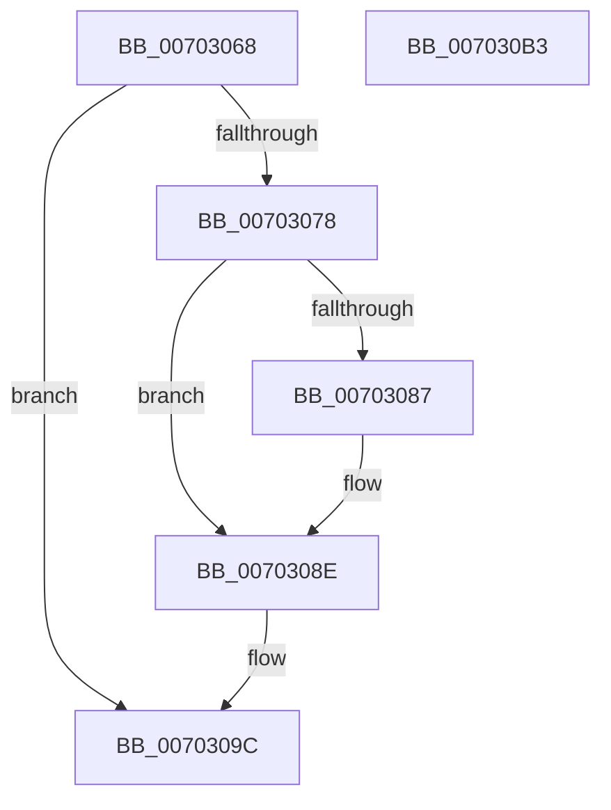

# PopDirectedDripsVisitDevice

- RVA: `0x00703068`–`0x007030B4` (길이 `76` bytes)
- VA: `0x0000000140703068`
- 실행 섹션: `PAGE`
- PDB 이름 있음: `예`; PDB Function 태그: `아니요`
- unwind 정보 RVA: `0x0005C788`
- 디코드: `23`개 명령, `76/76` bytes 표시
- 미해석 바이트: `0` (있으면 어셈블리에 `.byte`로 보존)

> 이 문서는 커널 이미지의 기계어와 PDB 기호를 분석해 생성했습니다. 4번과 5번은 함수 원형과 자료형을 바이너리 사용 방식에서 추정한 C 해석이며 원본 소스 복구 결과는 아닙니다.

## 1. Dependencies

- 직접 호출 지점: **1**; 고유 호출 대상: **1**
- 직접 호출자로 확인된 함수: **5**
- RIP 상대 이미지 참조: **0**

### Outgoing calls
- `0x007030A9` → [PopDirectedDripsDiagTraceBroadcastVisit](../AC/PopDirectedDripsDiagTraceBroadcastVisit_function_00ACA95C.md) (function, `0x00ACA95C`)

### Direct callers
- [PopDirectedDripsBuildBroadcastTreeFull](../77/PopDirectedDripsBuildBroadcastTreeFull_function_00771970.md) at `0x00771A1C`
- [PopDirectedDripsBuildPs4BroadcastTree](../77/PopDirectedDripsBuildPs4BroadcastTree_function_00771C90.md) at `0x00771D0B`
- [PopDirectedDripsVisitPs4Device](../77/PopDirectedDripsVisitPs4Device_function_00771EE0.md) at `0x00771F1C`
- [PopDirectedDripsVisitPs4Device](../77/PopDirectedDripsVisitPs4Device_function_00771EE0.md) at `0x00771F82`
- [PopDirectedDripsMarkDfxDevice](../AA/PopDirectedDripsMarkDfxDevice_function_00AACA44.md) at `0x00AACA87`
- [PopDirectedDripsMarkDfxDevice](../AA/PopDirectedDripsMarkDfxDevice_function_00AACA44.md) at `0x00AACB1D`
- [sub_00B4A78A](../B4/Unknown_function_00B4A78A.md) at `0x00B4A7A9`

### Static image references
- 디코드된 RIP-relative 메모리 참조가 없습니다.

## 2. Other-region calls and transfers

- 다른 실행 섹션으로 향하는 call: **0**
- 별도 외부 분기/꼬리 이동을 확인하지 못했습니다.

## 3. Assembly (complete function range)

```asm
00703068  48 83 EC 28                     sub rsp, 0x28
0070306C  4C 8D 52 10                     lea r10, [rdx + 0x10]
00703070  4D 8B D8                        mov r11, r8
00703073  4D 39 12                        cmp qword ptr [r10], r10
00703076  75 24                           jne 0x14070309c
00703078  8B 42 20                        mov eax, dword ptr [rdx + 0x20]
0070307B  89 42 24                        mov dword ptr [rdx + 0x24], eax
0070307E  48 8B 41 08                     mov rax, qword ptr [rcx + 8]
00703082  48 39 08                        cmp qword ptr [rax], rcx
00703085  74 07                           je 0x14070308e
00703087  B9 03 00 00 00                  mov ecx, 3
0070308C  CD 29                           int 0x29
0070308E  49 89 0A                        mov qword ptr [r10], rcx
00703091  49 89 42 08                     mov qword ptr [r10 + 8], rax
00703095  4C 89 10                        mov qword ptr [rax], r10
00703098  4C 89 51 08                     mov qword ptr [rcx + 8], r10
0070309C  48 8D 8A 28 FD FF FF            lea rcx, [rdx - 0x2d8]
007030A3  45 8B C1                        mov r8d, r9d
007030A6  49 8B D3                        mov rdx, r11
007030A9  E8 AE 78 3C 00                  call 0x140aca95c
007030AE  48 83 C4 28                     add rsp, 0x28
007030B2  C3                              ret
007030B3  CC                              int3
```

## 4. C-style interpretation (structured pseudocode)

```c
__int64 __fastcall PopDirectedDripsVisitDevice(__int64 a1, __int64 a2, __int64 a3, int a4)
{
    __int64 result;
    __int64 v_rsp;

    v_rsp = (v_rsp) - (40);
    if ((*(unsigned __int64 *)(a2 + 16)) != (a2 + 16)) goto loc_0070309C;
    *(unsigned int *)(a2 + 36) = (unsigned int)((unsigned int)(*(unsigned int *)(a2 + 32)));
    if ((*(unsigned __int64 *)(*(unsigned __int64 *)(a1 + 8))) != a1) {
        a1 = 3;
    }
    *(unsigned __int64 *)(a2 + 16) = a1;
    *(unsigned __int64 *)(a2 + 16 + 8) = *(unsigned __int64 *)(a1 + 8);
    *(unsigned __int64 *)(*(unsigned __int64 *)(a1 + 8)) = a2 + 16;
    *(unsigned __int64 *)(a1 + 8) = a2 + 16;
loc_0070309C:
    result = PopDirectedDripsDiagTraceBroadcastVisit(a2 - 728, a3, (unsigned int)(a4), a4);
    v_rsp = (v_rsp) + (40);
    return result;
}
```

## 5. (Beta) C Style

```c
int64_t PopDirectedDripsVisitDevice(void *Arg1, void *Arg2, int64_t Arg3, int32_t Arg4)
{
    uint8_t *arg1 = (uint8_t *)Arg1;
    uint8_t *arg2 = (uint8_t *)Arg2;

    int64_t result;
    int64_t local_rsp;

    local_rsp = (local_rsp) - (40);
    if ((*(uint64_t *)(arg2 + 0x10)) != (Arg2 + 16)) goto loc_0070309C;
    *(uint32_t *)(arg2 + 0x24) = (uint32_t)((uint32_t)(*(uint32_t *)(arg2 + 0x20)));
    if ((*(uint64_t *)(*(uint64_t *)(arg1 + 0x8))) != Arg1) {
        Arg1 = 3;
    }
    *(void **)(arg2 + 0x10) = Arg1;
    *(uint64_t *)(arg2 + 0x10 + 0x8) = *(uint64_t *)(arg1 + 0x8);
    *(void **)(*(uint64_t *)(arg1 + 0x8)) = Arg2 + 16;
    *(void **)(arg1 + 0x8) = Arg2 + 16;
loc_0070309C:
    result = PopDirectedDripsDiagTraceBroadcastVisit(Arg2 - 728, Arg3, (uint32_t)(Arg4), Arg4);
    local_rsp = (local_rsp) + (40);
    return result;
}
```

### 관측된 메모리 오프셋

구조체 형식이 확인되지 않은 접근은 인자 기준의 오프셋으로만 기록했습니다.

| 기준 인자 | 오프셋 표현 | 폭 (bit) | 접근 |
|---|---:|---:|---|
| `Arg1` | `+ 0x8` | `64` | `R` |
| `Arg2` | `- 0x2D8` | `64` | `R` |
| `Arg2` | `+ 0x0` | `64` | `R` |
| `Arg2` | `+ 0x0` | `64` | `W` |
| `Arg2` | `+ 0x8` | `64` | `W` |
| `Arg2` | `+ 0x10` | `64` | `R` |
| `Arg2` | `+ 0x20` | `32` | `R` |
| `Arg2` | `+ 0x24` | `32` | `W` |

## 6. Execution-region graph

[열기: 2D/3D 그래프와 함수 탐색 컨트롤 패널](../../../control-panel.html?section=page&rva=0x00703068&view=graph)

- 2D 그래프는 위에서 아래로 흐르고, 3D 그래프는 빈 공간을 드래그해 회전합니다. Shift+드래그는 이동, 휠은 확대·축소, 함수 노드 선택은 대상 보고서 이동입니다.

### Static fallback


