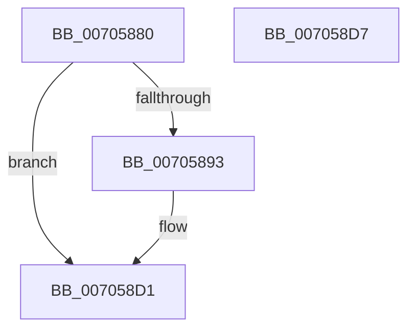

# PopDripsWatchdogScheduleNextTimer

- RVA: `0x00705880`–`0x007058D8` (길이 `88` bytes)
- VA: `0x0000000140705880`
- 실행 섹션: `PAGE`
- PDB 이름 있음: `예`; PDB Function 태그: `아니요`
- unwind 정보 RVA: `0x00064C80`
- 디코드: `20`개 명령, `88/88` bytes 표시
- 미해석 바이트: `0` (있으면 어셈블리에 `.byte`로 보존)

> 이 문서는 커널 이미지의 기계어와 PDB 기호를 분석해 생성했습니다. 4번과 5번은 함수 원형과 자료형을 바이너리 사용 방식에서 추정한 C 해석이며 원본 소스 복구 결과는 아닙니다.

## 1. Dependencies

- 직접 호출 지점: **1**; 고유 호출 대상: **1**
- 직접 호출자로 확인된 함수: **3**
- RIP 상대 이미지 참조: **0**

### Outgoing calls
- `0x007058C5` → [KeSetTimer2](../../text/3A/KeSetTimer2_function_003A08E0.md) (function, `0x003A08E0`)

### Direct callers
- [PopDripsWatchdogCallbackWorker](../76/PopDripsWatchdogCallbackWorker_function_0076C360.md) at `0x0076C3B8`
- [PopDripsWatchdogDiagnosticWorker](../76/PopDripsWatchdogDiagnosticWorker_function_0076C600.md) at `0x0076C697`
- [PopDripsWatchdogDiagnosticWorker](../76/PopDripsWatchdogDiagnosticWorker_function_0076C600.md) at `0x0076C74C`
- [PopDripsWatchdogStartWatchdog](../A3/PopDripsWatchdogStartWatchdog_function_00A32148.md) at `0x00A3220A`
- [PopDripsWatchdogStartWatchdog](../A3/PopDripsWatchdogStartWatchdog_function_00A32148.md) at `0x00A32297`

### Static image references
- 디코드된 RIP-relative 메모리 참조가 없습니다.

## 2. Other-region calls and transfers

- 다른 실행 섹션으로 향하는 call: **1**
  - `0x007058C5` → [KeSetTimer2](../../text/3A/KeSetTimer2_function_003A08E0.md) (`PAGE` → `.text`)
- 별도 외부 분기/꼬리 이동을 확인하지 못했습니다.

## 3. Assembly (complete function range)

```asm
00705880  40 53                           push rbx
00705882  48 83 EC 30                     sub rsp, 0x30
00705886  8B 81 B4 00 00 00               mov eax, dword ptr [rcx + 0xb4]
0070588C  48 8B D9                        mov rbx, rcx
0070588F  A8 02                           test al, 2
00705891  75 3E                           jne 0x1407058d1
00705893  48 A1 08 00 00 00 80 F7 FF FF   movabs rax, qword ptr [0xfffff78000000008]
0070589D  4C 8D 4C 24 20                  lea r9, [rsp + 0x20]
007058A2  48 83 64 24 20 00               and qword ptr [rsp + 0x20], 0
007058A8  45 33 C0                        xor r8d, r8d
007058AB  48 83 4C 24 28 FF               or qword ptr [rsp + 0x28], 0xffffffffffffffff
007058B1  48 89 81 B8 00 00 00            mov qword ptr [rcx + 0xb8], rax
007058B8  8B 81 B0 00 00 00               mov eax, dword ptr [rcx + 0xb0]
007058BE  48 69 D0 80 69 67 FF            imul rdx, rax, -0x989680
007058C5  E8 16 B0 C9 FF                  call 0x1403a08e0
007058CA  83 8B B4 00 00 00 02            or dword ptr [rbx + 0xb4], 2
007058D1  48 83 C4 30                     add rsp, 0x30
007058D5  5B                              pop rbx
007058D6  C3                              ret
007058D7  CC                              int3
```

## 4. C-style interpretation (structured pseudocode)

```c
__int64 __fastcall PopDripsWatchdogScheduleNextTimer(__int64 a1, __int64 a2, int a3)
{
    __int64 result;
    __int64 v_rsp;
    unsigned __int64 v_stack_m10;
    unsigned __int64 v_stack_m18;

    v_rsp = (v_rsp) - (48);
    result = (unsigned int)(*(unsigned int *)(a1 + 180));
    if ((((unsigned __int8)((unsigned int)(*(unsigned int *)(a1 + 180)))) & (2)) == 0) {
        a4 = v_stack_m18;
        a3 = 0;
        *(unsigned __int64 *)(a1 + 184) = (unsigned int)(*(unsigned int *)(a1 + 180));
        result = *(unsigned int *)(a1 + 176);
        a2 = (a2) * (result);
        result = KeSetTimer2(a1, a2, a3, a4);
    }
    v_rsp = (v_rsp) + (48);
    return result;
}
```

## 5. (Beta) C Style

```c
int64_t PopDripsWatchdogScheduleNextTimer(void *Arg1, int64_t Arg2, int32_t Arg3)
{
    uint8_t *arg1 = (uint8_t *)Arg1;

    int64_t result;
    int64_t local_rsp;
    uint64_t v_stack_m10;
    uint64_t v_stack_m18;

    local_rsp = (local_rsp) - (48);
    result = (uint32_t)(*(uint32_t *)(arg1 + 0xB4));
    if ((((uint8_t)((uint32_t)(*(uint32_t *)(arg1 + 0xB4)))) & (2)) == 0) {
        a4 = v_stack_m18;
        Arg3 = 0;
        *(uint64_t *)(arg1 + 0xB8) = (uint32_t)(*(uint32_t *)(arg1 + 0xB4));
        result = *(uint32_t *)(arg1 + 0xB0);
        Arg2 = (Arg2) * (result);
        result = KeSetTimer2(Arg1, Arg2, Arg3, a4);
    }
    local_rsp = (local_rsp) + (48);
    return result;
}
```

### 관측된 메모리 오프셋

구조체 형식이 확인되지 않은 접근은 인자 기준의 오프셋으로만 기록했습니다.

| 기준 인자 | 오프셋 표현 | 폭 (bit) | 접근 |
|---|---:|---:|---|
| `Arg1` | `+ 0xB0` | `32` | `R` |
| `Arg1` | `+ 0xB4` | `32` | `R` |
| `Arg1` | `+ 0xB4` | `32` | `R/W` |
| `Arg1` | `+ 0xB8` | `64` | `W` |

## 6. Execution-region graph

[열기: 2D/3D 그래프와 함수 탐색 컨트롤 패널](../../../control-panel.html?section=page&rva=0x00705880&view=graph)

- 2D 그래프는 위에서 아래로 흐르고, 3D 그래프는 빈 공간을 드래그해 회전합니다. Shift+드래그는 이동, 휠은 확대·축소, 함수 노드 선택은 대상 보고서 이동입니다.

### Static fallback


