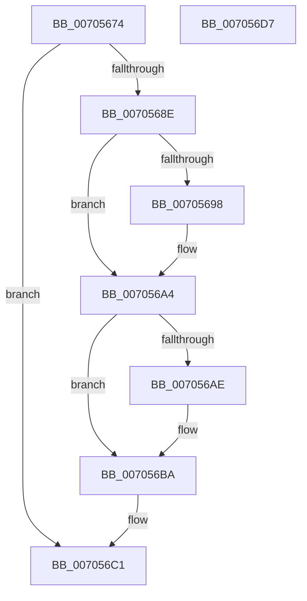

# PopDripsWatchdogStopWatchdog

- RVA: `0x00705674`–`0x007056D8` (길이 `100` bytes)
- VA: `0x0000000140705674`
- 실행 섹션: `PAGE`
- PDB 이름 있음: `예`; PDB Function 태그: `아니요`
- unwind 정보 RVA: `0x0005C788`
- 디코드: `23`개 명령, `100/100` bytes 표시
- 미해석 바이트: `0` (있으면 어셈블리에 `.byte`로 보존)

> 이 문서는 커널 이미지의 기계어와 PDB 기호를 분석해 생성했습니다. 4번과 5번은 함수 원형과 자료형을 바이너리 사용 방식에서 추정한 C 해석이며 원본 소스 복구 결과는 아닙니다.

## 1. Dependencies

- 직접 호출 지점: **5**; 고유 호출 대상: **4**
- 직접 호출자로 확인된 함수: **1**
- RIP 상대 이미지 참조: **7**

### Outgoing calls
- `0x0070567F` → [PiDmObjectManagerAcquireExclusiveLock](../95/PiDmObjectManagerAcquireExclusiveLock_function_00951334.md) (function, `0x00951334`)
- `0x0070569F` → [PopDripsWatchdogStopTimer](../76/PopDripsWatchdogStopTimer_function_0076C808.md) (function, `0x0076C808`)
- `0x007056B5` → [PopDripsWatchdogStopTimer](../76/PopDripsWatchdogStopTimer_function_0076C808.md) (function, `0x0076C808`)
- `0x007056C8` → [ExReleaseResourceLite](../../text/25/ExReleaseResourceLite_function_0025FA10.md) (function, `0x0025FA10`)
- `0x007056CD` → [KeLeaveCriticalRegion](../../text/25/KeLeaveCriticalRegion_function_0025D8B0.md) (function, `0x0025D8B0`)

### Direct callers
- [PopPdcIdleResiliencyCallback](../A3/PopPdcIdleResiliencyCallback_function_00A31518.md) at `0x00A315D5`

### Static image references
- `0x00705678` → RVA `0x00F07EA0` (`.data`; read)
- `0x00705684` → RVA `0x00F07F08` (`.data`; read)
- `0x0070568E` → RVA `0x00F07FC4` (`.data`; read)
- `0x00705698` → RVA `0x00F07F10` (`.data`; read)
- `0x007056A4` → RVA `0x00F080CC` (`.data`; read)
- `0x007056AE` → RVA `0x00F08018` (`.data`; read)
- `0x007056BA` → RVA `0x00F07F08` (`.data`; read/write)

## 2. Other-region calls and transfers

- 다른 실행 섹션으로 향하는 call: **2**
  - `0x007056C8` → [ExReleaseResourceLite](../../text/25/ExReleaseResourceLite_function_0025FA10.md) (`PAGE` → `.text`)
  - `0x007056CD` → [KeLeaveCriticalRegion](../../text/25/KeLeaveCriticalRegion_function_0025D8B0.md) (`PAGE` → `.text`)
- 별도 외부 분기/꼬리 이동을 확인하지 못했습니다.

## 3. Assembly (complete function range)

```asm
00705674  48 83 EC 28                     sub rsp, 0x28
00705678  48 8D 0D 21 28 80 00            lea rcx, [rip + 0x802821]
0070567F  E8 B0 BC 24 00                  call 0x140951334
00705684  8B 05 7E 28 80 00               mov eax, dword ptr [rip + 0x80287e]
0070568A  A8 04                           test al, 4
0070568C  74 33                           je 0x1407056c1
0070568E  8B 05 30 29 80 00               mov eax, dword ptr [rip + 0x802930]
00705694  A8 01                           test al, 1
00705696  74 0C                           je 0x1407056a4
00705698  48 8D 0D 71 28 80 00            lea rcx, [rip + 0x802871]
0070569F  E8 64 71 06 00                  call 0x14076c808
007056A4  8B 05 22 2A 80 00               mov eax, dword ptr [rip + 0x802a22]
007056AA  A8 01                           test al, 1
007056AC  74 0C                           je 0x1407056ba
007056AE  48 8D 0D 63 29 80 00            lea rcx, [rip + 0x802963]
007056B5  E8 4E 71 06 00                  call 0x14076c808
007056BA  83 25 47 28 80 00 FB            and dword ptr [rip + 0x802847], 0xfffffffb
007056C1  48 8D 0D D8 27 80 00            lea rcx, [rip + 0x8027d8]
007056C8  E8 43 A3 B5 FF                  call 0x14025fa10
007056CD  E8 DE 81 B5 FF                  call 0x14025d8b0
007056D2  48 83 C4 28                     add rsp, 0x28
007056D6  C3                              ret
007056D7  CC                              int3
```

## 4. C-style interpretation (structured pseudocode)

```c
__int64 __fastcall PopDripsWatchdogStopWatchdog(void)
{
    __int64 result;
    __int64 v_rsp;

    v_rsp = (v_rsp) - (40);
    result = PiDmObjectManagerAcquireExclusiveLock(v_rip + 8398881, a2, a3, a4);
    if ((((unsigned __int8)((unsigned int)(*(unsigned int *)(v_rip + 8398974)))) & (4)) == 0) goto loc_007056C1;
    result = (unsigned int)(*(unsigned int *)(v_rip + 8399152));
    if ((((unsigned __int8)((unsigned int)(*(unsigned int *)(v_rip + 8399152)))) & (1)) != 0) {
        a1 = v_rip + 8398961;
        result = PopDripsWatchdogStopTimer(a1, a2, a3, a4);
    }
    result = (unsigned int)(*(unsigned int *)(v_rip + 8399394));
    if ((((unsigned __int8)((unsigned int)(*(unsigned int *)(v_rip + 8399394)))) & (1)) != 0) {
        a1 = v_rip + 8399203;
        result = PopDripsWatchdogStopTimer(a1, a2, a3, a4);
    }
loc_007056C1:
    result = ExReleaseResourceLite(v_rip + 8398808, a2, a3, a4);
    result = KeLeaveCriticalRegion(v_rip + 8398808, a2, a3, a4);
    v_rsp = (v_rsp) + (40);
    return result;
}
```

## 5. (Beta) C Style

```c
void PopDripsWatchdogStopWatchdog(void)
{
    int64_t result;
    int64_t local_rsp;

    local_rsp = (local_rsp) - (40);
    result = PiDmObjectManagerAcquireExclusiveLock(v_rip + 8398881, a2, a3, a4);
    if ((((uint8_t)((uint32_t)(*(uint32_t *)(v_rip + 0x80287E)))) & (4)) == 0) goto loc_007056C1;
    result = (uint32_t)(*(uint32_t *)(v_rip + 0x802930));
    if ((((uint8_t)((uint32_t)(*(uint32_t *)(v_rip + 0x802930)))) & (1)) != 0) {
        a1 = v_rip + 8398961;
        result = PopDripsWatchdogStopTimer(a1, a2, a3, a4);
    }
    result = (uint32_t)(*(uint32_t *)(v_rip + 0x802A22));
    if ((((uint8_t)((uint32_t)(*(uint32_t *)(v_rip + 0x802A22)))) & (1)) != 0) {
        a1 = v_rip + 8399203;
        result = PopDripsWatchdogStopTimer(a1, a2, a3, a4);
    }
loc_007056C1:
    result = ExReleaseResourceLite(v_rip + 8398808, a2, a3, a4);
    result = KeLeaveCriticalRegion(v_rip + 8398808, a2, a3, a4);
    local_rsp = (local_rsp) + (40);
    return result;
}
```

## 6. Execution-region graph

[열기: 2D/3D 그래프와 함수 탐색 컨트롤 패널](../../../control-panel.html?section=page&rva=0x00705674&view=graph)

- 2D 그래프는 위에서 아래로 흐르고, 3D 그래프는 빈 공간을 드래그해 회전합니다. Shift+드래그는 이동, 휠은 확대·축소, 함수 노드 선택은 대상 보고서 이동입니다.

### Static fallback


