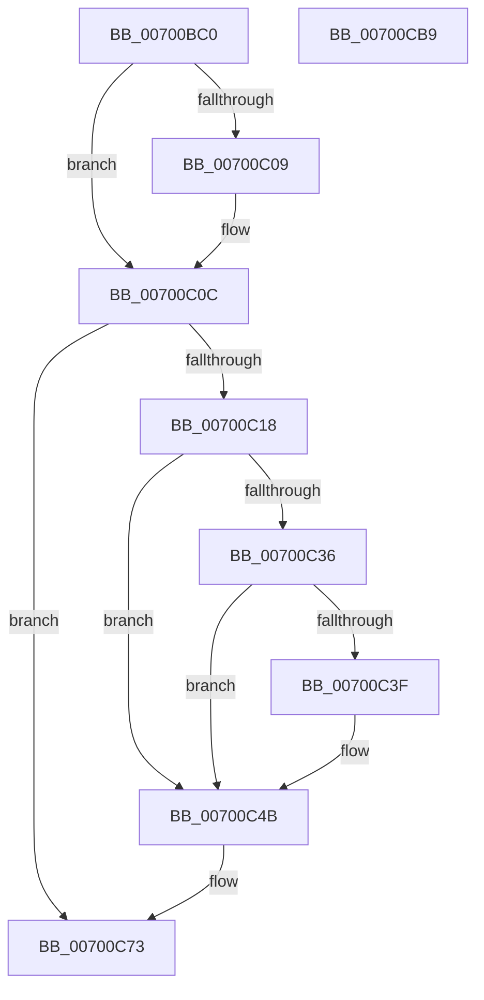

# PopEsSnapTelemetry

- RVA: `0x00700BC0`–`0x00700CBA` (길이 `250` bytes)
- VA: `0x0000000140700BC0`
- 실행 섹션: `PAGE`
- PDB 이름 있음: `예`; PDB Function 태그: `아니요`
- unwind 정보 RVA: `0x00093E28`
- 디코드: `60`개 명령, `250/250` bytes 표시
- 미해석 바이트: `0` (있으면 어셈블리에 `.byte`로 보존)

> 이 문서는 커널 이미지의 기계어와 PDB 기호를 분석해 생성했습니다. 4번과 5번은 함수 원형과 자료형을 바이너리 사용 방식에서 추정한 C 해석이며 원본 소스 복구 결과는 아닙니다.

## 1. Dependencies

- 직접 호출 지점: **2**; 고유 호출 대상: **2**
- 직접 호출자로 확인된 함수: **2**
- RIP 상대 이미지 참조: **14**

### Outgoing calls
- `0x00700C2D` → [Feature_SustainabilityFixes_FY26Q2__private_IsEnabledDeviceUsageNoInline](../../text/5D/Feature_SustainabilityFixes_FY26Q2__private_IsEnabledDeviceUsageNoInline_function_005D9FC4.md) (function, `0x005D9FC4`)
- `0x00700C6E` → [PopTraceEsState](../../text/5D/PopTraceEsState_function_005D7998.md) (function, `0x005D7998`)

### Direct callers
- [PopEsUpdateState](../../text/5D/PopEsUpdateState_function_005DA018.md) at `0x005DA0BA`
- [PopEsEnterSleepShutdown](../AD/PopEsEnterSleepShutdown_function_00AD168C.md) at `0x00AD16D1`

### Static image references
- `0x00700C0C` → RVA `0x00E67A10` (`.data`; read)
- `0x00700C18` → RVA `0x00E67A2C` (`.data`; read)
- `0x00700C27` → RVA `0x00E67A18` (`.data`; read)
- `0x00700C36` → RVA `0x00F0CE0C` (`.data`; read)
- `0x00700C3F` → RVA `0x00F0CE50` (`.data`; read)
- `0x00700C45` → RVA `0x00E67A20` (`.data`; write)
- `0x00700C4B` → RVA `0x00E67A08` (`.data`; read)
- `0x00700C55` → RVA `0x00E0B864` (`.data`; read)
- `0x00700C5E` → RVA `0x00E0B860` (`.data`; read)
- `0x00700C7F` → RVA `0x00E67A1C` (`.data`; write)
- `0x00700C91` → RVA `0x00F0CE55` (`.data`; read)
- `0x00700C97` → RVA `0x00E67A18` (`.data`; write)
- `0x00700CA2` → RVA `0x00E67A00` (`.data`; write)
- `0x00700CA8` → RVA `0x00E67A10` (`.data`; write)

## 2. Other-region calls and transfers

- 다른 실행 섹션으로 향하는 call: **2**
  - `0x00700C2D` → [Feature_SustainabilityFixes_FY26Q2__private_IsEnabledDeviceUsageNoInline](../../text/5D/Feature_SustainabilityFixes_FY26Q2__private_IsEnabledDeviceUsageNoInline_function_005D9FC4.md) (`PAGE` → `.text`)
  - `0x00700C6E` → [PopTraceEsState](../../text/5D/PopTraceEsState_function_005D7998.md) (`PAGE` → `.text`)
- 별도 외부 분기/꼬리 이동을 확인하지 못했습니다.

## 3. Assembly (complete function range)

```asm
00700BC0  48 89 5C 24 08                  mov qword ptr [rsp + 8], rbx
00700BC5  48 89 6C 24 10                  mov qword ptr [rsp + 0x10], rbp
00700BCA  48 89 74 24 18                  mov qword ptr [rsp + 0x18], rsi
00700BCF  57                              push rdi
00700BD0  41 56                           push r14
00700BD2  41 57                           push r15
00700BD4  48 83 EC 40                     sub rsp, 0x40
00700BD8  48 B8 04 00 00 00 80 F7 FF FF   movabs rax, 0xfffff78000000004
00700BE2  33 DB                           xor ebx, ebx
00700BE4  48 8B F9                        mov rdi, rcx
00700BE7  8B 10                           mov edx, dword ptr [rax]
00700BE9  48 B8 20 03 00 00 80 F7 FF FF   movabs rax, 0xfffff78000000320
00700BF3  48 C1 E2 20                     shl rdx, 0x20
00700BF7  48 8B 00                        mov rax, qword ptr [rax]
00700BFA  48 C1 E0 08                     shl rax, 8
00700BFE  48 F7 E2                        mul rdx
00700C01  4C 8B F2                        mov r14, rdx
00700C04  38 59 01                        cmp byte ptr [rcx + 1], bl
00700C07  74 03                           je 0x140700c0c
00700C09  8B 59 0C                        mov ebx, dword ptr [rcx + 0xc]
00700C0C  48 8B 05 FD 6D 76 00            mov rax, qword ptr [rip + 0x766dfd]
00700C13  48 85 C0                        test rax, rax
00700C16  74 5B                           je 0x140700c73
00700C18  44 8B 3D 0D 6E 76 00            mov r15d, dword ptr [rip + 0x766e0d]
00700C1F  49 8B F6                        mov rsi, r14
00700C22  48 2B F0                        sub rsi, rax
00700C25  8B EB                           mov ebp, ebx
00700C27  2B 2D EB 6D 76 00               sub ebp, dword ptr [rip + 0x766deb]
00700C2D  E8 92 93 ED FF                  call 0x1405d9fc4
00700C32  85 C0                           test eax, eax
00700C34  74 15                           je 0x140700c4b
00700C36  83 3D CF C1 80 00 00            cmp dword ptr [rip + 0x80c1cf], 0
00700C3D  75 0C                           jne 0x140700c4b
00700C3F  8B 05 0B C2 80 00               mov eax, dword ptr [rip + 0x80c20b]
00700C45  89 05 D5 6D 76 00               mov dword ptr [rip + 0x766dd5], eax
00700C4B  83 3D B6 6D 76 00 20            cmp dword ptr [rip + 0x766db6], 0x20
00700C52  44 8B C5                        mov r8d, ebp
00700C55  8B 0D 09 AC 70 00               mov ecx, dword ptr [rip + 0x70ac09]
00700C5B  48 8B D6                        mov rdx, rsi
00700C5E  0F 45 0D FB AB 70 00            cmovne ecx, dword ptr [rip + 0x70abfb]
00700C65  44 89 7C 24 38                  mov dword ptr [rsp + 0x38], r15d
00700C6A  89 4C 24 20                     mov dword ptr [rsp + 0x20], ecx
00700C6E  E8 25 6D ED FF                  call 0x1405d7998
00700C73  8A 07                           mov al, byte ptr [rdi]
00700C75  48 8B 6C 24 68                  mov rbp, qword ptr [rsp + 0x68]
00700C7A  48 8B 74 24 70                  mov rsi, qword ptr [rsp + 0x70]
00700C7F  88 05 97 6D 76 00               mov byte ptr [rip + 0x766d97], al
00700C85  8B 05 C5 C1 80 00               mov eax, dword ptr [rip + 0x80c1c5]
00700C8B  89 05 8F 6D 76 00               mov dword ptr [rip + 0x766d8f], eax
00700C91  8A 05 BE C1 80 00               mov al, byte ptr [rip + 0x80c1be]
00700C97  89 1D 7B 6D 76 00               mov dword ptr [rip + 0x766d7b], ebx
00700C9D  48 8B 5C 24 60                  mov rbx, qword ptr [rsp + 0x60]
00700CA2  88 05 58 6D 76 00               mov byte ptr [rip + 0x766d58], al
00700CA8  4C 89 35 61 6D 76 00            mov qword ptr [rip + 0x766d61], r14
00700CAF  48 83 C4 40                     add rsp, 0x40
00700CB3  41 5F                           pop r15
00700CB5  41 5E                           pop r14
00700CB7  5F                              pop rdi
00700CB8  C3                              ret
00700CB9  CC                              int3
```

## 4. C-style interpretation (structured pseudocode)

```c
__int64 __fastcall PopEsSnapTelemetry(__int64 a1)
{
    __int64 result;
    __int64 v_rbp;
    __int64 v_rbx;
    __int64 v_rsi;
    __int64 v_rsp;
    unsigned int v_stack_m20;
    unsigned int v_stack_m38;
    unsigned __int64 v_stack_p10;
    unsigned __int64 v_stack_p18;
    unsigned __int64 v_stack_p8;

    v_stack_p8 = v_rbx;
    v_stack_p10 = v_rbp;
    v_stack_p18 = v_rsi;
    v_rsp = (v_rsp) - (64);
    v_rbx = 0;
    a2 = ((unsigned int)(*(unsigned int *)(result))) << (32);
    result = (*(unsigned __int64 *)(result)) << (8);
    if ((*(unsigned __int8 *)(a1 + 1)) != 0) {
        v_rbx = *(unsigned int *)(a1 + 12);
    }
    if (*(unsigned __int64 *)(v_rip + 7761405) == 0) goto loc_00700C73;
    v_rsi = (a2) - (*(unsigned __int64 *)(v_rip + 7761405));
    v_rbp = (unsigned int)(((unsigned int)((unsigned int)(v_rbx))) - (*(unsigned int *)(v_rip + 7761387)));
    result = Feature_SustainabilityFixes_FY26Q2__private_IsEnabledDeviceUsageNoInline(a1, a2, a3, a4);
    if ((unsigned int)(result) == 0) goto loc_00700C4B;
    if ((*(unsigned int *)(v_rip + 8438223)) == 0) {
        result = *(unsigned int *)(v_rip + 8438283);
        *(unsigned int *)(v_rip + 7761365) = (unsigned int)(result);
    }
    a1 = (unsigned int)(*(unsigned int *)(v_rip + 7384073));
    if ((*(unsigned int *)(v_rip + 7761334)) != 32) { a1 = *(unsigned int *)(v_rip + 7384059); }
    v_stack_m20 = (unsigned int)((unsigned int)(*(unsigned int *)(v_rip + 7761421)));
    v_stack_m38 = (unsigned int)(a1);
    result = PopTraceEsState(a1, v_rsi, (unsigned int)((unsigned int)(v_rbp)), a4);
loc_00700C73:
    *(unsigned __int8 *)(v_rip + 7761303) = (unsigned __int8)(*(unsigned __int8 *)(a1));
    *(unsigned int *)(v_rip + 7761295) = (unsigned int)((unsigned int)(*(unsigned int *)(v_rip + 8438213)));
    *(unsigned int *)(v_rip + 7761275) = (unsigned int)(v_rbx);
    *(unsigned __int8 *)(v_rip + 7761240) = (unsigned __int8)(*(unsigned __int8 *)(v_rip + 8438206));
    *(unsigned __int64 *)(v_rip + 7761249) = a2;
    v_rsp = (v_rsp) + (64);
    return *(unsigned __int8 *)(v_rip + 8438206);
}
```

## 5. (Beta) C Style

```c
int64_t PopEsSnapTelemetry(void *Arg1)
{
    uint8_t *arg1 = (uint8_t *)Arg1;

    int64_t result;
    int64_t local_rbp;
    int64_t local_rbx;
    int64_t local_rsi;
    int64_t local_rsp;
    uint32_t v_stack_m20;
    uint32_t v_stack_m38;
    uint64_t v_stack_p10;
    uint64_t v_stack_p18;
    uint64_t v_stack_p8;

    v_stack_p8 = local_rbx;
    v_stack_p10 = local_rbp;
    v_stack_p18 = local_rsi;
    local_rsp = (local_rsp) - (64);
    local_rbx = 0;
    a2 = ((uint32_t)(*(uint32_t *)(result))) << (32);
    result = (*(uint64_t *)(result)) << (8);
    if ((*(uint8_t *)(arg1 + 0x1)) != 0) {
        local_rbx = *(uint32_t *)(arg1 + 0xC);
    }
    if (*(uint64_t *)(v_rip + 0x766DFD) == 0) goto loc_00700C73;
    local_rsi = (a2) - (*(uint64_t *)(v_rip + 0x766DFD));
    local_rbp = (uint32_t)(((uint32_t)((uint32_t)(local_rbx))) - (*(uint32_t *)(v_rip + 0x766DEB)));
    result = Feature_SustainabilityFixes_FY26Q2__private_IsEnabledDeviceUsageNoInline(Arg1, a2, a3, a4);
    if ((uint32_t)(result) == 0) goto loc_00700C4B;
    if ((*(uint32_t *)(v_rip + 0x80C1CF)) == 0) {
        result = *(uint32_t *)(v_rip + 0x80C20B);
        *(uint32_t *)(v_rip + 0x766DD5) = (uint32_t)(result);
    }
    Arg1 = (uint32_t)(*(uint32_t *)(v_rip + 0x70AC09));
    if ((*(uint32_t *)(v_rip + 0x766DB6)) != 32) { Arg1 = *(uint32_t *)(v_rip + 0x70ABFB); }
    v_stack_m20 = (uint32_t)((uint32_t)(*(uint32_t *)(v_rip + 0x766E0D)));
    v_stack_m38 = (uint32_t)(Arg1);
    result = PopTraceEsState(Arg1, local_rsi, (uint32_t)((uint32_t)(local_rbp)), a4);
loc_00700C73:
    *(uint8_t *)(v_rip + 0x766D97) = (uint8_t)(*(uint8_t *)(arg1));
    *(uint32_t *)(v_rip + 0x766D8F) = (uint32_t)((uint32_t)(*(uint32_t *)(v_rip + 0x80C1C5)));
    *(uint32_t *)(v_rip + 0x766D7B) = (uint32_t)(local_rbx);
    *(uint8_t *)(v_rip + 0x766D58) = (uint8_t)(*(uint8_t *)(v_rip + 0x80C1BE));
    *(uint64_t *)(v_rip + 0x766D61) = a2;
    local_rsp = (local_rsp) + (64);
    return *(uint8_t *)(v_rip + 0x80C1BE);
}
```

### 관측된 메모리 오프셋

구조체 형식이 확인되지 않은 접근은 인자 기준의 오프셋으로만 기록했습니다.

| 기준 인자 | 오프셋 표현 | 폭 (bit) | 접근 |
|---|---:|---:|---|
| `Arg1` | `+ 0x0` | `8` | `R` |
| `Arg1` | `+ 0x1` | `8` | `R` |
| `Arg1` | `+ 0xC` | `32` | `R` |

## 6. Execution-region graph

[열기: 2D/3D 그래프와 함수 탐색 컨트롤 패널](../../../control-panel.html?section=page&rva=0x00700BC0&view=graph)

- 2D 그래프는 위에서 아래로 흐르고, 3D 그래프는 빈 공간을 드래그해 회전합니다. Shift+드래그는 이동, 휠은 확대·축소, 함수 노드 선택은 대상 보고서 이동입니다.

### Static fallback


