# PopFreeHiberContext

- RVA: `0x00704F1C`–`0x0070513C` (길이 `544` bytes)
- VA: `0x0000000140704F1C`
- 실행 섹션: `PAGE`
- PDB 이름 있음: `예`; PDB Function 태그: `아니요`
- unwind 정보 RVA: `0x0009E61C`
- 디코드: `133`개 명령, `544/544` bytes 표시
- 미해석 바이트: `0` (있으면 어셈블리에 `.byte`로 보존)

> 이 문서는 커널 이미지의 기계어와 PDB 기호를 분석해 생성했습니다. 4번과 5번은 함수 원형과 자료형을 바이너리 사용 방식에서 추정한 C 해석이며 원본 소스 복구 결과는 아닙니다.

## 1. Dependencies

- 직접 호출 지점: **20**; 고유 호출 대상: **16**
- 직접 호출자로 확인된 함수: **2**
- RIP 상대 이미지 참조: **11**

### Outgoing calls
- `0x00704F49` → [BcdOpenStore](../A4/BcdOpenStore_function_00A4116C.md) (function, `0x00A4116C`)
- `0x00704F57` → [PopBcdClearPendingResume](../A3/PopBcdClearPendingResume_function_00A3E07C.md) (function, `0x00A3E07C`)
- `0x00704F61` → [BcdCloseStore](../A3/BcdCloseStore_function_00A3C68C.md) (function, `0x00A3C68C`)
- `0x00704F74` → [ExFreePoolWithTag](../../poolcode/B8/ExFreePoolWithTag_function_00B82870.md) (function, `0x00B82870`)
- `0x00704FA7` → [MmUnmapLockedPages](../../text/24/MmUnmapLockedPages_function_00246E60.md) (function, `0x00246E60`)
- `0x00704FAF` → [MmFreePagesFromMdl](../../text/3F/MmFreePagesFromMdl_function_003F82E0.md) (function, `0x003F82E0`)
- `0x00704FB9` → [ExFreePoolWithTag](../../poolcode/B8/ExFreePoolWithTag_function_00B82870.md) (function, `0x00B82870`)
- `0x00704FFF` → [ExFreePoolWithTag](../../poolcode/B8/ExFreePoolWithTag_function_00B82870.md) (function, `0x00B82870`)
- `0x00705031` → [guard_dispatch_icall](../../text/6B/guard_dispatch_icall_function_006BAAD0.md) (function, `0x006BAAD0`)
- `0x0070503C` → [IopDumpTraceFreeDumpStackFailure](../../text/59/IopDumpTraceFreeDumpStackFailure_function_00594F88.md) (function, `0x00594F88`)
- `0x00705055` → [PopInternalAddToDumpFile](../../text/5C/PopInternalAddToDumpFile_function_005CE634.md) (function, `0x005CE634`)
- `0x00705070` → [KeBugCheckEx](../../text/4F/KeBugCheckEx_function_004FD660.md) (function, `0x004FD660`)
- `0x00705082` → [PopClearHiberFileSignature](../75/PopClearHiberFileSignature_function_0075CD90.md) (function, `0x0075CD90`)
- `0x00705099` → [MmUnlockPreChargedPagedPool](../AC/MmUnlockPreChargedPagedPool_function_00AC5940.md) (function, `0x00AC5940`)
- `0x007050AF` → [ExFreePoolWithTag](../../poolcode/B8/ExFreePoolWithTag_function_00B82870.md) (function, `0x00B82870`)
- `0x007050C9` → [MmReleaseDumpHibernateResources](../7F/MmReleaseDumpHibernateResources_function_007FE418.md) (function, `0x007FE418`)
- `0x007050D7` → [BgkResumeFinished](../../pagelk/B7/BgkResumeFinished_function_00B7C7FC.md) (function, `0x00B7C7FC`)
- `0x007050EC` → [VslFreeSecureHibernateResources](../71/VslFreeSecureHibernateResources_function_00718AF4.md) (function, `0x00718AF4`)
- `0x00705102` → [ExFreePoolWithTag](../../poolcode/B8/ExFreePoolWithTag_function_00B82870.md) (function, `0x00B82870`)
- `0x0070511F` → [memset](../../text/6C/memset_function_006C6C40.md) (function, `0x006C6C40`)

### Direct callers
- [PopAllocateHiberContext](../AD/PopAllocateHiberContext_function_00ADC05C.md) at `0x00ADC65B`
- [PopUnlockAfterSleepWorker](../../pagelk/B7/PopUnlockAfterSleepWorker_function_00B782A0.md) at `0x00B78357`

### Static image references
- `0x00704F2C` → RVA `0x00F0BD90` (`.data`; read)
- `0x0070501C` → RVA `0x00E66058` (`.data`; read)
- `0x00705025` → RVA `0x00E65FF0` (`.data`; read)
- `0x0070508B` → RVA `0x00F0BF78` (`.data`; read)
- `0x00705092` → RVA `0x00F0BF70` (`.data`; read)
- `0x007050CE` → RVA `0x00F0DD9C` (`.data`; read)
- `0x007050DC` → RVA `0x00F0DD9C` (`.data`; write)
- `0x007050F1` → RVA `0x00F8EDF0` (`.data`; read)
- `0x00705107` → RVA `0x00F8EDF0` (`.data`; write)
- `0x0070510E` → RVA `0x00F8EDF8` (`.data`; write)
- `0x00705124` → RVA `0x00F0BD90` (`.data`; write)

## 2. Other-region calls and transfers

- 다른 실행 섹션으로 향하는 call: **13**
  - `0x00704F74` → [ExFreePoolWithTag](../../poolcode/B8/ExFreePoolWithTag_function_00B82870.md) (`PAGE` → `POOLCODE`)
  - `0x00704FA7` → [MmUnmapLockedPages](../../text/24/MmUnmapLockedPages_function_00246E60.md) (`PAGE` → `.text`)
  - `0x00704FAF` → [MmFreePagesFromMdl](../../text/3F/MmFreePagesFromMdl_function_003F82E0.md) (`PAGE` → `.text`)
  - `0x00704FB9` → [ExFreePoolWithTag](../../poolcode/B8/ExFreePoolWithTag_function_00B82870.md) (`PAGE` → `POOLCODE`)
  - `0x00704FFF` → [ExFreePoolWithTag](../../poolcode/B8/ExFreePoolWithTag_function_00B82870.md) (`PAGE` → `POOLCODE`)
  - `0x00705031` → [guard_dispatch_icall](../../text/6B/guard_dispatch_icall_function_006BAAD0.md) (`PAGE` → `.text`)
  - `0x0070503C` → [IopDumpTraceFreeDumpStackFailure](../../text/59/IopDumpTraceFreeDumpStackFailure_function_00594F88.md) (`PAGE` → `.text`)
  - `0x00705055` → [PopInternalAddToDumpFile](../../text/5C/PopInternalAddToDumpFile_function_005CE634.md) (`PAGE` → `.text`)
  - `0x00705070` → [KeBugCheckEx](../../text/4F/KeBugCheckEx_function_004FD660.md) (`PAGE` → `.text`)
  - `0x007050AF` → [ExFreePoolWithTag](../../poolcode/B8/ExFreePoolWithTag_function_00B82870.md) (`PAGE` → `POOLCODE`)
  - `0x007050D7` → [BgkResumeFinished](../../pagelk/B7/BgkResumeFinished_function_00B7C7FC.md) (`PAGE` → `PAGELK`)
  - `0x00705102` → [ExFreePoolWithTag](../../poolcode/B8/ExFreePoolWithTag_function_00B82870.md) (`PAGE` → `POOLCODE`)
  - `0x0070511F` → [memset](../../text/6C/memset_function_006C6C40.md) (`PAGE` → `.text`)
- 별도 외부 분기/꼬리 이동을 확인하지 못했습니다.

## 3. Assembly (complete function range)

```asm
00704F1C  48 8B C4                        mov rax, rsp
00704F1F  48 89 58 10                     mov qword ptr [rax + 0x10], rbx
00704F23  48 89 70 18                     mov qword ptr [rax + 0x18], rsi
00704F27  57                              push rdi
00704F28  48 83 EC 30                     sub rsp, 0x30
00704F2C  48 8B 1D 5D 6E 80 00            mov rbx, qword ptr [rip + 0x806e5d]
00704F33  33 F6                           xor esi, esi
00704F35  48 89 70 08                     mov qword ptr [rax + 8], rsi
00704F39  48 85 DB                        test rbx, rbx
00704F3C  0F 84 E9 01 00 00               je 0x14070512b
00704F42  4C 8D 40 08                     lea r8, [rax + 8]
00704F46  8D 56 02                        lea edx, [rsi + 2]
00704F49  E8 1E C2 33 00                  call 0x140a4116c
00704F4E  85 C0                           test eax, eax
00704F50  78 14                           js 0x140704f66
00704F52  48 8B 4C 24 40                  mov rcx, qword ptr [rsp + 0x40]
00704F57  E8 20 91 33 00                  call 0x140a3e07c
00704F5C  48 8B 4C 24 40                  mov rcx, qword ptr [rsp + 0x40]
00704F61  E8 26 77 33 00                  call 0x140a3c68c
00704F66  48 8B 8B 10 01 00 00            mov rcx, qword ptr [rbx + 0x110]
00704F6D  48 85 C9                        test rcx, rcx
00704F70  74 4C                           je 0x140704fbe
00704F72  33 D2                           xor edx, edx
00704F74  E8 F7 D8 47 00                  call 0x140b82870
00704F79  48 89 B3 10 01 00 00            mov qword ptr [rbx + 0x110], rsi
00704F80  EB 3C                           jmp 0x140704fbe
00704F82  48 8B 07                        mov rax, qword ptr [rdi]
00704F85  48 89 83 90 00 00 00            mov qword ptr [rbx + 0x90], rax
00704F8C  8B 47 28                        mov eax, dword ptr [rdi + 0x28]
00704F8F  48 C1 E8 0C                     shr rax, 0xc
00704F93  48 29 83 98 00 00 00            sub qword ptr [rbx + 0x98], rax
00704F9A  F6 47 0A 01                     test byte ptr [rdi + 0xa], 1
00704F9E  74 0C                           je 0x140704fac
00704FA0  48 8B 4F 18                     mov rcx, qword ptr [rdi + 0x18]
00704FA4  48 8B D7                        mov rdx, rdi
00704FA7  E8 B4 1E B4 FF                  call 0x140246e60
00704FAC  48 8B CF                        mov rcx, rdi
00704FAF  E8 2C 33 CF FF                  call 0x1403f82e0
00704FB4  33 D2                           xor edx, edx
00704FB6  48 8B CF                        mov rcx, rdi
00704FB9  E8 B2 D8 47 00                  call 0x140b82870
00704FBE  48 8B BB 90 00 00 00            mov rdi, qword ptr [rbx + 0x90]
00704FC5  48 85 FF                        test rdi, rdi
00704FC8  75 B8                           jne 0x140704f82
00704FCA  48 89 B3 F8 00 00 00            mov qword ptr [rbx + 0xf8], rsi
00704FD1  48 8D 7B 50                     lea rdi, [rbx + 0x50]
00704FD5  48 89 B3 F0 00 00 00            mov qword ptr [rbx + 0xf0], rsi
00704FDC  48 8B 0F                        mov rcx, qword ptr [rdi]
00704FDF  48 3B CF                        cmp rcx, rdi
00704FE2  74 2C                           je 0x140705010
00704FE4  48 8B 11                        mov rdx, qword ptr [rcx]
00704FE7  48 39 4A 08                     cmp qword ptr [rdx + 8], rcx
00704FEB  75 1C                           jne 0x140705009
00704FED  48 8B 41 08                     mov rax, qword ptr [rcx + 8]
00704FF1  48 39 08                        cmp qword ptr [rax], rcx
00704FF4  75 13                           jne 0x140705009
00704FF6  48 89 10                        mov qword ptr [rax], rdx
00704FF9  48 89 42 08                     mov qword ptr [rdx + 8], rax
00704FFD  33 D2                           xor edx, edx
00704FFF  E8 6C D8 47 00                  call 0x140b82870
00705004  FF 4B 60                        dec dword ptr [rbx + 0x60]
00705007  EB D3                           jmp 0x140704fdc
00705009  B9 03 00 00 00                  mov ecx, 3
0070500E  CD 29                           int 0x29
00705010  48 8B 8B B8 00 00 00            mov rcx, qword ptr [rbx + 0xb8]
00705017  48 85 C9                        test rcx, rcx
0070501A  74 25                           je 0x140705041
0070501C  48 39 35 35 10 76 00            cmp qword ptr [rip + 0x761035], rsi
00705023  74 1C                           je 0x140705041
00705025  48 8B 05 C4 0F 76 00            mov rax, qword ptr [rip + 0x760fc4]
0070502C  48 85 C0                        test rax, rax
0070502F  74 10                           je 0x140705041
00705031  E8 9A 5A FB FF                  call 0x1406baad0
00705036  85 C0                           test eax, eax
00705038  79 07                           jns 0x140705041
0070503A  8B C8                           mov ecx, eax
0070503C  E8 47 FF E8 FF                  call 0x140594f88
00705041  48 39 B3 98 00 00 00            cmp qword ptr [rbx + 0x98], rsi
00705048  74 2C                           je 0x140705076
0070504A  45 33 C0                        xor r8d, r8d
0070504D  BA F0 01 00 00                  mov edx, 0x1f0
00705052  48 8B CB                        mov rcx, rbx
00705055  E8 DA 95 EC FF                  call 0x1405ce634
0070505A  BA 03 01 00 00                  mov edx, 0x103
0070505F  48 89 74 24 20                  mov qword ptr [rsp + 0x20], rsi
00705064  4C 8B CB                        mov r9, rbx
00705067  41 B8 0A 00 00 00               mov r8d, 0xa
0070506D  8D 4A 9D                        lea ecx, [rdx - 0x63]
00705070  E8 EB 85 DF FF                  call 0x1404fd660
00705075  CC                              int3
00705076  81 BB CC 00 00 00 94 02 00 40   cmp dword ptr [rbx + 0xcc], 0x40000294
00705080  75 05                           jne 0x140705087
00705082  E8 09 7D 05 00                  call 0x14075cd90
00705087  40 88 73 18                     mov byte ptr [rbx + 0x18], sil
0070508B  48 8B 15 E6 6E 80 00            mov rdx, qword ptr [rip + 0x806ee6]
00705092  48 8B 0D D7 6E 80 00            mov rcx, qword ptr [rip + 0x806ed7]
00705099  E8 A2 08 3C 00                  call 0x140ac5940
0070509E  48 8B 8B 40 01 00 00            mov rcx, qword ptr [rbx + 0x140]
007050A5  48 85 C9                        test rcx, rcx
007050A8  74 0A                           je 0x1407050b4
007050AA  BA 68 69 62 72                  mov edx, 0x72626968
007050AF  E8 BC D7 47 00                  call 0x140b82870
007050B4  48 8B 8B 50 01 00 00            mov rcx, qword ptr [rbx + 0x150]
007050BB  48 85 C9                        test rcx, rcx
007050BE  74 0E                           je 0x1407050ce
007050C0  8B 93 20 01 00 00               mov edx, dword ptr [rbx + 0x120]
007050C6  C1 E2 10                        shl edx, 0x10
007050C9  E8 4A 93 0F 00                  call 0x1407fe418
007050CE  40 38 35 C7 8C 80 00            cmp byte ptr [rip + 0x808cc7], sil
007050D5  74 0C                           je 0x1407050e3
007050D7  E8 20 77 47 00                  call 0x140b7c7fc
007050DC  40 88 35 B9 8C 80 00            mov byte ptr [rip + 0x808cb9], sil
007050E3  40 38 B3 E8 01 00 00            cmp byte ptr [rbx + 0x1e8], sil
007050EA  74 05                           je 0x1407050f1
007050EC  E8 03 3A 01 00                  call 0x140718af4
007050F1  48 8B 0D F8 9C 88 00            mov rcx, qword ptr [rip + 0x889cf8]
007050F8  48 85 C9                        test rcx, rcx
007050FB  74 17                           je 0x140705114
007050FD  BA 48 56 4C 20                  mov edx, 0x204c5648
00705102  E8 69 D7 47 00                  call 0x140b82870
00705107  48 89 35 E2 9C 88 00            mov qword ptr [rip + 0x889ce2], rsi
0070510E  89 35 E4 9C 88 00               mov dword ptr [rip + 0x889ce4], esi
00705114  33 D2                           xor edx, edx
00705116  41 B8 F0 01 00 00               mov r8d, 0x1f0
0070511C  48 8B CB                        mov rcx, rbx
0070511F  E8 1C 1B FC FF                  call 0x1406c6c40
00705124  48 89 35 65 6C 80 00            mov qword ptr [rip + 0x806c65], rsi
0070512B  48 8B 5C 24 48                  mov rbx, qword ptr [rsp + 0x48]
00705130  48 8B 74 24 50                  mov rsi, qword ptr [rsp + 0x50]
00705135  48 83 C4 30                     add rsp, 0x30
00705139  5F                              pop rdi
0070513A  C3                              ret
0070513B  CC                              int3
```

## 4. C-style interpretation (structured pseudocode)

```c
__int64 __fastcall PopFreeHiberContext(void)
{
    __int64 result;
    __int64 v_rsi;
    __int64 v_rsp;
    unsigned __int64 v_stack_m18;
    unsigned __int64 v_stack_p10;
    unsigned __int64 v_stack_p18;
    unsigned __int64 v_stack_p8;

    *(unsigned __int64 *)(v_rsp + 16) = v_rbx;
    *(unsigned __int64 *)(v_rsp + 24) = v_rsi;
    v_rsp = (v_rsp) - (48);
    v_rsi = 0;
    *(unsigned __int64 *)(v_rsp + 8) = 0;
    if (*(unsigned __int64 *)(v_rip + 8416861) == 0) goto loc_0070512B;
    result = BcdOpenStore(a1, v_rsi + 2, v_rsp + 8, a4);
    if (!(sign_flag)) {
        a1 = v_stack_p8;
        result = PopBcdClearPendingResume(a1, v_rsi + 2, v_rsp + 8, a4);
        a1 = v_stack_p8;
        result = BcdCloseStore(a1, v_rsi + 2, v_rsp + 8, a4);
    }
    if (*(unsigned __int64 *)(*(unsigned __int64 *)(v_rip + 8416861) + 272) == 0) goto loc_00704FBE;
    a2 = 0;
    result = ExFreePoolWithTag(*(unsigned __int64 *)(*(unsigned __int64 *)(v_rip + 8416861) + 272), a2, v_rsp + 8, a4);
    *(unsigned __int64 *)(*(unsigned __int64 *)(v_rip + 8416861) + 272) = 0;
    goto loc_00704FBE;
loc_00704F82:
    *(unsigned __int64 *)(*(unsigned __int64 *)(v_rip + 8416861) + 144) = *(unsigned __int64 *)(v_rdi);
    result = ((unsigned int)(*(unsigned int *)(v_rdi + 40))) >> (12);
    if (((*(unsigned __int8 *)(v_rdi + 10)) & (1)) != 0) {
        a1 = *(unsigned __int64 *)(v_rdi + 24);
        a2 = v_rdi;
        result = MmUnmapLockedPages(a1, a2, v_rsp + 8, a4);
    }
    result = MmFreePagesFromMdl(v_rdi, a2, v_rsp + 8, a4);
    a2 = 0;
    result = ExFreePoolWithTag(v_rdi, a2, v_rsp + 8, a4);
loc_00704FBE:
    if (*(unsigned __int64 *)(*(unsigned __int64 *)(v_rip + 8416861) + 144) != 0) goto loc_00704F82;
    *(unsigned __int64 *)(*(unsigned __int64 *)(v_rip + 8416861) + 248) = 0;
    *(unsigned __int64 *)(*(unsigned __int64 *)(v_rip + 8416861) + 240) = 0;
loc_00704FDC:
    if ((*(unsigned __int64 *)(*(unsigned __int64 *)(v_rip + 8416861) + 80)) == (*(unsigned __int64 *)(v_rip + 8416861) + 80)) goto loc_00705010;
    if ((*(unsigned __int64 *)(*(unsigned __int64 *)(*(unsigned __int64 *)(*(unsigned __int64 *)(v_rip + 8416861) + 80)) + 8)) != (*(unsigned __int64 *)(*(unsigned __int64 *)(v_rip + 8416861) + 80))) goto loc_00705009;
    if ((*(unsigned __int64 *)(*(unsigned __int64 *)(*(unsigned __int64 *)(*(unsigned __int64 *)(v_rip + 8416861) + 80) + 8))) != (*(unsigned __int64 *)(*(unsigned __int64 *)(v_rip + 8416861) + 80))) goto loc_00705009;
    *(unsigned __int64 *)(*(unsigned __int64 *)(*(unsigned __int64 *)(*(unsigned __int64 *)(v_rip + 8416861) + 80) + 8)) = *(unsigned __int64 *)(*(unsigned __int64 *)(*(unsigned __int64 *)(v_rip + 8416861) + 80));
    *(unsigned __int64 *)(*(unsigned __int64 *)(*(unsigned __int64 *)(*(unsigned __int64 *)(v_rip + 8416861) + 80)) + 8) = *(unsigned __int64 *)(*(unsigned __int64 *)(*(unsigned __int64 *)(v_rip + 8416861) + 80) + 8);
    a2 = 0;
    result = ExFreePoolWithTag(*(unsigned __int64 *)(*(unsigned __int64 *)(v_rip + 8416861) + 80), a2, v_rsp + 8, a4);
    goto loc_00704FDC;
loc_00705009:
loc_00705010:
    if (*(unsigned __int64 *)(*(unsigned __int64 *)(v_rip + 8416861) + 184) == 0) goto loc_00705041;
    if ((*(unsigned __int64 *)(v_rip + 7737397)) == 0) goto loc_00705041;
    if (*(unsigned __int64 *)(v_rip + 7737284) == 0) goto loc_00705041;
    result = guard_dispatch_icall(*(unsigned __int64 *)(*(unsigned __int64 *)(v_rip + 8416861) + 184), a2, v_rsp + 8, a4);
    if (sign_flag) {
        a1 = (unsigned int)(result);
        result = IopDumpTraceFreeDumpStackFailure(a1, a2, v_rsp + 8, a4);
    }
    if ((*(unsigned __int64 *)(*(unsigned __int64 *)(v_rip + 8416861) + 152)) != 0) {
        a3 = 0;
        a2 = 496;
        a1 = *(unsigned __int64 *)(v_rip + 8416861);
        result = PopInternalAddToDumpFile(a1, a2, a3, a4);
        a2 = 259;
        v_stack_m18 = 0;
        a4 = *(unsigned __int64 *)(v_rip + 8416861);
        a3 = 10;
        a1 = a2 - 99;
        result = KeBugCheckEx(a1, a2, a3, a4);
    }
    if ((*(unsigned int *)(*(unsigned __int64 *)(v_rip + 8416861) + 204)) == 0x40000294ULL) {
        result = PopClearHiberFileSignature(a1, a2, a3, a4);
    }
    *(unsigned __int8 *)(*(unsigned __int64 *)(v_rip + 8416861) + 24) = 0;
    result = MmUnlockPreChargedPagedPool(*(unsigned __int64 *)(v_rip + 8416983), *(unsigned __int64 *)(v_rip + 8416998), a3, a4);
    if (*(unsigned __int64 *)(*(unsigned __int64 *)(v_rip + 8416861) + 320) != 0) {
        a2 = 0x72626968ULL;
        result = ExFreePoolWithTag(*(unsigned __int64 *)(*(unsigned __int64 *)(v_rip + 8416861) + 320), a2, a3, a4);
    }
    if (*(unsigned __int64 *)(*(unsigned __int64 *)(v_rip + 8416861) + 336) != 0) {
        a2 = *(unsigned int *)(*(unsigned __int64 *)(v_rip + 8416861) + 288);
        a2 = (unsigned int)((a2) << (16));
        result = MmReleaseDumpHibernateResources(*(unsigned __int64 *)(*(unsigned __int64 *)(v_rip + 8416861) + 336), a2, a3, a4);
    }
    if ((*(unsigned __int8 *)(v_rip + 8424647)) != 0) {
        result = BgkResumeFinished(*(unsigned __int64 *)(*(unsigned __int64 *)(v_rip + 8416861) + 336), a2, a3, a4);
        *(unsigned __int8 *)(v_rip + 8424633) = 0;
    }
    if ((*(unsigned __int8 *)(*(unsigned __int64 *)(v_rip + 8416861) + 488)) != 0) {
        result = VslFreeSecureHibernateResources(*(unsigned __int64 *)(*(unsigned __int64 *)(v_rip + 8416861) + 336), a2, a3, a4);
    }
    if (*(unsigned __int64 *)(v_rip + 8953080) != 0) {
        a2 = 0x204C5648ULL;
        result = ExFreePoolWithTag(*(unsigned __int64 *)(v_rip + 8953080), a2, a3, a4);
        *(unsigned __int64 *)(v_rip + 8953058) = 0;
        *(unsigned int *)(v_rip + 8953060) = 0;
    }
    a2 = 0;
    result = memset(*(unsigned __int64 *)(v_rip + 8416861), a2, 496, a4);
    *(unsigned __int64 *)(v_rip + 8416357) = 0;
loc_0070512B:
    v_rsp = (v_rsp) + (48);
    return result;
}
```

## 5. (Beta) C Style

```c
void PopFreeHiberContext(void)
{
    int64_t result;
    int64_t local_rsi;
    int64_t local_rsp;
    uint64_t v_stack_m18;
    uint64_t v_stack_p10;
    uint64_t v_stack_p18;
    uint64_t v_stack_p8;

    *(uint64_t *)(local_rsp + 0x10) = local_rbx;
    *(uint64_t *)(local_rsp + 0x18) = local_rsi;
    local_rsp = (local_rsp) - (48);
    local_rsi = 0;
    *(uint64_t *)(local_rsp + 0x8) = 0;
    if (*(uint64_t *)(v_rip + 0x806E5D) == 0) goto loc_0070512B;
    result = BcdOpenStore(a1, local_rsi + 2, local_rsp + 8, a4);
    if (!(sign_flag)) {
        a1 = v_stack_p8;
        result = PopBcdClearPendingResume(a1, local_rsi + 2, local_rsp + 8, a4);
        a1 = v_stack_p8;
        result = BcdCloseStore(a1, local_rsi + 2, local_rsp + 8, a4);
    }
    if (*(uint64_t *)(*(uint64_t *)(v_rip + 0x806E5D) + 0x110) == 0) goto loc_00704FBE;
    a2 = 0;
    result = ExFreePoolWithTag(*(uint64_t *)(*(uint64_t *)(v_rip + 0x806E5D) + 0x110), a2, local_rsp + 8, a4);
    *(uint64_t *)(*(uint64_t *)(v_rip + 0x806E5D) + 0x110) = 0;
    goto loc_00704FBE;
loc_00704F82:
    *(uint64_t *)(*(uint64_t *)(v_rip + 0x806E5D) + 0x90) = *(uint64_t *)(local_rdi);
    result = ((uint32_t)(*(uint32_t *)(local_rdi + 0x28))) >> (12);
    if (((*(uint8_t *)(local_rdi + 0xA)) & (1)) != 0) {
        a1 = *(uint64_t *)(local_rdi + 0x18);
        a2 = local_rdi;
        result = MmUnmapLockedPages(a1, a2, local_rsp + 8, a4);
    }
    result = MmFreePagesFromMdl(local_rdi, a2, local_rsp + 8, a4);
    a2 = 0;
    result = ExFreePoolWithTag(local_rdi, a2, local_rsp + 8, a4);
loc_00704FBE:
    if (*(uint64_t *)(*(uint64_t *)(v_rip + 0x806E5D) + 0x90) != 0) goto loc_00704F82;
    *(uint64_t *)(*(uint64_t *)(v_rip + 0x806E5D) + 0xF8) = 0;
    *(uint64_t *)(*(uint64_t *)(v_rip + 0x806E5D) + 0xF0) = 0;
loc_00704FDC:
    if ((*(uint64_t *)(*(uint64_t *)(v_rip + 0x806E5D) + 0x50)) == (*(uint64_t *)(v_rip + 0x806E5D) + 80)) goto loc_00705010;
    if ((*(uint64_t *)(*(uint64_t *)(*(uint64_t *)(*(uint64_t *)(v_rip + 0x806E5D) + 0x50)) + 0x8)) != (*(uint64_t *)(*(uint64_t *)(v_rip + 0x806E5D) + 0x50))) goto loc_00705009;
    if ((*(uint64_t *)(*(uint64_t *)(*(uint64_t *)(*(uint64_t *)(v_rip + 0x806E5D) + 0x50) + 0x8))) != (*(uint64_t *)(*(uint64_t *)(v_rip + 0x806E5D) + 0x50))) goto loc_00705009;
    *(uint64_t *)(*(uint64_t *)(*(uint64_t *)(*(uint64_t *)(v_rip + 0x806E5D) + 0x50) + 0x8)) = *(uint64_t *)(*(uint64_t *)(*(uint64_t *)(v_rip + 0x806E5D) + 0x50));
    *(uint64_t *)(*(uint64_t *)(*(uint64_t *)(*(uint64_t *)(v_rip + 0x806E5D) + 0x50)) + 0x8) = *(uint64_t *)(*(uint64_t *)(*(uint64_t *)(v_rip + 0x806E5D) + 0x50) + 0x8);
    a2 = 0;
    result = ExFreePoolWithTag(*(uint64_t *)(*(uint64_t *)(v_rip + 0x806E5D) + 0x50), a2, local_rsp + 8, a4);
    goto loc_00704FDC;
loc_00705009:
loc_00705010:
    if (*(uint64_t *)(*(uint64_t *)(v_rip + 0x806E5D) + 0xB8) == 0) goto loc_00705041;
    if ((*(uint64_t *)(v_rip + 0x761035)) == 0) goto loc_00705041;
    if (*(uint64_t *)(v_rip + 0x760FC4) == 0) goto loc_00705041;
    result = guard_dispatch_icall(*(uint64_t *)(*(uint64_t *)(v_rip + 0x806E5D) + 0xB8), a2, local_rsp + 8, a4);
    if (sign_flag) {
        a1 = (uint32_t)(result);
        result = IopDumpTraceFreeDumpStackFailure(a1, a2, local_rsp + 8, a4);
    }
    if ((*(uint64_t *)(*(uint64_t *)(v_rip + 0x806E5D) + 0x98)) != 0) {
        a3 = 0;
        a2 = 496;
        a1 = *(uint64_t *)(v_rip + 0x806E5D);
        result = PopInternalAddToDumpFile(a1, a2, a3, a4);
        a2 = 259;
        v_stack_m18 = 0;
        a4 = *(uint64_t *)(v_rip + 0x806E5D);
        a3 = 10;
        a1 = a2 - 99;
        result = KeBugCheckEx(a1, a2, a3, a4);
    }
    if ((*(uint32_t *)(*(uint64_t *)(v_rip + 0x806E5D) + 0xCC)) == 0x40000294ULL) {
        result = PopClearHiberFileSignature(a1, a2, a3, a4);
    }
    *(uint8_t *)(*(uint64_t *)(v_rip + 0x806E5D) + 0x18) = 0;
    result = MmUnlockPreChargedPagedPool(*(uint64_t *)(v_rip + 0x806ED7), *(uint64_t *)(v_rip + 0x806EE6), a3, a4);
    if (*(uint64_t *)(*(uint64_t *)(v_rip + 0x806E5D) + 0x140) != 0) {
        a2 = 0x72626968ULL;
        result = ExFreePoolWithTag(*(uint64_t *)(*(uint64_t *)(v_rip + 0x806E5D) + 0x140), a2, a3, a4);
    }
    if (*(uint64_t *)(*(uint64_t *)(v_rip + 0x806E5D) + 0x150) != 0) {
        a2 = *(uint32_t *)(*(uint64_t *)(v_rip + 0x806E5D) + 0x120);
        a2 = (uint32_t)((a2) << (16));
        result = MmReleaseDumpHibernateResources(*(uint64_t *)(*(uint64_t *)(v_rip + 0x806E5D) + 0x150), a2, a3, a4);
    }
    if ((*(uint8_t *)(v_rip + 0x808CC7)) != 0) {
        result = BgkResumeFinished(*(uint64_t *)(*(uint64_t *)(v_rip + 0x806E5D) + 0x150), a2, a3, a4);
        *(uint8_t *)(v_rip + 0x808CB9) = 0;
    }
    if ((*(uint8_t *)(*(uint64_t *)(v_rip + 0x806E5D) + 0x1E8)) != 0) {
        result = VslFreeSecureHibernateResources(*(uint64_t *)(*(uint64_t *)(v_rip + 0x806E5D) + 0x150), a2, a3, a4);
    }
    if (*(uint64_t *)(v_rip + 0x889CF8) != 0) {
        a2 = 0x204C5648ULL;
        result = ExFreePoolWithTag(*(uint64_t *)(v_rip + 0x889CF8), a2, a3, a4);
        *(uint64_t *)(v_rip + 0x889CE2) = 0;
        *(uint32_t *)(v_rip + 0x889CE4) = 0;
    }
    a2 = 0;
    result = memset(*(uint64_t *)(v_rip + 0x806E5D), a2, 496, a4);
    *(uint64_t *)(v_rip + 0x806C65) = 0;
loc_0070512B:
    local_rsp = (local_rsp) + (48);
    return result;
}
```

## 6. Execution-region graph

[열기: 2D/3D 그래프와 함수 탐색 컨트롤 패널](../../../control-panel.html?section=page&rva=0x00704F1C&view=graph)

- 2D 그래프는 위에서 아래로 흐르고, 3D 그래프는 빈 공간을 드래그해 회전합니다. Shift+드래그는 이동, 휠은 확대·축소, 함수 노드 선택은 대상 보고서 이동입니다.

### Static fallback

```mermaid
flowchart TD
  bb_00704F1C[BB_00704F1C]
  bb_00704F42[BB_00704F42]
  bb_00704F52[BB_00704F52]
  bb_00704F66[BB_00704F66]
  bb_00704F72[BB_00704F72]
  bb_00704F82[BB_00704F82]
  bb_00704FA0[BB_00704FA0]
  bb_00704FAC[BB_00704FAC]
  bb_00704FBE[BB_00704FBE]
  bb_00704FCA[BB_00704FCA]
  bb_00704FDC[BB_00704FDC]
  bb_00704FE4[BB_00704FE4]
  bb_00704FED[BB_00704FED]
  bb_00704FF6[BB_00704FF6]
  bb_00705009[BB_00705009]
  bb_00705010[BB_00705010]
  bb_0070501C[BB_0070501C]
  bb_00705025[BB_00705025]
  bb_00705031[BB_00705031]
  bb_0070503A[BB_0070503A]
  bb_00705041[BB_00705041]
  bb_0070504A[BB_0070504A]
  bb_00705076[BB_00705076]
  bb_00705082[BB_00705082]
  bb_00705087[BB_00705087]
  bb_007050AA[BB_007050AA]
  bb_007050B4[BB_007050B4]
  bb_007050C0[BB_007050C0]
  bb_007050CE[BB_007050CE]
  bb_007050D7[BB_007050D7]
  bb_007050E3[BB_007050E3]
  bb_007050EC[BB_007050EC]
  bb_007050F1[BB_007050F1]
  bb_007050FD[BB_007050FD]
  bb_00705114[BB_00705114]
  bb_0070512B[BB_0070512B]
  bb_0070513B[BB_0070513B]
  bb_00704F1C -->|branch| bb_0070512B
  bb_00704F1C -->|fallthrough| bb_00704F42
  bb_00704F42 -->|branch| bb_00704F66
  bb_00704F42 -->|fallthrough| bb_00704F52
  bb_00704F52 -->|flow| bb_00704F66
  bb_00704F66 -->|branch| bb_00704FBE
  bb_00704F66 -->|fallthrough| bb_00704F72
  bb_00704F72 -->|branch| bb_00704FBE
  bb_00704F82 -->|branch| bb_00704FAC
  bb_00704F82 -->|fallthrough| bb_00704FA0
  bb_00704FA0 -->|flow| bb_00704FAC
  bb_00704FAC -->|flow| bb_00704FBE
  bb_00704FBE -->|branch| bb_00704F82
  bb_00704FBE -->|fallthrough| bb_00704FCA
  bb_00704FCA -->|flow| bb_00704FDC
  bb_00704FDC -->|branch| bb_00705010
  bb_00704FDC -->|fallthrough| bb_00704FE4
  bb_00704FE4 -->|branch| bb_00705009
  bb_00704FE4 -->|fallthrough| bb_00704FED
  bb_00704FED -->|branch| bb_00705009
  bb_00704FED -->|fallthrough| bb_00704FF6
  bb_00704FF6 -->|branch| bb_00704FDC
  bb_00705009 -->|flow| bb_00705010
  bb_00705010 -->|branch| bb_00705041
  bb_00705010 -->|fallthrough| bb_0070501C
  bb_0070501C -->|branch| bb_00705041
  bb_0070501C -->|fallthrough| bb_00705025
  bb_00705025 -->|branch| bb_00705041
  bb_00705025 -->|fallthrough| bb_00705031
  bb_00705031 -->|branch| bb_00705041
  bb_00705031 -->|fallthrough| bb_0070503A
  bb_0070503A -->|flow| bb_00705041
  bb_00705041 -->|branch| bb_00705076
  bb_00705041 -->|fallthrough| bb_0070504A
  bb_0070504A -->|flow| bb_00705076
  bb_00705076 -->|branch| bb_00705087
  bb_00705076 -->|fallthrough| bb_00705082
  bb_00705082 -->|flow| bb_00705087
  bb_00705087 -->|branch| bb_007050B4
  bb_00705087 -->|fallthrough| bb_007050AA
  bb_007050AA -->|flow| bb_007050B4
  bb_007050B4 -->|branch| bb_007050CE
  bb_007050B4 -->|fallthrough| bb_007050C0
  bb_007050C0 -->|flow| bb_007050CE
  bb_007050CE -->|branch| bb_007050E3
  bb_007050CE -->|fallthrough| bb_007050D7
  bb_007050D7 -->|flow| bb_007050E3
  bb_007050E3 -->|branch| bb_007050F1
  bb_007050E3 -->|fallthrough| bb_007050EC
  bb_007050EC -->|flow| bb_007050F1
  bb_007050F1 -->|branch| bb_00705114
  bb_007050F1 -->|fallthrough| bb_007050FD
  bb_007050FD -->|flow| bb_00705114
  bb_00705114 -->|flow| bb_0070512B
```


