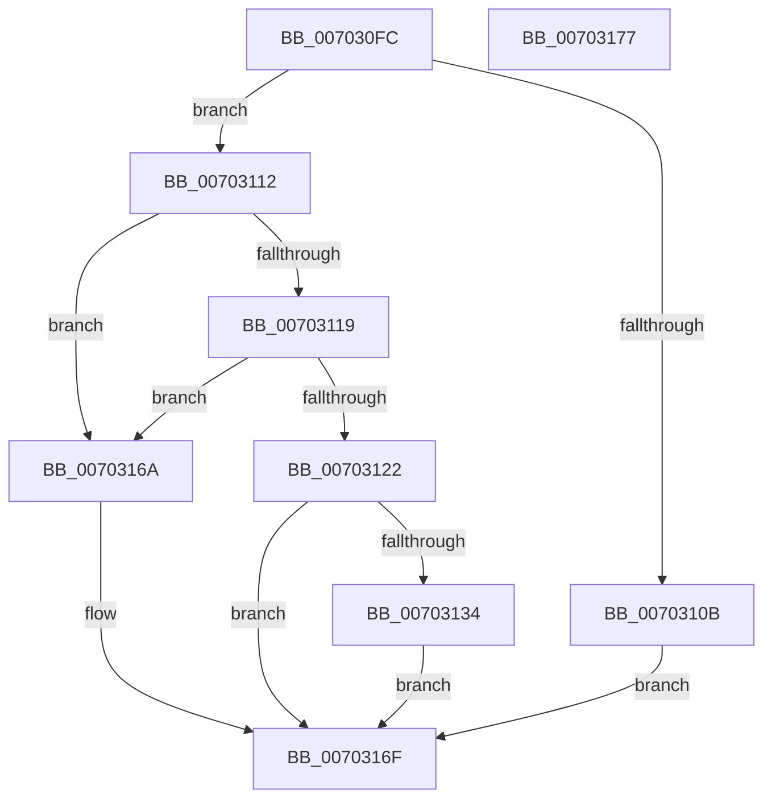

# PopFxPlatformRegisterInterface

- RVA: `0x007030FC`–`0x00703178` (길이 `124` bytes)
- VA: `0x00000001407030FC`
- 실행 섹션: `PAGE`
- PDB 이름 있음: `예`; PDB Function 태그: `아니요`
- unwind 정보 RVA: `0x0005CF00`
- 디코드: `34`개 명령, `124/124` bytes 표시
- 미해석 바이트: `0` (있으면 어셈블리에 `.byte`로 보존)

> 이 문서는 커널 이미지의 기계어와 PDB 기호를 분석해 생성했습니다. 4번과 5번은 함수 원형과 자료형을 바이너리 사용 방식에서 추정한 C 해석이며 원본 소스 복구 결과는 아닙니다.

## 1. Dependencies

- 직접 호출 지점: **1**; 고유 호출 대상: **1**
- 직접 호출자로 확인된 함수: **1**
- RIP 상대 이미지 참조: **4**

### Outgoing calls
- `0x00703163` → [ObfReferenceObjectWithTag](../../text/21/ObfReferenceObjectWithTag_function_00210710.md) (function, `0x00210710`)

### Direct callers
- [PopPowerInformationInternal](../A8/PopPowerInformationInternal_function_00A8B7C0.md) at `0x00A8BC40`

### Static image references
- `0x00703129` → RVA `0x00F070F0` (`.data`; read)
- `0x0070313A` → RVA `0x00F070E0` (`.data`; write)
- `0x0070314A` → RVA `0x00F070E8` (`.data`; write)
- `0x00703151` → RVA `0x004D3D00` (`PoFxPlatformRequestHandler`; read)

## 2. Other-region calls and transfers

- 다른 실행 섹션으로 향하는 call: **1**
  - `0x00703163` → [ObfReferenceObjectWithTag](../../text/21/ObfReferenceObjectWithTag_function_00210710.md) (`PAGE` → `.text`)
- 별도 외부 분기/꼬리 이동을 확인하지 못했습니다.

## 3. Assembly (complete function range)

```asm
007030FC  40 53                           push rbx
007030FE  48 83 EC 20                     sub rsp, 0x20
00703102  83 79 04 01                     cmp dword ptr [rcx + 4], 1
00703106  4C 8B C2                        mov r8, rdx
00703109  74 07                           je 0x140703112
0070310B  BB 59 00 00 C0                  mov ebx, 0xc0000059
00703110  EB 5D                           jmp 0x14070316f
00703112  48 83 79 08 00                  cmp qword ptr [rcx + 8], 0
00703117  74 51                           je 0x14070316a
00703119  48 8B 51 18                     mov rdx, qword ptr [rcx + 0x18]
0070311D  48 85 D2                        test rdx, rdx
00703120  74 48                           je 0x14070316a
00703122  BB 01 00 00 C0                  mov ebx, 0xc0000001
00703127  33 C0                           xor eax, eax
00703129  F0 48 0F B1 15 BE 3F 80 00      lock cmpxchg qword ptr [rip + 0x803fbe], rdx
00703132  75 3B                           jne 0x14070316f
00703134  48 8B 41 08                     mov rax, qword ptr [rcx + 8]
00703138  33 DB                           xor ebx, ebx
0070313A  48 89 05 9F 3F 80 00            mov qword ptr [rip + 0x803f9f], rax
00703141  BA 50 46 58 4D                  mov edx, 0x4d584650
00703146  48 8B 41 10                     mov rax, qword ptr [rcx + 0x10]
0070314A  48 89 05 97 3F 80 00            mov qword ptr [rip + 0x803f97], rax
00703151  48 8D 05 A8 0B DD FF            lea rax, [rip - 0x22f458]
00703158  49 21 58 08                     and qword ptr [r8 + 8], rbx
0070315C  49 89 00                        mov qword ptr [r8], rax
0070315F  48 8B 49 18                     mov rcx, qword ptr [rcx + 0x18]
00703163  E8 A8 D5 B0 FF                  call 0x140210710
00703168  EB 05                           jmp 0x14070316f
0070316A  BB 0D 00 00 C0                  mov ebx, 0xc000000d
0070316F  8B C3                           mov eax, ebx
00703171  48 83 C4 20                     add rsp, 0x20
00703175  5B                              pop rbx
00703176  C3                              ret
00703177  CC                              int3
```

## 4. C-style interpretation (structured pseudocode)

```c
__int64 __fastcall PopFxPlatformRegisterInterface(__int64 a1, __int64 a2)
{
    __int64 result;
    __int64 v_rbx;
    __int64 v_rsp;

    v_rsp = (v_rsp) - (32);
    if ((*(unsigned int *)(a1 + 4)) == 1) goto loc_00703112;
    goto loc_0070316F;
loc_00703112:
    if ((*(unsigned __int64 *)(a1 + 8)) == 0) goto loc_0070316A;
    if (*(unsigned __int64 *)(a1 + 24) == 0) goto loc_0070316A;
    result = 0;
    if (condition_is_not_equal) goto loc_0070316F;
    v_rbx = 0;
    *(unsigned __int64 *)(v_rip + 8404895) = *(unsigned __int64 *)(a1 + 8);
    *(unsigned __int64 *)(v_rip + 8404887) = *(unsigned __int64 *)(a1 + 16);
    *(unsigned __int64 *)(a2) = v_rip - 2290776;
    result = ObfReferenceObjectWithTag(*(unsigned __int64 *)(a1 + 24), (unsigned int)(0x4D584650ULL), a2, a4);
    goto loc_0070316F;
loc_0070316A:
loc_0070316F:
    v_rsp = (v_rsp) + (32);
    return (unsigned int)((unsigned int)((unsigned int)(0xC000000DULL)));
}
```

## 5. (Beta) C Style

```c
int64_t PopFxPlatformRegisterInterface(void *Arg1, void *Arg2)
{
    uint8_t *arg1 = (uint8_t *)Arg1;
    uint8_t *arg2 = (uint8_t *)Arg2;

    int64_t result;
    int64_t local_rbx;
    int64_t local_rsp;

    local_rsp = (local_rsp) - (32);
    if ((*(uint32_t *)(arg1 + 0x4)) == 1) goto loc_00703112;
    goto loc_0070316F;
loc_00703112:
    if ((*(uint64_t *)(arg1 + 0x8)) == 0) goto loc_0070316A;
    if (*(uint64_t *)(arg1 + 0x18) == 0) goto loc_0070316A;
    result = 0;
    if (condition_is_not_equal) goto loc_0070316F;
    local_rbx = 0;
    *(uint64_t *)(v_rip + 0x803F9F) = *(uint64_t *)(arg1 + 0x8);
    *(uint64_t *)(v_rip + 0x803F97) = *(uint64_t *)(arg1 + 0x10);
    *(uint64_t *)(arg2) = v_rip - 2290776;
    result = ObfReferenceObjectWithTag(*(uint64_t *)(arg1 + 0x18), (uint32_t)(0x4D584650ULL), Arg2, a4);
    goto loc_0070316F;
loc_0070316A:
loc_0070316F:
    local_rsp = (local_rsp) + (32);
    return (uint32_t)((uint32_t)((uint32_t)(0xC000000DULL)));
}
```

### 관측된 메모리 오프셋

구조체 형식이 확인되지 않은 접근은 인자 기준의 오프셋으로만 기록했습니다.

| 기준 인자 | 오프셋 표현 | 폭 (bit) | 접근 |
|---|---:|---:|---|
| `Arg1` | `+ 0x4` | `32` | `R` |
| `Arg1` | `+ 0x8` | `64` | `R` |
| `Arg1` | `+ 0x10` | `64` | `R` |
| `Arg1` | `+ 0x18` | `64` | `R` |
| `Arg2` | `+ 0x0` | `64` | `W` |
| `Arg2` | `+ 0x8` | `64` | `R/W` |

## 6. Execution-region graph

[열기: 2D/3D 그래프와 함수 탐색 컨트롤 패널](../../../control-panel.html?section=page&rva=0x007030FC&view=graph)

- 2D 그래프는 위에서 아래로 흐르고, 3D 그래프는 빈 공간을 드래그해 회전합니다. Shift+드래그는 이동, 휠은 확대·축소, 함수 노드 선택은 대상 보고서 이동입니다.

### Static fallback


