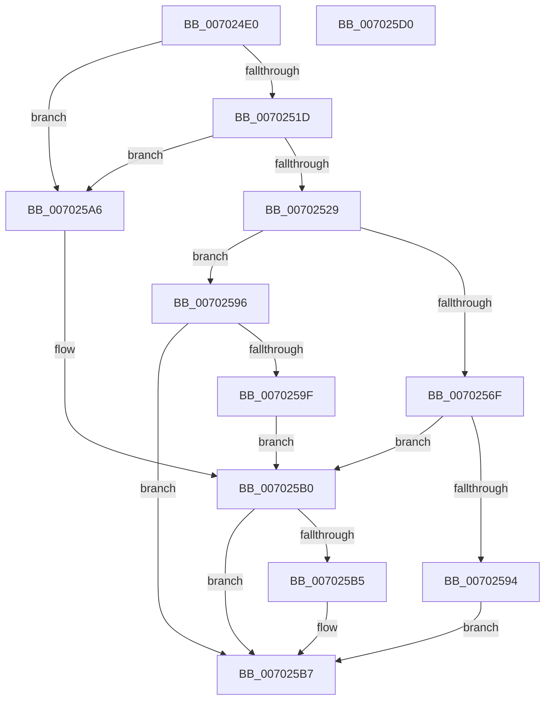

# PopOpenHiberPersistedKey

- RVA: `0x007024E0`–`0x007025D1` (길이 `241` bytes)
- VA: `0x00000001407024E0`
- 실행 섹션: `PAGE`
- PDB 이름 있음: `예`; PDB Function 태그: `아니요`
- unwind 정보 RVA: `0x000BF7FC`
- 디코드: `67`개 명령, `241/241` bytes 표시
- 미해석 바이트: `0` (있으면 어셈블리에 `.byte`로 보존)

> 이 문서는 커널 이미지의 기계어와 PDB 기호를 분석해 생성했습니다. 4번과 5번은 함수 원형과 자료형을 바이너리 사용 방식에서 추정한 C 해석이며 원본 소스 복구 결과는 아닙니다.

## 1. Dependencies

- 직접 호출 지점: **3**; 고유 호출 대상: **3**
- 직접 호출자로 확인된 함수: **1**
- RIP 상대 이미지 참조: **1**

### Outgoing calls
- `0x00702531` → [RtlInitUnicodeString](../../text/42/RtlInitUnicodeString_function_0042A780.md) (function, `0x0042A780`)
- `0x00702583` → [ZwCreateKey](../../text/6A/ZwCreateKey_function_006AD470.md) (function, `0x006AD470`)
- `0x00702596` → [ZwOpenKey](../../text/6A/ZwOpenKey_function_006AD310.md) (function, `0x006AD310`)

### Direct callers
- [PopQueryHiberPersistedRegValue](../75/PopQueryHiberPersistedRegValue_function_0075DDFC.md) at `0x0075DE72`

### Static image references
- `0x0070251D` → RVA `0x00F0DE50` (`.data`; read)

## 2. Other-region calls and transfers

- 다른 실행 섹션으로 향하는 call: **3**
  - `0x00702531` → [RtlInitUnicodeString](../../text/42/RtlInitUnicodeString_function_0042A780.md) (`PAGE` → `.text`)
  - `0x00702583` → [ZwCreateKey](../../text/6A/ZwCreateKey_function_006AD470.md) (`PAGE` → `.text`)
  - `0x00702596` → [ZwOpenKey](../../text/6A/ZwOpenKey_function_006AD310.md) (`PAGE` → `.text`)
- 별도 외부 분기/꼬리 이동을 확인하지 못했습니다.

## 3. Assembly (complete function range)

```asm
007024E0  48 89 5C 24 10                  mov qword ptr [rsp + 0x10], rbx
007024E5  48 89 74 24 18                  mov qword ptr [rsp + 0x18], rsi
007024EA  48 89 7C 24 20                  mov qword ptr [rsp + 0x20], rdi
007024EF  55                              push rbp
007024F0  48 8B EC                        mov rbp, rsp
007024F3  48 81 EC 80 00 00 00            sub rsp, 0x80
007024FA  33 C0                           xor eax, eax
007024FC  0F 57 C0                        xorps xmm0, xmm0
007024FF  21 45 EC                        and dword ptr [rbp - 0x14], eax
00702502  49 8B F8                        mov rdi, r8
00702505  89 45 D4                        mov dword ptr [rbp - 0x2c], eax
00702508  8B F2                           mov esi, edx
0070250A  21 45 D4                        and dword ptr [rbp - 0x2c], eax
0070250D  48 8B D9                        mov rbx, rcx
00702510  0F 11 45 C0                     movups xmmword ptr [rbp - 0x40], xmm0
00702514  48 85 C9                        test rcx, rcx
00702517  0F 84 89 00 00 00               je 0x1407025a6
0070251D  48 8B 15 2C B9 80 00            mov rdx, qword ptr [rip + 0x80b92c]
00702524  48 85 D2                        test rdx, rdx
00702527  74 7D                           je 0x1407025a6
00702529  48 83 09 FF                     or qword ptr [rcx], 0xffffffffffffffff
0070252D  48 8D 4D C0                     lea rcx, [rbp - 0x40]
00702531  E8 4A 82 D2 FF                  call 0x14042a780
00702536  48 83 65 D8 00                  and qword ptr [rbp - 0x28], 0
0070253B  48 8D 45 C0                     lea rax, [rbp - 0x40]
0070253F  B9 06 00 02 00                  mov ecx, 0x20006
00702544  48 89 45 E0                     mov qword ptr [rbp - 0x20], rax
00702548  8B C6                           mov eax, esi
0070254A  C7 45 D0 30 00 00 00            mov dword ptr [rbp - 0x30], 0x30
00702551  23 C1                           and eax, ecx
00702553  C7 45 E8 40 02 00 00            mov dword ptr [rbp - 0x18], 0x240
0070255A  0F 57 C0                        xorps xmm0, xmm0
0070255D  4C 8D 45 D0                     lea r8, [rbp - 0x30]
00702561  3B C1                           cmp eax, ecx
00702563  8B D6                           mov edx, esi
00702565  48 8B CB                        mov rcx, rbx
00702568  F3 0F 7F 45 F0                  movdqu xmmword ptr [rbp - 0x10], xmm0
0070256D  75 27                           jne 0x140702596
0070256F  48 83 64 24 30 00               and qword ptr [rsp + 0x30], 0
00702575  45 33 C9                        xor r9d, r9d
00702578  83 64 24 28 00                  and dword ptr [rsp + 0x28], 0
0070257D  48 83 64 24 20 00               and qword ptr [rsp + 0x20], 0
00702583  E8 E8 AE FA FF                  call 0x1406ad470
00702588  8B C8                           mov ecx, eax
0070258A  C1 F9 1F                        sar ecx, 0x1f
0070258D  83 E1 08                        and ecx, 8
00702590  85 C0                           test eax, eax
00702592  78 1C                           js 0x1407025b0
00702594  EB 21                           jmp 0x1407025b7
00702596  E8 75 AD FA FF                  call 0x1406ad310
0070259B  85 C0                           test eax, eax
0070259D  79 18                           jns 0x1407025b7
0070259F  B9 09 00 00 00                  mov ecx, 9
007025A4  EB 0A                           jmp 0x1407025b0
007025A6  B9 07 00 00 00                  mov ecx, 7
007025AB  B8 0D 00 00 C0                  mov eax, 0xc000000d
007025B0  48 85 FF                        test rdi, rdi
007025B3  74 02                           je 0x1407025b7
007025B5  89 0F                           mov dword ptr [rdi], ecx
007025B7  4C 8D 9C 24 80 00 00 00         lea r11, [rsp + 0x80]
007025BF  49 8B 5B 18                     mov rbx, qword ptr [r11 + 0x18]
007025C3  49 8B 73 20                     mov rsi, qword ptr [r11 + 0x20]
007025C7  49 8B 7B 28                     mov rdi, qword ptr [r11 + 0x28]
007025CB  49 8B E3                        mov rsp, r11
007025CE  5D                              pop rbp
007025CF  C3                              ret
007025D0  CC                              int3
```

## 4. C-style interpretation (structured pseudocode)

```c
__int64 __fastcall PopOpenHiberPersistedKey(__int64 a1, int a2, __int64 a3, int a4)
{
    __int64 result;
    __int64 v_rsp;
    unsigned __int64 v_stack_m18;
    unsigned int v_stack_m1C;
    unsigned int v_stack_m20;
    unsigned __int64 v_stack_m28;
    unsigned __int64 v_stack_m30;
    unsigned int v_stack_m34;
    unsigned int v_stack_m38;
    unsigned __int64 v_stack_m48;
    unsigned __int64 v_stack_m58;
    unsigned int v_stack_m60;
    unsigned __int64 v_stack_m68;
    unsigned __int64 v_stack_m8;
    unsigned __int64 v_stack_p10;
    unsigned __int64 v_stack_p18;
    unsigned __int64 v_stack_p20;

    v_stack_p10 = v_rbx;
    v_stack_p18 = v_rsi;
    v_stack_p20 = v_rdi;
    v_rsp = (v_rsp) - (128);
    result = 0;
    v_stack_m34 = 0;
    v_stack_m48 = v_xmm0;
    if (a1 == 0) goto loc_007025A6;
    if (*(unsigned __int64 *)(v_rip + 8436012) == 0) goto loc_007025A6;
    result = RtlInitUnicodeString(v_stack_m48, *(unsigned __int64 *)(v_rip + 8436012), a3, a4);
    v_stack_m28 = v_stack_m48;
    v_stack_m38 = 48;
    result = (unsigned int)(((unsigned int)((unsigned int)((unsigned int)(a2)))) & ((unsigned int)((unsigned int)(0x20006ULL))));
    v_stack_m20 = 576;
    v_stack_m18 = v_xmm0;
    if (((unsigned int)(result)) != ((unsigned int)((unsigned int)(0x20006ULL)))) goto loc_00702596;
    a4 = 0;
    result = ZwCreateKey(a1, (unsigned int)((unsigned int)((unsigned int)(a2))), v_stack_m38, a4);
    a1 = (unsigned int)(((unsigned int)((unsigned int)(result))) >> (31));
    a1 = (unsigned int)((a1) & (8));
    if (sign_flag) goto loc_007025B0;
    goto loc_007025B7;
loc_00702596:
    result = ZwOpenKey(a1, (unsigned int)((unsigned int)((unsigned int)(a2))), v_stack_m38, a4);
    if (!sign_flag) goto loc_007025B7;
    goto loc_007025B0;
loc_007025A6:
loc_007025B0:
    if (a3 != 0) {
        *(unsigned int *)(a3) = 7;
    }
    return (unsigned int)(0xC000000DULL);
}
```

## 5. (Beta) C Style

```c
int64_t PopOpenHiberPersistedKey(int64_t Arg1, int32_t Arg2, int64_t Arg3, int32_t Arg4)
{
    int64_t result;
    int64_t local_rsp;
    uint64_t v_stack_m18;
    uint32_t v_stack_m1C;
    uint32_t v_stack_m20;
    uint64_t v_stack_m28;
    uint64_t v_stack_m30;
    uint32_t v_stack_m34;
    uint32_t v_stack_m38;
    uint64_t v_stack_m48;
    uint64_t v_stack_m58;
    uint32_t v_stack_m60;
    uint64_t v_stack_m68;
    uint64_t v_stack_m8;
    uint64_t v_stack_p10;
    uint64_t v_stack_p18;
    uint64_t v_stack_p20;

    v_stack_p10 = local_rbx;
    v_stack_p18 = local_rsi;
    v_stack_p20 = local_rdi;
    local_rsp = (local_rsp) - (128);
    result = 0;
    v_stack_m34 = 0;
    v_stack_m48 = v_xmm0;
    if (Arg1 == 0) goto loc_007025A6;
    if (*(uint64_t *)(v_rip + 0x80B92C) == 0) goto loc_007025A6;
    result = RtlInitUnicodeString(v_stack_m48, *(uint64_t *)(v_rip + 0x80B92C), Arg3, Arg4);
    v_stack_m28 = v_stack_m48;
    v_stack_m38 = 48;
    result = (uint32_t)(((uint32_t)((uint32_t)((uint32_t)(Arg2)))) & ((uint32_t)((uint32_t)(0x20006ULL))));
    v_stack_m20 = 576;
    v_stack_m18 = v_xmm0;
    if (((uint32_t)(result)) != ((uint32_t)((uint32_t)(0x20006ULL)))) goto loc_00702596;
    Arg4 = 0;
    result = ZwCreateKey(Arg1, (uint32_t)((uint32_t)((uint32_t)(Arg2))), v_stack_m38, Arg4);
    Arg1 = (uint32_t)(((uint32_t)((uint32_t)(result))) >> (31));
    Arg1 = (uint32_t)((Arg1) & (8));
    if (sign_flag) goto loc_007025B0;
    goto loc_007025B7;
loc_00702596:
    result = ZwOpenKey(Arg1, (uint32_t)((uint32_t)((uint32_t)(Arg2))), v_stack_m38, Arg4);
    if (!sign_flag) goto loc_007025B7;
    goto loc_007025B0;
loc_007025A6:
loc_007025B0:
    if (Arg3 != 0) {
        *(uint32_t *)(Arg3) = 7;
    }
    return (uint32_t)(0xC000000DULL);
}
```

## 6. Execution-region graph

[열기: 2D/3D 그래프와 함수 탐색 컨트롤 패널](../../../control-panel.html?section=page&rva=0x007024E0&view=graph)

- 2D 그래프는 위에서 아래로 흐르고, 3D 그래프는 빈 공간을 드래그해 회전합니다. Shift+드래그는 이동, 휠은 확대·축소, 함수 노드 선택은 대상 보고서 이동입니다.

### Static fallback


